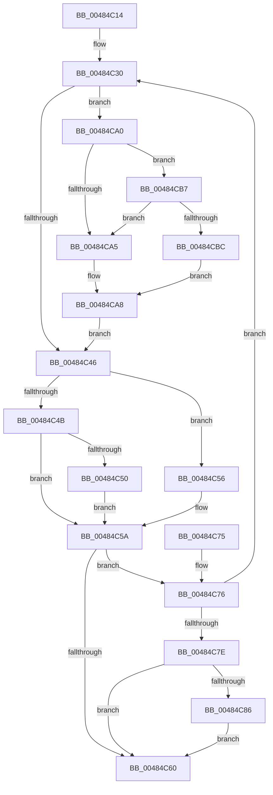

# RtlpHpSegMgrCommitComplete

- RVA: `0x00484C14`–`0x00484CC3` (길이 `175` bytes)
- VA: `0x0000000140484C14`
- 실행 섹션: `.text`
- PDB 이름 있음: `예`; PDB Function 태그: `아니요`
- unwind 정보 RVA: `0x000AF384`
- 디코드: `51`개 명령, `175/175` bytes 표시
- 미해석 바이트: `0` (있으면 어셈블리에 `.byte`로 보존)

> 이 문서는 커널 이미지의 기계어와 PDB 기호를 분석해 생성했습니다. 4번과 5번은 함수 원형과 자료형을 바이너리 사용 방식에서 추정한 C 해석이며 원본 소스 복구 결과는 아닙니다.

## 1. Dependencies

- 직접 호출 지점: **1**; 고유 호출 대상: **1**
- 직접 호출자로 확인된 함수: **1**
- RIP 상대 이미지 참조: **0**

### Outgoing calls
- `0x00484C99` → [RtlpHpReleaseLockExclusive](../32/RtlpHpReleaseLockExclusive_function_00324230.md) (function, `0x00324230`)

### Direct callers
- [RtlpHpSegMgrCommit](../32/RtlpHpSegMgrCommit_function_00326BE4.md) at `0x00326DF7`

### Static image references
- 디코드된 RIP-relative 메모리 참조가 없습니다.

## 2. Other-region calls and transfers

- 다른 실행 섹션으로 향하는 call: **0**
- 별도 외부 분기/꼬리 이동을 확인하지 못했습니다.

## 3. Assembly (complete function range)

```asm
00484C14  48 89 5C 24 08                  mov qword ptr [rsp + 8], rbx
00484C19  48 89 6C 24 10                  mov qword ptr [rsp + 0x10], rbp
00484C1E  48 89 74 24 20                  mov qword ptr [rsp + 0x20], rsi
00484C23  57                              push rdi
00484C24  48 83 EC 20                     sub rsp, 0x20
00484C28  0F B7 02                        movzx eax, word ptr [rdx]
00484C2B  48 8B D9                        mov rbx, rcx
00484C2E  33 F6                           xor esi, esi
00484C30  66 0F BA E0 0E                  bt ax, 0xe
00484C35  66 89 44 24 40                  mov word ptr [rsp + 0x40], ax
00484C3A  44 0F B7 54 24 40               movzx r10d, word ptr [rsp + 0x40]
00484C40  44 0F B7 D8                     movzx r11d, ax
00484C44  72 5A                           jb 0x140484ca0
00484C46  45 85 C0                        test r8d, r8d
00484C49  7E 0B                           jle 0x140484c56
00484C4B  45 85 C9                        test r9d, r9d
00484C4E  75 0A                           jne 0x140484c5a
00484C50  66 45 2B D0                     sub r10w, r8w
00484C54  EB 04                           jmp 0x140484c5a
00484C56  66 45 03 D0                     add r10w, r8w
00484C5A  66 44 3B D0                     cmp r10w, ax
00484C5E  75 16                           jne 0x140484c76
00484C60  48 8B 5C 24 30                  mov rbx, qword ptr [rsp + 0x30]
00484C65  48 8B 6C 24 38                  mov rbp, qword ptr [rsp + 0x38]
00484C6A  48 8B 74 24 48                  mov rsi, qword ptr [rsp + 0x48]
00484C6F  48 83 C4 20                     add rsp, 0x20
00484C73  5F                              pop rdi
00484C74  C3                              ret
00484C75  CC                              int3
00484C76  66 F0 44 0F B1 12               lock cmpxchg word ptr [rdx], r10w
00484C7C  75 B2                           jne 0x140484c30
00484C7E  66 41 0F BA E3 0E               bt r11w, 0xe
00484C84  73 DA                           jae 0x140484c60
00484C86  8B 43 28                        mov eax, dword ptr [rbx + 0x28]
00484C89  44 8A 44 24 58                  mov r8b, byte ptr [rsp + 0x58]
00484C8E  48 8B 4C 24 50                  mov rcx, qword ptr [rsp + 0x50]
00484C93  0F B6 D0                        movzx edx, al
00484C96  83 E2 01                        and edx, 1
00484C99  E8 92 F5 E9 FF                  call 0x140324230
00484C9E  EB C0                           jmp 0x140484c60
00484CA0  45 85 C9                        test r9d, r9d
00484CA3  75 12                           jne 0x140484cb7
00484CA5  0F B7 CE                        movzx ecx, si
00484CA8  BF FF 3F 00 00                  mov edi, 0x3fff
00484CAD  66 44 23 D7                     and r10w, di
00484CB1  66 44 0B D1                     or r10w, cx
00484CB5  EB 8F                           jmp 0x140484c46
00484CB7  45 85 C0                        test r8d, r8d
00484CBA  7E E9                           jle 0x140484ca5
00484CBC  B9 00 80 00 00                  mov ecx, 0x8000
00484CC1  EB E5                           jmp 0x140484ca8
```

## 4. C-style interpretation (structured pseudocode)

```c
__int64 __fastcall RtlpHpSegMgrCommitComplete(__int64 a1, __int64 a2, int a3, int a4, __int64 a5, unsigned __int8 a6)
{
    __int64 result;
    __int64 v_r10;
    __int64 v_rsi;
    __int64 v_rsp;
    unsigned __int64 v_stack_p10;
    unsigned __int16 v_stack_p18;
    unsigned __int64 v_stack_p20;
    unsigned __int64 v_stack_p8;

    v_stack_p8 = v_rbx;
    v_stack_p10 = v_rbp;
    v_stack_p20 = v_rsi;
    v_rsp = (v_rsp) - (32);
    v_rsi = 0;
loc_00484C30:
    v_stack_p18 = (unsigned __int16)(*(unsigned __int16 *)(a2));
    if (condition_is_below) goto loc_00484CA0;
loc_00484C46:
    if (condition_is_less_or_equal) goto loc_00484C56;
    if (a4 != 0) goto loc_00484C5A;
    v_r10 = (unsigned __int16)((v_stack_p18) - ((unsigned __int16)(a3)));
    goto loc_00484C5A;
loc_00484C56:
    v_r10 = (unsigned __int16)((v_r10) + ((unsigned __int16)(a3)));
loc_00484C5A:
    if (((unsigned __int16)(v_r10)) != ((unsigned __int16)(*(unsigned __int16 *)(a2)))) goto loc_00484C76;
loc_00484C60:
    v_rsp = (v_rsp) + (32);
    return *(unsigned __int16 *)(a2);
loc_00484C76:
    if (condition_is_not_equal) goto loc_00484C30;
    if (condition_is_above_or_equal) goto loc_00484C60;
    a2 = (unsigned int)(((unsigned __int8)((unsigned int)(*(unsigned int *)(v_stack_p8 + 40)))) & (1));
    result = RtlpHpReleaseLockExclusive(a5, a2, a6, a4);
    goto loc_00484C60;
loc_00484CA0:
    if (a4 != 0) goto loc_00484CB7;
loc_00484CA5:
loc_00484CA8:
    v_r10 = (unsigned __int16)((v_r10) & ((unsigned __int16)((unsigned int)(0x3FFFULL))));
    v_r10 = (unsigned __int16)((v_r10) | ((unsigned __int16)((unsigned __int16)(v_stack_p20))));
    goto loc_00484C46;
loc_00484CB7:
    if (condition_is_less_or_equal) goto loc_00484CA5;
    goto loc_00484CA8;
}
```

## 5. (Beta) C Style

```c
int64_t RtlpHpSegMgrCommitComplete(void *Arg1, void *Arg2, int32_t Arg3, int32_t Arg4, int64_t Arg5, uint8_t Arg6)
{
    uint8_t *arg1 = (uint8_t *)Arg1;
    uint8_t *arg2 = (uint8_t *)Arg2;

    int64_t result;
    int64_t local_r10;
    int64_t local_rsi;
    int64_t local_rsp;
    uint64_t v_stack_p10;
    uint16_t v_stack_p18;
    uint64_t v_stack_p20;
    uint64_t v_stack_p8;

    v_stack_p8 = local_rbx;
    v_stack_p10 = local_rbp;
    v_stack_p20 = local_rsi;
    local_rsp = (local_rsp) - (32);
    local_rsi = 0;
loc_00484C30:
    v_stack_p18 = (uint16_t)(*(uint16_t *)(arg2));
    if (condition_is_below) goto loc_00484CA0;
loc_00484C46:
    if (condition_is_less_or_equal) goto loc_00484C56;
    if (Arg4 != 0) goto loc_00484C5A;
    local_r10 = (uint16_t)((v_stack_p18) - ((uint16_t)(Arg3)));
    goto loc_00484C5A;
loc_00484C56:
    local_r10 = (uint16_t)((local_r10) + ((uint16_t)(Arg3)));
loc_00484C5A:
    if (((uint16_t)(local_r10)) != ((uint16_t)(*(uint16_t *)(arg2)))) goto loc_00484C76;
loc_00484C60:
    local_rsp = (local_rsp) + (32);
    return *(uint16_t *)(arg2);
loc_00484C76:
    if (condition_is_not_equal) goto loc_00484C30;
    if (condition_is_above_or_equal) goto loc_00484C60;
    Arg2 = (uint32_t)(((uint8_t)((uint32_t)(*(uint32_t *)(v_stack_p8 + 0x28)))) & (1));
    result = RtlpHpReleaseLockExclusive(Arg5, Arg2, Arg6, Arg4);
    goto loc_00484C60;
loc_00484CA0:
    if (Arg4 != 0) goto loc_00484CB7;
loc_00484CA5:
loc_00484CA8:
    local_r10 = (uint16_t)((local_r10) & ((uint16_t)((uint32_t)(0x3FFFULL))));
    local_r10 = (uint16_t)((local_r10) | ((uint16_t)((uint16_t)(v_stack_p20))));
    goto loc_00484C46;
loc_00484CB7:
    if (condition_is_less_or_equal) goto loc_00484CA5;
    goto loc_00484CA8;
}
```

### 관측된 메모리 오프셋

구조체 형식이 확인되지 않은 접근은 인자 기준의 오프셋으로만 기록했습니다.

| 기준 인자 | 오프셋 표현 | 폭 (bit) | 접근 |
|---|---:|---:|---|
| `Arg1` | `+ 0x28` | `32` | `R` |
| `Arg2` | `+ 0x0` | `16` | `R` |

## 6. Execution-region graph

[열기: 2D/3D 그래프와 함수 탐색 컨트롤 패널](../../../control-panel.html?section=text&rva=0x00484C14&view=graph)

- 2D 그래프는 위에서 아래로 흐르고, 3D 그래프는 빈 공간을 드래그해 회전합니다. Shift+드래그는 이동, 휠은 확대·축소, 함수 노드 선택은 대상 보고서 이동입니다.

### Static fallback


