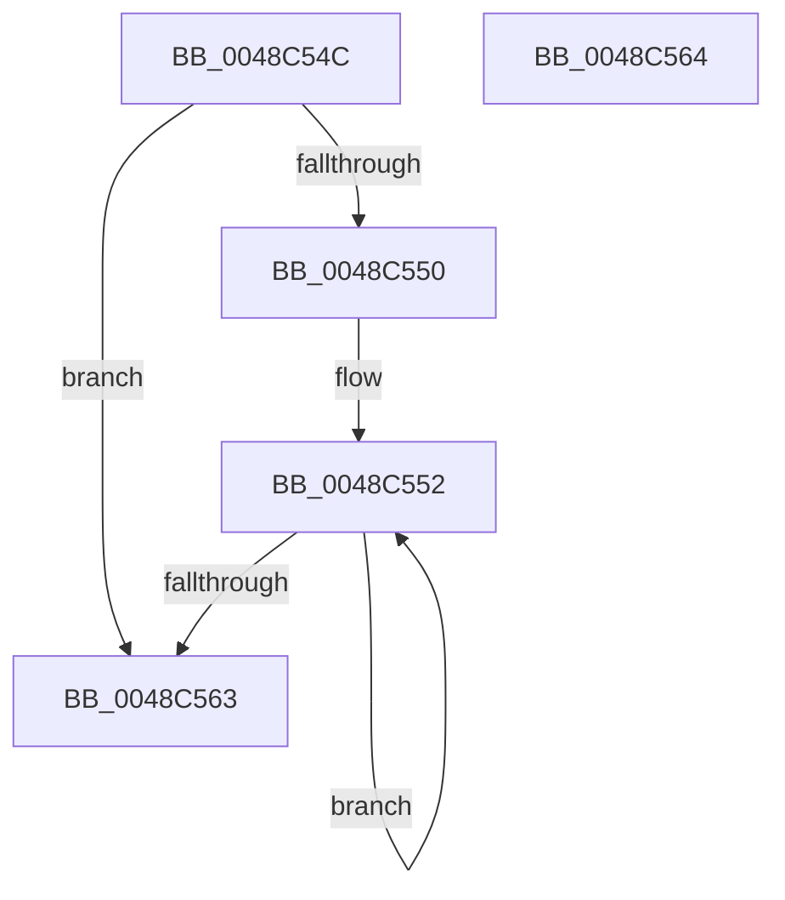

# RtlpInitializeSecondLevelDir

- RVA: `0x0048C54C`–`0x0048C565` (길이 `25` bytes)
- VA: `0x000000014048C54C`
- 실행 섹션: `.text`
- PDB 이름 있음: `예`; PDB Function 태그: `아니요`
- unwind 정보 RVA: `0x000DB714`
- 디코드: `10`개 명령, `25/25` bytes 표시
- 미해석 바이트: `0` (있으면 어셈블리에 `.byte`로 보존)

> 이 문서는 커널 이미지의 기계어와 PDB 기호를 분석해 생성했습니다. 4번과 5번은 함수 원형과 자료형을 바이너리 사용 방식에서 추정한 C 해석이며 원본 소스 복구 결과는 아닙니다.

## 1. Dependencies

- 직접 호출 지점: **0**; 고유 호출 대상: **0**
- 직접 호출자로 확인된 함수: **2**
- RIP 상대 이미지 참조: **0**

### Outgoing calls
- 직접 디코드된 call 명령이 없습니다.

### Direct callers
- [RtlpCreateHashTable](RtlpCreateHashTable_function_0048C400.md) at `0x0048C49E`
- [sub_006F647C](../6F/Unknown_function_006F647C.md) at `0x006F64AD`

### Static image references
- 디코드된 RIP-relative 메모리 참조가 없습니다.

## 2. Other-region calls and transfers

- 다른 실행 섹션으로 향하는 call: **0**
- 별도 외부 분기/꼬리 이동을 확인하지 못했습니다.

## 3. Assembly (complete function range)

```asm
0048C54C  85 D2                           test edx, edx
0048C54E  74 13                           je 0x14048c563
0048C550  8B C2                           mov eax, edx
0048C552  48 89 49 08                     mov qword ptr [rcx + 8], rcx
0048C556  48 89 09                        mov qword ptr [rcx], rcx
0048C559  48 83 C1 10                     add rcx, 0x10
0048C55D  48 83 E8 01                     sub rax, 1
0048C561  75 EF                           jne 0x14048c552
0048C563  C3                              ret
0048C564  CC                              int3
```

## 4. C-style interpretation (structured pseudocode)

```c
__int64 __fastcall RtlpInitializeSecondLevelDir(__int64 a1, int a2)
{
    __int64 result;

    if (a2 == 0) goto loc_0048C563;
loc_0048C552:
    *(unsigned __int64 *)(a1 + 8) = a1;
    *(unsigned __int64 *)(a1) = a1;
    a1 = (a1) + (16);
    result = ((unsigned int)(a2)) - (1);
    if (condition_is_not_equal) goto loc_0048C552;
loc_0048C563:
    return result;
}
```

## 5. (Beta) C Style

```c
int64_t RtlpInitializeSecondLevelDir(void *Arg1, int32_t Arg2)
{
    uint8_t *arg1 = (uint8_t *)Arg1;

    int64_t result;

    if (Arg2 == 0) goto loc_0048C563;
loc_0048C552:
    *(void **)(arg1 + 0x8) = Arg1;
    *(void **)(arg1) = Arg1;
    Arg1 = (Arg1) + (16);
    result = ((uint32_t)(Arg2)) - (1);
    if (condition_is_not_equal) goto loc_0048C552;
loc_0048C563:
    return result;
}
```

### 관측된 메모리 오프셋

구조체 형식이 확인되지 않은 접근은 인자 기준의 오프셋으로만 기록했습니다.

| 기준 인자 | 오프셋 표현 | 폭 (bit) | 접근 |
|---|---:|---:|---|
| `Arg1` | `+ 0x0` | `64` | `W` |
| `Arg1` | `+ 0x8` | `64` | `W` |

## 6. Execution-region graph

[열기: 2D/3D 그래프와 함수 탐색 컨트롤 패널](../../../control-panel.html?section=text&rva=0x0048C54C&view=graph)

- 2D 그래프는 위에서 아래로 흐르고, 3D 그래프는 빈 공간을 드래그해 회전합니다. Shift+드래그는 이동, 휠은 확대·축소, 함수 노드 선택은 대상 보고서 이동입니다.

### Static fallback


