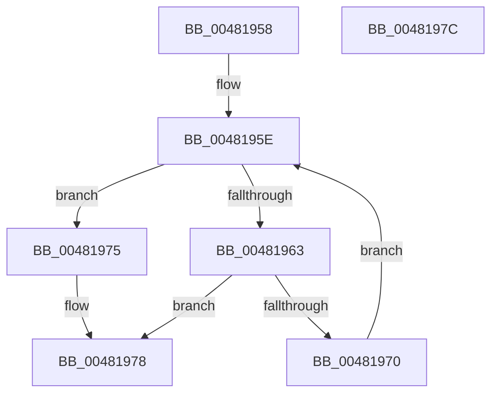

# RtlpIsNoShadowStackUnwindMachineFrameEntry

- RVA: `0x00481958`–`0x0048197D` (길이 `37` bytes)
- VA: `0x0000000140481958`
- 실행 섹션: `.text`
- PDB 이름 있음: `예`; PDB Function 태그: `아니요`
- unwind 정보 RVA: `0x000DB714`
- 디코드: `13`개 명령, `37/37` bytes 표시
- 미해석 바이트: `0` (있으면 어셈블리에 `.byte`로 보존)

> 이 문서는 커널 이미지의 기계어와 PDB 기호를 분석해 생성했습니다. 4번과 5번은 함수 원형과 자료형을 바이너리 사용 방식에서 추정한 C 해석이며 원본 소스 복구 결과는 아닙니다.

## 1. Dependencies

- 직접 호출 지점: **0**; 고유 호출 대상: **0**
- 직접 호출자로 확인된 함수: **1**
- RIP 상대 이미지 참조: **1**

### Outgoing calls
- 직접 디코드된 call 명령이 없습니다.

### Direct callers
- [RtlpUnwindPrologue](../2F/RtlpUnwindPrologue_function_002F5FA0.md) at `0x002F6674`

### Static image references
- `0x00481963` → RVA `0x00E01EC8` (`.data`; read)

## 2. Other-region calls and transfers

- 다른 실행 섹션으로 향하는 call: **0**
- 별도 외부 분기/꼬리 이동을 확인하지 못했습니다.

## 3. Assembly (complete function range)

```asm
00481958  33 D2                           xor edx, edx
0048195A  44 8D 42 01                     lea r8d, [rdx + 1]
0048195E  83 FA 03                        cmp edx, 3
00481961  73 12                           jae 0x140481975
00481963  4C 8D 0D 5E 05 98 00            lea r9, [rip + 0x98055e]
0048196A  49 3B 0C D1                     cmp rcx, qword ptr [r9 + rdx*8]
0048196E  74 08                           je 0x140481978
00481970  41 03 D0                        add edx, r8d
00481973  EB E9                           jmp 0x14048195e
00481975  45 32 C0                        xor r8b, r8b
00481978  41 8A C0                        mov al, r8b
0048197B  C3                              ret
0048197C  CC                              int3
```

## 4. C-style interpretation (structured pseudocode)

```c
__int64 __fastcall RtlpIsNoShadowStackUnwindMachineFrameEntry(__int64 a1, int a2)
{
    a2 = 0;
loc_0048195E:
    if (0 >= 3) goto loc_00481975;
    if (a1 == (*(unsigned __int64 *)(v_rip + 9962846 + a2 * 8))) goto loc_00481978;
    a2 = (unsigned int)((a2) + ((unsigned int)(a2 + 1)));
    goto loc_0048195E;
loc_00481975:
    a3 = 0;
loc_00481978:
    return 0;
}
```

## 5. (Beta) C Style

```c
int64_t RtlpIsNoShadowStackUnwindMachineFrameEntry(int64_t Arg1, int32_t Arg2)
{
    Arg2 = 0;
loc_0048195E:
    if (0 >= 3) goto loc_00481975;
    if (Arg1 == (*(uint64_t *)(v_rip + 0x98055E + Arg2 * 8))) goto loc_00481978;
    Arg2 = (uint32_t)((Arg2) + ((uint32_t)(Arg2 + 1)));
    goto loc_0048195E;
loc_00481975:
    a3 = 0;
loc_00481978:
    return 0;
}
```

## 6. Execution-region graph

[열기: 2D/3D 그래프와 함수 탐색 컨트롤 패널](../../../control-panel.html?section=text&rva=0x00481958&view=graph)

- 2D 그래프는 위에서 아래로 흐르고, 3D 그래프는 빈 공간을 드래그해 회전합니다. Shift+드래그는 이동, 휠은 확대·축소, 함수 노드 선택은 대상 보고서 이동입니다.

### Static fallback


