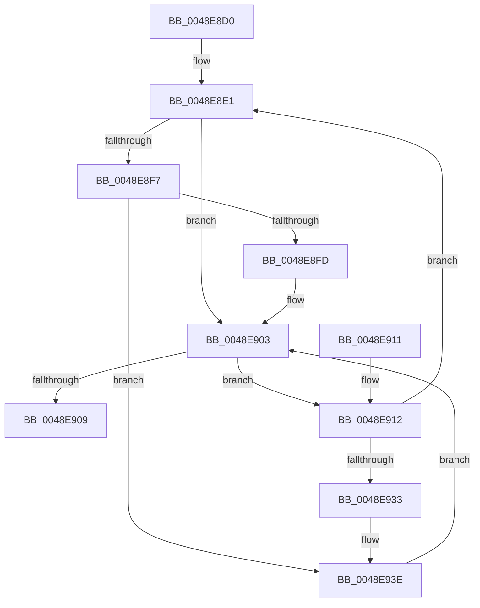

# RtlpLookupPrimaryFunctionEntry

- RVA: `0x0048E8D0`–`0x0048E94D` (길이 `125` bytes)
- VA: `0x000000014048E8D0`
- 실행 섹션: `.text`
- PDB 이름 있음: `예`; PDB Function 태그: `아니요`
- unwind 정보 RVA: `0x0009CC1C`
- 디코드: `37`개 명령, `125/125` bytes 표시
- 미해석 바이트: `0` (있으면 어셈블리에 `.byte`로 보존)

> 이 문서는 커널 이미지의 기계어와 PDB 기호를 분석해 생성했습니다. 4번과 5번은 함수 원형과 자료형을 바이너리 사용 방식에서 추정한 C 해석이며 원본 소스 복구 결과는 아닙니다.

## 1. Dependencies

- 직접 호출 지점: **2**; 고유 호출 대상: **2**
- 직접 호출자로 확인된 함수: **4**
- RIP 상대 이미지 참조: **0**

### Outgoing calls
- `0x0048E8FD` → [ExRaiseDatatypeMisalignment](../../page/89/ExRaiseDatatypeMisalignment_function_00899FD0.md) (function, `0x00899FD0`)
- `0x0048E938` → [RtlRaiseStatus](../2F/RtlRaiseStatus_function_002F6A50.md) (function, `0x002F6A50`)

### Direct callers
- [RtlpSameFunction](RtlpSameFunction_function_0048E81C.md) at `0x0048E83B`
- [RtlpSameFunction](RtlpSameFunction_function_0048E81C.md) at `0x0048E881`
- [RtlLookupExceptionHandler](../5E/RtlLookupExceptionHandler_function_005E6A48.md) at `0x005E6A5E`
- [RtlLookupPrimaryFunctionEntry](../5E/RtlLookupPrimaryFunctionEntry_function_005EED4C.md) at `0x005EED56`
- [CcInitializeBcbProfiler](../../init/BE/CcInitializeBcbProfiler_function_00BEF294.md) at `0x00BEF7EA`

### Static image references
- 디코드된 RIP-relative 메모리 참조가 없습니다.

## 2. Other-region calls and transfers

- 다른 실행 섹션으로 향하는 call: **1**
  - `0x0048E8FD` → [ExRaiseDatatypeMisalignment](../../page/89/ExRaiseDatatypeMisalignment_function_00899FD0.md) (`.text` → `PAGE`)
- 별도 외부 분기/꼬리 이동을 확인하지 못했습니다.

## 3. Assembly (complete function range)

```asm
0048E8D0  48 83 EC 28                     sub rsp, 0x28
0048E8D4  45 33 D2                        xor r10d, r10d
0048E8D7  49 BB 00 00 FF FF FF 7F 00 00   movabs r11, 0x7fffffff0000
0048E8E1  44 8B 49 08                     mov r9d, dword ptr [rcx + 8]
0048E8E5  48 B8 FF FF FE FF FF 7F 00 00   movabs rax, 0x7ffffffeffff
0048E8EF  4C 03 CA                        add r9, rdx
0048E8F2  4C 3B C0                        cmp r8, rax
0048E8F5  77 0C                           ja 0x14048e903
0048E8F7  41 F6 C1 03                     test r9b, 3
0048E8FB  74 41                           je 0x14048e93e
0048E8FD  E8 CE B6 40 00                  call 0x140899fd0
0048E902  CC                              int3
0048E903  41 F6 01 20                     test byte ptr [r9], 0x20
0048E907  75 09                           jne 0x14048e912
0048E909  48 8B C1                        mov rax, rcx
0048E90C  48 83 C4 28                     add rsp, 0x28
0048E910  C3                              ret
0048E911  CC                              int3
0048E912  41 0F B6 49 02                  movzx ecx, byte ptr [r9 + 2]
0048E917  F6 C1 01                        test cl, 1
0048E91A  8D 41 01                        lea eax, [rcx + 1]
0048E91D  0F 44 C1                        cmove eax, ecx
0048E920  41 FF C2                        inc r10d
0048E923  8B C8                           mov ecx, eax
0048E925  48 83 C1 02                     add rcx, 2
0048E929  49 8D 0C 49                     lea rcx, [r9 + rcx*2]
0048E92D  41 83 FA 20                     cmp r10d, 0x20
0048E931  76 AE                           jbe 0x14048e8e1
0048E933  B9 FF 00 00 C0                  mov ecx, 0xc00000ff
0048E938  E8 13 81 E6 FF                  call 0x1402f6a50
0048E93D  CC                              int3
0048E93E  4D 3B CB                        cmp r9, r11
0048E941  49 8B C1                        mov rax, r9
0048E944  90                              nop
0048E945  49 0F 43 C3                     cmovae rax, r11
0048E949  8A 00                           mov al, byte ptr [rax]
0048E94B  EB B6                           jmp 0x14048e903
```

## 4. C-style interpretation (structured pseudocode)

```c
__int64 __fastcall RtlpLookupPrimaryFunctionEntry(__int64 a1, __int64 a2, __int64 a3)
{
    __int64 result;
    __int64 v_r10;
    __int64 v_rsp;

    v_rsp = (v_rsp) - (40);
    v_r10 = 0;
loc_0048E8E1:
    a4 = ((unsigned int)(*(unsigned int *)(a1 + 8))) + (a2);
    if (a3 > result) goto loc_0048E903;
    if ((((unsigned __int8)(a4)) & (3)) == 0) goto loc_0048E93E;
    result = ExRaiseDatatypeMisalignment(a1, a2, a3, a4);
loc_0048E903:
    if (((*(unsigned __int8 *)(a4)) & (32)) != 0) goto loc_0048E912;
    v_rsp = (v_rsp) + (40);
    return a1;
loc_0048E912:
    result = *(unsigned __int8 *)(a4 + 2) + 1;
    if ((((unsigned __int8)(*(unsigned __int8 *)(a4 + 2))) & (1)) == 0) { result = (unsigned int)(*(unsigned __int8 *)(a4 + 2)); }
    v_r10 = (unsigned int)((v_r10) + 1);
    a1 = ((unsigned int)((unsigned int)(result))) + (2);
    if (((unsigned int)(v_r10)) <= 32) goto loc_0048E8E1;
    result = RtlRaiseStatus((unsigned int)(0xC00000FFULL), a2, a3, a4);
loc_0048E93E:
    if (a4 >= v_r11) { a4 = v_r11; }
    goto loc_0048E903;
}
```

## 5. (Beta) C Style

```c
int64_t RtlpLookupPrimaryFunctionEntry(int64_t Arg1, int64_t Arg2, int64_t Arg3)
{
    int64_t result;
    int64_t local_r10;
    int64_t local_rsp;

    local_rsp = (local_rsp) - (40);
    local_r10 = 0;
loc_0048E8E1:
    a4 = ((uint32_t)(*(uint32_t *)(Arg1 + 0x8))) + (Arg2);
    if (Arg3 > result) goto loc_0048E903;
    if ((((uint8_t)(a4)) & (3)) == 0) goto loc_0048E93E;
    result = ExRaiseDatatypeMisalignment(Arg1, Arg2, Arg3, a4);
loc_0048E903:
    if (((*(uint8_t *)(a4)) & (32)) != 0) goto loc_0048E912;
    local_rsp = (local_rsp) + (40);
    return Arg1;
loc_0048E912:
    result = *(uint8_t *)(a4 + 0x2) + 1;
    if ((((uint8_t)(*(uint8_t *)(a4 + 0x2))) & (1)) == 0) { result = (uint32_t)(*(uint8_t *)(a4 + 0x2)); }
    local_r10 = (uint32_t)((local_r10) + 1);
    Arg1 = ((uint32_t)((uint32_t)(result))) + (2);
    if (((uint32_t)(local_r10)) <= 32) goto loc_0048E8E1;
    result = RtlRaiseStatus((uint32_t)(0xC00000FFULL), Arg2, Arg3, a4);
loc_0048E93E:
    if (a4 >= local_r11) { a4 = local_r11; }
    goto loc_0048E903;
}
```

## 6. Execution-region graph

[열기: 2D/3D 그래프와 함수 탐색 컨트롤 패널](../../../control-panel.html?section=text&rva=0x0048E8D0&view=graph)

- 2D 그래프는 위에서 아래로 흐르고, 3D 그래프는 빈 공간을 드래그해 회전합니다. Shift+드래그는 이동, 휠은 확대·축소, 함수 노드 선택은 대상 보고서 이동입니다.

### Static fallback


