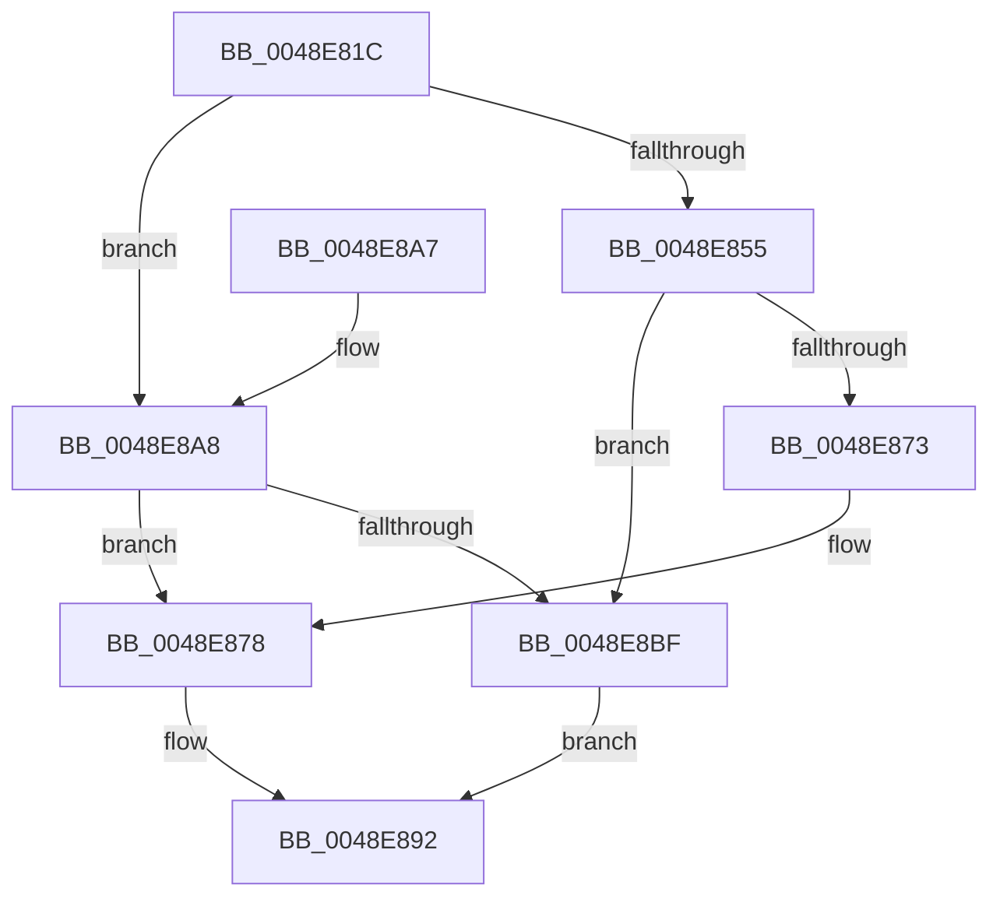

# RtlpSameFunction

- RVA: `0x0048E81C`–`0x0048E8C3` (길이 `167` bytes)
- VA: `0x000000014048E81C`
- 실행 섹션: `.text`
- PDB 이름 있음: `예`; PDB Function 태그: `아니요`
- unwind 정보 RVA: `0x000B290C`
- 디코드: `48`개 명령, `167/167` bytes 표시
- 미해석 바이트: `0` (있으면 어셈블리에 `.byte`로 보존)

> 이 문서는 커널 이미지의 기계어와 PDB 기호를 분석해 생성했습니다. 4번과 5번은 함수 원형과 자료형을 바이너리 사용 방식에서 추정한 C 해석이며 원본 소스 복구 결과는 아닙니다.

## 1. Dependencies

- 직접 호출 지점: **4**; 고유 호출 대상: **3**
- 직접 호출자로 확인된 함수: **2**
- RIP 상대 이미지 참조: **0**

### Outgoing calls
- `0x0048E83B` → [RtlpLookupPrimaryFunctionEntry](RtlpLookupPrimaryFunctionEntry_function_0048E8D0.md) (function, `0x0048E8D0`)
- `0x0048E869` → [RtlpLookupFunctionEntryForStackWalks](../2F/RtlpLookupFunctionEntryForStackWalks_function_002F4ED0.md) (function, `0x002F4ED0`)
- `0x0048E881` → [RtlpLookupPrimaryFunctionEntry](RtlpLookupPrimaryFunctionEntry_function_0048E8D0.md) (function, `0x0048E8D0`)
- `0x0048E8B0` → [RtlLookupFunctionEntry](../2F/RtlLookupFunctionEntry_function_002F2F30.md) (function, `0x002F2F30`)

### Direct callers
- [RtlpxVirtualUnwind](../2F/RtlpxVirtualUnwind_function_002F5110.md) at `0x002F5B69`
- [sub_00BF16D0](../../init/BF/Unknown_function_00BF16D0.md) at `0x00BF27E9`
- [sub_00BF16D0](../../init/BF/Unknown_function_00BF16D0.md) at `0x00BF3A83`
- [sub_00BF16D0](../../init/BF/Unknown_function_00BF16D0.md) at `0x00BF83CF`
- [sub_00BF16D0](../../init/BF/Unknown_function_00BF16D0.md) at `0x00C13F18`

### Static image references
- 디코드된 RIP-relative 메모리 참조가 없습니다.

## 2. Other-region calls and transfers

- 다른 실행 섹션으로 향하는 call: **0**
- 별도 외부 분기/꼬리 이동을 확인하지 못했습니다.

## 3. Assembly (complete function range)

```asm
0048E81C  48 8B C4                        mov rax, rsp
0048E81F  48 89 58 08                     mov qword ptr [rax + 8], rbx
0048E823  48 89 68 10                     mov qword ptr [rax + 0x10], rbp
0048E827  48 89 70 20                     mov qword ptr [rax + 0x20], rsi
0048E82B  57                              push rdi
0048E82C  48 83 EC 40                     sub rsp, 0x40
0048E830  33 DB                           xor ebx, ebx
0048E832  49 8B F0                        mov rsi, r8
0048E835  8B FB                           mov edi, ebx
0048E837  48 89 58 18                     mov qword ptr [rax + 0x18], rbx
0048E83B  E8 90 00 00 00                  call 0x14048e8d0
0048E840  48 8B E8                        mov rbp, rax
0048E843  48 8B CE                        mov rcx, rsi
0048E846  48 B8 FF FF FE FF FF 7F 00 00   movabs rax, 0x7ffffffeffff
0048E850  48 3B F0                        cmp rsi, rax
0048E853  77 53                           ja 0x14048e8a8
0048E855  0F 57 C0                        xorps xmm0, xmm0
0048E858  48 8D 54 24 20                  lea rdx, [rsp + 0x20]
0048E85D  33 C0                           xor eax, eax
0048E85F  0F 11 44 24 20                  movups xmmword ptr [rsp + 0x20], xmm0
0048E864  48 89 44 24 30                  mov qword ptr [rsp + 0x30], rax
0048E869  E8 62 66 E6 FF                  call 0x1402f4ed0
0048E86E  48 85 C0                        test rax, rax
0048E871  74 4C                           je 0x14048e8bf
0048E873  48 8B 7C 24 28                  mov rdi, qword ptr [rsp + 0x28]
0048E878  4C 8B C6                        mov r8, rsi
0048E87B  48 8B D7                        mov rdx, rdi
0048E87E  48 8B C8                        mov rcx, rax
0048E881  E8 4A 00 00 00                  call 0x14048e8d0
0048E886  8B 08                           mov ecx, dword ptr [rax]
0048E888  39 4D 00                        cmp dword ptr [rbp], ecx
0048E88B  48 0F 44 DD                     cmove rbx, rbp
0048E88F  48 8B C3                        mov rax, rbx
0048E892  48 8B 5C 24 50                  mov rbx, qword ptr [rsp + 0x50]
0048E897  48 8B 6C 24 58                  mov rbp, qword ptr [rsp + 0x58]
0048E89C  48 8B 74 24 68                  mov rsi, qword ptr [rsp + 0x68]
0048E8A1  48 83 C4 40                     add rsp, 0x40
0048E8A5  5F                              pop rdi
0048E8A6  C3                              ret
0048E8A7  CC                              int3
0048E8A8  45 33 C0                        xor r8d, r8d
0048E8AB  48 8D 54 24 60                  lea rdx, [rsp + 0x60]
0048E8B0  E8 7B 46 E6 FF                  call 0x1402f2f30
0048E8B5  48 8B 7C 24 60                  mov rdi, qword ptr [rsp + 0x60]
0048E8BA  48 85 C0                        test rax, rax
0048E8BD  75 B9                           jne 0x14048e878
0048E8BF  33 C0                           xor eax, eax
0048E8C1  EB CF                           jmp 0x14048e892
```

## 4. C-style interpretation (structured pseudocode)

```c
__int64 __fastcall RtlpSameFunction(__int64 a1, __int64 a2, __int64 a3)
{
    __int64 result;
    __int64 v_rbx;
    __int64 v_rsp;
    unsigned __int64 v_stack_m18;
    unsigned __int64 v_stack_m20;
    unsigned __int64 v_stack_m28;
    unsigned __int64 v_stack_p10;
    unsigned __int64 v_stack_p20;
    unsigned __int64 v_stack_p60;
    unsigned __int64 v_stack_p8;

    *(unsigned __int64 *)(v_rsp + 8) = v_rbx;
    *(unsigned __int64 *)(v_rsp + 16) = v_rbp;
    *(unsigned __int64 *)(v_rsp + 32) = v_rsi;
    v_rsp = (v_rsp) - (64);
    v_rbx = 0;
    *(unsigned __int64 *)(v_rsp + 24) = 0;
    result = RtlpLookupPrimaryFunctionEntry(a1, a2, a3, a4);
    if (a3 > result) goto loc_0048E8A8;
    result = 0;
    v_stack_m28 = v_xmm0;
    v_stack_m18 = 0;
    result = RtlpLookupFunctionEntryForStackWalks(a3, v_stack_m28, a3, a4);
    if (result == 0) goto loc_0048E8BF;
loc_0048E878:
    result = RtlpLookupPrimaryFunctionEntry(result, v_stack_m20, a3, a4);
    if ((*(unsigned int *)(result)) == ((unsigned int)((unsigned int)(*(unsigned int *)(result))))) { v_rbx = result; }
loc_0048E892:
    v_rsp = (v_rsp) + (64);
    return v_rbx;
loc_0048E8A8:
    a3 = 0;
    result = RtlLookupFunctionEntry((unsigned int)(*(unsigned int *)(result)), v_stack_p60, a3, a4);
    if (result != 0) goto loc_0048E878;
loc_0048E8BF:
    result = 0;
    goto loc_0048E892;
}
```

## 5. (Beta) C Style

```c
int64_t RtlpSameFunction(int64_t Arg1, int64_t Arg2, int64_t Arg3)
{
    int64_t result;
    int64_t local_rbx;
    int64_t local_rsp;
    uint64_t v_stack_m18;
    uint64_t v_stack_m20;
    uint64_t v_stack_m28;
    uint64_t v_stack_p10;
    uint64_t v_stack_p20;
    uint64_t v_stack_p60;
    uint64_t v_stack_p8;

    *(uint64_t *)(local_rsp + 0x8) = local_rbx;
    *(uint64_t *)(local_rsp + 0x10) = local_rbp;
    *(uint64_t *)(local_rsp + 0x20) = local_rsi;
    local_rsp = (local_rsp) - (64);
    local_rbx = 0;
    *(uint64_t *)(local_rsp + 0x18) = 0;
    result = RtlpLookupPrimaryFunctionEntry(Arg1, Arg2, Arg3, a4);
    if (Arg3 > result) goto loc_0048E8A8;
    result = 0;
    v_stack_m28 = v_xmm0;
    v_stack_m18 = 0;
    result = RtlpLookupFunctionEntryForStackWalks(Arg3, v_stack_m28, Arg3, a4);
    if (result == 0) goto loc_0048E8BF;
loc_0048E878:
    result = RtlpLookupPrimaryFunctionEntry(result, v_stack_m20, Arg3, a4);
    if ((*(uint32_t *)(result)) == ((uint32_t)((uint32_t)(*(uint32_t *)(result))))) { local_rbx = result; }
loc_0048E892:
    local_rsp = (local_rsp) + (64);
    return local_rbx;
loc_0048E8A8:
    Arg3 = 0;
    result = RtlLookupFunctionEntry((uint32_t)(*(uint32_t *)(result)), v_stack_p60, Arg3, a4);
    if (result != 0) goto loc_0048E878;
loc_0048E8BF:
    result = 0;
    goto loc_0048E892;
}
```

## 6. Execution-region graph

[열기: 2D/3D 그래프와 함수 탐색 컨트롤 패널](../../../control-panel.html?section=text&rva=0x0048E81C&view=graph)

- 2D 그래프는 위에서 아래로 흐르고, 3D 그래프는 빈 공간을 드래그해 회전합니다. Shift+드래그는 이동, 휠은 확대·축소, 함수 노드 선택은 대상 보고서 이동입니다.

### Static fallback


