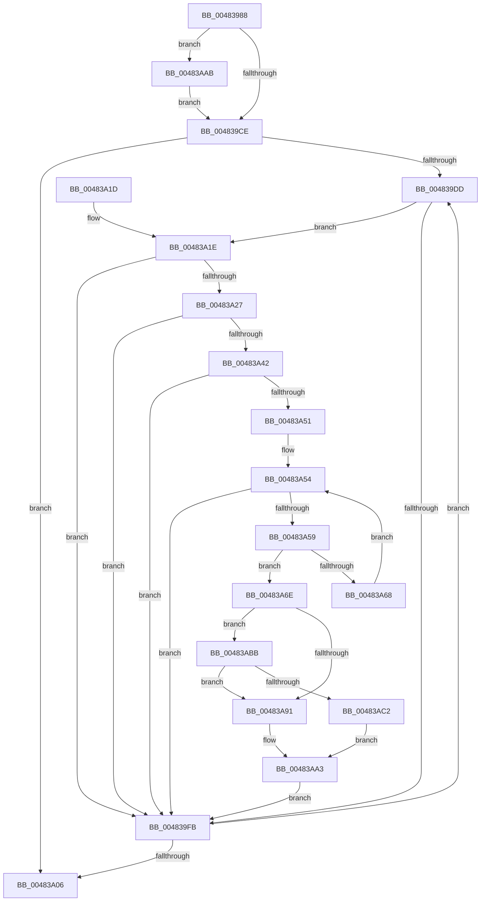

# ST_STORE&lt;SM_TRAITS&gt;::StCompactionFindEmptiest

- RVA: `0x00483988`–`0x00483ACA` (길이 `322` bytes)
- VA: `0x0000000140483988`
- 실행 섹션: `.text`
- PDB 이름 있음: `예`; PDB Function 태그: `아니요`
- unwind 정보 RVA: `0x000AEF78`
- 디코드: `99`개 명령, `322/322` bytes 표시
- 미해석 바이트: `0` (있으면 어셈블리에 `.byte`로 보존)

> 이 문서는 커널 이미지의 기계어와 PDB 기호를 분석해 생성했습니다. 4번과 5번은 함수 원형과 자료형을 바이너리 사용 방식에서 추정한 C 해석이며 원본 소스 복구 결과는 아닙니다.

## 1. Dependencies

- 직접 호출 지점: **1**; 고유 호출 대상: **1**
- 직접 호출자로 확인된 함수: **1**
- RIP 상대 이미지 참조: **0**

### Outgoing calls
- `0x00483A7F` → [memcpy](../6C/memcpy_function_006C6840.md) (function, `0x006C6840`)

### Direct callers
- [ST_STORE&lt;SM_TRAITS&gt;::StCompactionPerformInMem](../41/ST_STORE_SM_TRAITS_StCompactionPerformInMem_function_004111D8.md) at `0x00411258`

### Static image references
- 디코드된 RIP-relative 메모리 참조가 없습니다.

## 2. Other-region calls and transfers

- 다른 실행 섹션으로 향하는 call: **0**
- 별도 외부 분기/꼬리 이동을 확인하지 못했습니다.

## 3. Assembly (complete function range)

```asm
00483988  48 89 5C 24 10                  mov qword ptr [rsp + 0x10], rbx
0048398D  55                              push rbp
0048398E  56                              push rsi
0048398F  57                              push rdi
00483990  41 54                           push r12
00483992  41 55                           push r13
00483994  41 56                           push r14
00483996  41 57                           push r15
00483998  48 83 EC 20                     sub rsp, 0x20
0048399C  45 8B E0                        mov r12d, r8d
0048399F  4C 8B F1                        mov r14, rcx
004839A2  41 8B C8                        mov ecx, r8d
004839A5  41 BA FF 1F 00 00               mov r10d, 0x1fff
004839AB  45 33 C0                        xor r8d, r8d
004839AE  66 44 89 54 24 70               mov word ptr [rsp + 0x70], r10w
004839B4  41 8B E9                        mov ebp, r9d
004839B7  4C 8B FA                        mov r15, rdx
004839BA  4E 8D 2C E2                     lea r13, [rdx + r12*8]
004839BE  49 3B D5                        cmp rdx, r13
004839C1  41 0F 47 C8                     cmova ecx, r8d
004839C5  48 85 C9                        test rcx, rcx
004839C8  0F 85 DD 00 00 00               jne 0x140483aab
004839CE  41 8B F8                        mov edi, r8d
004839D1  41 8B F0                        mov esi, r8d
004839D4  45 39 86 14 03 00 00            cmp dword ptr [r14 + 0x314], r8d
004839DB  74 29                           je 0x140483a06
004839DD  49 8B 86 78 05 00 00            mov rax, qword ptr [r14 + 0x578]
004839E4  8B CE                           mov ecx, esi
004839E6  48 8D 04 48                     lea rax, [rax + rcx*2]
004839EA  48 89 44 24 60                  mov qword ptr [rsp + 0x60], rax
004839EF  0F B7 00                        movzx eax, word ptr [rax]
004839F2  0F B7 D0                        movzx edx, ax
004839F5  66 41 23 D2                     and dx, r10w
004839F9  75 23                           jne 0x140483a1e
004839FB  FF C6                           inc esi
004839FD  41 3B B6 14 03 00 00            cmp esi, dword ptr [r14 + 0x314]
00483A04  75 D7                           jne 0x1404839dd
00483A06  48 8B 5C 24 68                  mov rbx, qword ptr [rsp + 0x68]
00483A0B  8B C7                           mov eax, edi
00483A0D  48 83 C4 20                     add rsp, 0x20
00483A11  41 5F                           pop r15
00483A13  41 5E                           pop r14
00483A15  41 5D                           pop r13
00483A17  41 5C                           pop r12
00483A19  5F                              pop rdi
00483A1A  5E                              pop rsi
00483A1B  5D                              pop rbp
00483A1C  C3                              ret
00483A1D  CC                              int3
00483A1E  8B C8                           mov ecx, eax
00483A20  41 23 C2                        and eax, r10d
00483A23  3B C5                           cmp eax, ebp
00483A25  77 D4                           ja 0x1404839fb
00483A27  8B 84 24 80 00 00 00            mov eax, dword ptr [rsp + 0x80]
00483A2E  C1 E9 0D                        shr ecx, 0xd
00483A31  41 80 BE 08 03 00 00 00         cmp byte ptr [r14 + 0x308], 0
00483A39  41 0F 45 C8                     cmovne ecx, r8d
00483A3D  0F A3 C8                        bt eax, ecx
00483A40  73 B9                           jae 0x1404839fb
00483A42  8B C1                           mov eax, ecx
00483A44  48 03 C0                        add rax, rax
00483A47  41 3B B4 C6 58 06 00 00         cmp esi, dword ptr [r14 + rax*8 + 0x658]
00483A4F  74 AA                           je 0x1404839fb
00483A51  49 8B DF                        mov rbx, r15
00483A54  49 3B DD                        cmp rbx, r13
00483A57  73 A2                           jae 0x1404839fb
00483A59  48 8B 03                        mov rax, qword ptr [rbx]
00483A5C  0F B7 08                        movzx ecx, word ptr [rax]
00483A5F  66 41 23 CA                     and cx, r10w
00483A63  66 3B D1                        cmp dx, cx
00483A66  72 06                           jb 0x140483a6e
00483A68  48 83 C3 08                     add rbx, 8
00483A6C  EB E6                           jmp 0x140483a54
00483A6E  4D 8B C5                        mov r8, r13
00483A71  48 8D 4B 08                     lea rcx, [rbx + 8]
00483A75  4C 2B C3                        sub r8, rbx
00483A78  48 8B D3                        mov rdx, rbx
00483A7B  49 83 E8 08                     sub r8, 8
00483A7F  E8 BC 2D 24 00                  call 0x1406c6840
00483A84  48 8B 44 24 60                  mov rax, qword ptr [rsp + 0x60]
00483A89  48 89 03                        mov qword ptr [rbx], rax
00483A8C  41 3B FC                        cmp edi, r12d
00483A8F  72 2A                           jb 0x140483abb
00483A91  49 8B 4D F8                     mov rcx, qword ptr [r13 - 8]
00483A95  41 BA FF 1F 00 00               mov r10d, 0x1fff
00483A9B  0F B7 29                        movzx ebp, word ptr [rcx]
00483A9E  41 23 EA                        and ebp, r10d
00483AA1  FF CD                           dec ebp
00483AA3  45 33 C0                        xor r8d, r8d
00483AA6  E9 50 FF FF FF                  jmp 0x1404839fb
00483AAB  48 8D 44 24 70                  lea rax, [rsp + 0x70]
00483AB0  49 8B FF                        mov rdi, r15
00483AB3  F3 48 AB                        rep stosq qword ptr [rdi], rax
00483AB6  E9 13 FF FF FF                  jmp 0x1404839ce
00483ABB  FF C7                           inc edi
00483ABD  41 3B FC                        cmp edi, r12d
00483AC0  73 CF                           jae 0x140483a91
00483AC2  41 BA FF 1F 00 00               mov r10d, 0x1fff
00483AC8  EB D9                           jmp 0x140483aa3
```

## 4. C-style interpretation (structured pseudocode)

```c
__int64 __fastcall ST_STORE_SM_TRAITS___StCompactionFindEmptiest(__int64 a1, __int64 a2, int a3, int a4, unsigned int a5)
{
    __int64 result;
    __int64 v_rbp;
    __int64 v_rbx;
    __int64 v_rdi;
    __int64 v_rsi;
    __int64 v_rsp;
    unsigned __int64 v_stack_p10;
    unsigned __int16 v_stack_p18;
    unsigned __int64 v_stack_p60;
    unsigned __int64 v_stack_p70;
    unsigned __int64 v_stack_p8;

    v_stack_p10 = v_rbx;
    v_rsp = (v_rsp) - (32);
    a3 = 0;
    v_stack_p18 = (unsigned __int16)((unsigned int)(0x1FFFULL));
    a1 = (unsigned int)(a3);
    if (a2 > (a2 + (unsigned int)(a3) * 8)) { a1 = 0; }
    if (a1 != 0) goto loc_00483AAB;
loc_004839CE:
    if ((*(unsigned int *)(a1 + 788)) == 0) goto loc_00483A06;
loc_004839DD:
    v_stack_p8 = *(unsigned __int64 *)(a1 + 1400) + 0 * 2;
    a2 = (unsigned __int16)(((unsigned __int16)(*(unsigned __int16 *)(*(unsigned __int64 *)(a1 + 1400) + 0 * 2))) & ((unsigned __int16)((unsigned int)(0x1FFFULL))));
    if (condition_is_not_equal) goto loc_00483A1E;
loc_004839FB:
    v_rsi = (unsigned int)((0) + 1);
    if (((unsigned int)(v_rsi)) != (*(unsigned int *)(a1 + 788))) goto loc_004839DD;
loc_00483A06:
    v_rsp = (v_rsp) + (32);
    return 0;
loc_00483A1E:
    result = (unsigned int)((0) & ((unsigned int)((unsigned int)(0x1FFFULL))));
    if (((unsigned int)(result)) > ((unsigned int)((unsigned int)(a4)))) goto loc_004839FB;
    a1 = (unsigned int)((0) >> (13));
    if ((*(unsigned __int8 *)(a1 + 776)) != 0) { a1 = 0; }
    if ((*(unsigned __int8 *)(a1 + 776)) >= 0) goto loc_004839FB;
    result = ((unsigned int)((unsigned int)(a1))) + ((unsigned int)((unsigned int)(a1)));
    if (((unsigned int)(v_rsi)) == (*(unsigned int *)(a1 + result * 8 + 1624))) goto loc_004839FB;
loc_00483A54:
    if (a2 >= (a2 + (unsigned int)(a3) * 8)) goto loc_004839FB;
    a1 = (unsigned __int16)((*(unsigned __int16 *)(*(unsigned __int64 *)(a2))) & ((unsigned __int16)((unsigned int)(0x1FFFULL))));
    if (((unsigned __int16)(a2)) < ((unsigned __int16)(a1))) goto loc_00483A6E;
    v_rbx = (a2) + (8);
    goto loc_00483A54;
loc_00483A6E:
    a3 = (a2 + (unsigned int)(a3) * 8) - (v_rbx);
    a3 = (a3) - (8);
    result = memcpy(v_rbx + 8, v_rbx, a3, a4);
    *(unsigned __int64 *)(v_rbx) = v_stack_p60;
    if (0 < ((unsigned int)((unsigned int)(a3)))) goto loc_00483ABB;
loc_00483A91:
    v_rbp = (unsigned int)((*(unsigned __int16 *)(*(unsigned __int64 *)(a2 + (unsigned int)(a3) * 8 - 8))) & ((unsigned int)((unsigned int)(0x1FFFULL))));
    v_rbp = (unsigned int)((v_rbp) - 1);
loc_00483AA3:
    a3 = 0;
    goto loc_004839FB;
loc_00483AAB:
    goto loc_004839CE;
loc_00483ABB:
    v_rdi = (unsigned int)((a2) + 1);
    if (((unsigned int)(v_rdi)) >= ((unsigned int)((unsigned int)(a3)))) goto loc_00483A91;
    goto loc_00483AA3;
}
```

## 5. (Beta) C Style

```c
int64_t ST_STORE_SM_TRAITS___StCompactionFindEmptiest(void *Arg1, void *Arg2, int32_t Arg3, int32_t Arg4, uint32_t Arg5)
{
    uint8_t *arg1 = (uint8_t *)Arg1;
    uint8_t *arg2 = (uint8_t *)Arg2;

    int64_t result;
    int64_t local_rbp;
    int64_t local_rbx;
    int64_t local_rdi;
    int64_t local_rsi;
    int64_t local_rsp;
    uint64_t v_stack_p10;
    uint16_t v_stack_p18;
    uint64_t v_stack_p60;
    uint64_t v_stack_p70;
    uint64_t v_stack_p8;

    v_stack_p10 = local_rbx;
    local_rsp = (local_rsp) - (32);
    Arg3 = 0;
    v_stack_p18 = (uint16_t)((uint32_t)(0x1FFFULL));
    Arg1 = (uint32_t)(Arg3);
    if (Arg2 > (Arg2 + (uint32_t)(Arg3) * 8)) { Arg1 = 0; }
    if (Arg1 != NULL) goto loc_00483AAB;
loc_004839CE:
    if ((*(uint32_t *)(arg1 + 0x314)) == 0) goto loc_00483A06;
loc_004839DD:
    v_stack_p8 = *(uint64_t *)(arg1 + 0x578) + 0 * 2;
    Arg2 = (uint16_t)(((uint16_t)(*(uint16_t *)(*(uint64_t *)(arg1 + 0x578) + 0x0 * 2))) & ((uint16_t)((uint32_t)(0x1FFFULL))));
    if (condition_is_not_equal) goto loc_00483A1E;
loc_004839FB:
    local_rsi = (uint32_t)((0) + 1);
    if (((uint32_t)(local_rsi)) != (*(uint32_t *)(arg1 + 0x314))) goto loc_004839DD;
loc_00483A06:
    local_rsp = (local_rsp) + (32);
    return 0;
loc_00483A1E:
    result = (uint32_t)((0) & ((uint32_t)((uint32_t)(0x1FFFULL))));
    if (((uint32_t)(result)) > ((uint32_t)((uint32_t)(Arg4)))) goto loc_004839FB;
    Arg1 = (uint32_t)((0) >> (13));
    if ((*(uint8_t *)(arg1 + 0x308)) != 0) { Arg1 = 0; }
    if ((*(uint8_t *)(arg1 + 0x308)) >= 0) goto loc_004839FB;
    result = ((uint32_t)((uint32_t)(Arg1))) + ((uint32_t)((uint32_t)(Arg1)));
    if (((uint32_t)(local_rsi)) == (*(uint32_t *)(arg1 + result * 8 + 0x658))) goto loc_004839FB;
loc_00483A54:
    if (Arg2 >= (Arg2 + (uint32_t)(Arg3) * 8)) goto loc_004839FB;
    Arg1 = (uint16_t)((*(uint16_t *)(*(uint64_t *)(arg2))) & ((uint16_t)((uint32_t)(0x1FFFULL))));
    if (((uint16_t)(Arg2)) < ((uint16_t)(Arg1))) goto loc_00483A6E;
    local_rbx = (Arg2) + (8);
    goto loc_00483A54;
loc_00483A6E:
    Arg3 = (Arg2 + (uint32_t)(Arg3) * 8) - (local_rbx);
    Arg3 = (Arg3) - (8);
    result = memcpy(local_rbx + 8, local_rbx, Arg3, Arg4);
    *(uint64_t *)(local_rbx) = v_stack_p60;
    if (0 < ((uint32_t)((uint32_t)(Arg3)))) goto loc_00483ABB;
loc_00483A91:
    local_rbp = (uint32_t)((*(uint16_t *)(*(uint64_t *)(arg2 + (uint32_t)(Arg3) * 8 - 0x8))) & ((uint32_t)((uint32_t)(0x1FFFULL))));
    local_rbp = (uint32_t)((local_rbp) - 1);
loc_00483AA3:
    Arg3 = 0;
    goto loc_004839FB;
loc_00483AAB:
    goto loc_004839CE;
loc_00483ABB:
    local_rdi = (uint32_t)((Arg2) + 1);
    if (((uint32_t)(local_rdi)) >= ((uint32_t)((uint32_t)(Arg3)))) goto loc_00483A91;
    goto loc_00483AA3;
}
```

### 관측된 메모리 오프셋

구조체 형식이 확인되지 않은 접근은 인자 기준의 오프셋으로만 기록했습니다.

| 기준 인자 | 오프셋 표현 | 폭 (bit) | 접근 |
|---|---:|---:|---|
| `Arg1` | `+ 0x308` | `8` | `R` |
| `Arg1` | `+ 0x314` | `32` | `R` |
| `Arg1` | `+ 0x578` | `64` | `R` |
| `Arg1` | `+ 0x658 + rax*8` | `32` | `R` |
| `Arg2` | `- 0x8` | `64` | `R` |
| `Arg2` | `+ 0x0` | `64` | `W` |
| `Arg2` | `+ 0x0 + r12*8` | `64` | `R` |

## 6. Execution-region graph

[열기: 2D/3D 그래프와 함수 탐색 컨트롤 패널](../../../control-panel.html?section=text&rva=0x00483988&view=graph)

- 2D 그래프는 위에서 아래로 흐르고, 3D 그래프는 빈 공간을 드래그해 회전합니다. Shift+드래그는 이동, 휠은 확대·축소, 함수 노드 선택은 대상 보고서 이동입니다.

### Static fallback


