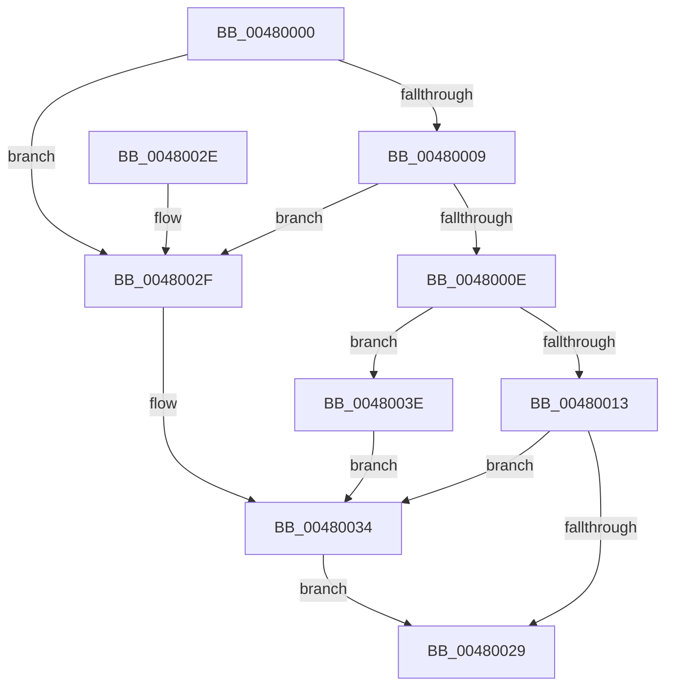

# SeConvertStringSecurityDescriptorToSecurityDescriptor

- RVA: `0x00480000`–`0x00480045` (길이 `69` bytes)
- VA: `0x0000000140480000`
- 실행 섹션: `.text`
- PDB 이름 있음: `예`; PDB Function 태그: `아니요`
- unwind 정보 RVA: `0x000958CC`
- 디코드: `22`개 명령, `69/69` bytes 표시
- 미해석 바이트: `0` (있으면 어셈블리에 `.byte`로 보존)

> 이 문서는 커널 이미지의 기계어와 PDB 기호를 분석해 생성했습니다. 4번과 5번은 함수 원형과 자료형을 바이너리 사용 방식에서 추정한 C 해석이며 원본 소스 복구 결과는 아닙니다.

## 1. Dependencies

- 직접 호출 지점: **1**; 고유 호출 대상: **1**
- 직접 호출자로 확인된 함수: **5**
- RIP 상대 이미지 참조: **0**

### Outgoing calls
- `0x00480020` → [LocalConvertStringSDToSD_Rev1](../../page/92/LocalConvertStringSDToSD_Rev1_function_0092656C.md) (function, `0x0092656C`)

### Direct callers
- [PspIumVerifyParentSd](../../page/78/PspIumVerifyParentSd_function_00787D04.md) at `0x00787D37`
- [IopUpdateSecureDeviceClassState](../../page/9A/IopUpdateSecureDeviceClassState_function_009A2CE8.md) at `0x009A2E67`
- [IoCreateDeviceSecure](../../page/9A/IoCreateDeviceSecure_function_009A31E0.md) at `0x009A3290`
- [CmFcInitSystem2](../../init/C5/CmFcInitSystem2_function_00C5AD0C.md) at `0x00C5AD3A`
- [CmFcManagerStartRuntimePhase](../../init/C5/CmFcManagerStartRuntimePhase_function_00C5DC70.md) at `0x00C5DD01`

### Static image references
- 디코드된 RIP-relative 메모리 참조가 없습니다.

## 2. Other-region calls and transfers

- 다른 실행 섹션으로 향하는 call: **1**
  - `0x00480020` → [LocalConvertStringSDToSD_Rev1](../../page/92/LocalConvertStringSDToSD_Rev1_function_0092656C.md) (`.text` → `PAGE`)
- 별도 외부 분기/꼬리 이동을 확인하지 못했습니다.

## 3. Assembly (complete function range)

```asm
00480000  48 83 EC 38                     sub rsp, 0x38
00480004  48 85 C9                        test rcx, rcx
00480007  74 26                           je 0x14048002f
00480009  4D 85 C0                        test r8, r8
0048000C  74 21                           je 0x14048002f
0048000E  83 FA 01                        cmp edx, 1
00480011  75 2B                           jne 0x14048003e
00480013  4C 89 4C 24 28                  mov qword ptr [rsp + 0x28], r9
00480018  4C 8B C9                        mov r9, rcx
0048001B  4C 89 44 24 20                  mov qword ptr [rsp + 0x20], r8
00480020  E8 47 65 4A 00                  call 0x14092656c
00480025  85 C0                           test eax, eax
00480027  7F 0B                           jg 0x140480034
00480029  48 83 C4 38                     add rsp, 0x38
0048002D  C3                              ret
0048002E  CC                              int3
0048002F  B8 57 00 00 00                  mov eax, 0x57
00480034  0F B7 C0                        movzx eax, ax
00480037  0D 00 00 07 C0                  or eax, 0xc0070000
0048003C  EB EB                           jmp 0x140480029
0048003E  B8 19 05 00 00                  mov eax, 0x519
00480043  EB EF                           jmp 0x140480034
```

## 4. C-style interpretation (structured pseudocode)

```c
__int64 __fastcall SeConvertStringSecurityDescriptorToSecurityDescriptor(__int64 a1, int a2, __int64 a3, __int64 a4)
{
    __int64 result;
    __int64 v_rsp;
    unsigned __int64 v_stack_m10;
    unsigned __int64 v_stack_m18;

    v_rsp = (v_rsp) - (56);
    if (a1 == 0) goto loc_0048002F;
    if (a3 == 0) goto loc_0048002F;
    if (a2 != 1) goto loc_0048003E;
    v_stack_m10 = a4;
    v_stack_m18 = a3;
    result = LocalConvertStringSDToSD_Rev1(a1, a2, a3, a1);
    if (condition_is_greater) goto loc_00480034;
loc_00480029:
    v_rsp = (v_rsp) + (56);
    return result;
loc_0048002F:
loc_00480034:
    result = (unsigned int)((87) | (0xC0070000ULL));
    goto loc_00480029;
loc_0048003E:
    goto loc_00480034;
}
```

## 5. (Beta) C Style

```c
int64_t SeConvertStringSecurityDescriptorToSecurityDescriptor(int64_t Arg1, int32_t Arg2, int64_t Arg3, int64_t Arg4)
{
    int64_t result;
    int64_t local_rsp;
    uint64_t v_stack_m10;
    uint64_t v_stack_m18;

    local_rsp = (local_rsp) - (56);
    if (Arg1 == 0) goto loc_0048002F;
    if (Arg3 == 0) goto loc_0048002F;
    if (Arg2 != 1) goto loc_0048003E;
    v_stack_m10 = Arg4;
    v_stack_m18 = Arg3;
    result = LocalConvertStringSDToSD_Rev1(Arg1, Arg2, Arg3, Arg1);
    if (condition_is_greater) goto loc_00480034;
loc_00480029:
    local_rsp = (local_rsp) + (56);
    return result;
loc_0048002F:
loc_00480034:
    result = (uint32_t)((87) | (0xC0070000ULL));
    goto loc_00480029;
loc_0048003E:
    goto loc_00480034;
}
```

## 6. Execution-region graph

[열기: 2D/3D 그래프와 함수 탐색 컨트롤 패널](../../../control-panel.html?section=text&rva=0x00480000&view=graph)

- 2D 그래프는 위에서 아래로 흐르고, 3D 그래프는 빈 공간을 드래그해 회전합니다. Shift+드래그는 이동, 휠은 확대·축소, 함수 노드 선택은 대상 보고서 이동입니다.

### Static fallback


