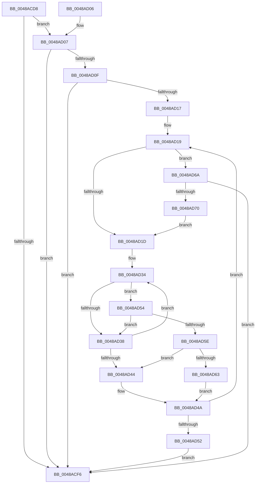

# SepAdtCheckPrivilegeForSensitivity

- RVA: `0x0048ACD8`–`0x0048AD72` (길이 `154` bytes)
- VA: `0x000000014048ACD8`
- 실행 섹션: `.text`
- PDB 이름 있음: `예`; PDB Function 태그: `아니요`
- unwind 정보 RVA: `0x000B0290`
- 디코드: `49`개 명령, `154/154` bytes 표시
- 미해석 바이트: `0` (있으면 어셈블리에 `.byte`로 보존)

> 이 문서는 커널 이미지의 기계어와 PDB 기호를 분석해 생성했습니다. 4번과 5번은 함수 원형과 자료형을 바이너리 사용 방식에서 추정한 C 해석이며 원본 소스 복구 결과는 아닙니다.

## 1. Dependencies

- 직접 호출 지점: **0**; 고유 호출 대상: **0**
- 직접 호출자로 확인된 함수: **3**
- RIP 상대 이미지 참조: **1**

### Outgoing calls
- 직접 디코드된 call 명령이 없습니다.

### Direct callers
- [SepAdtPrivilegeObjectAuditAlarm](../../page/86/SepAdtPrivilegeObjectAuditAlarm_function_0086E3F0.md) at `0x0086E4F6`
- [SepAdtAuditPrivilegeUseWithContext](../../page/87/SepAdtAuditPrivilegeUseWithContext_function_00870BD0.md) at `0x00870C73`
- [SepAdtPrivilegedServiceAuditAlarm](../../page/87/SepAdtPrivilegedServiceAuditAlarm_function_008714F0.md) at `0x00871606`

### Static image references
- `0x0048AD1D` → RVA `0x00B4EC50` (`SepSensitivePrivileges`; read)

## 2. Other-region calls and transfers

- 다른 실행 섹션으로 향하는 call: **0**
- 별도 외부 분기/꼬리 이동을 확인하지 못했습니다.

## 3. Assembly (complete function range)

```asm
0048ACD8  48 89 5C 24 08                  mov qword ptr [rsp + 8], rbx
0048ACDD  48 89 74 24 10                  mov qword ptr [rsp + 0x10], rsi
0048ACE2  48 89 7C 24 18                  mov qword ptr [rsp + 0x18], rdi
0048ACE7  C6 02 00                        mov byte ptr [rdx], 0
0048ACEA  4C 8B C9                        mov r9, rcx
0048ACED  41 C6 00 00                     mov byte ptr [r8], 0
0048ACF1  48 85 C9                        test rcx, rcx
0048ACF4  75 11                           jne 0x14048ad07
0048ACF6  48 8B 5C 24 08                  mov rbx, qword ptr [rsp + 8]
0048ACFB  48 8B 74 24 10                  mov rsi, qword ptr [rsp + 0x10]
0048AD00  48 8B 7C 24 18                  mov rdi, qword ptr [rsp + 0x18]
0048AD05  C3                              ret
0048AD06  CC                              int3
0048AD07  44 8B 11                        mov r10d, dword ptr [rcx]
0048AD0A  45 85 D2                        test r10d, r10d
0048AD0D  74 E7                           je 0x14048acf6
0048AD0F  45 33 DB                        xor r11d, r11d
0048AD12  45 85 D2                        test r10d, r10d
0048AD15  74 DF                           je 0x14048acf6
0048AD17  32 C0                           xor al, al
0048AD19  84 C0                           test al, al
0048AD1B  75 4D                           jne 0x14048ad6a
0048AD1D  48 8B 0D 2C 3F 6C 00            mov rcx, qword ptr [rip + 0x6c3f2c]
0048AD24  4B 8D 3C 5B                     lea rdi, [r11 + r11*2]
0048AD28  41 8B 74 B9 08                  mov esi, dword ptr [r9 + rdi*4 + 8]
0048AD2D  48 8D 1D 1C 3F 6C 00            lea rbx, [rip + 0x6c3f1c]
0048AD34  3B 31                           cmp esi, dword ptr [rcx]
0048AD36  74 1C                           je 0x14048ad54
0048AD38  48 83 C3 08                     add rbx, 8
0048AD3C  48 8B 0B                        mov rcx, qword ptr [rbx]
0048AD3F  48 85 C9                        test rcx, rcx
0048AD42  75 F0                           jne 0x14048ad34
0048AD44  8A 02                           mov al, byte ptr [rdx]
0048AD46  41 C6 00 01                     mov byte ptr [r8], 1
0048AD4A  41 FF C3                        inc r11d
0048AD4D  45 3B DA                        cmp r11d, r10d
0048AD50  72 C7                           jb 0x14048ad19
0048AD52  EB A2                           jmp 0x14048acf6
0048AD54  8B 41 04                        mov eax, dword ptr [rcx + 4]
0048AD57  41 39 44 B9 0C                  cmp dword ptr [r9 + rdi*4 + 0xc], eax
0048AD5C  75 DA                           jne 0x14048ad38
0048AD5E  48 85 C9                        test rcx, rcx
0048AD61  74 E1                           je 0x14048ad44
0048AD63  C6 02 01                        mov byte ptr [rdx], 1
0048AD66  B0 01                           mov al, 1
0048AD68  EB E0                           jmp 0x14048ad4a
0048AD6A  41 80 38 00                     cmp byte ptr [r8], 0
0048AD6E  75 86                           jne 0x14048acf6
0048AD70  EB AB                           jmp 0x14048ad1d
```

## 4. C-style interpretation (structured pseudocode)

```c
__int64 __fastcall SepAdtCheckPrivilegeForSensitivity(__int64 a1, __int64 a2, __int64 a3)
{
    __int64 result;
    __int64 v_r11;
    __int64 v_rbx;
    unsigned __int64 v_stack_p10;
    unsigned __int64 v_stack_p18;
    unsigned __int64 v_stack_p8;

    v_stack_p8 = v_rbx;
    v_stack_p10 = v_rsi;
    v_stack_p18 = v_rdi;
    *(unsigned __int8 *)(a2) = 0;
    *(unsigned __int8 *)(a3) = 0;
    if (a1 != 0) goto loc_0048AD07;
loc_0048ACF6:
    return result;
loc_0048AD07:
    if ((unsigned int)((unsigned int)(*(unsigned int *)(a1))) == 0) goto loc_0048ACF6;
    v_r11 = 0;
    if ((unsigned int)((unsigned int)(*(unsigned int *)(a1))) == 0) goto loc_0048ACF6;
    result = 0;
loc_0048AD19:
    if (0 != 0) goto loc_0048AD6A;
loc_0048AD1D:
loc_0048AD34:
    if (((unsigned int)((unsigned int)(*(unsigned int *)(a1 + v_r11 + v_r11 * 2 * 4 + 8)))) == (*(unsigned int *)(*(unsigned __int64 *)(v_rip + 7094060)))) goto loc_0048AD54;
loc_0048AD38:
    v_rbx = (v_rip + 7094044) + (8);
    if (*(unsigned __int64 *)(v_rbx) != 0) goto loc_0048AD34;
loc_0048AD44:
    *(unsigned __int8 *)(a3) = 1;
loc_0048AD4A:
    v_r11 = (unsigned int)((v_r11) + 1);
    if (((unsigned int)(v_r11)) < ((unsigned int)((unsigned int)(*(unsigned int *)(a1))))) goto loc_0048AD19;
    goto loc_0048ACF6;
loc_0048AD54:
    if ((*(unsigned int *)(a1 + v_r11 + v_r11 * 2 * 4 + 12)) != ((unsigned int)((unsigned int)(*(unsigned int *)(*(unsigned __int64 *)(v_rbx) + 4))))) goto loc_0048AD38;
    if (*(unsigned __int64 *)(v_rbx) == 0) goto loc_0048AD44;
    *(unsigned __int8 *)(a2) = 1;
    goto loc_0048AD4A;
loc_0048AD6A:
    if ((*(unsigned __int8 *)(a3)) != 0) goto loc_0048ACF6;
    goto loc_0048AD1D;
}
```

## 5. (Beta) C Style

```c
int64_t SepAdtCheckPrivilegeForSensitivity(void *Arg1, void *Arg2, void *Arg3)
{
    uint8_t *arg1 = (uint8_t *)Arg1;
    uint8_t *arg2 = (uint8_t *)Arg2;
    uint8_t *arg3 = (uint8_t *)Arg3;

    int64_t result;
    int64_t local_r11;
    int64_t local_rbx;
    uint64_t v_stack_p10;
    uint64_t v_stack_p18;
    uint64_t v_stack_p8;

    v_stack_p8 = local_rbx;
    v_stack_p10 = local_rsi;
    v_stack_p18 = local_rdi;
    *(uint8_t *)(arg2) = 0;
    *(uint8_t *)(arg3) = 0;
    if (Arg1 != NULL) goto loc_0048AD07;
loc_0048ACF6:
    return result;
loc_0048AD07:
    if ((uint32_t)((uint32_t)(*(uint32_t *)(arg1))) == 0) goto loc_0048ACF6;
    local_r11 = 0;
    if ((uint32_t)((uint32_t)(*(uint32_t *)(arg1))) == 0) goto loc_0048ACF6;
    result = 0;
loc_0048AD19:
    if (0 != 0) goto loc_0048AD6A;
loc_0048AD1D:
loc_0048AD34:
    if (((uint32_t)((uint32_t)(*(uint32_t *)(arg1 + local_r11 + local_r11 * 2 * 4 + 0x8)))) == (*(uint32_t *)(*(uint64_t *)(v_rip + 0x6C3F2C)))) goto loc_0048AD54;
loc_0048AD38:
    local_rbx = (v_rip + 7094044) + (8);
    if (*(uint64_t *)(local_rbx) != 0) goto loc_0048AD34;
loc_0048AD44:
    *(uint8_t *)(arg3) = 1;
loc_0048AD4A:
    local_r11 = (uint32_t)((local_r11) + 1);
    if (((uint32_t)(local_r11)) < ((uint32_t)((uint32_t)(*(uint32_t *)(arg1))))) goto loc_0048AD19;
    goto loc_0048ACF6;
loc_0048AD54:
    if ((*(uint32_t *)(arg1 + local_r11 + local_r11 * 2 * 4 + 0xC)) != ((uint32_t)((uint32_t)(*(uint32_t *)(*(uint64_t *)(local_rbx) + 0x4))))) goto loc_0048AD38;
    if (*(uint64_t *)(local_rbx) == 0) goto loc_0048AD44;
    *(uint8_t *)(arg2) = 1;
    goto loc_0048AD4A;
loc_0048AD6A:
    if ((*(uint8_t *)(arg3)) != 0) goto loc_0048ACF6;
    goto loc_0048AD1D;
}
```

### 관측된 메모리 오프셋

구조체 형식이 확인되지 않은 접근은 인자 기준의 오프셋으로만 기록했습니다.

| 기준 인자 | 오프셋 표현 | 폭 (bit) | 접근 |
|---|---:|---:|---|
| `Arg1` | `+ 0x8 + rdi*4` | `32` | `R` |
| `Arg1` | `+ 0xC + rdi*4` | `32` | `R` |
| `Arg2` | `+ 0x0` | `8` | `R` |
| `Arg2` | `+ 0x0` | `8` | `W` |
| `Arg3` | `+ 0x0` | `8` | `R` |
| `Arg3` | `+ 0x0` | `8` | `W` |

## 6. Execution-region graph

[열기: 2D/3D 그래프와 함수 탐색 컨트롤 패널](../../../control-panel.html?section=text&rva=0x0048ACD8&view=graph)

- 2D 그래프는 위에서 아래로 흐르고, 3D 그래프는 빈 공간을 드래그해 회전합니다. Shift+드래그는 이동, 휠은 확대·축소, 함수 노드 선택은 대상 보고서 이동입니다.

### Static fallback


