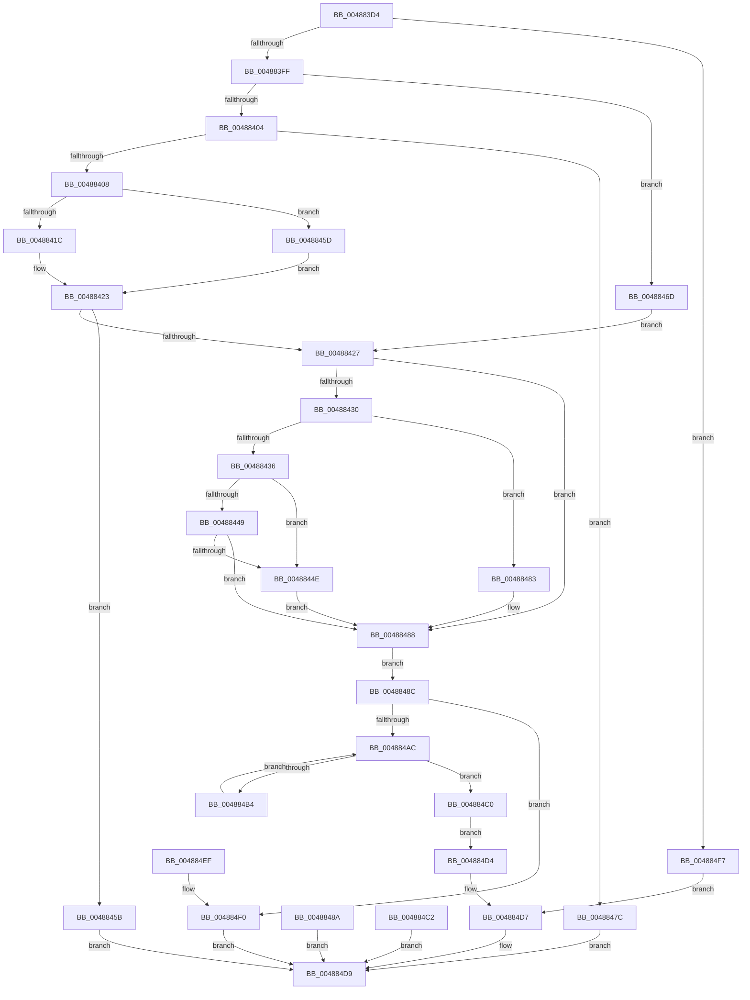

# SepCaptureTokenSecurityOperations

- RVA: `0x004883D4`–`0x004884FC` (길이 `296` bytes)
- VA: `0x00000001404883D4`
- 실행 섹션: `.text`
- PDB 이름 있음: `예`; PDB Function 태그: `아니요`
- unwind 정보 RVA: `0x000AFD04`
- 디코드: `93`개 명령, `296/296` bytes 표시
- 미해석 바이트: `0` (있으면 어셈블리에 `.byte`로 보존)

> 이 문서는 커널 이미지의 기계어와 PDB 기호를 분석해 생성했습니다. 4번과 5번은 함수 원형과 자료형을 바이너리 사용 방식에서 추정한 C 해석이며 원본 소스 복구 결과는 아닙니다.

## 1. Dependencies

- 직접 호출 지점: **3**; 고유 호출 대상: **3**
- 직접 호출자로 확인된 함수: **1**
- RIP 상대 이미지 참조: **0**

### Outgoing calls
- `0x00488483` → [ExRaiseDatatypeMisalignment](../../page/89/ExRaiseDatatypeMisalignment_function_00899FD0.md) (function, `0x00899FD0`)
- `0x0048849A` → [ExAllocatePool2](../../poolcode/B8/ExAllocatePool2_function_00B820F0.md) (function, `0x00B820F0`)
- `0x004884CB` → [ExFreePoolWithTag](../../poolcode/B8/ExFreePoolWithTag_function_00B82870.md) (function, `0x00B82870`)

### Direct callers
- [SepCaptureTokenSecurityAttributesAndOperationsInformation](../../page/97/SepCaptureTokenSecurityAttributesAndOperationsInformation_function_00971E0C.md) at `0x00971EEF`

### Static image references
- 디코드된 RIP-relative 메모리 참조가 없습니다.

## 2. Other-region calls and transfers

- 다른 실행 섹션으로 향하는 call: **3**
  - `0x00488483` → [ExRaiseDatatypeMisalignment](../../page/89/ExRaiseDatatypeMisalignment_function_00899FD0.md) (`.text` → `PAGE`)
  - `0x0048849A` → [ExAllocatePool2](../../poolcode/B8/ExAllocatePool2_function_00B820F0.md) (`.text` → `POOLCODE`)
  - `0x004884CB` → [ExFreePoolWithTag](../../poolcode/B8/ExFreePoolWithTag_function_00B82870.md) (`.text` → `POOLCODE`)
- 별도 외부 분기/꼬리 이동을 확인하지 못했습니다.

## 3. Assembly (complete function range)

```asm
004883D4  48 8B C4                        mov rax, rsp
004883D7  48 89 58 08                     mov qword ptr [rax + 8], rbx
004883DB  48 89 70 10                     mov qword ptr [rax + 0x10], rsi
004883DF  48 89 78 18                     mov qword ptr [rax + 0x18], rdi
004883E3  41 56                           push r14
004883E5  48 83 EC 40                     sub rsp, 0x40
004883E9  4D 8B F1                        mov r14, r9
004883EC  8B FA                           mov edi, edx
004883EE  48 8B F1                        mov rsi, rcx
004883F1  33 DB                           xor ebx, ebx
004883F3  89 58 D8                        mov dword ptr [rax - 0x28], ebx
004883F6  45 84 C0                        test r8b, r8b
004883F9  0F 84 F8 00 00 00               je 0x1404884f7
004883FF  83 39 01                        cmp dword ptr [rcx], 1
00488402  74 69                           je 0x14048846d
00488404  85 D2                           test edx, edx
00488406  74 74                           je 0x14048847c
00488408  48 89 58 E8                     mov qword ptr [rax - 0x18], rbx
0048840C  8B C7                           mov eax, edi
0048840E  8D 4B 04                        lea ecx, [rbx + 4]
00488411  48 F7 E1                        mul rcx
00488414  48 8B C8                        mov rcx, rax
00488417  48 85 D2                        test rdx, rdx
0048841A  75 41                           jne 0x14048845d
0048841C  48 89 44 24 28                  mov qword ptr [rsp + 0x28], rax
00488421  8B C3                           mov eax, ebx
00488423  85 C0                           test eax, eax
00488425  78 34                           js 0x14048845b
00488427  89 7C 24 20                     mov dword ptr [rsp + 0x20], edi
0048842B  48 85 C9                        test rcx, rcx
0048842E  74 58                           je 0x140488488
00488430  40 F6 C6 03                     test sil, 3
00488434  75 4D                           jne 0x140488483
00488436  48 8D 04 31                     lea rax, [rcx + rsi]
0048843A  48 BA 00 00 FF FF FF 7F 00 00   movabs rdx, 0x7fffffff0000
00488444  48 3B C2                        cmp rax, rdx
00488447  77 05                           ja 0x14048844e
00488449  48 3B C6                        cmp rax, rsi
0048844C  73 3A                           jae 0x140488488
0048844E  8A 02                           mov al, byte ptr [rdx]
00488450  8B 7C 24 20                     mov edi, dword ptr [rsp + 0x20]
00488454  48 8B 4C 24 28                  mov rcx, qword ptr [rsp + 0x28]
00488459  EB 2D                           jmp 0x140488488
0048845B  EB 7C                           jmp 0x1404884d9
0048845D  48 83 C9 FF                     or rcx, 0xffffffffffffffff
00488461  48 89 4C 24 28                  mov qword ptr [rsp + 0x28], rcx
00488466  B8 95 00 00 C0                  mov eax, 0xc0000095
0048846B  EB B6                           jmp 0x140488423
0048846D  B9 04 00 00 00                  mov ecx, 4
00488472  48 89 4C 24 28                  mov qword ptr [rsp + 0x28], rcx
00488477  8D 79 FD                        lea edi, [rcx - 3]
0048847A  EB AB                           jmp 0x140488427
0048847C  B8 0D 00 00 C0                  mov eax, 0xc000000d
00488481  EB 56                           jmp 0x1404884d9
00488483  E8 48 1B 41 00                  call 0x140899fd0
00488488  EB 02                           jmp 0x14048848c
0048848A  EB 4D                           jmp 0x1404884d9
0048848C  41 B8 53 65 4F 70               mov r8d, 0x704f6553
00488492  48 8B D1                        mov rdx, rcx
00488495  B9 00 01 00 00                  mov ecx, 0x100
0048849A  E8 51 9C 6F 00                  call 0x140b820f0
0048849F  48 8B D0                        mov rdx, rax
004884A2  48 89 44 24 30                  mov qword ptr [rsp + 0x30], rax
004884A7  48 85 C0                        test rax, rax
004884AA  74 44                           je 0x1404884f0
004884AC  89 5C 24 24                     mov dword ptr [rsp + 0x24], ebx
004884B0  3B DF                           cmp ebx, edi
004884B2  73 0C                           jae 0x1404884c0
004884B4  8B CB                           mov ecx, ebx
004884B6  8B 04 8E                        mov eax, dword ptr [rsi + rcx*4]
004884B9  89 04 8A                        mov dword ptr [rdx + rcx*4], eax
004884BC  FF C3                           inc ebx
004884BE  EB EC                           jmp 0x1404884ac
004884C0  EB 12                           jmp 0x1404884d4
004884C2  8B D8                           mov ebx, eax
004884C4  33 D2                           xor edx, edx
004884C6  48 8B 4C 24 30                  mov rcx, qword ptr [rsp + 0x30]
004884CB  E8 A0 A3 6F 00                  call 0x140b82870
004884D0  8B C3                           mov eax, ebx
004884D2  EB 05                           jmp 0x1404884d9
004884D4  49 89 16                        mov qword ptr [r14], rdx
004884D7  33 C0                           xor eax, eax
004884D9  48 8B 5C 24 50                  mov rbx, qword ptr [rsp + 0x50]
004884DE  48 8B 74 24 58                  mov rsi, qword ptr [rsp + 0x58]
004884E3  48 8B 7C 24 60                  mov rdi, qword ptr [rsp + 0x60]
004884E8  48 83 C4 40                     add rsp, 0x40
004884EC  41 5E                           pop r14
004884EE  C3                              ret
004884EF  CC                              int3
004884F0  B8 17 00 00 C0                  mov eax, 0xc0000017
004884F5  EB E2                           jmp 0x1404884d9
004884F7  49 89 31                        mov qword ptr [r9], rsi
004884FA  EB DB                           jmp 0x1404884d7
```

## 4. C-style interpretation (structured pseudocode)

```c
__int64 __fastcall SepCaptureTokenSecurityOperations(__int64 a1, __int64 a2, unsigned __int8 a3, __int64 a4)
{
    __int64 result;
    __int64 v_rbx;
    __int64 v_rsp;
    unsigned __int64 v_stack_m18;
    unsigned __int64 v_stack_m20;
    unsigned int v_stack_m24;
    unsigned int v_stack_m28;
    unsigned __int64 v_stack_p10;
    unsigned __int64 v_stack_p18;
    unsigned __int64 v_stack_p8;

    *(unsigned __int64 *)(v_rsp + 8) = v_rbx;
    *(unsigned __int64 *)(v_rsp + 16) = v_rsi;
    *(unsigned __int64 *)(v_rsp + 24) = v_rdi;
    v_rsp = (v_rsp) - (64);
    v_rbx = 0;
    *(unsigned int *)(v_rsp - 40) = 0;
    if (a3 == 0) goto loc_004884F7;
    if ((*(unsigned int *)(a1)) == 1) goto loc_0048846D;
    if ((unsigned int)(a2) == 0) goto loc_0048847C;
    *(unsigned __int64 *)(v_rsp - 24) = 0;
    if (a2 != 0) goto loc_0048845D;
    v_stack_m20 = (unsigned int)((unsigned int)((unsigned int)((unsigned int)(a2))));
loc_00488423:
    if (sign_flag) goto loc_0048845B;
loc_00488427:
    v_stack_m28 = (unsigned int)((unsigned int)((unsigned int)(a2)));
    if ((unsigned int)((unsigned int)((unsigned int)((unsigned int)(a2)))) == 0) goto loc_00488488;
    if ((((unsigned __int8)(a1)) & (3)) != 0) goto loc_00488483;
    if (((unsigned int)((unsigned int)((unsigned int)((unsigned int)(a2)))) + a1 * 1) > a2) goto loc_0048844E;
    if (((unsigned int)((unsigned int)((unsigned int)((unsigned int)(a2)))) + a1 * 1) >= a1) goto loc_00488488;
loc_0048844E:
    goto loc_00488488;
loc_0048845B:
    goto loc_004884D9;
loc_0048845D:
    a1 = (v_stack_m20) | (-1);
    v_stack_m20 = a1;
    goto loc_00488423;
loc_0048846D:
    v_stack_m20 = 4;
    goto loc_00488427;
loc_0048847C:
    goto loc_004884D9;
loc_00488483:
    result = ExRaiseDatatypeMisalignment(4, a2, a3, a4);
loc_00488488:
    goto loc_0048848C;
loc_0048848C:
    result = ExAllocatePool2(256, 4, (unsigned int)(0x704F6553ULL), a4);
    v_stack_m18 = result;
    if (result == 0) goto loc_004884F0;
loc_004884AC:
    v_stack_m24 = 0;
    if (0 >= ((unsigned int)(4 - 3))) goto loc_004884C0;
    *(unsigned int *)(result + 0 * 4) = (unsigned int)((unsigned int)(*(unsigned int *)(a1 + 0 * 4)));
    v_rbx = (unsigned int)((v_rbx) + 1);
    goto loc_004884AC;
loc_004884C0:
    goto loc_004884D4;
loc_004884D4:
    *(unsigned __int64 *)(a4) = result;
loc_004884D7:
    result = 0;
loc_004884D9:
    v_rsp = (v_rsp) + (64);
    return result;
loc_004884F0:
    goto loc_004884D9;
loc_004884F7:
    *(unsigned __int64 *)(a4) = v_stack_p10;
    goto loc_004884D7;
}
```

## 5. (Beta) C Style

```c
int64_t SepCaptureTokenSecurityOperations(void *Arg1, int64_t Arg2, uint8_t Arg3, void *Arg4)
{
    uint8_t *arg1 = (uint8_t *)Arg1;
    uint8_t *arg4 = (uint8_t *)Arg4;

    int64_t result;
    int64_t local_rbx;
    int64_t local_rsp;
    uint64_t v_stack_m18;
    uint64_t v_stack_m20;
    uint32_t v_stack_m24;
    uint32_t v_stack_m28;
    uint64_t v_stack_p10;
    uint64_t v_stack_p18;
    uint64_t v_stack_p8;

    *(uint64_t *)(local_rsp + 0x8) = local_rbx;
    *(uint64_t *)(local_rsp + 0x10) = local_rsi;
    *(uint64_t *)(local_rsp + 0x18) = local_rdi;
    local_rsp = (local_rsp) - (64);
    local_rbx = 0;
    *(uint32_t *)(local_rsp - 0x28) = 0;
    if (Arg3 == 0) goto loc_004884F7;
    if ((*(uint32_t *)(arg1)) == 1) goto loc_0048846D;
    if ((uint32_t)(Arg2) == 0) goto loc_0048847C;
    *(uint64_t *)(local_rsp - 0x18) = 0;
    if (Arg2 != 0) goto loc_0048845D;
    v_stack_m20 = (uint32_t)((uint32_t)((uint32_t)((uint32_t)(Arg2))));
loc_00488423:
    if (sign_flag) goto loc_0048845B;
loc_00488427:
    v_stack_m28 = (uint32_t)((uint32_t)((uint32_t)(Arg2)));
    if ((uint32_t)((uint32_t)((uint32_t)((uint32_t)(Arg2)))) == 0) goto loc_00488488;
    if ((((uint8_t)(Arg1)) & (3)) != 0) goto loc_00488483;
    if (((uint32_t)((uint32_t)((uint32_t)((uint32_t)(Arg2)))) + Arg1 * 1) > Arg2) goto loc_0048844E;
    if (((uint32_t)((uint32_t)((uint32_t)((uint32_t)(Arg2)))) + Arg1 * 1) >= Arg1) goto loc_00488488;
loc_0048844E:
    goto loc_00488488;
loc_0048845B:
    goto loc_004884D9;
loc_0048845D:
    Arg1 = (v_stack_m20) | (-1);
    v_stack_m20 = Arg1;
    goto loc_00488423;
loc_0048846D:
    v_stack_m20 = 4;
    goto loc_00488427;
loc_0048847C:
    goto loc_004884D9;
loc_00488483:
    result = ExRaiseDatatypeMisalignment(4, Arg2, Arg3, Arg4);
loc_00488488:
    goto loc_0048848C;
loc_0048848C:
    result = ExAllocatePool2(256, 4, (uint32_t)(0x704F6553ULL), Arg4);
    v_stack_m18 = result;
    if (result == 0) goto loc_004884F0;
loc_004884AC:
    v_stack_m24 = 0;
    if (0 >= ((uint32_t)(4 - 3))) goto loc_004884C0;
    *(uint32_t *)(result + 0x0 * 4) = (uint32_t)((uint32_t)(*(uint32_t *)(arg1 + 0x0 * 4)));
    local_rbx = (uint32_t)((local_rbx) + 1);
    goto loc_004884AC;
loc_004884C0:
    goto loc_004884D4;
loc_004884D4:
    *(uint64_t *)(arg4) = result;
loc_004884D7:
    result = 0;
loc_004884D9:
    local_rsp = (local_rsp) + (64);
    return result;
loc_004884F0:
    goto loc_004884D9;
loc_004884F7:
    *(uint64_t *)(arg4) = v_stack_p10;
    goto loc_004884D7;
}
```

### 관측된 메모리 오프셋

구조체 형식이 확인되지 않은 접근은 인자 기준의 오프셋으로만 기록했습니다.

| 기준 인자 | 오프셋 표현 | 폭 (bit) | 접근 |
|---|---:|---:|---|
| `Arg1` | `+ 0x0` | `32` | `R` |
| `Arg4` | `+ 0x0` | `64` | `W` |

## 6. Execution-region graph

[열기: 2D/3D 그래프와 함수 탐색 컨트롤 패널](../../../control-panel.html?section=text&rva=0x004883D4&view=graph)

- 2D 그래프는 위에서 아래로 흐르고, 3D 그래프는 빈 공간을 드래그해 회전합니다. Shift+드래그는 이동, 휠은 확대·축소, 함수 노드 선택은 대상 보고서 이동입니다.

### Static fallback


