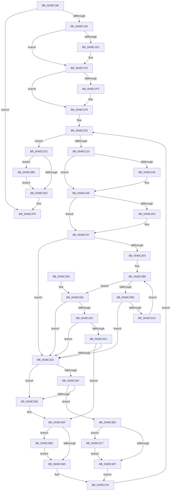

# SepDeleteSessionLowboxEntries

- RVA: `0x0048C188`–`0x0048C3D1` (길이 `585` bytes)
- VA: `0x000000014048C188`
- 실행 섹션: `.text`
- PDB 이름 있음: `예`; PDB Function 태그: `아니요`
- unwind 정보 RVA: `0x000B0E44`
- 디코드: `163`개 명령, `585/585` bytes 표시
- 미해석 바이트: `0` (있으면 어셈블리에 `.byte`로 보존)

> 이 문서는 커널 이미지의 기계어와 PDB 기호를 분석해 생성했습니다. 4번과 5번은 함수 원형과 자료형을 바이너리 사용 방식에서 추정한 C 해석이며 원본 소스 복구 결과는 아닙니다.

## 1. Dependencies

- 직접 호출 지점: **16**; 고유 호출 대상: **7**
- 직접 호출자로 확인된 함수: **2**
- RIP 상대 이미지 참조: **3**

### Outgoing calls
- `0x0048C1D2` → [KeAbPreAcquire](../21/KeAbPreAcquire_function_00210230.md) (function, `0x00210230`)
- `0x0048C1EB` → [ExfAcquirePushLockExclusiveEx](../20/ExfAcquirePushLockExclusiveEx_function_0020FC90.md) (function, `0x0020FC90`)
- `0x0048C230` → [KeAbPreAcquire](../21/KeAbPreAcquire_function_00210230.md) (function, `0x00210230`)
- `0x0048C249` → [ExfAcquirePushLockExclusiveEx](../20/ExfAcquirePushLockExclusiveEx_function_0020FC90.md) (function, `0x0020FC90`)
- `0x0048C2E6` → [KeAbPostRelease](../2E/KeAbPostRelease_function_002E1600.md) (function, `0x002E1600`)
- `0x0048C2EB` → [KeLeaveCriticalRegion](../25/KeLeaveCriticalRegion_function_0025D8B0.md) (function, `0x0025D8B0`)
- `0x0048C336` → [RtlDeleteHashTable](RtlDeleteHashTable_function_0048C570.md) (function, `0x0048C570`)
- `0x0048C341` → [ExFreePoolWithTag](../../poolcode/B8/ExFreePoolWithTag_function_00B82870.md) (function, `0x00B82870`)
- `0x0048C370` → [KeAbPostRelease](../2E/KeAbPostRelease_function_002E1600.md) (function, `0x002E1600`)
- `0x0048C375` → [KeLeaveCriticalRegion](../25/KeLeaveCriticalRegion_function_0025D8B0.md) (function, `0x0025D8B0`)
- `0x0048C39A` → [KeAbPostRelease](../2E/KeAbPostRelease_function_002E1600.md) (function, `0x002E1600`)
- `0x0048C39F` → [KeLeaveCriticalRegion](../25/KeLeaveCriticalRegion_function_0025D8B0.md) (function, `0x0025D8B0`)
- `0x0048C3A9` → [ExFreePoolWithTag](../../poolcode/B8/ExFreePoolWithTag_function_00B82870.md) (function, `0x00B82870`)
- `0x0048C3B3` → [ExfTryToWakePushLock](../26/ExfTryToWakePushLock_function_00265DD0.md) (function, `0x00265DD0`)
- `0x0048C3C0` → [ExfTryToWakePushLock](../26/ExfTryToWakePushLock_function_00265DD0.md) (function, `0x00265DD0`)
- `0x0048C3CA` → [ExfTryToWakePushLock](../26/ExfTryToWakePushLock_function_00265DD0.md) (function, `0x00265DD0`)

### Direct callers
- [SepDeleteLogonSessionTrack](../../page/AA/SepDeleteLogonSessionTrack_function_00AA04E0.md) at `0x00AA0684`
- [SepDeReferenceLogonSession](../../page/AF/SepDeReferenceLogonSession_function_00AF25EC.md) at `0x00AF2824`

### Static image references
- `0x0048C1A0` → RVA `0x00F0FE80` (`.data`; read)
- `0x0048C1B7` → RVA `0x00F0FE88` (`.data`; read)
- `0x0048C2CE` → RVA `0x00F0FE88` (`.data`; read/write)

## 2. Other-region calls and transfers

- 다른 실행 섹션으로 향하는 call: **2**
  - `0x0048C341` → [ExFreePoolWithTag](../../poolcode/B8/ExFreePoolWithTag_function_00B82870.md) (`.text` → `POOLCODE`)
  - `0x0048C3A9` → [ExFreePoolWithTag](../../poolcode/B8/ExFreePoolWithTag_function_00B82870.md) (`.text` → `POOLCODE`)
- 별도 외부 분기/꼬리 이동을 확인하지 못했습니다.

## 3. Assembly (complete function range)

```asm
0048C188  48 89 5C 24 10                  mov qword ptr [rsp + 0x10], rbx
0048C18D  48 89 6C 24 18                  mov qword ptr [rsp + 0x18], rbp
0048C192  48 89 74 24 20                  mov qword ptr [rsp + 0x20], rsi
0048C197  57                              push rdi
0048C198  41 56                           push r14
0048C19A  41 57                           push r15
0048C19C  48 83 EC 20                     sub rsp, 0x20
0048C1A0  48 83 3D D8 3C A8 00 00         cmp qword ptr [rip + 0xa83cd8], 0
0048C1A8  0F 84 42 01 00 00               je 0x14048c2f0
0048C1AE  65 48 8B 04 25 88 01 00 00      mov rax, qword ptr gs:[0x188]
0048C1B7  4C 8D 3D CA 3C A8 00            lea r15, [rip + 0xa83cca]
0048C1BE  48 83 CB FF                     or rbx, 0xffffffffffffffff
0048C1C2  45 33 C0                        xor r8d, r8d
0048C1C5  33 D2                           xor edx, edx
0048C1C7  49 8B CF                        mov rcx, r15
0048C1CA  66 01 98 E4 01 00 00            add word ptr [rax + 0x1e4], bx
0048C1D1  90                              nop
0048C1D2  E8 59 40 D8 FF                  call 0x140210230
0048C1D7  F0 49 0F BA 2F 00               lock bts qword ptr [r15], 0
0048C1DD  48 8B F8                        mov rdi, rax
0048C1E0  73 0E                           jae 0x14048c1f0
0048C1E2  4D 8B C7                        mov r8, r15
0048C1E5  48 8B D0                        mov rdx, rax
0048C1E8  49 8B CF                        mov rcx, r15
0048C1EB  E8 A0 3A D8 FF                  call 0x14020fc90
0048C1F0  48 85 FF                        test rdi, rdi
0048C1F3  74 04                           je 0x14048c1f9
0048C1F5  C6 47 0A 01                     mov byte ptr [rdi + 0xa], 1
0048C1F9  48 8B 05 80 3C A8 00            mov rax, qword ptr [rip + 0xa83c80]
0048C200  48 8B 30                        mov rsi, qword ptr [rax]
0048C203  48 3B 35 76 3C A8 00            cmp rsi, qword ptr [rip + 0xa83c76]
0048C20A  0F 84 BE 00 00 00               je 0x14048c2ce
0048C210  65 48 8B 04 25 88 01 00 00      mov rax, qword ptr gs:[0x188]
0048C219  48 8D 7E 18                     lea rdi, [rsi + 0x18]
0048C21D  4C 8B 36                        mov r14, qword ptr [rsi]
0048C220  45 33 C0                        xor r8d, r8d
0048C223  33 D2                           xor edx, edx
0048C225  48 8B CF                        mov rcx, rdi
0048C228  66 01 98 E4 01 00 00            add word ptr [rax + 0x1e4], bx
0048C22F  90                              nop
0048C230  E8 FB 3F D8 FF                  call 0x140210230
0048C235  F0 48 0F BA 2F 00               lock bts qword ptr [rdi], 0
0048C23B  48 8B E8                        mov rbp, rax
0048C23E  73 0E                           jae 0x14048c24e
0048C240  4C 8B C7                        mov r8, rdi
0048C243  48 8B D0                        mov rdx, rax
0048C246  48 8B CF                        mov rcx, rdi
0048C249  E8 42 3A D8 FF                  call 0x14020fc90
0048C24E  48 85 ED                        test rbp, rbp
0048C251  74 04                           je 0x14048c257
0048C253  C6 45 0A 01                     mov byte ptr [rbp + 0xa], 1
0048C257  44 8B 47 08                     mov r8d, dword ptr [rdi + 8]
0048C25B  4C 8B 4F 10                     mov r9, qword ptr [rdi + 0x10]
0048C25F  49 8B C9                        mov rcx, r9
0048C262  83 E1 04                        and ecx, 4
0048C265  8B C1                           mov eax, ecx
0048C267  41 8D 68 FF                     lea ebp, [r8 - 1]
0048C26B  48 F7 D8                        neg rax
0048C26E  45 1B D2                        sbb r10d, r10d
0048C271  41 83 E2 20                     and r10d, 0x20
0048C275  48 F7 D9                        neg rcx
0048C278  48 1B C0                        sbb rax, rax
0048C27B  83 64 24 40 00                  and dword ptr [rsp + 0x40], 0
0048C280  83 E0 04                        and eax, 4
0048C283  41 03 EA                        add ebp, r10d
0048C286  4C 2B C8                        sub r9, rax
0048C289  41 83 F8 01                     cmp r8d, 1
0048C28D  0F 82 9F 00 00 00               jb 0x14048c332
0048C293  8B C5                           mov eax, ebp
0048C295  41 8B CA                        mov ecx, r10d
0048C298  48 C1 E8 06                     shr rax, 6
0048C29C  41 B8 01 00 00 00               mov r8d, 1
0048C2A2  49 D3 E0                        shl r8, cl
0048C2A5  49 8B D1                        mov rdx, r9
0048C2A8  49 FF C8                        dec r8
0048C2AB  4D 8D 1C C1                     lea r11, [r9 + rax*8]
0048C2AF  49 8B 01                        mov rax, qword ptr [r9]
0048C2B2  48 F7 D0                        not rax
0048C2B5  4C 0B C0                        or r8, rax
0048C2B8  4C 3B C3                        cmp r8, rbx
0048C2BB  75 4D                           jne 0x14048c30a
0048C2BD  48 83 C2 08                     add rdx, 8
0048C2C1  49 3B D3                        cmp rdx, r11
0048C2C4  77 6C                           ja 0x14048c332
0048C2C6  4C 8B 02                        mov r8, qword ptr [rdx]
0048C2C9  49 F7 D0                        not r8
0048C2CC  EB EA                           jmp 0x14048c2b8
0048C2CE  F0 48 0F C1 1D B1 3B A8 00      lock xadd qword ptr [rip + 0xa83bb1], rbx
0048C2D7  80 E3 06                        and bl, 6
0048C2DA  80 FB 02                        cmp bl, 2
0048C2DD  0F 84 CD 00 00 00               je 0x14048c3b0
0048C2E3  49 8B CF                        mov rcx, r15
0048C2E6  E8 15 53 E5 FF                  call 0x1402e1600
0048C2EB  E8 C0 15 DD FF                  call 0x14025d8b0
0048C2F0  48 8B 5C 24 48                  mov rbx, qword ptr [rsp + 0x48]
0048C2F5  48 8B 6C 24 50                  mov rbp, qword ptr [rsp + 0x50]
0048C2FA  48 8B 74 24 58                  mov rsi, qword ptr [rsp + 0x58]
0048C2FF  48 83 C4 20                     add rsp, 0x20
0048C303  41 5F                           pop r15
0048C305  41 5E                           pop r14
0048C307  5F                              pop rdi
0048C308  C3                              ret
0048C309  CC                              int3
0048C30A  49 2B D1                        sub rdx, r9
0048C30D  49 F7 D0                        not r8
0048C310  49 0F BC C0                     bsf rax, r8
0048C314  48 C1 FA 03                     sar rdx, 3
0048C318  C1 E2 06                        shl edx, 6
0048C31B  03 D0                           add edx, eax
0048C31D  89 44 24 40                     mov dword ptr [rsp + 0x40], eax
0048C321  3B D5                           cmp edx, ebp
0048C323  77 0D                           ja 0x14048c332
0048C325  83 FA FF                        cmp edx, -1
0048C328  74 08                           je 0x14048c332
0048C32A  41 2B D2                        sub edx, r10d
0048C32D  83 FA FF                        cmp edx, -1
0048C330  75 2D                           jne 0x14048c35f
0048C332  48 8B 4F 18                     mov rcx, qword ptr [rdi + 0x18]
0048C336  E8 35 02 00 00                  call 0x14048c570
0048C33B  48 8B 4F 10                     mov rcx, qword ptr [rdi + 0x10]
0048C33F  33 D2                           xor edx, edx
0048C341  E8 2A 65 6F 00                  call 0x140b82870
0048C346  48 8B 0E                        mov rcx, qword ptr [rsi]
0048C349  48 39 71 08                     cmp qword ptr [rcx + 8], rsi
0048C34D  75 09                           jne 0x14048c358
0048C34F  48 8B 46 08                     mov rax, qword ptr [rsi + 8]
0048C353  48 39 30                        cmp qword ptr [rax], rsi
0048C356  74 2A                           je 0x14048c382
0048C358  B9 03 00 00 00                  mov ecx, 3
0048C35D  CD 29                           int 0x29
0048C35F  48 8B C3                        mov rax, rbx
0048C362  F0 48 0F C1 07                  lock xadd qword ptr [rdi], rax
0048C367  24 06                           and al, 6
0048C369  3C 02                           cmp al, 2
0048C36B  74 50                           je 0x14048c3bd
0048C36D  48 8B CF                        mov rcx, rdi
0048C370  E8 8B 52 E5 FF                  call 0x1402e1600
0048C375  E8 36 15 DD FF                  call 0x14025d8b0
0048C37A  49 8B F6                        mov rsi, r14
0048C37D  E9 81 FE FF FF                  jmp 0x14048c203
0048C382  48 89 08                        mov qword ptr [rax], rcx
0048C385  48 89 41 08                     mov qword ptr [rcx + 8], rax
0048C389  48 8B C3                        mov rax, rbx
0048C38C  F0 48 0F C1 07                  lock xadd qword ptr [rdi], rax
0048C391  24 06                           and al, 6
0048C393  3C 02                           cmp al, 2
0048C395  74 30                           je 0x14048c3c7
0048C397  48 8B CF                        mov rcx, rdi
0048C39A  E8 61 52 E5 FF                  call 0x1402e1600
0048C39F  E8 0C 15 DD FF                  call 0x14025d8b0
0048C3A4  33 D2                           xor edx, edx
0048C3A6  48 8B CE                        mov rcx, rsi
0048C3A9  E8 C2 64 6F 00                  call 0x140b82870
0048C3AE  EB CA                           jmp 0x14048c37a
0048C3B0  49 8B CF                        mov rcx, r15
0048C3B3  E8 18 9A DD FF                  call 0x140265dd0
0048C3B8  E9 26 FF FF FF                  jmp 0x14048c2e3
0048C3BD  48 8B CF                        mov rcx, rdi
0048C3C0  E8 0B 9A DD FF                  call 0x140265dd0
0048C3C5  EB A6                           jmp 0x14048c36d
0048C3C7  48 8B CF                        mov rcx, rdi
0048C3CA  E8 01 9A DD FF                  call 0x140265dd0
0048C3CF  EB C6                           jmp 0x14048c397
```

## 4. C-style interpretation (structured pseudocode)

```c
__int64 __fastcall SepDeleteSessionLowboxEntries(__int64 a1, int a2, int a3)
{
    __int64 result;
    __int64 v_r10;
    __int64 v_rbp;
    __int64 v_rbx;
    __int64 v_rsp;
    unsigned __int64 v_stack_p10;
    unsigned __int64 v_stack_p18;
    unsigned __int64 v_stack_p20;
    unsigned int v_stack_p40;
    unsigned int v_stack_p8;

    v_stack_p10 = v_rbx;
    v_stack_p18 = v_rbp;
    v_stack_p20 = v_rsi;
    v_rsp = (v_rsp) - (32);
    if ((*(unsigned __int64 *)(v_rip + 11025624)) == 0) goto loc_0048C2F0;
    v_rbx = (v_rbx) | (-1);
    a3 = 0;
    a2 = 0;
    result = KeAbPreAcquire(v_rip + 11025610, a2, a3, a4);
    if (!(condition_is_above_or_equal)) {
        a3 = v_rip + 11025610;
        a2 = result;
        a1 = v_rip + 11025610;
        result = ExfAcquirePushLockExclusiveEx(a1, a2, a3, a4);
    }
    if (result != 0) {
        *(unsigned __int8 *)(result + 10) = 1;
    }
loc_0048C203:
    if ((*(unsigned __int64 *)(*(unsigned __int64 *)(v_rip + 11025536))) == (*(unsigned __int64 *)(v_rip + 11025526))) goto loc_0048C2CE;
    a3 = 0;
    a2 = 0;
    result = KeAbPreAcquire(*(unsigned __int64 *)(*(unsigned __int64 *)(v_rip + 11025536)) + 24, a2, a3, a4);
    if (!(condition_is_above_or_equal)) {
        a3 = *(unsigned __int64 *)(*(unsigned __int64 *)(v_rip + 11025536)) + 24;
        a2 = result;
        a1 = *(unsigned __int64 *)(*(unsigned __int64 *)(v_rip + 11025536)) + 24;
        result = ExfAcquirePushLockExclusiveEx(a1, a2, a3, a4);
    }
    if (result != 0) {
        *(unsigned __int8 *)(result + 10) = 1;
    }
    a1 = (unsigned int)((*(unsigned __int64 *)(*(unsigned __int64 *)(*(unsigned __int64 *)(v_rip + 11025536)) + 24 + 16)) & (4));
    result = -((unsigned int)((unsigned int)(a1)));
    v_r10 = (unsigned int)((v_r10) & (32));
    a1 = -(a1);
    result = (unsigned int)((result) & (4));
    v_rbp = (unsigned int)(((unsigned int)(*(unsigned int *)(*(unsigned __int64 *)(*(unsigned __int64 *)(v_rip + 11025536)) + 24 + 8)) - 1) + ((unsigned int)(v_r10)));
    a4 = (*(unsigned __int64 *)(*(unsigned __int64 *)(*(unsigned __int64 *)(v_rip + 11025536)) + 24 + 16)) - (result);
    if (((unsigned int)((unsigned int)(*(unsigned int *)(*(unsigned __int64 *)(*(unsigned __int64 *)(v_rip + 11025536)) + 24 + 8)))) < 1) goto loc_0048C332;
    result = ((unsigned int)((unsigned int)(v_rbp))) >> (6);
    a3 = (1) << ((unsigned __int8)((unsigned int)((unsigned int)(v_r10))));
    a3 = (a3) - 1;
    result = ~(*(unsigned __int64 *)(a4));
    a3 = (a3) | (result);
loc_0048C2B8:
    if (a3 != v_rbx) goto loc_0048C30A;
    a2 = (a4) + (8);
    if (a2 > (a4 + result * 8)) goto loc_0048C332;
    a3 = ~(*(unsigned __int64 *)(a2));
    goto loc_0048C2B8;
loc_0048C2CE:
    v_rbx = (unsigned __int8)((v_rbx) & (6));
    if (((unsigned __int8)(v_rbx)) == 2) goto loc_0048C3B0;
loc_0048C2E3:
    result = KeAbPostRelease(v_rip + 11025610, a2, a3, a4);
    result = KeLeaveCriticalRegion(v_rip + 11025610, a2, a3, a4);
loc_0048C2F0:
    v_rsp = (v_rsp) + (32);
    return result;
loc_0048C30A:
    a2 = (a2) - (a4);
    a3 = ~(a3);
    a2 = (a2) >> (3);
    a2 = (unsigned int)((a2) << (6));
    a2 = (unsigned int)((a2) + ((unsigned int)(result)));
    v_stack_p40 = (unsigned int)(result);
    if (a2 > ((unsigned int)(v_stack_p18))) goto loc_0048C332;
    if (a2 == -1) goto loc_0048C332;
    a2 = (unsigned int)((a2) - ((unsigned int)(v_r10)));
    if (a2 != -1) goto loc_0048C35F;
loc_0048C332:
    result = RtlDeleteHashTable(*(unsigned __int64 *)(*(unsigned __int64 *)(*(unsigned __int64 *)(v_rip + 11025536)) + 24 + 24), a2, a3, a4);
    a2 = 0;
    result = ExFreePoolWithTag(*(unsigned __int64 *)(*(unsigned __int64 *)(*(unsigned __int64 *)(v_rip + 11025536)) + 24 + 16), a2, a3, a4);
    if ((*(unsigned __int64 *)(*(unsigned __int64 *)(v_stack_p20) + 8)) != v_stack_p20) goto loc_0048C358;
    if ((*(unsigned __int64 *)(*(unsigned __int64 *)(v_stack_p20 + 8))) == v_stack_p20) goto loc_0048C382;
loc_0048C358:
loc_0048C35F:
    result = (unsigned __int8)((v_stack_p10) & (6));
    if (((unsigned __int8)(result)) == 2) goto loc_0048C3BD;
loc_0048C36D:
    result = KeAbPostRelease(*(unsigned __int64 *)(*(unsigned __int64 *)(v_rip + 11025536)) + 24, a2, a3, a4);
    result = KeLeaveCriticalRegion(*(unsigned __int64 *)(*(unsigned __int64 *)(v_rip + 11025536)) + 24, a2, a3, a4);
loc_0048C37A:
    goto loc_0048C203;
loc_0048C382:
    *(unsigned __int64 *)(result) = *(unsigned __int64 *)(*(unsigned __int64 *)(v_rip + 11025536)) + 24;
    *(unsigned __int64 *)(*(unsigned __int64 *)(*(unsigned __int64 *)(v_rip + 11025536)) + 24 + 8) = result;
    result = (unsigned __int8)((v_stack_p10) & (6));
    if (((unsigned __int8)(result)) == 2) goto loc_0048C3C7;
loc_0048C397:
    result = KeAbPostRelease(*(unsigned __int64 *)(*(unsigned __int64 *)(v_rip + 11025536)) + 24, a2, a3, a4);
    result = KeLeaveCriticalRegion(*(unsigned __int64 *)(*(unsigned __int64 *)(v_rip + 11025536)) + 24, a2, a3, a4);
    a2 = 0;
    result = ExFreePoolWithTag(*(unsigned __int64 *)(*(unsigned __int64 *)(*(unsigned __int64 *)(v_rip + 11025536))), a2, a3, a4);
    goto loc_0048C37A;
loc_0048C3B0:
    result = ExfTryToWakePushLock(v_rip + 11025610, a2, a3, a4);
    goto loc_0048C2E3;
loc_0048C3BD:
    result = ExfTryToWakePushLock(*(unsigned __int64 *)(*(unsigned __int64 *)(v_rip + 11025536)) + 24, a2, a3, a4);
    goto loc_0048C36D;
loc_0048C3C7:
    result = ExfTryToWakePushLock(*(unsigned __int64 *)(*(unsigned __int64 *)(v_rip + 11025536)) + 24, a2, a3, a4);
    goto loc_0048C397;
}
```

## 5. (Beta) C Style

```c
int64_t SepDeleteSessionLowboxEntries(int64_t Arg1, int32_t Arg2, int32_t Arg3)
{
    int64_t result;
    int64_t local_r10;
    int64_t local_rbp;
    int64_t local_rbx;
    int64_t local_rsp;
    uint64_t v_stack_p10;
    uint64_t v_stack_p18;
    uint64_t v_stack_p20;
    uint32_t v_stack_p40;
    uint32_t v_stack_p8;

    v_stack_p10 = local_rbx;
    v_stack_p18 = local_rbp;
    v_stack_p20 = local_rsi;
    local_rsp = (local_rsp) - (32);
    if ((*(uint64_t *)(v_rip + 0xA83CD8)) == 0) goto loc_0048C2F0;
    local_rbx = (local_rbx) | (-1);
    Arg3 = 0;
    Arg2 = 0;
    result = KeAbPreAcquire(v_rip + 11025610, Arg2, Arg3, a4);
    if (!(condition_is_above_or_equal)) {
        Arg3 = v_rip + 11025610;
        Arg2 = result;
        Arg1 = v_rip + 11025610;
        result = ExfAcquirePushLockExclusiveEx(Arg1, Arg2, Arg3, a4);
    }
    if (result != 0) {
        *(uint8_t *)(result + 0xA) = 1;
    }
loc_0048C203:
    if ((*(uint64_t *)(*(uint64_t *)(v_rip + 0xA83C80))) == (*(uint64_t *)(v_rip + 0xA83C76))) goto loc_0048C2CE;
    Arg3 = 0;
    Arg2 = 0;
    result = KeAbPreAcquire(*(uint64_t *)(*(uint64_t *)(v_rip + 0xA83C80)) + 24, Arg2, Arg3, a4);
    if (!(condition_is_above_or_equal)) {
        Arg3 = *(uint64_t *)(*(uint64_t *)(v_rip + 0xA83C80)) + 24;
        Arg2 = result;
        Arg1 = *(uint64_t *)(*(uint64_t *)(v_rip + 0xA83C80)) + 24;
        result = ExfAcquirePushLockExclusiveEx(Arg1, Arg2, Arg3, a4);
    }
    if (result != 0) {
        *(uint8_t *)(result + 0xA) = 1;
    }
    Arg1 = (uint32_t)((*(uint64_t *)(*(uint64_t *)(*(uint64_t *)(v_rip + 0xA83C80)) + 0x18 + 0x10)) & (4));
    result = -((uint32_t)((uint32_t)(Arg1)));
    local_r10 = (uint32_t)((local_r10) & (32));
    Arg1 = -(Arg1);
    result = (uint32_t)((result) & (4));
    local_rbp = (uint32_t)(((uint32_t)(*(uint32_t *)(*(uint64_t *)(*(uint64_t *)(v_rip + 0xA83C80)) + 0x18 + 0x8)) - 1) + ((uint32_t)(local_r10)));
    a4 = (*(uint64_t *)(*(uint64_t *)(*(uint64_t *)(v_rip + 0xA83C80)) + 0x18 + 0x10)) - (result);
    if (((uint32_t)((uint32_t)(*(uint32_t *)(*(uint64_t *)(*(uint64_t *)(v_rip + 0xA83C80)) + 0x18 + 0x8)))) < 1) goto loc_0048C332;
    result = ((uint32_t)((uint32_t)(local_rbp))) >> (6);
    Arg3 = (1) << ((uint8_t)((uint32_t)((uint32_t)(local_r10))));
    Arg3 = (Arg3) - 1;
    result = ~(*(uint64_t *)(a4));
    Arg3 = (Arg3) | (result);
loc_0048C2B8:
    if (Arg3 != local_rbx) goto loc_0048C30A;
    Arg2 = (a4) + (8);
    if (Arg2 > (a4 + result * 8)) goto loc_0048C332;
    Arg3 = ~(*(uint64_t *)(Arg2));
    goto loc_0048C2B8;
loc_0048C2CE:
    local_rbx = (uint8_t)((local_rbx) & (6));
    if (((uint8_t)(local_rbx)) == 2) goto loc_0048C3B0;
loc_0048C2E3:
    result = KeAbPostRelease(v_rip + 11025610, Arg2, Arg3, a4);
    result = KeLeaveCriticalRegion(v_rip + 11025610, Arg2, Arg3, a4);
loc_0048C2F0:
    local_rsp = (local_rsp) + (32);
    return result;
loc_0048C30A:
    Arg2 = (Arg2) - (a4);
    Arg3 = ~(Arg3);
    Arg2 = (Arg2) >> (3);
    Arg2 = (uint32_t)((Arg2) << (6));
    Arg2 = (uint32_t)((Arg2) + ((uint32_t)(result)));
    v_stack_p40 = (uint32_t)(result);
    if (Arg2 > ((uint32_t)(v_stack_p18))) goto loc_0048C332;
    if (Arg2 == -1) goto loc_0048C332;
    Arg2 = (uint32_t)((Arg2) - ((uint32_t)(local_r10)));
    if (Arg2 != -1) goto loc_0048C35F;
loc_0048C332:
    result = RtlDeleteHashTable(*(uint64_t *)(*(uint64_t *)(*(uint64_t *)(v_rip + 0xA83C80)) + 0x18 + 0x18), Arg2, Arg3, a4);
    Arg2 = 0;
    result = ExFreePoolWithTag(*(uint64_t *)(*(uint64_t *)(*(uint64_t *)(v_rip + 0xA83C80)) + 0x18 + 0x10), Arg2, Arg3, a4);
    if ((*(uint64_t *)(*(uint64_t *)(v_stack_p20) + 0x8)) != v_stack_p20) goto loc_0048C358;
    if ((*(uint64_t *)(*(uint64_t *)(v_stack_p20 + 0x8))) == v_stack_p20) goto loc_0048C382;
loc_0048C358:
loc_0048C35F:
    result = (uint8_t)((v_stack_p10) & (6));
    if (((uint8_t)(result)) == 2) goto loc_0048C3BD;
loc_0048C36D:
    result = KeAbPostRelease(*(uint64_t *)(*(uint64_t *)(v_rip + 0xA83C80)) + 24, Arg2, Arg3, a4);
    result = KeLeaveCriticalRegion(*(uint64_t *)(*(uint64_t *)(v_rip + 0xA83C80)) + 24, Arg2, Arg3, a4);
loc_0048C37A:
    goto loc_0048C203;
loc_0048C382:
    *(uint64_t *)(result) = *(uint64_t *)(*(uint64_t *)(v_rip + 0xA83C80)) + 24;
    *(uint64_t *)(*(uint64_t *)(*(uint64_t *)(v_rip + 0xA83C80)) + 0x18 + 0x8) = result;
    result = (uint8_t)((v_stack_p10) & (6));
    if (((uint8_t)(result)) == 2) goto loc_0048C3C7;
loc_0048C397:
    result = KeAbPostRelease(*(uint64_t *)(*(uint64_t *)(v_rip + 0xA83C80)) + 24, Arg2, Arg3, a4);
    result = KeLeaveCriticalRegion(*(uint64_t *)(*(uint64_t *)(v_rip + 0xA83C80)) + 24, Arg2, Arg3, a4);
    Arg2 = 0;
    result = ExFreePoolWithTag(*(uint64_t *)(*(uint64_t *)(*(uint64_t *)(v_rip + 0xA83C80))), Arg2, Arg3, a4);
    goto loc_0048C37A;
loc_0048C3B0:
    result = ExfTryToWakePushLock(v_rip + 11025610, Arg2, Arg3, a4);
    goto loc_0048C2E3;
loc_0048C3BD:
    result = ExfTryToWakePushLock(*(uint64_t *)(*(uint64_t *)(v_rip + 0xA83C80)) + 24, Arg2, Arg3, a4);
    goto loc_0048C36D;
loc_0048C3C7:
    result = ExfTryToWakePushLock(*(uint64_t *)(*(uint64_t *)(v_rip + 0xA83C80)) + 24, Arg2, Arg3, a4);
    goto loc_0048C397;
}
```

## 6. Execution-region graph

[열기: 2D/3D 그래프와 함수 탐색 컨트롤 패널](../../../control-panel.html?section=text&rva=0x0048C188&view=graph)

- 2D 그래프는 위에서 아래로 흐르고, 3D 그래프는 빈 공간을 드래그해 회전합니다. Shift+드래그는 이동, 휠은 확대·축소, 함수 노드 선택은 대상 보고서 이동입니다.

### Static fallback


