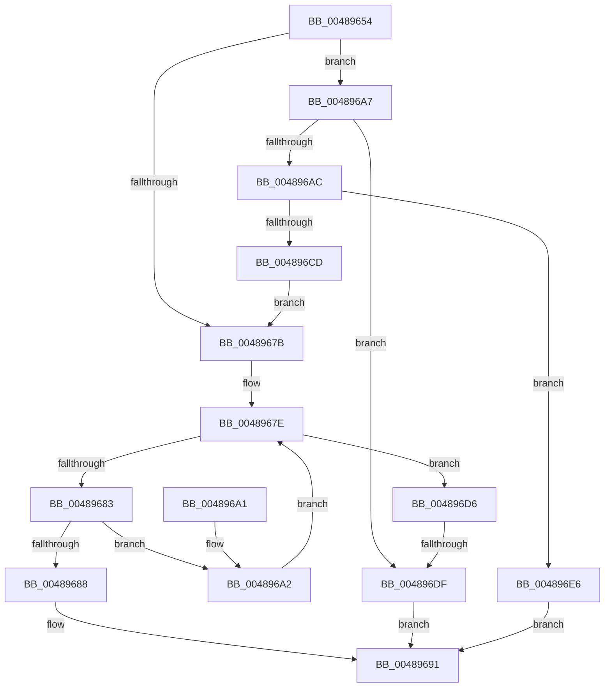

# SepGetTokenSessionMapEntry

- RVA: `0x00489654`–`0x004896ED` (길이 `153` bytes)
- VA: `0x0000000140489654`
- 실행 섹션: `.text`
- PDB 이름 있음: `예`; PDB Function 태그: `예`
- unwind 정보 RVA: `0x0006D4EC`
- 디코드: `45`개 명령, `153/153` bytes 표시
- 미해석 바이트: `0` (있으면 어셈블리에 `.byte`로 보존)

> 이 문서는 커널 이미지의 기계어와 PDB 기호를 분석해 생성했습니다. 4번과 5번은 함수 원형과 자료형을 바이너리 사용 방식에서 추정한 C 해석이며 원본 소스 복구 결과는 아닙니다.

## 1. Dependencies

- 직접 호출 지점: **1**; 고유 호출 대상: **1**
- 직접 호출자로 확인된 함수: **4**
- RIP 상대 이미지 참조: **2**

### Outgoing calls
- `0x004896BC` → [ExAllocatePool2](../../poolcode/B8/ExAllocatePool2_function_00B820F0.md) (function, `0x00B820F0`)

### Direct callers
- [SepSetTokenLowboxNumberEntry](../60/SepSetTokenLowboxNumberEntry_function_0060B594.md) at `0x0060B64B`
- [SepSetTokenLowboxNumberEntry](../60/SepSetTokenLowboxNumberEntry_function_0060B594.md) at `0x0060B6DB`
- [SepIsParentOfChildAppContainer](../../page/7A/SepIsParentOfChildAppContainer_function_007A34C0.md) at `0x007A358B`
- [SepDereferenceLowBoxNumberEntry](../../page/A5/SepDereferenceLowBoxNumberEntry_function_00A55DBC.md) at `0x00A55EFC`
- [SepSetTokenLowboxNumber](../../page/A6/SepSetTokenLowboxNumber_function_00A64D6C.md) at `0x00A64F22`
- [SepSetTokenLowboxNumber](../../page/A6/SepSetTokenLowboxNumber_function_00A64D6C.md) at `0x00A64FB2`

### Static image references
- `0x0048966A` → RVA `0x00F0FE80` (`.data`; read)
- `0x004896C1` → RVA `0x00F0FE80` (`.data`; write)

## 2. Other-region calls and transfers

- 다른 실행 섹션으로 향하는 call: **1**
  - `0x004896BC` → [ExAllocatePool2](../../poolcode/B8/ExAllocatePool2_function_00B820F0.md) (`.text` → `POOLCODE`)
- call이 아닌 외부 분기/꼬리 이동: **1**
  - `0x004896D9` → [sub_006F5F88](../6F/Unknown_function_006F5F88.md) (`tail-transfer`)

## 3. Assembly (complete function range)

```asm
00489654  48 89 5C 24 08                  mov qword ptr [rsp + 8], rbx
00489659  48 89 74 24 10                  mov qword ptr [rsp + 0x10], rsi
0048965E  57                              push rdi
0048965F  48 83 EC 20                     sub rsp, 0x20
00489663  49 83 20 00                     and qword ptr [r8], 0
00489667  49 8B D8                        mov rbx, r8
0048966A  48 8B 05 0F 68 A8 00            mov rax, qword ptr [rip + 0xa8680f]
00489671  40 8A FA                        mov dil, dl
00489674  8B F1                           mov esi, ecx
00489676  48 85 C0                        test rax, rax
00489679  74 2C                           je 0x1404896a7
0048967B  48 8B 08                        mov rcx, qword ptr [rax]
0048967E  48 3B C8                        cmp rcx, rax
00489681  74 53                           je 0x1404896d6
00489683  39 71 10                        cmp dword ptr [rcx + 0x10], esi
00489686  75 1A                           jne 0x1404896a2
00489688  48 83 C1 18                     add rcx, 0x18
0048968C  48 89 0B                        mov qword ptr [rbx], rcx
0048968F  33 C0                           xor eax, eax
00489691  48 8B 5C 24 30                  mov rbx, qword ptr [rsp + 0x30]
00489696  48 8B 74 24 38                  mov rsi, qword ptr [rsp + 0x38]
0048969B  48 83 C4 20                     add rsp, 0x20
0048969F  5F                              pop rdi
004896A0  C3                              ret
004896A1  CC                              int3
004896A2  48 8B 09                        mov rcx, qword ptr [rcx]
004896A5  EB D7                           jmp 0x14048967e
004896A7  40 84 FF                        test dil, dil
004896AA  74 33                           je 0x1404896df
004896AC  BA 10 00 00 00                  mov edx, 0x10
004896B1  B9 00 01 00 00                  mov ecx, 0x100
004896B6  41 B8 53 65 4C 73               mov r8d, 0x734c6553
004896BC  E8 2F 8A 6F 00                  call 0x140b820f0
004896C1  48 89 05 B8 67 A8 00            mov qword ptr [rip + 0xa867b8], rax
004896C8  48 85 C0                        test rax, rax
004896CB  74 19                           je 0x1404896e6
004896CD  48 89 40 08                     mov qword ptr [rax + 8], rax
004896D1  48 89 00                        mov qword ptr [rax], rax
004896D4  EB A5                           jmp 0x14048967b
004896D6  40 84 FF                        test dil, dil
004896D9  0F 85 A9 C8 26 00               jne 0x1406f5f88
004896DF  B8 25 02 00 C0                  mov eax, 0xc0000225
004896E4  EB AB                           jmp 0x140489691
004896E6  B8 9A 00 00 C0                  mov eax, 0xc000009a
004896EB  EB A4                           jmp 0x140489691
```

## 4. C-style interpretation (structured pseudocode)

```c
__int64 __fastcall SepGetTokenSessionMapEntry(int a1, unsigned __int8 a2, __int64 a3)
{
    __int64 result;
    __int64 v_rsp;
    unsigned __int64 v_stack_p10;
    unsigned __int64 v_stack_p8;

    v_stack_p8 = v_rbx;
    v_stack_p10 = v_rsi;
    v_rsp = (v_rsp) - (32);
    if (*(unsigned __int64 *)(v_rip + 11036687) == 0) goto loc_004896A7;
loc_0048967B:
loc_0048967E:
    if ((*(unsigned __int64 *)(*(unsigned __int64 *)(v_rip + 11036687))) == (*(unsigned __int64 *)(v_rip + 11036687))) goto loc_004896D6;
    if ((*(unsigned int *)(*(unsigned __int64 *)(*(unsigned __int64 *)(v_rip + 11036687)) + 16)) != ((unsigned int)((unsigned int)(a1)))) goto loc_004896A2;
    a1 = (*(unsigned __int64 *)(*(unsigned __int64 *)(v_rip + 11036687))) + (24);
    *(unsigned __int64 *)(a3) = a1;
    result = 0;
loc_00489691:
    v_rsp = (v_rsp) + (32);
    return result;
loc_004896A2:
    goto loc_0048967E;
loc_004896A7:
    if (a2 == 0) goto loc_004896DF;
    result = ExAllocatePool2(256, 16, (unsigned int)(0x734C6553ULL), a4);
    *(unsigned __int64 *)(v_rip + 11036600) = result;
    if (result == 0) goto loc_004896E6;
    *(unsigned __int64 *)(result + 8) = result;
    *(unsigned __int64 *)(result) = result;
    goto loc_0048967B;
loc_004896D6:
loc_004896DF:
    goto loc_00489691;
loc_004896E6:
    goto loc_00489691;
}
```

## 5. (Beta) C Style

```c
int64_t SepGetTokenSessionMapEntry(int32_t Arg1, uint8_t Arg2, void *Arg3)
{
    uint8_t *arg3 = (uint8_t *)Arg3;

    int64_t result;
    int64_t local_rsp;
    uint64_t v_stack_p10;
    uint64_t v_stack_p8;

    v_stack_p8 = local_rbx;
    v_stack_p10 = local_rsi;
    local_rsp = (local_rsp) - (32);
    if (*(uint64_t *)(v_rip + 0xA8680F) == 0) goto loc_004896A7;
loc_0048967B:
loc_0048967E:
    if ((*(uint64_t *)(*(uint64_t *)(v_rip + 0xA8680F))) == (*(uint64_t *)(v_rip + 0xA8680F))) goto loc_004896D6;
    if ((*(uint32_t *)(*(uint64_t *)(*(uint64_t *)(v_rip + 0xA8680F)) + 0x10)) != ((uint32_t)((uint32_t)(Arg1)))) goto loc_004896A2;
    Arg1 = (*(uint64_t *)(*(uint64_t *)(v_rip + 0xA8680F))) + (24);
    *(uint64_t *)(arg3) = Arg1;
    result = 0;
loc_00489691:
    local_rsp = (local_rsp) + (32);
    return result;
loc_004896A2:
    goto loc_0048967E;
loc_004896A7:
    if (Arg2 == 0) goto loc_004896DF;
    result = ExAllocatePool2(256, 16, (uint32_t)(0x734C6553ULL), a4);
    *(uint64_t *)(v_rip + 0xA867B8) = result;
    if (result == 0) goto loc_004896E6;
    *(uint64_t *)(result + 0x8) = result;
    *(uint64_t *)(result) = result;
    goto loc_0048967B;
loc_004896D6:
loc_004896DF:
    goto loc_00489691;
loc_004896E6:
    goto loc_00489691;
}
```

### 관측된 메모리 오프셋

구조체 형식이 확인되지 않은 접근은 인자 기준의 오프셋으로만 기록했습니다.

| 기준 인자 | 오프셋 표현 | 폭 (bit) | 접근 |
|---|---:|---:|---|
| `Arg3` | `+ 0x0` | `64` | `R/W` |
| `Arg3` | `+ 0x0` | `64` | `W` |

## 6. Execution-region graph

[열기: 2D/3D 그래프와 함수 탐색 컨트롤 패널](../../../control-panel.html?section=text&rva=0x00489654&view=graph)

- 2D 그래프는 위에서 아래로 흐르고, 3D 그래프는 빈 공간을 드래그해 회전합니다. Shift+드래그는 이동, 휠은 확대·축소, 함수 노드 선택은 대상 보고서 이동입니다.

### Static fallback


