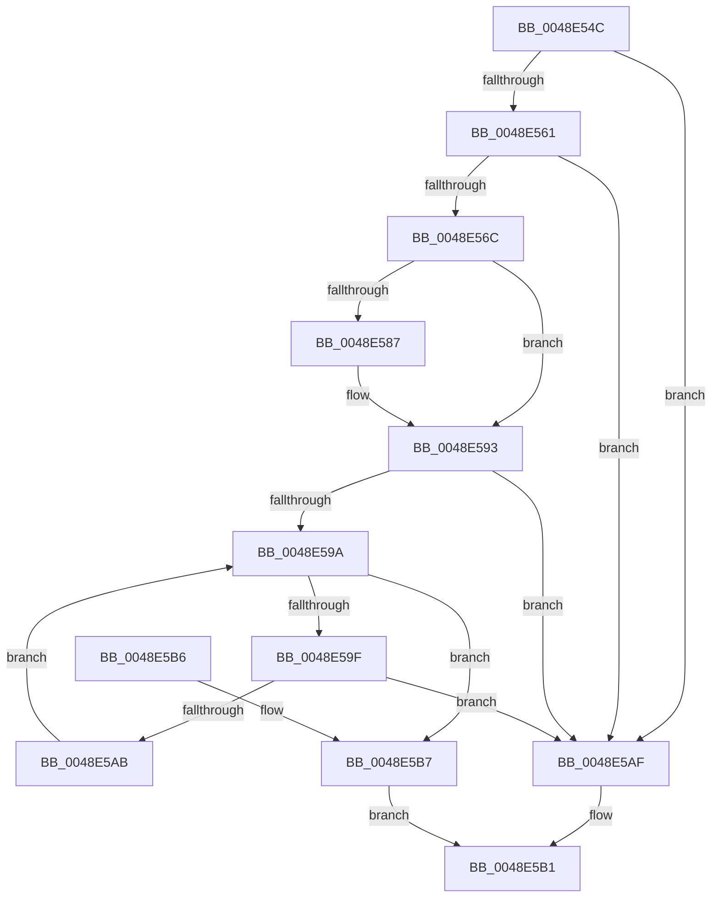

# SepIsAppSiloCapability

- RVA: `0x0048E54C`–`0x0048E5BB` (길이 `111` bytes)
- VA: `0x000000014048E54C`
- 실행 섹션: `.text`
- PDB 이름 있음: `예`; PDB Function 태그: `아니요`
- unwind 정보 RVA: `0x00069B1C`
- 디코드: `36`개 명령, `111/111` bytes 표시
- 미해석 바이트: `0` (있으면 어셈블리에 `.byte`로 보존)

> 이 문서는 커널 이미지의 기계어와 PDB 기호를 분석해 생성했습니다. 4번과 5번은 함수 원형과 자료형을 바이너리 사용 방식에서 추정한 C 해석이며 원본 소스 복구 결과는 아닙니다.

## 1. Dependencies

- 직접 호출 지점: **2**; 고유 호출 대상: **1**
- 직접 호출자로 확인된 함수: **2**
- RIP 상대 이미지 참조: **1**

### Outgoing calls
- `0x0048E56F` → [RtlIdentifierAuthoritySid](../../page/A7/RtlIdentifierAuthoritySid_function_00A76904.md) (function, `0x00A76904`)
- `0x0048E57A` → [RtlIdentifierAuthoritySid](../../page/A7/RtlIdentifierAuthoritySid_function_00A76904.md) (function, `0x00A76904`)

### Direct callers
- [SepCreateAppContainerToken](../4F/SepCreateAppContainerToken_function_004F43AC.md) at `0x004F465E`
- [NtCreateLowBoxToken](../../page/AB/NtCreateLowBoxToken_function_00AB9880.md) at `0x00AB9E84`

### Static image references
- `0x0048E550` → RVA `0x00E67BD8` (`.data`; read)

## 2. Other-region calls and transfers

- 다른 실행 섹션으로 향하는 call: **2**
  - `0x0048E56F` → [RtlIdentifierAuthoritySid](../../page/A7/RtlIdentifierAuthoritySid_function_00A76904.md) (`.text` → `PAGE`)
  - `0x0048E57A` → [RtlIdentifierAuthoritySid](../../page/A7/RtlIdentifierAuthoritySid_function_00A76904.md) (`.text` → `PAGE`)
- 별도 외부 분기/꼬리 이동을 확인하지 못했습니다.

## 3. Assembly (complete function range)

```asm
0048E54C  48 83 EC 28                     sub rsp, 0x28
0048E550  4C 8B 15 81 96 9D 00            mov r10, qword ptr [rip + 0x9d9681]
0048E557  4C 8B C9                        mov r9, rcx
0048E55A  41 8A 02                        mov al, byte ptr [r10]
0048E55D  38 01                           cmp byte ptr [rcx], al
0048E55F  75 4E                           jne 0x14048e5af
0048E561  45 0F B6 5A 01                  movzx r11d, byte ptr [r10 + 1]
0048E566  44 38 59 01                     cmp byte ptr [rcx + 1], r11b
0048E56A  76 43                           jbe 0x14048e5af
0048E56C  49 8B CA                        mov rcx, r10
0048E56F  E8 90 83 5E 00                  call 0x140a76904
0048E574  49 8B C9                        mov rcx, r9
0048E577  48 8B D0                        mov rdx, rax
0048E57A  E8 85 83 5E 00                  call 0x140a76904
0048E57F  44 8B 00                        mov r8d, dword ptr [rax]
0048E582  44 2B 02                        sub r8d, dword ptr [rdx]
0048E585  75 0C                           jne 0x14048e593
0048E587  44 0F B7 40 04                  movzx r8d, word ptr [rax + 4]
0048E58C  0F B7 42 04                     movzx eax, word ptr [rdx + 4]
0048E590  44 2B C0                        sub r8d, eax
0048E593  33 D2                           xor edx, edx
0048E595  45 85 C0                        test r8d, r8d
0048E598  75 15                           jne 0x14048e5af
0048E59A  41 3B D3                        cmp edx, r11d
0048E59D  73 18                           jae 0x14048e5b7
0048E59F  41 8B 44 92 08                  mov eax, dword ptr [r10 + rdx*4 + 8]
0048E5A4  41 39 44 91 08                  cmp dword ptr [r9 + rdx*4 + 8], eax
0048E5A9  75 04                           jne 0x14048e5af
0048E5AB  FF C2                           inc edx
0048E5AD  EB EB                           jmp 0x14048e59a
0048E5AF  32 C0                           xor al, al
0048E5B1  48 83 C4 28                     add rsp, 0x28
0048E5B5  C3                              ret
0048E5B6  CC                              int3
0048E5B7  B0 01                           mov al, 1
0048E5B9  EB F6                           jmp 0x14048e5b1
```

## 4. C-style interpretation (structured pseudocode)

```c
__int64 __fastcall SepIsAppSiloCapability(__int64 a1)
{
    __int64 result;
    __int64 v_rsp;

    v_rsp = (v_rsp) - (40);
    if ((*(unsigned __int8 *)(a1)) != ((unsigned __int8)(*(unsigned __int8 *)(*(unsigned __int64 *)(v_rip + 10327681))))) goto loc_0048E5AF;
    if ((*(unsigned __int8 *)(a1 + 1)) <= ((unsigned __int8)(*(unsigned __int8 *)(*(unsigned __int64 *)(v_rip + 10327681) + 1)))) goto loc_0048E5AF;
    result = RtlIdentifierAuthoritySid(*(unsigned __int64 *)(v_rip + 10327681), a2, a3, a1);
    result = RtlIdentifierAuthoritySid(a1, result, a3, a1);
    a3 = (unsigned int)(((unsigned int)(*(unsigned int *)(result))) - (*(unsigned int *)(result)));
    if (!(condition_is_not_equal)) {
        a3 = *(unsigned __int16 *)(result + 4);
        result = *(unsigned __int16 *)(result + 4);
        a3 = (unsigned int)((a3) - ((unsigned int)(result)));
    }
    a2 = 0;
    if ((unsigned int)(a3) != 0) goto loc_0048E5AF;
loc_0048E59A:
    if (0 >= ((unsigned int)(*(unsigned __int8 *)(*(unsigned __int64 *)(v_rip + 10327681) + 1)))) goto loc_0048E5B7;
    if ((*(unsigned int *)(a1 + a2 * 4 + 8)) != ((unsigned int)((unsigned int)(*(unsigned int *)(*(unsigned __int64 *)(v_rip + 10327681) + a2 * 4 + 8))))) goto loc_0048E5AF;
    a2 = (unsigned int)((a2) + 1);
    goto loc_0048E59A;
loc_0048E5AF:
    result = 0;
loc_0048E5B1:
    v_rsp = (v_rsp) + (40);
    return result;
loc_0048E5B7:
    goto loc_0048E5B1;
}
```

## 5. (Beta) C Style

```c
int64_t SepIsAppSiloCapability(void *Arg1)
{
    uint8_t *arg1 = (uint8_t *)Arg1;

    int64_t result;
    int64_t local_rsp;

    local_rsp = (local_rsp) - (40);
    if ((*(uint8_t *)(arg1)) != ((uint8_t)(*(uint8_t *)(*(uint64_t *)(v_rip + 0x9D9681))))) goto loc_0048E5AF;
    if ((*(uint8_t *)(arg1 + 0x1)) <= ((uint8_t)(*(uint8_t *)(*(uint64_t *)(v_rip + 0x9D9681) + 0x1)))) goto loc_0048E5AF;
    result = RtlIdentifierAuthoritySid(*(uint64_t *)(v_rip + 0x9D9681), a2, a3, Arg1);
    result = RtlIdentifierAuthoritySid(Arg1, result, a3, Arg1);
    a3 = (uint32_t)(((uint32_t)(*(uint32_t *)(result))) - (*(uint32_t *)(result)));
    if (!(condition_is_not_equal)) {
        a3 = *(uint16_t *)(result + 0x4);
        result = *(uint16_t *)(result + 0x4);
        a3 = (uint32_t)((a3) - ((uint32_t)(result)));
    }
    a2 = 0;
    if ((uint32_t)(a3) != 0) goto loc_0048E5AF;
loc_0048E59A:
    if (0 >= ((uint32_t)(*(uint8_t *)(*(uint64_t *)(v_rip + 0x9D9681) + 0x1)))) goto loc_0048E5B7;
    if ((*(uint32_t *)(arg1 + a2 * 4 + 0x8)) != ((uint32_t)((uint32_t)(*(uint32_t *)(*(uint64_t *)(v_rip + 0x9D9681) + a2 * 4 + 0x8))))) goto loc_0048E5AF;
    a2 = (uint32_t)((a2) + 1);
    goto loc_0048E59A;
loc_0048E5AF:
    result = 0;
loc_0048E5B1:
    local_rsp = (local_rsp) + (40);
    return result;
loc_0048E5B7:
    goto loc_0048E5B1;
}
```

### 관측된 메모리 오프셋

구조체 형식이 확인되지 않은 접근은 인자 기준의 오프셋으로만 기록했습니다.

| 기준 인자 | 오프셋 표현 | 폭 (bit) | 접근 |
|---|---:|---:|---|
| `Arg1` | `+ 0x0` | `8` | `R` |
| `Arg1` | `+ 0x1` | `8` | `R` |

## 6. Execution-region graph

[열기: 2D/3D 그래프와 함수 탐색 컨트롤 패널](../../../control-panel.html?section=text&rva=0x0048E54C&view=graph)

- 2D 그래프는 위에서 아래로 흐르고, 3D 그래프는 빈 공간을 드래그해 회전합니다. Shift+드래그는 이동, 휠은 확대·축소, 함수 노드 선택은 대상 보고서 이동입니다.

### Static fallback


