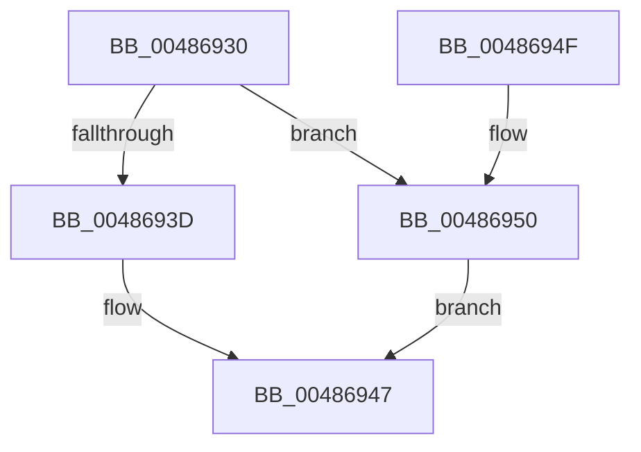

# SleepstudyHelperDestroyBlocker

- RVA: `0x00486930`–`0x00486957` (길이 `39` bytes)
- VA: `0x0000000140486930`
- 실행 섹션: `.text`
- PDB 이름 있음: `예`; PDB Function 태그: `아니요`
- unwind 정보 RVA: `0x0005DAC8`
- 디코드: `15`개 명령, `39/39` bytes 표시
- 미해석 바이트: `0` (있으면 어셈블리에 `.byte`로 보존)

> 이 문서는 커널 이미지의 기계어와 PDB 기호를 분석해 생성했습니다. 4번과 5번은 함수 원형과 자료형을 바이너리 사용 방식에서 추정한 C 해석이며 원본 소스 복구 결과는 아닙니다.

## 1. Dependencies

- 직접 호출 지점: **1**; 고유 호출 대상: **1**
- 직접 호출자로 확인된 함수: **6**
- RIP 상대 이미지 참조: **0**

### Outgoing calls
- `0x00486942` → [SshpDereferenceBlocker](SshpDereferenceBlocker_function_00486960.md) (function, `0x00486960`)

### Direct callers
- [SleepstudyHelper_UnregisterComponent](../5E/SleepstudyHelper_UnregisterComponent_function_005E20A0.md) at `0x005E20B0`
- [SleepstudyHelper_RegisterComponentEx](../../page/77/SleepstudyHelper_RegisterComponentEx_function_00774A50.md) at `0x00774AF1`
- [SleepstudyHelper_RegisterPdoWithParentGuid](../../page/77/SleepstudyHelper_RegisterPdoWithParentGuid_function_00774B30.md) at `0x00774BBE`
- [SleepstudyHelper_RegisterPdoWithParentHandle](../../page/77/SleepstudyHelper_RegisterPdoWithParentHandle_function_00774C00.md) at `0x00774CB9`
- [SleepstudyHelper_RegisterPdoWithParentPdo](../../page/77/SleepstudyHelper_RegisterPdoWithParentPdo_function_00774D00.md) at `0x00774D93`
- [PopPowerRequestDelete](../../page/91/PopPowerRequestDelete_function_00913030.md) at `0x0091310C`

### Static image references
- 디코드된 RIP-relative 메모리 참조가 없습니다.

## 2. Other-region calls and transfers

- 다른 실행 섹션으로 향하는 call: **0**
- 별도 외부 분기/꼬리 이동을 확인하지 못했습니다.

## 3. Assembly (complete function range)

```asm
00486930  40 53                           push rbx
00486932  48 83 EC 20                     sub rsp, 0x20
00486936  33 DB                           xor ebx, ebx
00486938  48 85 C9                        test rcx, rcx
0048693B  74 13                           je 0x140486950
0048693D  41 B0 01                        mov r8b, 1
00486940  33 D2                           xor edx, edx
00486942  E8 19 00 00 00                  call 0x140486960
00486947  8B C3                           mov eax, ebx
00486949  48 83 C4 20                     add rsp, 0x20
0048694D  5B                              pop rbx
0048694E  C3                              ret
0048694F  CC                              int3
00486950  BB 0D 00 00 C0                  mov ebx, 0xc000000d
00486955  EB F0                           jmp 0x140486947
```

## 4. C-style interpretation (structured pseudocode)

```c
__int64 __fastcall SleepstudyHelperDestroyBlocker(__int64 a1, int a2)
{
    __int64 result;
    __int64 v_rbx;
    __int64 v_rsp;

    v_rsp = (v_rsp) - (32);
    v_rbx = 0;
    if (a1 == 0) goto loc_00486950;
    a2 = 0;
    result = SshpDereferenceBlocker(a1, a2, 1, a4);
loc_00486947:
    v_rsp = (v_rsp) + (32);
    return 0;
loc_00486950:
    goto loc_00486947;
}
```

## 5. (Beta) C Style

```c
int64_t SleepstudyHelperDestroyBlocker(int64_t Arg1, int32_t Arg2)
{
    int64_t result;
    int64_t local_rbx;
    int64_t local_rsp;

    local_rsp = (local_rsp) - (32);
    local_rbx = 0;
    if (Arg1 == 0) goto loc_00486950;
    Arg2 = 0;
    result = SshpDereferenceBlocker(Arg1, Arg2, 1, a4);
loc_00486947:
    local_rsp = (local_rsp) + (32);
    return 0;
loc_00486950:
    goto loc_00486947;
}
```

## 6. Execution-region graph

[열기: 2D/3D 그래프와 함수 탐색 컨트롤 패널](../../../control-panel.html?section=text&rva=0x00486930&view=graph)

- 2D 그래프는 위에서 아래로 흐르고, 3D 그래프는 빈 공간을 드래그해 회전합니다. Shift+드래그는 이동, 휠은 확대·축소, 함수 노드 선택은 대상 보고서 이동입니다.

### Static fallback


