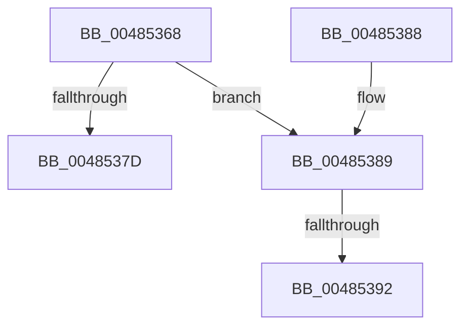

# SmStoreDecompressBufferContextCleanup

- RVA: `0x00485368`–`0x00485397` (길이 `47` bytes)
- VA: `0x0000000140485368`
- 실행 섹션: `.text`
- PDB 이름 있음: `예`; PDB Function 태그: `예`
- unwind 정보 RVA: `0x000AF45C`
- 디코드: `15`개 명령, `47/47` bytes 표시
- 미해석 바이트: `0` (있으면 어셈블리에 `.byte`로 보존)

> 이 문서는 커널 이미지의 기계어와 PDB 기호를 분석해 생성했습니다. 4번과 5번은 함수 원형과 자료형을 바이너리 사용 방식에서 추정한 C 해석이며 원본 소스 복구 결과는 아닙니다.

## 1. Dependencies

- 직접 호출 지점: **0**; 고유 호출 대상: **0**
- 직접 호출자로 확인된 함수: **1**
- RIP 상대 이미지 참조: **0**

### Outgoing calls
- 직접 디코드된 call 명령이 없습니다.

### Direct callers
- [SmStoreDecompressBuffer$fin$0](../6D/SmStoreDecompressBuffer_fin_0_function_006D299D.md) at `0x006D29BB`

### Static image references
- 디코드된 RIP-relative 메모리 참조가 없습니다.

## 2. Other-region calls and transfers

- 다른 실행 섹션으로 향하는 call: **0**
- call이 아닌 외부 분기/꼬리 이동: **2**
  - `0x0048538C` → [sub_006F54E6](../6F/Unknown_function_006F54E6.md) (`tail-transfer`)
  - `0x00485392` → [sub_006F54E6 + 0x24](../6F/Unknown_function_006F54E6.md) (`tail-transfer`)

## 3. Assembly (complete function range)

```asm
00485368  48 89 5C 24 18                  mov qword ptr [rsp + 0x18], rbx
0048536D  57                              push rdi
0048536E  48 83 EC 30                     sub rsp, 0x30
00485372  33 FF                           xor edi, edi
00485374  48 8B D9                        mov rbx, rcx
00485377  48 39 79 08                     cmp qword ptr [rcx + 8], rdi
0048537B  75 0C                           jne 0x140485389
0048537D  48 8B 5C 24 50                  mov rbx, qword ptr [rsp + 0x50]
00485382  48 83 C4 30                     add rsp, 0x30
00485386  5F                              pop rdi
00485387  C3                              ret
00485388  CC                              int3
00485389  39 79 24                        cmp dword ptr [rcx + 0x24], edi
0048538C  0F 87 54 01 27 00               ja 0x1406f54e6
00485392  E9 73 01 27 00                  jmp 0x1406f550a
```

## 4. C-style interpretation (structured pseudocode)

```c
void __fastcall SmStoreDecompressBufferContextCleanup(__int64 a1)
{
    __int64 v_rdi;
    __int64 v_rsp;
    unsigned __int64 v_stack_p18;

    v_stack_p18 = v_rbx;
    v_rsp = (v_rsp) - (48);
    v_rdi = 0;
    if ((*(unsigned __int64 *)(a1 + 8)) != 0) goto loc_00485389;
    v_rsp = (v_rsp) + (48);
    return;
loc_00485389:
}
```

## 5. (Beta) C Style

```c
void SmStoreDecompressBufferContextCleanup(void *Arg1)
{
    uint8_t *arg1 = (uint8_t *)Arg1;

    int64_t local_rdi;
    int64_t local_rsp;
    uint64_t v_stack_p18;

    v_stack_p18 = local_rbx;
    local_rsp = (local_rsp) - (48);
    local_rdi = 0;
    if ((*(uint64_t *)(arg1 + 0x8)) != 0) goto loc_00485389;
    local_rsp = (local_rsp) + (48);
    return;
loc_00485389:
}
```

### 관측된 메모리 오프셋

구조체 형식이 확인되지 않은 접근은 인자 기준의 오프셋으로만 기록했습니다.

| 기준 인자 | 오프셋 표현 | 폭 (bit) | 접근 |
|---|---:|---:|---|
| `Arg1` | `+ 0x8` | `64` | `R` |
| `Arg1` | `+ 0x24` | `32` | `R` |

## 6. Execution-region graph

[열기: 2D/3D 그래프와 함수 탐색 컨트롤 패널](../../../control-panel.html?section=text&rva=0x00485368&view=graph)

- 2D 그래프는 위에서 아래로 흐르고, 3D 그래프는 빈 공간을 드래그해 회전합니다. Shift+드래그는 이동, 휠은 확대·축소, 함수 노드 선택은 대상 보고서 이동입니다.

### Static fallback


