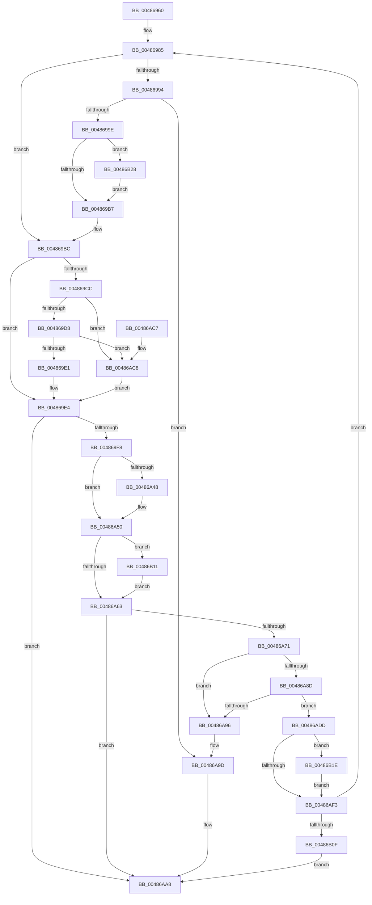

# SshpDereferenceBlocker

- RVA: `0x00486960`–`0x00486B35` (길이 `469` bytes)
- VA: `0x0000000140486960`
- 실행 섹션: `.text`
- PDB 이름 있음: `예`; PDB Function 태그: `아니요`
- unwind 정보 RVA: `0x000AF9B0`
- 디코드: `127`개 명령, `469/469` bytes 표시
- 미해석 바이트: `0` (있으면 어셈블리에 `.byte`로 보존)

> 이 문서는 커널 이미지의 기계어와 PDB 기호를 분석해 생성했습니다. 4번과 5번은 함수 원형과 자료형을 바이너리 사용 방식에서 추정한 C 해석이며 원본 소스 복구 결과는 아닙니다.

## 1. Dependencies

- 직접 호출 지점: **15**; 고유 호출 대상: **9**
- 직접 호출자로 확인된 함수: **5**
- RIP 상대 이미지 참조: **2**

### Outgoing calls
- `0x00486988` → [KeAcquireSpinLockRaiseToDpc](../20/KeAcquireSpinLockRaiseToDpc_function_00208470.md) (function, `0x00208470`)
- `0x004869EA` → [KeReleaseSpinLock](../39/KeReleaseSpinLock_function_00392BA0.md) (function, `0x00392BA0`)
- `0x00486A27` → [CmSiRWLockAcquireExclusive](../../page/A1/CmSiRWLockAcquireExclusive_function_00A1679C.md) (function, `0x00A1679C`)
- `0x00486A2F` → [KeAcquireSpinLockRaiseToDpc](../20/KeAcquireSpinLockRaiseToDpc_function_00208470.md) (function, `0x00208470`)
- `0x00486A3D` → [KeReleaseSpinLock](../39/KeReleaseSpinLock_function_00392BA0.md) (function, `0x00392BA0`)
- `0x00486A4B` → [SshpUnlinkBlockerFromLibrary](../../page/A4/SshpUnlinkBlockerFromLibrary_function_00A4E0C8.md) (function, `0x00A4E0C8`)
- `0x00486A66` → [KeAbPostRelease](../2E/KeAbPostRelease_function_002E1600.md) (function, `0x002E1600`)
- `0x00486A74` → [CmSiRWLockAcquireExclusive](../../page/A1/CmSiRWLockAcquireExclusive_function_00A1679C.md) (function, `0x00A1679C`)
- `0x00486AA3` → [KeReleaseSpinLock](../39/KeReleaseSpinLock_function_00392BA0.md) (function, `0x00392BA0`)
- `0x00486AD3` → [SshpWorkItemQueue](SshpWorkItemQueue_function_00486B3C.md) (function, `0x00486B3C`)
- `0x00486AF6` → [KeAbPostRelease](../2E/KeAbPostRelease_function_002E1600.md) (function, `0x002E1600`)
- `0x00486AFE` → [SshpFreeBlockerEntry](../../page/A4/SshpFreeBlockerEntry_function_00A4E15C.md) (function, `0x00A4E15C`)
- `0x00486B14` → [ExfTryToWakePushLock](../26/ExfTryToWakePushLock_function_00265DD0.md) (function, `0x00265DD0`)
- `0x00486B21` → [ExfTryToWakePushLock](../26/ExfTryToWakePushLock_function_00265DD0.md) (function, `0x00265DD0`)
- `0x00486B2B` → [SshpBlockerActiveDereference](../45/SshpBlockerActiveDereference_function_00453888.md) (function, `0x00453888`)

### Direct callers
- [SleepstudyHelperDestroyBlocker](SleepstudyHelperDestroyBlocker_function_00486930.md) at `0x00486942`
- [SleepstudyHelperSetBlockerParentHandle](../49/SleepstudyHelperSetBlockerParentHandle_function_004915E0.md) at `0x0049163D`
- [SleepstudyHelperDestroyBlockerBuilder](../../page/A2/SleepstudyHelperDestroyBlockerBuilder_function_00A2DE80.md) at `0x00A2DED9`
- [SshpPurgeBlockersWorker](../../page/A4/SshpPurgeBlockersWorker_function_00A4DE90.md) at `0x00A4E089`
- [SshNotifySystemSessionChange](../../page/A6/SshNotifySystemSessionChange_function_00A602BC.md) at `0x00A60520`

### Static image references
- `0x00486A19` → RVA `0x00E08400` (`.data`; read)
- `0x00486ACC` → RVA `0x00F07060` (`.data`; read)

## 2. Other-region calls and transfers

- 다른 실행 섹션으로 향하는 call: **4**
  - `0x00486A27` → [CmSiRWLockAcquireExclusive](../../page/A1/CmSiRWLockAcquireExclusive_function_00A1679C.md) (`.text` → `PAGE`)
  - `0x00486A4B` → [SshpUnlinkBlockerFromLibrary](../../page/A4/SshpUnlinkBlockerFromLibrary_function_00A4E0C8.md) (`.text` → `PAGE`)
  - `0x00486A74` → [CmSiRWLockAcquireExclusive](../../page/A1/CmSiRWLockAcquireExclusive_function_00A1679C.md) (`.text` → `PAGE`)
  - `0x00486AFE` → [SshpFreeBlockerEntry](../../page/A4/SshpFreeBlockerEntry_function_00A4E15C.md) (`.text` → `PAGE`)
- 별도 외부 분기/꼬리 이동을 확인하지 못했습니다.

## 3. Assembly (complete function range)

```asm
00486960  48 8B C4                        mov rax, rsp
00486963  48 89 58 08                     mov qword ptr [rax + 8], rbx
00486967  48 89 68 10                     mov qword ptr [rax + 0x10], rbp
0048696B  48 89 70 18                     mov qword ptr [rax + 0x18], rsi
0048696F  48 89 78 20                     mov qword ptr [rax + 0x20], rdi
00486973  41 54                           push r12
00486975  41 56                           push r14
00486977  41 57                           push r15
00486979  48 83 EC 20                     sub rsp, 0x20
0048697D  45 8A E0                        mov r12b, r8b
00486980  8B EA                           mov ebp, edx
00486982  48 8B D9                        mov rbx, rcx
00486985  48 8B CB                        mov rcx, rbx
00486988  E8 E3 1A D8 FF                  call 0x140208470
0048698D  40 8A F8                        mov dil, al
00486990  85 ED                           test ebp, ebp
00486992  75 28                           jne 0x1404869bc
00486994  83 6B 0C 01                     sub dword ptr [rbx + 0xc], 1
00486998  0F 85 FF 00 00 00               jne 0x140486a9d
0048699E  44 8B 43 14                     mov r8d, dword ptr [rbx + 0x14]
004869A2  8B 4B 18                        mov ecx, dword ptr [rbx + 0x18]
004869A5  85 C9                           test ecx, ecx
004869A7  41 8D 50 FF                     lea edx, [r8 - 1]
004869AB  41 0F 4E D0                     cmovle edx, r8d
004869AF  85 D2                           test edx, edx
004869B1  0F 85 71 01 00 00               jne 0x140486b28
004869B7  BD 01 00 00 00                  mov ebp, 1
004869BC  8B 4B 10                        mov ecx, dword ptr [rbx + 0x10]
004869BF  40 32 F6                        xor sil, sil
004869C2  8D 41 FF                        lea eax, [rcx - 1]
004869C5  89 43 10                        mov dword ptr [rbx + 0x10], eax
004869C8  85 C0                           test eax, eax
004869CA  75 18                           jne 0x1404869e4
004869CC  89 4B 10                        mov dword ptr [rbx + 0x10], ecx
004869CF  45 84 E4                        test r12b, r12b
004869D2  0F 84 F0 00 00 00               je 0x140486ac8
004869D8  40 84 FF                        test dil, dil
004869DB  0F 85 E7 00 00 00               jne 0x140486ac8
004869E1  40 B6 01                        mov sil, 1
004869E4  40 8A D7                        mov dl, dil
004869E7  48 8B CB                        mov rcx, rbx
004869EA  E8 B1 C1 F0 FF                  call 0x140392ba0
004869EF  40 84 F6                        test sil, sil
004869F2  0F 84 B0 00 00 00               je 0x140486aa8
004869F8  48 8B 8B 30 01 00 00            mov rcx, qword ptr [rbx + 0x130]
004869FF  4C 8B B3 28 01 00 00            mov r14, qword ptr [rbx + 0x128]
00486A06  48 63 41 28                     movsxd rax, dword ptr [rcx + 0x28]
00486A0A  48 8B 71 20                     mov rsi, qword ptr [rcx + 0x20]
00486A0E  48 83 C6 10                     add rsi, 0x10
00486A12  48 8B CE                        mov rcx, rsi
00486A15  48 8D 3C 40                     lea rdi, [rax + rax*2]
00486A19  48 8D 05 E0 19 98 00            lea rax, [rip + 0x9819e0]
00486A20  48 C1 E7 04                     shl rdi, 4
00486A24  48 03 F8                        add rdi, rax
00486A27  E8 70 FD 58 00                  call 0x140a1679c
00486A2C  48 8B CB                        mov rcx, rbx
00486A2F  E8 3C 1A D8 FF                  call 0x140208470
00486A34  44 8B 7B 10                     mov r15d, dword ptr [rbx + 0x10]
00486A38  8A D0                           mov dl, al
00486A3A  48 8B CB                        mov rcx, rbx
00486A3D  E8 5E C1 F0 FF                  call 0x140392ba0
00486A42  41 83 FF 01                     cmp r15d, 1
00486A46  75 08                           jne 0x140486a50
00486A48  48 8B CB                        mov rcx, rbx
00486A4B  E8 78 76 5C 00                  call 0x140a4e0c8
00486A50  48 83 C8 FF                     or rax, 0xffffffffffffffff
00486A54  F0 48 0F C1 06                  lock xadd qword ptr [rsi], rax
00486A59  24 06                           and al, 6
00486A5B  3C 02                           cmp al, 2
00486A5D  0F 84 AE 00 00 00               je 0x140486b11
00486A63  48 8B CE                        mov rcx, rsi
00486A66  E8 95 AB E5 FF                  call 0x1402e1600
00486A6B  41 83 FF 01                     cmp r15d, 1
00486A6F  75 37                           jne 0x140486aa8
00486A71  48 8B CF                        mov rcx, rdi
00486A74  E8 23 FD 58 00                  call 0x140a1679c
00486A79  48 8B 83 30 01 00 00            mov rax, qword ptr [rbx + 0x130]
00486A80  48 83 C0 10                     add rax, 0x10
00486A84  48 8B 10                        mov rdx, qword ptr [rax]
00486A87  48 39 42 08                     cmp qword ptr [rdx + 8], rax
00486A8B  75 09                           jne 0x140486a96
00486A8D  48 8B 48 08                     mov rcx, qword ptr [rax + 8]
00486A91  48 39 01                        cmp qword ptr [rcx], rax
00486A94  74 47                           je 0x140486add
00486A96  B9 03 00 00 00                  mov ecx, 3
00486A9B  CD 29                           int 0x29
00486A9D  40 8A D7                        mov dl, dil
00486AA0  48 8B CB                        mov rcx, rbx
00486AA3  E8 F8 C0 F0 FF                  call 0x140392ba0
00486AA8  48 8B 5C 24 40                  mov rbx, qword ptr [rsp + 0x40]
00486AAD  48 8B 6C 24 48                  mov rbp, qword ptr [rsp + 0x48]
00486AB2  48 8B 74 24 50                  mov rsi, qword ptr [rsp + 0x50]
00486AB7  48 8B 7C 24 58                  mov rdi, qword ptr [rsp + 0x58]
00486ABC  48 83 C4 20                     add rsp, 0x20
00486AC0  41 5F                           pop r15
00486AC2  41 5E                           pop r14
00486AC4  41 5C                           pop r12
00486AC6  C3                              ret
00486AC7  CC                              int3
00486AC8  83 4B 08 08                     or dword ptr [rbx + 8], 8
00486ACC  48 8D 0D 8D 05 A8 00            lea rcx, [rip + 0xa8058d]
00486AD3  E8 64 00 00 00                  call 0x140486b3c
00486AD8  E9 07 FF FF FF                  jmp 0x1404869e4
00486ADD  48 89 11                        mov qword ptr [rcx], rdx
00486AE0  48 83 C8 FF                     or rax, 0xffffffffffffffff
00486AE4  48 89 4A 08                     mov qword ptr [rdx + 8], rcx
00486AE8  F0 48 0F C1 07                  lock xadd qword ptr [rdi], rax
00486AED  24 06                           and al, 6
00486AEF  3C 02                           cmp al, 2
00486AF1  74 2B                           je 0x140486b1e
00486AF3  48 8B CF                        mov rcx, rdi
00486AF6  E8 05 AB E5 FF                  call 0x1402e1600
00486AFB  48 8B CB                        mov rcx, rbx
00486AFE  E8 59 76 5C 00                  call 0x140a4e15c
00486B03  49 8B DE                        mov rbx, r14
00486B06  4D 85 F6                        test r14, r14
00486B09  0F 85 76 FE FF FF               jne 0x140486985
00486B0F  EB 97                           jmp 0x140486aa8
00486B11  48 8B CE                        mov rcx, rsi
00486B14  E8 B7 F2 DD FF                  call 0x140265dd0
00486B19  E9 45 FF FF FF                  jmp 0x140486a63
00486B1E  48 8B CF                        mov rcx, rdi
00486B21  E8 AA F2 DD FF                  call 0x140265dd0
00486B26  EB CB                           jmp 0x140486af3
00486B28  48 8B CB                        mov rcx, rbx
00486B2B  E8 58 CD FC FF                  call 0x140453888
00486B30  E9 82 FE FF FF                  jmp 0x1404869b7
```

## 4. C-style interpretation (structured pseudocode)

```c
__int64 __fastcall SshpDereferenceBlocker(__int64 a1, int a2, unsigned __int8 a3)
{
    __int64 result;
    __int64 v_rdi;
    __int64 v_rsi;
    __int64 v_rsp;
    unsigned __int64 v_stack_p10;
    unsigned __int64 v_stack_p18;
    unsigned __int64 v_stack_p20;
    unsigned __int64 v_stack_p8;

    *(unsigned __int64 *)(v_rsp + 8) = v_rbx;
    *(unsigned __int64 *)(v_rsp + 16) = v_rbp;
    *(unsigned __int64 *)(v_rsp + 24) = v_rsi;
    *(unsigned __int64 *)(v_rsp + 32) = v_rdi;
    v_rsp = (v_rsp) - (32);
loc_00486985:
    result = KeAcquireSpinLockRaiseToDpc(a1, a2, a3, a4);
    if ((unsigned int)((unsigned int)(a2)) != 0) goto loc_004869BC;
    if ((unsigned int)((unsigned int)(a2)) != 0) goto loc_00486A9D;
    a2 = (unsigned int)(*(unsigned int *)(a1 + 20)) - 1;
    if (condition_is_less_or_equal) { a2 = (unsigned int)((unsigned int)(*(unsigned int *)(a1 + 20))); }
    if (a2 != 0) goto loc_00486B28;
loc_004869B7:
loc_004869BC:
    v_rsi = 0;
    *(unsigned int *)(a1 + 16) = (unsigned int)((unsigned int)(*(unsigned int *)(a1 + 16)) - 1);
    if ((unsigned int)((unsigned int)(*(unsigned int *)(a1 + 16)) - 1) != 0) goto loc_004869E4;
    *(unsigned int *)(a1 + 16) = (unsigned int)((unsigned int)(*(unsigned int *)(a1 + 16)));
    if (a3 == 0) goto loc_00486AC8;
    if ((unsigned __int8)((unsigned __int8)(result)) != 0) goto loc_00486AC8;
loc_004869E4:
    result = KeReleaseSpinLock(a1, (unsigned __int8)((unsigned __int8)(result)), (unsigned int)(*(unsigned int *)(a1 + 20)), a4);
    if (1 == 0) goto loc_00486AA8;
    v_rsi = (*(unsigned __int64 *)(*(unsigned __int64 *)(a1 + 304) + 32)) + (16);
    v_rdi = ((int)(*(unsigned int *)(*(unsigned __int64 *)(a1 + 304) + 40)) + (int)(*(unsigned int *)(*(unsigned __int64 *)(a1 + 304) + 40)) * 2) << (4);
    v_rdi = (v_rdi) + (v_rip + 9968096);
    result = CmSiRWLockAcquireExclusive(v_rsi, (unsigned __int8)((unsigned __int8)(result)), (unsigned int)(*(unsigned int *)(a1 + 20)), a4);
    result = KeAcquireSpinLockRaiseToDpc(a1, (unsigned __int8)((unsigned __int8)(result)), (unsigned int)(*(unsigned int *)(a1 + 20)), a4);
    result = KeReleaseSpinLock(a1, (unsigned __int8)(result), (unsigned int)(*(unsigned int *)(a1 + 20)), a4);
    if (((unsigned int)((unsigned int)(*(unsigned int *)(a1 + 16)))) == 1) {
        a1 = a1;
        result = SshpUnlinkBlockerFromLibrary(a1, (unsigned __int8)(result), (unsigned int)(*(unsigned int *)(a1 + 20)), a4);
    }
    result = (result) | (-1);
    result = (unsigned __int8)((result) & (6));
    if (((unsigned __int8)(result)) == 2) goto loc_00486B11;
loc_00486A63:
    result = KeAbPostRelease(v_rsi, (unsigned __int8)(result), (unsigned int)(*(unsigned int *)(a1 + 20)), a4);
    if (((unsigned int)((unsigned int)(*(unsigned int *)(a1 + 16)))) != 1) goto loc_00486AA8;
    result = CmSiRWLockAcquireExclusive(v_rdi, (unsigned __int8)(result), (unsigned int)(*(unsigned int *)(a1 + 20)), a4);
    result = (*(unsigned __int64 *)(a1 + 304)) + (16);
    if ((*(unsigned __int64 *)(*(unsigned __int64 *)(result) + 8)) != result) goto loc_00486A96;
    if ((*(unsigned __int64 *)(*(unsigned __int64 *)(result + 8))) == result) goto loc_00486ADD;
loc_00486A96:
loc_00486A9D:
    result = KeReleaseSpinLock(a1, (unsigned __int8)(v_rdi), (unsigned int)(*(unsigned int *)(a1 + 20)), a4);
loc_00486AA8:
    v_rsp = (v_rsp) + (32);
    return result;
loc_00486AC8:
    result = SshpWorkItemQueue(v_rip + 11011469, (unsigned __int8)(v_rdi), (unsigned int)(*(unsigned int *)(a1 + 20)), a4);
    goto loc_004869E4;
loc_00486ADD:
    *(unsigned __int64 *)(v_rip + 11011469) = (unsigned __int8)(v_rdi);
    result = (result) | (-1);
    *(unsigned __int64 *)((unsigned __int8)(v_rdi) + 8) = v_rip + 11011469;
    result = (unsigned __int8)((result) & (6));
    if (((unsigned __int8)(result)) == 2) goto loc_00486B1E;
loc_00486AF3:
    result = KeAbPostRelease(v_stack_p20, (unsigned __int8)(v_rdi), (unsigned int)(*(unsigned int *)(a1 + 20)), a4);
    result = SshpFreeBlockerEntry(v_stack_p8, (unsigned __int8)(v_rdi), (unsigned int)(*(unsigned int *)(a1 + 20)), a4);
    if (*(unsigned __int64 *)(a1 + 296) != 0) goto loc_00486985;
    goto loc_00486AA8;
loc_00486B11:
    result = ExfTryToWakePushLock(v_stack_p18, (unsigned __int8)(v_rdi), (unsigned int)(*(unsigned int *)(a1 + 20)), a4);
    goto loc_00486A63;
loc_00486B1E:
    result = ExfTryToWakePushLock(v_stack_p20, (unsigned __int8)(v_rdi), (unsigned int)(*(unsigned int *)(a1 + 20)), a4);
    goto loc_00486AF3;
loc_00486B28:
    result = SshpBlockerActiveDereference(*(unsigned __int64 *)(a1 + 296), (unsigned __int8)(v_rdi), (unsigned int)(*(unsigned int *)(a1 + 20)), a4);
    goto loc_004869B7;
}
```

## 5. (Beta) C Style

```c
int64_t SshpDereferenceBlocker(int64_t Arg1, int32_t Arg2, uint8_t Arg3)
{
    int64_t result;
    int64_t local_rdi;
    int64_t local_rsi;
    int64_t local_rsp;
    uint64_t v_stack_p10;
    uint64_t v_stack_p18;
    uint64_t v_stack_p20;
    uint64_t v_stack_p8;

    *(uint64_t *)(local_rsp + 0x8) = local_rbx;
    *(uint64_t *)(local_rsp + 0x10) = local_rbp;
    *(uint64_t *)(local_rsp + 0x18) = local_rsi;
    *(uint64_t *)(local_rsp + 0x20) = local_rdi;
    local_rsp = (local_rsp) - (32);
loc_00486985:
    result = KeAcquireSpinLockRaiseToDpc(Arg1, Arg2, Arg3, a4);
    if ((uint32_t)((uint32_t)(Arg2)) != 0) goto loc_004869BC;
    if ((uint32_t)((uint32_t)(Arg2)) != 0) goto loc_00486A9D;
    Arg2 = (uint32_t)(*(uint32_t *)(Arg1 + 0x14)) - 1;
    if (condition_is_less_or_equal) { Arg2 = (uint32_t)((uint32_t)(*(uint32_t *)(Arg1 + 0x14))); }
    if (Arg2 != 0) goto loc_00486B28;
loc_004869B7:
loc_004869BC:
    local_rsi = 0;
    *(uint32_t *)(Arg1 + 0x10) = (uint32_t)((uint32_t)(*(uint32_t *)(Arg1 + 0x10)) - 1);
    if ((uint32_t)((uint32_t)(*(uint32_t *)(Arg1 + 0x10)) - 1) != 0) goto loc_004869E4;
    *(uint32_t *)(Arg1 + 0x10) = (uint32_t)((uint32_t)(*(uint32_t *)(Arg1 + 0x10)));
    if (Arg3 == 0) goto loc_00486AC8;
    if ((uint8_t)((uint8_t)(result)) != 0) goto loc_00486AC8;
loc_004869E4:
    result = KeReleaseSpinLock(Arg1, (uint8_t)((uint8_t)(result)), (uint32_t)(*(uint32_t *)(Arg1 + 0x14)), a4);
    if (1 == 0) goto loc_00486AA8;
    local_rsi = (*(uint64_t *)(*(uint64_t *)(Arg1 + 0x130) + 0x20)) + (16);
    local_rdi = ((int32_t)(*(uint32_t *)(*(uint64_t *)(Arg1 + 0x130) + 0x28)) + (int32_t)(*(uint32_t *)(*(uint64_t *)(Arg1 + 0x130) + 0x28)) * 2) << (4);
    local_rdi = (local_rdi) + (v_rip + 9968096);
    result = CmSiRWLockAcquireExclusive(local_rsi, (uint8_t)((uint8_t)(result)), (uint32_t)(*(uint32_t *)(Arg1 + 0x14)), a4);
    result = KeAcquireSpinLockRaiseToDpc(Arg1, (uint8_t)((uint8_t)(result)), (uint32_t)(*(uint32_t *)(Arg1 + 0x14)), a4);
    result = KeReleaseSpinLock(Arg1, (uint8_t)(result), (uint32_t)(*(uint32_t *)(Arg1 + 0x14)), a4);
    if (((uint32_t)((uint32_t)(*(uint32_t *)(Arg1 + 0x10)))) == 1) {
        Arg1 = Arg1;
        result = SshpUnlinkBlockerFromLibrary(Arg1, (uint8_t)(result), (uint32_t)(*(uint32_t *)(Arg1 + 0x14)), a4);
    }
    result = (result) | (-1);
    result = (uint8_t)((result) & (6));
    if (((uint8_t)(result)) == 2) goto loc_00486B11;
loc_00486A63:
    result = KeAbPostRelease(local_rsi, (uint8_t)(result), (uint32_t)(*(uint32_t *)(Arg1 + 0x14)), a4);
    if (((uint32_t)((uint32_t)(*(uint32_t *)(Arg1 + 0x10)))) != 1) goto loc_00486AA8;
    result = CmSiRWLockAcquireExclusive(local_rdi, (uint8_t)(result), (uint32_t)(*(uint32_t *)(Arg1 + 0x14)), a4);
    result = (*(uint64_t *)(Arg1 + 0x130)) + (16);
    if ((*(uint64_t *)(*(uint64_t *)(result) + 0x8)) != result) goto loc_00486A96;
    if ((*(uint64_t *)(*(uint64_t *)(result + 0x8))) == result) goto loc_00486ADD;
loc_00486A96:
loc_00486A9D:
    result = KeReleaseSpinLock(Arg1, (uint8_t)(local_rdi), (uint32_t)(*(uint32_t *)(Arg1 + 0x14)), a4);
loc_00486AA8:
    local_rsp = (local_rsp) + (32);
    return result;
loc_00486AC8:
    result = SshpWorkItemQueue(v_rip + 11011469, (uint8_t)(local_rdi), (uint32_t)(*(uint32_t *)(Arg1 + 0x14)), a4);
    goto loc_004869E4;
loc_00486ADD:
    *(uint64_t *)(v_rip + 0xA8058D) = (uint8_t)(local_rdi);
    result = (result) | (-1);
    *(uint64_t *)((uint8_t)(local_rdi) + 0x8) = v_rip + 11011469;
    result = (uint8_t)((result) & (6));
    if (((uint8_t)(result)) == 2) goto loc_00486B1E;
loc_00486AF3:
    result = KeAbPostRelease(v_stack_p20, (uint8_t)(local_rdi), (uint32_t)(*(uint32_t *)(Arg1 + 0x14)), a4);
    result = SshpFreeBlockerEntry(v_stack_p8, (uint8_t)(local_rdi), (uint32_t)(*(uint32_t *)(Arg1 + 0x14)), a4);
    if (*(uint64_t *)(Arg1 + 0x128) != 0) goto loc_00486985;
    goto loc_00486AA8;
loc_00486B11:
    result = ExfTryToWakePushLock(v_stack_p18, (uint8_t)(local_rdi), (uint32_t)(*(uint32_t *)(Arg1 + 0x14)), a4);
    goto loc_00486A63;
loc_00486B1E:
    result = ExfTryToWakePushLock(v_stack_p20, (uint8_t)(local_rdi), (uint32_t)(*(uint32_t *)(Arg1 + 0x14)), a4);
    goto loc_00486AF3;
loc_00486B28:
    result = SshpBlockerActiveDereference(*(uint64_t *)(Arg1 + 0x128), (uint8_t)(local_rdi), (uint32_t)(*(uint32_t *)(Arg1 + 0x14)), a4);
    goto loc_004869B7;
}
```

## 6. Execution-region graph

[열기: 2D/3D 그래프와 함수 탐색 컨트롤 패널](../../../control-panel.html?section=text&rva=0x00486960&view=graph)

- 2D 그래프는 위에서 아래로 흐르고, 3D 그래프는 빈 공간을 드래그해 회전합니다. Shift+드래그는 이동, 휠은 확대·축소, 함수 노드 선택은 대상 보고서 이동입니다.

### Static fallback


