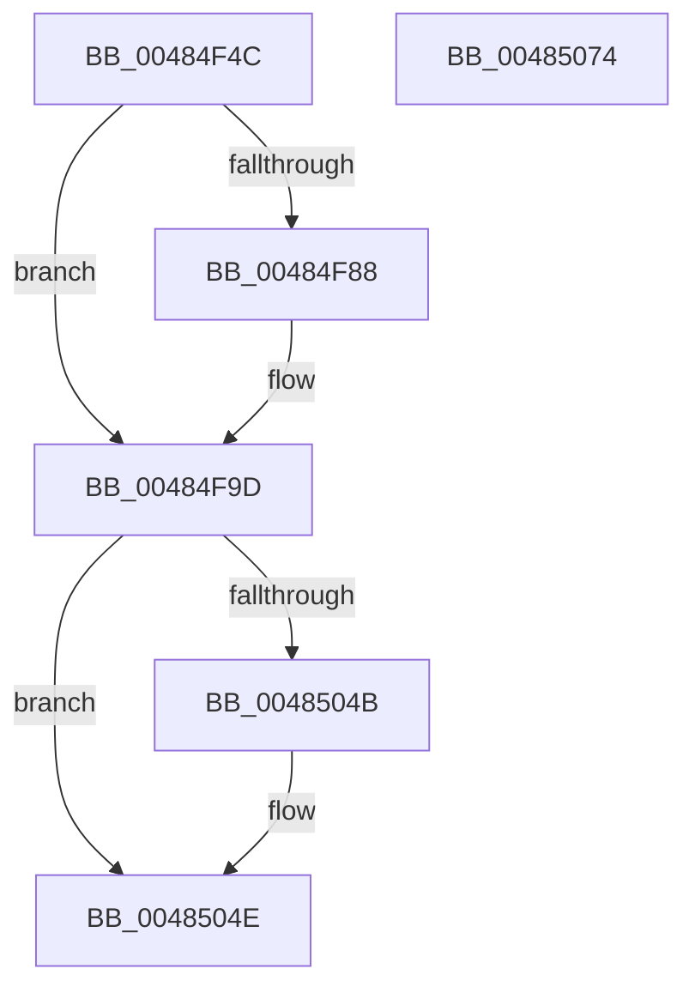

# SshpQueryAndResetBlockerAccounting

- RVA: `0x00484F4C`–`0x00485075` (길이 `297` bytes)
- VA: `0x0000000140484F4C`
- 실행 섹션: `.text`
- PDB 이름 있음: `예`; PDB Function 태그: `아니요`
- unwind 정보 RVA: `0x0005E6B4`
- 디코드: `79`개 명령, `297/297` bytes 표시
- 미해석 바이트: `0` (있으면 어셈블리에 `.byte`로 보존)

> 이 문서는 커널 이미지의 기계어와 PDB 기호를 분석해 생성했습니다. 4번과 5번은 함수 원형과 자료형을 바이너리 사용 방식에서 추정한 C 해석이며 원본 소스 복구 결과는 아닙니다.

## 1. Dependencies

- 직접 호출 지점: **5**; 고유 호출 대상: **4**
- 직접 호출자로 확인된 함수: **1**
- RIP 상대 이미지 참조: **0**

### Outgoing calls
- `0x00484F71` → [KeAcquireSpinLockRaiseToDpc](../20/KeAcquireSpinLockRaiseToDpc_function_00208470.md) (function, `0x00208470`)
- `0x00484F98` → [SshpStopBlockerAccounting](SshpStopBlockerAccounting_function_0048518C.md) (function, `0x0048518C`)
- `0x0048502F` → [memset](../6C/memset_function_006C6C40.md) (function, `0x006C6C40`)
- `0x0048503C` → [memset](../6C/memset_function_006C6C40.md) (function, `0x006C6C40`)
- `0x00485054` → [KeReleaseSpinLock](../39/KeReleaseSpinLock_function_00392BA0.md) (function, `0x00392BA0`)

### Direct callers
- [SshNotifySystemSessionChange](../../page/A6/SshNotifySystemSessionChange_function_00A602BC.md) at `0x00A604C6`

### Static image references
- 디코드된 RIP-relative 메모리 참조가 없습니다.

## 2. Other-region calls and transfers

- 다른 실행 섹션으로 향하는 call: **0**
- 별도 외부 분기/꼬리 이동을 확인하지 못했습니다.

## 3. Assembly (complete function range)

```asm
00484F4C  48 8B C4                        mov rax, rsp
00484F4F  48 89 58 08                     mov qword ptr [rax + 8], rbx
00484F53  48 89 68 10                     mov qword ptr [rax + 0x10], rbp
00484F57  48 89 70 18                     mov qword ptr [rax + 0x18], rsi
00484F5B  48 89 78 20                     mov qword ptr [rax + 0x20], rdi
00484F5F  41 56                           push r14
00484F61  48 83 EC 20                     sub rsp, 0x20
00484F65  49 8B F1                        mov rsi, r9
00484F68  49 8B E8                        mov rbp, r8
00484F6B  48 8B DA                        mov rbx, rdx
00484F6E  48 8B F9                        mov rdi, rcx
00484F71  E8 FA 34 D8 FF                  call 0x140208470
00484F76  44 8B 57 08                     mov r10d, dword ptr [rdi + 8]
00484F7A  41 B8 02 00 00 00               mov r8d, 2
00484F80  44 8A F0                        mov r14b, al
00484F83  45 84 D0                        test r8b, r10b
00484F86  74 15                           je 0x140484f9d
00484F88  48 BA 08 00 00 00 80 F7 FF FF   movabs rdx, 0xfffff78000000008
00484F92  48 8B CF                        mov rcx, rdi
00484F95  48 8B 12                        mov rdx, qword ptr [rdx]
00484F98  E8 EF 01 00 00                  call 0x14048518c
00484F9D  48 8D 4F 28                     lea rcx, [rdi + 0x28]
00484FA1  33 D2                           xor edx, edx
00484FA3  0F 10 01                        movups xmm0, xmmword ptr [rcx]
00484FA6  0F 29 03                        movaps xmmword ptr [rbx], xmm0
00484FA9  0F 10 49 10                     movups xmm1, xmmword ptr [rcx + 0x10]
00484FAD  0F 29 4B 10                     movaps xmmword ptr [rbx + 0x10], xmm1
00484FB1  0F 10 41 20                     movups xmm0, xmmword ptr [rcx + 0x20]
00484FB5  0F 29 43 20                     movaps xmmword ptr [rbx + 0x20], xmm0
00484FB9  0F 10 49 30                     movups xmm1, xmmword ptr [rcx + 0x30]
00484FBD  0F 29 4B 30                     movaps xmmword ptr [rbx + 0x30], xmm1
00484FC1  0F 10 41 40                     movups xmm0, xmmword ptr [rcx + 0x40]
00484FC5  0F 29 43 40                     movaps xmmword ptr [rbx + 0x40], xmm0
00484FC9  0F 10 49 50                     movups xmm1, xmmword ptr [rcx + 0x50]
00484FCD  0F 29 4B 50                     movaps xmmword ptr [rbx + 0x50], xmm1
00484FD1  0F 10 41 60                     movups xmm0, xmmword ptr [rcx + 0x60]
00484FD5  0F 29 43 60                     movaps xmmword ptr [rbx + 0x60], xmm0
00484FD9  0F 10 49 70                     movups xmm1, xmmword ptr [rcx + 0x70]
00484FDD  0F 29 4B 70                     movaps xmmword ptr [rbx + 0x70], xmm1
00484FE1  48 8D 9F A8 00 00 00            lea rbx, [rdi + 0xa8]
00484FE8  0F 10 03                        movups xmm0, xmmword ptr [rbx]
00484FEB  0F 29 45 00                     movaps xmmword ptr [rbp], xmm0
00484FEF  0F 10 4B 10                     movups xmm1, xmmword ptr [rbx + 0x10]
00484FF3  0F 29 4D 10                     movaps xmmword ptr [rbp + 0x10], xmm1
00484FF7  0F 10 43 20                     movups xmm0, xmmword ptr [rbx + 0x20]
00484FFB  0F 29 45 20                     movaps xmmword ptr [rbp + 0x20], xmm0
00484FFF  0F 10 4B 30                     movups xmm1, xmmword ptr [rbx + 0x30]
00485003  0F 29 4D 30                     movaps xmmword ptr [rbp + 0x30], xmm1
00485007  0F 10 43 40                     movups xmm0, xmmword ptr [rbx + 0x40]
0048500B  0F 29 45 40                     movaps xmmword ptr [rbp + 0x40], xmm0
0048500F  0F 10 4B 50                     movups xmm1, xmmword ptr [rbx + 0x50]
00485013  0F 29 4D 50                     movaps xmmword ptr [rbp + 0x50], xmm1
00485017  0F 10 43 60                     movups xmm0, xmmword ptr [rbx + 0x60]
0048501B  0F 29 45 60                     movaps xmmword ptr [rbp + 0x60], xmm0
0048501F  0F 10 4B 70                     movups xmm1, xmmword ptr [rbx + 0x70]
00485023  0F 29 4D 70                     movaps xmmword ptr [rbp + 0x70], xmm1
00485027  BD 80 00 00 00                  mov ebp, 0x80
0048502C  44 8B C5                        mov r8d, ebp
0048502F  E8 0C 1C 24 00                  call 0x1406c6c40
00485034  44 8B C5                        mov r8d, ebp
00485037  33 D2                           xor edx, edx
00485039  48 8B CB                        mov rcx, rbx
0048503C  E8 FF 1B 24 00                  call 0x1406c6c40
00485041  8B 47 08                        mov eax, dword ptr [rdi + 8]
00485044  C6 06 00                        mov byte ptr [rsi], 0
00485047  A8 04                           test al, 4
00485049  74 03                           je 0x14048504e
0048504B  C6 06 01                        mov byte ptr [rsi], 1
0048504E  41 8A D6                        mov dl, r14b
00485051  48 8B CF                        mov rcx, rdi
00485054  E8 47 DB F0 FF                  call 0x140392ba0
00485059  48 8B 5C 24 30                  mov rbx, qword ptr [rsp + 0x30]
0048505E  48 8B 6C 24 38                  mov rbp, qword ptr [rsp + 0x38]
00485063  48 8B 74 24 40                  mov rsi, qword ptr [rsp + 0x40]
00485068  48 8B 7C 24 48                  mov rdi, qword ptr [rsp + 0x48]
0048506D  48 83 C4 20                     add rsp, 0x20
00485071  41 5E                           pop r14
00485073  C3                              ret
00485074  CC                              int3
```

## 4. C-style interpretation (structured pseudocode)

```c
__int64 __fastcall SshpQueryAndResetBlockerAccounting(__int64 a1, __int64 a2, __int64 a3, __int64 a4)
{
    __int64 result;
    __int64 v_rsp;
    unsigned __int64 v_stack_p10;
    unsigned __int64 v_stack_p18;
    unsigned __int64 v_stack_p20;
    unsigned __int64 v_stack_p8;

    *(unsigned __int64 *)(v_rsp + 8) = v_rbx;
    *(unsigned __int64 *)(v_rsp + 16) = v_rbp;
    *(unsigned __int64 *)(v_rsp + 24) = v_rsi;
    *(unsigned __int64 *)(v_rsp + 32) = v_rdi;
    v_rsp = (v_rsp) - (32);
    result = KeAcquireSpinLockRaiseToDpc(a1, a2, a3, a4);
    if (((2) & ((unsigned __int8)((unsigned int)(*(unsigned int *)(a1 + 8))))) != 0) {
        a1 = a1;
        a2 = *(unsigned __int64 *)(a2);
        result = SshpStopBlockerAccounting(a1, a2, 2, a4);
    }
    a2 = 0;
    *(unsigned __int64 *)(a2) = v_xmm0;
    *(unsigned __int64 *)(a2 + 16) = v_xmm1;
    *(unsigned __int64 *)(a2 + 32) = v_xmm0;
    *(unsigned __int64 *)(a2 + 48) = v_xmm1;
    *(unsigned __int64 *)(a2 + 64) = v_xmm0;
    *(unsigned __int64 *)(a2 + 80) = v_xmm1;
    *(unsigned __int64 *)(a2 + 96) = v_xmm0;
    *(unsigned __int64 *)(a2 + 112) = v_xmm1;
    *(unsigned __int64 *)(a3) = v_xmm0;
    *(unsigned __int64 *)(a3 + 16) = v_xmm1;
    *(unsigned __int64 *)(a3 + 32) = v_xmm0;
    *(unsigned __int64 *)(a3 + 48) = v_xmm1;
    *(unsigned __int64 *)(a3 + 64) = v_xmm0;
    *(unsigned __int64 *)(a3 + 80) = v_xmm1;
    *(unsigned __int64 *)(a3 + 96) = v_xmm0;
    *(unsigned __int64 *)(a3 + 112) = v_xmm1;
    result = memset(a1 + 40, a2, 128, a4);
    a2 = 0;
    result = memset(a1 + 168, a2, 128, a4);
    *(unsigned __int8 *)(a4) = 0;
    if ((((unsigned __int8)((unsigned int)(*(unsigned int *)(a1 + 8)))) & (4)) != 0) {
        *(unsigned __int8 *)(a4) = 1;
    }
    result = KeReleaseSpinLock(a1, (unsigned __int8)((unsigned __int8)(result)), 128, a4);
    v_rsp = (v_rsp) + (32);
    return result;
}
```

## 5. (Beta) C Style

```c
int64_t SshpQueryAndResetBlockerAccounting(void *Arg1, void *Arg2, void *Arg3, void *Arg4)
{
    uint8_t *arg1 = (uint8_t *)Arg1;
    uint8_t *arg2 = (uint8_t *)Arg2;
    uint8_t *arg3 = (uint8_t *)Arg3;
    uint8_t *arg4 = (uint8_t *)Arg4;

    int64_t result;
    int64_t local_rsp;
    uint64_t v_stack_p10;
    uint64_t v_stack_p18;
    uint64_t v_stack_p20;
    uint64_t v_stack_p8;

    *(uint64_t *)(local_rsp + 0x8) = local_rbx;
    *(uint64_t *)(local_rsp + 0x10) = local_rbp;
    *(uint64_t *)(local_rsp + 0x18) = local_rsi;
    *(uint64_t *)(local_rsp + 0x20) = local_rdi;
    local_rsp = (local_rsp) - (32);
    result = KeAcquireSpinLockRaiseToDpc(Arg1, Arg2, Arg3, Arg4);
    if (((2) & ((uint8_t)((uint32_t)(*(uint32_t *)(arg1 + 0x8))))) != 0) {
        Arg1 = Arg1;
        Arg2 = *(uint64_t *)(arg2);
        result = SshpStopBlockerAccounting(Arg1, Arg2, 2, Arg4);
    }
    Arg2 = 0;
    *(uint64_t *)(arg2) = v_xmm0;
    *(uint64_t *)(arg2 + 0x10) = v_xmm1;
    *(uint64_t *)(arg2 + 0x20) = v_xmm0;
    *(uint64_t *)(arg2 + 0x30) = v_xmm1;
    *(uint64_t *)(arg2 + 0x40) = v_xmm0;
    *(uint64_t *)(arg2 + 0x50) = v_xmm1;
    *(uint64_t *)(arg2 + 0x60) = v_xmm0;
    *(uint64_t *)(arg2 + 0x70) = v_xmm1;
    *(uint64_t *)(arg3) = v_xmm0;
    *(uint64_t *)(arg3 + 0x10) = v_xmm1;
    *(uint64_t *)(arg3 + 0x20) = v_xmm0;
    *(uint64_t *)(arg3 + 0x30) = v_xmm1;
    *(uint64_t *)(arg3 + 0x40) = v_xmm0;
    *(uint64_t *)(arg3 + 0x50) = v_xmm1;
    *(uint64_t *)(arg3 + 0x60) = v_xmm0;
    *(uint64_t *)(arg3 + 0x70) = v_xmm1;
    result = memset(Arg1 + 40, Arg2, 128, Arg4);
    Arg2 = 0;
    result = memset(Arg1 + 168, Arg2, 128, Arg4);
    *(uint8_t *)(arg4) = 0;
    if ((((uint8_t)((uint32_t)(*(uint32_t *)(arg1 + 0x8)))) & (4)) != 0) {
        *(uint8_t *)(arg4) = 1;
    }
    result = KeReleaseSpinLock(Arg1, (uint8_t)((uint8_t)(result)), 128, Arg4);
    local_rsp = (local_rsp) + (32);
    return result;
}
```

### 관측된 메모리 오프셋

구조체 형식이 확인되지 않은 접근은 인자 기준의 오프셋으로만 기록했습니다.

| 기준 인자 | 오프셋 표현 | 폭 (bit) | 접근 |
|---|---:|---:|---|
| `Arg1` | `+ 0x0` | `128` | `R` |
| `Arg1` | `+ 0x8` | `32` | `R` |
| `Arg1` | `+ 0x10` | `128` | `R` |
| `Arg1` | `+ 0x20` | `128` | `R` |
| `Arg1` | `+ 0x28` | `64` | `R` |
| `Arg1` | `+ 0x30` | `128` | `R` |
| `Arg1` | `+ 0x40` | `128` | `R` |
| `Arg1` | `+ 0x50` | `128` | `R` |
| `Arg1` | `+ 0x60` | `128` | `R` |
| `Arg1` | `+ 0x70` | `128` | `R` |
| `Arg1` | `+ 0xA8` | `64` | `R` |
| `Arg2` | `+ 0x0` | `128` | `W` |
| `Arg2` | `+ 0x10` | `128` | `W` |
| `Arg2` | `+ 0x20` | `128` | `W` |
| `Arg2` | `+ 0x30` | `128` | `W` |
| `Arg2` | `+ 0x40` | `128` | `W` |
| `Arg2` | `+ 0x50` | `128` | `W` |
| `Arg2` | `+ 0x60` | `128` | `W` |
| `Arg2` | `+ 0x70` | `128` | `W` |
| `Arg3` | `+ 0x0` | `128` | `W` |
| `Arg3` | `+ 0x10` | `128` | `W` |
| `Arg3` | `+ 0x20` | `128` | `W` |
| `Arg3` | `+ 0x30` | `128` | `W` |
| `Arg3` | `+ 0x40` | `128` | `W` |
| `Arg3` | `+ 0x50` | `128` | `W` |
| `Arg3` | `+ 0x60` | `128` | `W` |
| `Arg3` | `+ 0x70` | `128` | `W` |
| `Arg4` | `+ 0x0` | `8` | `W` |

## 6. Execution-region graph

[열기: 2D/3D 그래프와 함수 탐색 컨트롤 패널](../../../control-panel.html?section=text&rva=0x00484F4C&view=graph)

- 2D 그래프는 위에서 아래로 흐르고, 3D 그래프는 빈 공간을 드래그해 회전합니다. Shift+드래그는 이동, 휠은 확대·축소, 함수 노드 선택은 대상 보고서 이동입니다.

### Static fallback


