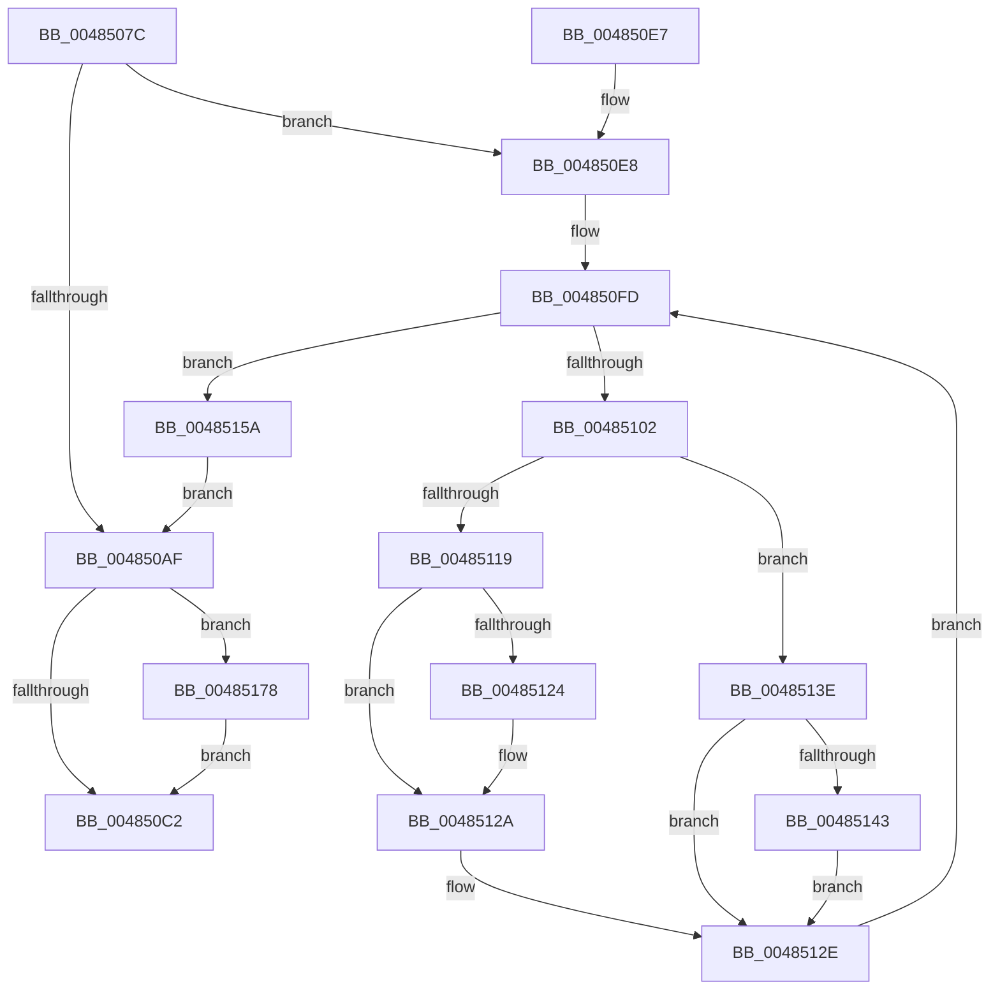

# SshpSetCollectionActive

- RVA: `0x0048507C`–`0x00485185` (길이 `265` bytes)
- VA: `0x000000014048507C`
- 실행 섹션: `.text`
- PDB 이름 있음: `예`; PDB Function 태그: `아니요`
- unwind 정보 RVA: `0x000AF3D8`
- 디코드: `79`개 명령, `265/265` bytes 표시
- 미해석 바이트: `0` (있으면 어셈블리에 `.byte`로 보존)

> 이 문서는 커널 이미지의 기계어와 PDB 기호를 분석해 생성했습니다. 4번과 5번은 함수 원형과 자료형을 바이너리 사용 방식에서 추정한 C 해석이며 원본 소스 복구 결과는 아닙니다.

## 1. Dependencies

- 직접 호출 지점: **7**; 고유 호출 대상: **7**
- 직접 호출자로 확인된 함수: **3**
- RIP 상대 이미지 참조: **0**

### Outgoing calls
- `0x0048509E` → [CmSiRWLockAcquireExclusive](../../page/A1/CmSiRWLockAcquireExclusive_function_00A1679C.md) (function, `0x00A1679C`)
- `0x004850C5` → [KeAbPostRelease](../2E/KeAbPostRelease_function_002E1600.md) (function, `0x002E1600`)
- `0x00485109` → [KeAcquireSpinLockRaiseToDpc](../20/KeAcquireSpinLockRaiseToDpc_function_00208470.md) (function, `0x00208470`)
- `0x00485134` → [KeReleaseSpinLock](../39/KeReleaseSpinLock_function_00392BA0.md) (function, `0x00392BA0`)
- `0x0048514F` → [SshpStopBlockerAccounting](SshpStopBlockerAccounting_function_0048518C.md) (function, `0x0048518C`)
- `0x0048516E` → [SshpTracingWriteCollectionStateChange](../../page/AA/SshpTracingWriteCollectionStateChange_function_00AADE8C.md) (function, `0x00AADE8C`)
- `0x0048517B` → [ExfTryToWakePushLock](../26/ExfTryToWakePushLock_function_00265DD0.md) (function, `0x00265DD0`)

### Direct callers
- [SshpPowerSettingCallback](../../page/AA/SshpPowerSettingCallback_function_00AA20F0.md) at `0x00AA2128`
- [PdcPoSleepStudyHelperSetPhaseActive](../../page/AA/PdcPoSleepStudyHelperSetPhaseActive_function_00AAFB10.md) at `0x00AAFB3B`
- [SshInitialize](../../init/C4/SshInitialize_function_00C4465C.md) at `0x00C4470F`

### Static image references
- 디코드된 RIP-relative 메모리 참조가 없습니다.

## 2. Other-region calls and transfers

- 다른 실행 섹션으로 향하는 call: **2**
  - `0x0048509E` → [CmSiRWLockAcquireExclusive](../../page/A1/CmSiRWLockAcquireExclusive_function_00A1679C.md) (`.text` → `PAGE`)
  - `0x0048516E` → [SshpTracingWriteCollectionStateChange](../../page/AA/SshpTracingWriteCollectionStateChange_function_00AADE8C.md) (`.text` → `PAGE`)
- 별도 외부 분기/꼬리 이동을 확인하지 못했습니다.

## 3. Assembly (complete function range)

```asm
0048507C  48 89 5C 24 08                  mov qword ptr [rsp + 8], rbx
00485081  48 89 6C 24 10                  mov qword ptr [rsp + 0x10], rbp
00485086  48 89 74 24 18                  mov qword ptr [rsp + 0x18], rsi
0048508B  57                              push rdi
0048508C  41 54                           push r12
0048508E  41 55                           push r13
00485090  41 56                           push r14
00485092  41 57                           push r15
00485094  48 83 EC 20                     sub rsp, 0x20
00485098  0F B6 EA                        movzx ebp, dl
0048509B  48 8B D9                        mov rbx, rcx
0048509E  E8 F9 16 59 00                  call 0x140a1679c
004850A3  8B 43 1C                        mov eax, dword ptr [rbx + 0x1c]
004850A6  8B F5                           mov esi, ebp
004850A8  83 E0 01                        and eax, 1
004850AB  3B C5                           cmp eax, ebp
004850AD  75 39                           jne 0x1404850e8
004850AF  48 83 C8 FF                     or rax, 0xffffffffffffffff
004850B3  F0 48 0F C1 03                  lock xadd qword ptr [rbx], rax
004850B8  24 06                           and al, 6
004850BA  3C 02                           cmp al, 2
004850BC  0F 84 B6 00 00 00               je 0x140485178
004850C2  48 8B CB                        mov rcx, rbx
004850C5  E8 36 C5 E5 FF                  call 0x1402e1600
004850CA  48 8B 5C 24 50                  mov rbx, qword ptr [rsp + 0x50]
004850CF  48 8B 6C 24 58                  mov rbp, qword ptr [rsp + 0x58]
004850D4  48 8B 74 24 60                  mov rsi, qword ptr [rsp + 0x60]
004850D9  48 83 C4 20                     add rsp, 0x20
004850DD  41 5F                           pop r15
004850DF  41 5E                           pop r14
004850E1  41 5D                           pop r13
004850E3  41 5C                           pop r12
004850E5  5F                              pop rdi
004850E6  C3                              ret
004850E7  CC                              int3
004850E8  49 BC 08 00 00 00 80 F7 FF FF   movabs r12, 0xfffff78000000008
004850F2  4C 8D 7B 20                     lea r15, [rbx + 0x20]
004850F6  4D 8B 24 24                     mov r12, qword ptr [r12]
004850FA  4D 8B 37                        mov r14, qword ptr [r15]
004850FD  4D 3B F7                        cmp r14, r15
00485100  74 58                           je 0x14048515a
00485102  49 8B 7E 60                     mov rdi, qword ptr [r14 + 0x60]
00485106  48 8B CF                        mov rcx, rdi
00485109  E8 62 33 D8 FF                  call 0x140208470
0048510E  8B 4F 08                        mov ecx, dword ptr [rdi + 8]
00485111  44 8A E8                        mov r13b, al
00485114  40 84 ED                        test bpl, bpl
00485117  74 25                           je 0x14048513e
00485119  83 C9 02                        or ecx, 2
0048511C  89 4F 08                        mov dword ptr [rdi + 8], ecx
0048511F  F6 C1 01                        test cl, 1
00485122  75 06                           jne 0x14048512a
00485124  FF 87 80 00 00 00               inc dword ptr [rdi + 0x80]
0048512A  4C 89 67 20                     mov qword ptr [rdi + 0x20], r12
0048512E  41 8A D5                        mov dl, r13b
00485131  48 8B CF                        mov rcx, rdi
00485134  E8 67 DA F0 FF                  call 0x140392ba0
00485139  4D 8B 36                        mov r14, qword ptr [r14]
0048513C  EB BF                           jmp 0x1404850fd
0048513E  F6 C1 02                        test cl, 2
00485141  74 EB                           je 0x14048512e
00485143  41 B8 01 00 00 00               mov r8d, 1
00485149  49 8B D4                        mov rdx, r12
0048514C  48 8B CF                        mov rcx, rdi
0048514F  E8 38 00 00 00                  call 0x14048518c
00485154  83 67 08 FD                     and dword ptr [rdi + 8], 0xfffffffd
00485158  EB D4                           jmp 0x14048512e
0048515A  8B 43 1C                        mov eax, dword ptr [rbx + 0x1c]
0048515D  40 8A D5                        mov dl, bpl
00485160  48 8B 4B 08                     mov rcx, qword ptr [rbx + 8]
00485164  33 F0                           xor esi, eax
00485166  83 E6 01                        and esi, 1
00485169  33 F0                           xor esi, eax
0048516B  89 73 1C                        mov dword ptr [rbx + 0x1c], esi
0048516E  E8 19 8D 62 00                  call 0x140aade8c
00485173  E9 37 FF FF FF                  jmp 0x1404850af
00485178  48 8B CB                        mov rcx, rbx
0048517B  E8 50 0C DE FF                  call 0x140265dd0
00485180  E9 3D FF FF FF                  jmp 0x1404850c2
```

## 4. C-style interpretation (structured pseudocode)

```c
__int64 __fastcall SshpSetCollectionActive(__int64 a1, unsigned __int8 a2)
{
    __int64 result;
    __int64 v_rsi;
    __int64 v_rsp;
    unsigned __int64 v_stack_p10;
    unsigned __int64 v_stack_p18;
    unsigned __int64 v_stack_p8;

    v_stack_p8 = v_rbx;
    v_stack_p10 = v_rbp;
    v_stack_p18 = v_rsi;
    v_rsp = (v_rsp) - (32);
    result = CmSiRWLockAcquireExclusive(a1, a2, a3, a4);
    result = (unsigned int)(((unsigned int)(*(unsigned int *)(a1 + 28))) & (1));
    if (((unsigned int)(result)) != a2) goto loc_004850E8;
loc_004850AF:
    result = (result) | (-1);
    result = (unsigned __int8)((result) & (6));
    if (((unsigned __int8)(result)) == 2) goto loc_00485178;
loc_004850C2:
    result = KeAbPostRelease(a1, a2, a3, a4);
    v_rsp = (v_rsp) + (32);
    return result;
loc_004850E8:
loc_004850FD:
    if ((*(unsigned __int64 *)(v_stack_p8 + 32)) == (v_stack_p8 + 32)) goto loc_0048515A;
    result = KeAcquireSpinLockRaiseToDpc(*(unsigned __int64 *)(*(unsigned __int64 *)(v_stack_p8 + 32) + 96), a2, a3, a4);
    if ((unsigned __int8)(v_stack_p10) == 0) goto loc_0048513E;
    a1 = (unsigned int)(((unsigned int)(*(unsigned int *)(*(unsigned __int64 *)(*(unsigned __int64 *)(v_stack_p8 + 32) + 96) + 8))) | (2));
    *(unsigned int *)(*(unsigned __int64 *)(*(unsigned __int64 *)(v_stack_p8 + 32) + 96) + 8) = (unsigned int)(a1);
    if ((((unsigned __int8)(a1)) & (1)) == 0) {
    }
    *(unsigned __int64 *)(*(unsigned __int64 *)(*(unsigned __int64 *)(v_stack_p8 + 32) + 96) + 32) = *(unsigned __int64 *)(v_r12);
loc_0048512E:
    result = KeReleaseSpinLock(*(unsigned __int64 *)(*(unsigned __int64 *)(v_stack_p8 + 32) + 96), (unsigned __int8)((unsigned __int8)(result)), a3, a4);
    goto loc_004850FD;
loc_0048513E:
    if ((((unsigned __int8)(*(unsigned __int64 *)(*(unsigned __int64 *)(v_stack_p8 + 32) + 96))) & (2)) == 0) goto loc_0048512E;
    result = SshpStopBlockerAccounting(*(unsigned __int64 *)(*(unsigned __int64 *)(v_stack_p8 + 32) + 96), *(unsigned __int64 *)(v_r12), 1, a4);
    goto loc_0048512E;
loc_0048515A:
    v_rsi = (unsigned int)((v_stack_p18) ^ ((unsigned int)((unsigned int)(*(unsigned int *)(v_stack_p8 + 28)))));
    v_rsi = (unsigned int)((v_rsi) & (1));
    v_rsi = (unsigned int)((v_rsi) ^ ((unsigned int)((unsigned int)(*(unsigned int *)(v_stack_p8 + 28)))));
    *(unsigned int *)(v_stack_p8 + 28) = (unsigned int)(v_rsi);
    result = SshpTracingWriteCollectionStateChange(*(unsigned __int64 *)(v_stack_p8 + 8), (unsigned __int8)(v_stack_p10), 1, a4);
    goto loc_004850AF;
loc_00485178:
    result = ExfTryToWakePushLock(v_stack_p8, (unsigned __int8)(v_stack_p10), 1, a4);
    goto loc_004850C2;
}
```

## 5. (Beta) C Style

```c
int64_t SshpSetCollectionActive(void *Arg1, uint8_t Arg2)
{
    uint8_t *arg1 = (uint8_t *)Arg1;

    int64_t result;
    int64_t local_rsi;
    int64_t local_rsp;
    uint64_t v_stack_p10;
    uint64_t v_stack_p18;
    uint64_t v_stack_p8;

    v_stack_p8 = local_rbx;
    v_stack_p10 = local_rbp;
    v_stack_p18 = local_rsi;
    local_rsp = (local_rsp) - (32);
    result = CmSiRWLockAcquireExclusive(Arg1, Arg2, a3, a4);
    result = (uint32_t)(((uint32_t)(*(uint32_t *)(arg1 + 0x1C))) & (1));
    if (((uint32_t)(result)) != Arg2) goto loc_004850E8;
loc_004850AF:
    result = (result) | (-1);
    result = (uint8_t)((result) & (6));
    if (((uint8_t)(result)) == 2) goto loc_00485178;
loc_004850C2:
    result = KeAbPostRelease(Arg1, Arg2, a3, a4);
    local_rsp = (local_rsp) + (32);
    return result;
loc_004850E8:
loc_004850FD:
    if ((*(uint64_t *)(v_stack_p8 + 0x20)) == (v_stack_p8 + 32)) goto loc_0048515A;
    result = KeAcquireSpinLockRaiseToDpc(*(uint64_t *)(*(uint64_t *)(v_stack_p8 + 0x20) + 0x60), Arg2, a3, a4);
    if ((uint8_t)(v_stack_p10) == 0) goto loc_0048513E;
    Arg1 = (uint32_t)(((uint32_t)(*(uint32_t *)(*(uint64_t *)(*(uint64_t *)(v_stack_p8 + 0x20) + 0x60) + 0x8))) | (2));
    *(uint32_t *)(*(uint64_t *)(*(uint64_t *)(v_stack_p8 + 0x20) + 0x60) + 0x8) = (uint32_t)(Arg1);
    if ((((uint8_t)(Arg1)) & (1)) == 0) {
    }
    *(uint64_t *)(*(uint64_t *)(*(uint64_t *)(v_stack_p8 + 0x20) + 0x60) + 0x20) = *(uint64_t *)(local_r12);
loc_0048512E:
    result = KeReleaseSpinLock(*(uint64_t *)(*(uint64_t *)(v_stack_p8 + 0x20) + 0x60), (uint8_t)((uint8_t)(result)), a3, a4);
    goto loc_004850FD;
loc_0048513E:
    if ((((uint8_t)(*(uint64_t *)(*(uint64_t *)(v_stack_p8 + 0x20) + 0x60))) & (2)) == 0) goto loc_0048512E;
    result = SshpStopBlockerAccounting(*(uint64_t *)(*(uint64_t *)(v_stack_p8 + 0x20) + 0x60), *(uint64_t *)(local_r12), 1, a4);
    goto loc_0048512E;
loc_0048515A:
    local_rsi = (uint32_t)((v_stack_p18) ^ ((uint32_t)((uint32_t)(*(uint32_t *)(v_stack_p8 + 0x1C)))));
    local_rsi = (uint32_t)((local_rsi) & (1));
    local_rsi = (uint32_t)((local_rsi) ^ ((uint32_t)((uint32_t)(*(uint32_t *)(v_stack_p8 + 0x1C)))));
    *(uint32_t *)(v_stack_p8 + 0x1C) = (uint32_t)(local_rsi);
    result = SshpTracingWriteCollectionStateChange(*(uint64_t *)(v_stack_p8 + 0x8), (uint8_t)(v_stack_p10), 1, a4);
    goto loc_004850AF;
loc_00485178:
    result = ExfTryToWakePushLock(v_stack_p8, (uint8_t)(v_stack_p10), 1, a4);
    goto loc_004850C2;
}
```

### 관측된 메모리 오프셋

구조체 형식이 확인되지 않은 접근은 인자 기준의 오프셋으로만 기록했습니다.

| 기준 인자 | 오프셋 표현 | 폭 (bit) | 접근 |
|---|---:|---:|---|
| `Arg1` | `+ 0x0` | `64` | `R` |
| `Arg1` | `+ 0x0` | `64` | `R/W` |
| `Arg1` | `+ 0x8` | `64` | `R` |
| `Arg1` | `+ 0x1C` | `32` | `R` |
| `Arg1` | `+ 0x1C` | `32` | `W` |
| `Arg1` | `+ 0x20` | `64` | `R` |

## 6. Execution-region graph

[열기: 2D/3D 그래프와 함수 탐색 컨트롤 패널](../../../control-panel.html?section=text&rva=0x0048507C&view=graph)

- 2D 그래프는 위에서 아래로 흐르고, 3D 그래프는 빈 공간을 드래그해 회전합니다. Shift+드래그는 이동, 휠은 확대·축소, 함수 노드 선택은 대상 보고서 이동입니다.

### Static fallback


