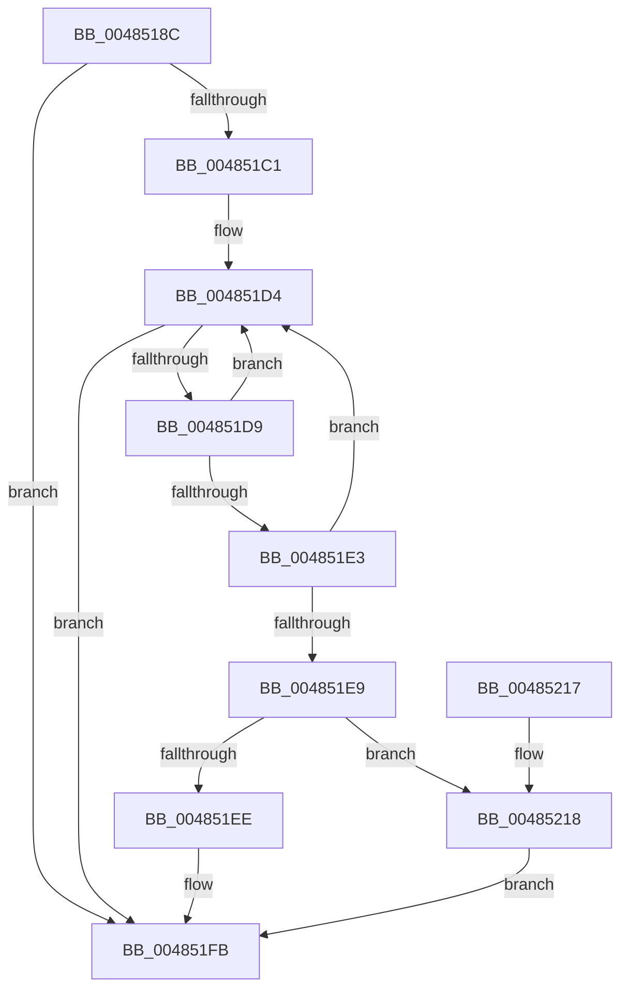

# SshpStopBlockerAccounting

- RVA: `0x0048518C`–`0x00485227` (길이 `155` bytes)
- VA: `0x000000014048518C`
- 실행 섹션: `.text`
- PDB 이름 있음: `예`; PDB Function 태그: `아니요`
- unwind 정보 RVA: `0x000AF3F8`
- 디코드: `43`개 명령, `155/155` bytes 표시
- 미해석 바이트: `0` (있으면 어셈블리에 `.byte`로 보존)

> 이 문서는 커널 이미지의 기계어와 PDB 기호를 분석해 생성했습니다. 4번과 5번은 함수 원형과 자료형을 바이너리 사용 방식에서 추정한 C 해석이며 원본 소스 복구 결과는 아닙니다.

## 1. Dependencies

- 직접 호출 지점: **0**; 고유 호출 대상: **0**
- 직접 호출자로 확인된 함수: **2**
- RIP 상대 이미지 참조: **1**

### Outgoing calls
- 직접 디코드된 call 명령이 없습니다.

### Direct callers
- [SshpQueryAndResetBlockerAccounting](SshpQueryAndResetBlockerAccounting_function_00484F4C.md) at `0x00484F98`
- [SshpSetCollectionActive](SshpSetCollectionActive_function_0048507C.md) at `0x0048514F`

### Static image references
- `0x004851C4` → RVA `0x000294D8` (`.rdata`; read)

## 2. Other-region calls and transfers

- 다른 실행 섹션으로 향하는 call: **0**
- 별도 외부 분기/꼬리 이동을 확인하지 못했습니다.

## 3. Assembly (complete function range)

```asm
0048518C  48 89 5C 24 08                  mov qword ptr [rsp + 8], rbx
00485191  48 89 74 24 10                  mov qword ptr [rsp + 0x10], rsi
00485196  48 89 7C 24 18                  mov qword ptr [rsp + 0x18], rdi
0048519B  44 8B 49 08                     mov r9d, dword ptr [rcx + 8]
0048519F  33 FF                           xor edi, edi
004851A1  48 8B 41 20                     mov rax, qword ptr [rcx + 0x20]
004851A5  41 F7 D1                        not r9d
004851A8  41 83 E1 01                     and r9d, 1
004851AC  45 8B D8                        mov r11d, r8d
004851AF  49 C1 E1 07                     shl r9, 7
004851B3  4C 8B D2                        mov r10, rdx
004851B6  4C 03 C9                        add r9, rcx
004851B9  48 8B D9                        mov rbx, rcx
004851BC  48 3B D0                        cmp rdx, rax
004851BF  72 3A                           jb 0x1404851fb
004851C1  4C 8B C2                        mov r8, rdx
004851C4  48 8D 35 0D 43 BA FF            lea rsi, [rip - 0x45bcf3]
004851CB  4C 2B C0                        sub r8, rax
004851CE  8B D7                           mov edx, edi
004851D0  4D 01 41 28                     add qword ptr [r9 + 0x28], r8
004851D4  83 FA 05                        cmp edx, 5
004851D7  73 22                           jae 0x1404851fb
004851D9  8B CA                           mov ecx, edx
004851DB  FF C2                           inc edx
004851DD  4C 3B 04 CE                     cmp r8, qword ptr [rsi + rcx*8]
004851E1  72 F1                           jb 0x1404851d4
004851E3  4C 3B 04 D6                     cmp r8, qword ptr [rsi + rdx*8]
004851E7  73 EB                           jae 0x1404851d4
004851E9  45 85 DB                        test r11d, r11d
004851EC  74 2A                           je 0x140485218
004851EE  41 FF 84 89 94 00 00 00         inc dword ptr [r9 + rcx*4 + 0x94]
004851F6  4D 01 44 C9 58                  add qword ptr [r9 + rcx*8 + 0x58], r8
004851FB  41 83 FB 01                     cmp r11d, 1
004851FF  4C 0F 44 D7                     cmove r10, rdi
00485203  4C 89 53 20                     mov qword ptr [rbx + 0x20], r10
00485207  48 8B 5C 24 08                  mov rbx, qword ptr [rsp + 8]
0048520C  48 8B 74 24 10                  mov rsi, qword ptr [rsp + 0x10]
00485211  48 8B 7C 24 18                  mov rdi, qword ptr [rsp + 0x18]
00485216  C3                              ret
00485217  CC                              int3
00485218  41 FF 84 89 80 00 00 00         inc dword ptr [r9 + rcx*4 + 0x80]
00485220  4D 01 44 C9 30                  add qword ptr [r9 + rcx*8 + 0x30], r8
00485225  EB D4                           jmp 0x1404851fb
```

## 4. C-style interpretation (structured pseudocode)

```c
__int64 __fastcall SshpStopBlockerAccounting(__int64 a1, __int64 a2, int a3)
{
    __int64 v_rdi;
    unsigned __int64 v_stack_p10;
    unsigned __int64 v_stack_p18;
    unsigned __int64 v_stack_p8;

    v_stack_p8 = v_rbx;
    v_stack_p10 = v_rsi;
    v_stack_p18 = v_rdi;
    v_rdi = 0;
    a4 = (unsigned int)(~((unsigned int)(*(unsigned int *)(a1 + 8))));
    a4 = (unsigned int)((a4) & (1));
    a4 = (a4) << (7);
    a4 = (a4) + (a1);
    if (a2 < (*(unsigned __int64 *)(a1 + 32))) goto loc_004851FB;
    a3 = (a2) - (*(unsigned __int64 *)(a1 + 32));
loc_004851D4:
    if (0 >= 5) goto loc_004851FB;
    a2 = (unsigned int)((0) + 1);
    if (a3 < (*(unsigned __int64 *)(v_rip - 4570355 + 0 * 8))) goto loc_004851D4;
    if (a3 >= (*(unsigned __int64 *)(v_rip - 4570355 + a2 * 8))) goto loc_004851D4;
    if ((unsigned int)((unsigned int)(a3)) == 0) goto loc_00485218;
loc_004851FB:
    if (((unsigned int)((unsigned int)(a3))) == 1) { a2 = 0; }
    *(unsigned __int64 *)(a1 + 32) = a2;
    return *(unsigned __int64 *)(a1 + 32);
loc_00485218:
    goto loc_004851FB;
}
```

## 5. (Beta) C Style

```c
int64_t SshpStopBlockerAccounting(void *Arg1, int64_t Arg2, int32_t Arg3)
{
    uint8_t *arg1 = (uint8_t *)Arg1;

    int64_t local_rdi;
    uint64_t v_stack_p10;
    uint64_t v_stack_p18;
    uint64_t v_stack_p8;

    v_stack_p8 = local_rbx;
    v_stack_p10 = local_rsi;
    v_stack_p18 = local_rdi;
    local_rdi = 0;
    a4 = (uint32_t)(~((uint32_t)(*(uint32_t *)(arg1 + 0x8))));
    a4 = (uint32_t)((a4) & (1));
    a4 = (a4) << (7);
    a4 = (a4) + (Arg1);
    if (Arg2 < (*(uint64_t *)(arg1 + 0x20))) goto loc_004851FB;
    Arg3 = (Arg2) - (*(uint64_t *)(arg1 + 0x20));
loc_004851D4:
    if (0 >= 5) goto loc_004851FB;
    Arg2 = (uint32_t)((0) + 1);
    if (Arg3 < (*(uint64_t *)(v_rip - 0x45BCF3 + 0x0 * 8))) goto loc_004851D4;
    if (Arg3 >= (*(uint64_t *)(v_rip - 0x45BCF3 + Arg2 * 8))) goto loc_004851D4;
    if ((uint32_t)((uint32_t)(Arg3)) == 0) goto loc_00485218;
loc_004851FB:
    if (((uint32_t)((uint32_t)(Arg3))) == 1) { Arg2 = 0; }
    *(uint64_t *)(arg1 + 0x20) = Arg2;
    return *(uint64_t *)(arg1 + 0x20);
loc_00485218:
    goto loc_004851FB;
}
```

### 관측된 메모리 오프셋

구조체 형식이 확인되지 않은 접근은 인자 기준의 오프셋으로만 기록했습니다.

| 기준 인자 | 오프셋 표현 | 폭 (bit) | 접근 |
|---|---:|---:|---|
| `Arg1` | `+ 0x8` | `32` | `R` |
| `Arg1` | `+ 0x20` | `64` | `R` |
| `Arg1` | `+ 0x20` | `64` | `W` |

## 6. Execution-region graph

[열기: 2D/3D 그래프와 함수 탐색 컨트롤 패널](../../../control-panel.html?section=text&rva=0x0048518C&view=graph)

- 2D 그래프는 위에서 아래로 흐르고, 3D 그래프는 빈 공간을 드래그해 회전합니다. Shift+드래그는 이동, 휠은 확대·축소, 함수 노드 선택은 대상 보고서 이동입니다.

### Static fallback


