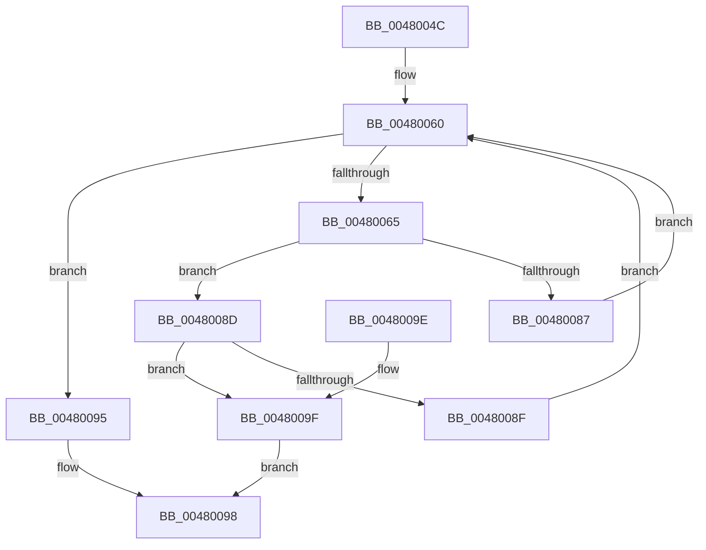

# sub_0048004C

- RVA: `0x0048004C`–`0x004800A4` (길이 `88` bytes)
- VA: `0x000000014048004C`
- 실행 섹션: `.text`
- PDB 이름 있음: `아니요`; PDB Function 태그: `아니요`
- unwind 정보 RVA: `0x000AE424`
- 디코드: `29`개 명령, `88/88` bytes 표시
- 미해석 바이트: `0` (있으면 어셈블리에 `.byte`로 보존)

> 이 문서는 커널 이미지의 기계어와 PDB 기호를 분석해 생성했습니다. 4번과 5번은 함수 원형과 자료형을 바이너리 사용 방식에서 추정한 C 해석이며 원본 소스 복구 결과는 아닙니다.

## 1. Dependencies

- 직접 호출 지점: **0**; 고유 호출 대상: **0**
- 직접 호출자로 확인된 함수: **1**
- RIP 상대 이미지 참조: **0**

### Outgoing calls
- 직접 디코드된 call 명령이 없습니다.

### Direct callers
- [sub_00486C44](Unknown_function_00486C44.md) at `0x00486C72`

### Static image references
- 디코드된 RIP-relative 메모리 참조가 없습니다.

## 2. Other-region calls and transfers

- 다른 실행 섹션으로 향하는 call: **0**
- 별도 외부 분기/꼬리 이동을 확인하지 못했습니다.

## 3. Assembly (complete function range)

```asm
0048004C  48 89 5C 24 08                  mov qword ptr [rsp + 8], rbx
00480051  44 8B 01                        mov r8d, dword ptr [rcx]
00480054  45 33 C9                        xor r9d, r9d
00480057  41 FF C8                        dec r8d
0048005A  44 8B DA                        mov r11d, edx
0048005D  48 8B D9                        mov rbx, rcx
00480060  45 3B C1                        cmp r8d, r9d
00480063  7C 30                           jl 0x140480095
00480065  B9 02 00 00 00                  mov ecx, 2
0048006A  43 8D 04 08                     lea eax, [r8 + r9]
0048006E  99                              cdq
0048006F  F7 F9                           idiv ecx
00480071  48 8B 4B 04                     mov rcx, qword ptr [rbx + 4]
00480075  4C 63 D0                        movsxd r10, eax
00480078  42 8B 14 91                     mov edx, dword ptr [rcx + r10*4]
0048007C  81 E2 FF FF FF 0F               and edx, 0xfffffff
00480082  44 3B DA                        cmp r11d, edx
00480085  73 06                           jae 0x14048008d
00480087  44 8D 40 FF                     lea r8d, [rax - 1]
0048008B  EB D3                           jmp 0x140480060
0048008D  76 10                           jbe 0x14048009f
0048008F  44 8D 48 01                     lea r9d, [rax + 1]
00480093  EB CB                           jmp 0x140480060
00480095  49 63 C1                        movsxd rax, r9d
00480098  48 8B 5C 24 08                  mov rbx, qword ptr [rsp + 8]
0048009D  C3                              ret
0048009E  CC                              int3
0048009F  49 8B C2                        mov rax, r10
004800A2  EB F4                           jmp 0x140480098
```

## 4. C-style interpretation (structured pseudocode)

```c
__int64 __fastcall sub_0048004C(__int64 a1, int a2, __int64 a3, int a4)
{
    unsigned __int64 v_stack_p8;

    v_stack_p8 = v_rbx;
    a4 = 0;
    a3 = (unsigned int)(((unsigned int)(*(unsigned int *)(a1))) - 1);
loc_00480060:
    if (((unsigned int)(a3)) < 0) goto loc_00480095;
    a2 = (unsigned int)(((unsigned int)(*(unsigned int *)(*(unsigned __int64 *)(a1 + 4) + (int)((unsigned int)(a3 + a4 * 1)) * 4))) & (0xFFFFFFFULL));
    if (((unsigned int)((unsigned int)(a2))) >= a2) goto loc_0048008D;
    goto loc_00480060;
loc_0048008D:
    if (((unsigned int)((unsigned int)(a2))) <= a2) goto loc_0048009F;
    goto loc_00480060;
loc_00480095:
loc_00480098:
    return (int)((unsigned int)(a3 + a4 * 1 + 1));
loc_0048009F:
    goto loc_00480098;
}
```

## 5. (Beta) C Style

```c
int64_t sub_0048004C(void *Arg1, int32_t Arg2, int64_t Arg3, int32_t Arg4)
{
    uint8_t *arg1 = (uint8_t *)Arg1;

    uint64_t v_stack_p8;

    v_stack_p8 = local_rbx;
    Arg4 = 0;
    Arg3 = (uint32_t)(((uint32_t)(*(uint32_t *)(arg1))) - 1);
loc_00480060:
    if (((uint32_t)(Arg3)) < 0) goto loc_00480095;
    Arg2 = (uint32_t)(((uint32_t)(*(uint32_t *)(*(uint64_t *)(arg1 + 0x4) + (int32_t)((uint32_t)(Arg3 + Arg4 * 1)) * 4))) & (0xFFFFFFFULL));
    if (((uint32_t)((uint32_t)(Arg2))) >= Arg2) goto loc_0048008D;
    goto loc_00480060;
loc_0048008D:
    if (((uint32_t)((uint32_t)(Arg2))) <= Arg2) goto loc_0048009F;
    goto loc_00480060;
loc_00480095:
loc_00480098:
    return (int32_t)((uint32_t)(Arg3 + Arg4 * 1 + 1));
loc_0048009F:
    goto loc_00480098;
}
```

### 관측된 메모리 오프셋

구조체 형식이 확인되지 않은 접근은 인자 기준의 오프셋으로만 기록했습니다.

| 기준 인자 | 오프셋 표현 | 폭 (bit) | 접근 |
|---|---:|---:|---|
| `Arg1` | `+ 0x0` | `32` | `R` |
| `Arg1` | `+ 0x4` | `64` | `R` |

## 6. Execution-region graph

[열기: 2D/3D 그래프와 함수 탐색 컨트롤 패널](../../../control-panel.html?section=text&rva=0x0048004C&view=graph)

- 2D 그래프는 위에서 아래로 흐르고, 3D 그래프는 빈 공간을 드래그해 회전합니다. Shift+드래그는 이동, 휠은 확대·축소, 함수 노드 선택은 대상 보고서 이동입니다.

### Static fallback


