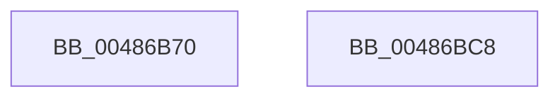

# sub_00486B70

- RVA: `0x00486B70`–`0x00486BC9` (길이 `89` bytes)
- VA: `0x0000000140486B70`
- 실행 섹션: `.text`
- PDB 이름 있음: `아니요`; PDB Function 태그: `아니요`
- unwind 정보 RVA: `0x000AF0B0`
- 디코드: `22`개 명령, `89/89` bytes 표시
- 미해석 바이트: `0` (있으면 어셈블리에 `.byte`로 보존)

> 이 문서는 커널 이미지의 기계어와 PDB 기호를 분석해 생성했습니다. 4번과 5번은 함수 원형과 자료형을 바이너리 사용 방식에서 추정한 C 해석이며 원본 소스 복구 결과는 아닙니다.

## 1. Dependencies

- 직접 호출 지점: **2**; 고유 호출 대상: **2**
- 직접 호출자로 확인된 함수: **2**
- RIP 상대 이미지 참조: **0**

### Outgoing calls
- `0x00486B9E` → [sub_00486C44](Unknown_function_00486C44.md) (function, `0x00486C44`)
- `0x00486BBB` → [sub_00486BD0](Unknown_function_00486BD0.md) (function, `0x00486BD0`)

### Direct callers
- [sub_00811EE0](../../page/81/Unknown_function_00811EE0.md) at `0x00811FD2`
- [sub_00811EE0](../../page/81/Unknown_function_00811EE0.md) at `0x008120AC`
- [sub_009A0EC4](../../page/9A/Unknown_function_009A0EC4.md) at `0x009A0FA6`
- [sub_009A0EC4](../../page/9A/Unknown_function_009A0EC4.md) at `0x009A10C1`

### Static image references
- 디코드된 RIP-relative 메모리 참조가 없습니다.

## 2. Other-region calls and transfers

- 다른 실행 섹션으로 향하는 call: **0**
- 별도 외부 분기/꼬리 이동을 확인하지 못했습니다.

## 3. Assembly (complete function range)

```asm
00486B70  48 8B C4                        mov rax, rsp
00486B73  53                              push rbx
00486B74  48 83 EC 50                     sub rsp, 0x50
00486B78  83 60 D4 00                     and dword ptr [rax - 0x2c], 0
00486B7C  49 8B D9                        mov rbx, r9
00486B7F  89 50 C8                        mov dword ptr [rax - 0x38], edx
00486B82  48 8B 94 24 80 00 00 00         mov rdx, qword ptr [rsp + 0x80]
00486B8A  48 89 48 CC                     mov qword ptr [rax - 0x34], rcx
00486B8E  48 8D 48 C8                     lea rcx, [rax - 0x38]
00486B92  4C 89 40 E4                     mov qword ptr [rax - 0x1c], r8
00486B96  44 8B 84 24 90 00 00 00         mov r8d, dword ptr [rsp + 0x90]
00486B9E  E8 A1 00 00 00                  call 0x140486c44
00486BA3  48 8B 94 24 88 00 00 00         mov rdx, qword ptr [rsp + 0x88]
00486BAB  48 8D 4C 24 20                  lea rcx, [rsp + 0x20]
00486BB0  48 2B 94 24 80 00 00 00         sub rdx, qword ptr [rsp + 0x80]
00486BB8  4C 8B C3                        mov r8, rbx
00486BBB  E8 10 00 00 00                  call 0x140486bd0
00486BC0  33 C0                           xor eax, eax
00486BC2  48 83 C4 50                     add rsp, 0x50
00486BC6  5B                              pop rbx
00486BC7  C3                              ret
00486BC8  CC                              int3
```

## 4. C-style interpretation (structured pseudocode)

```c
__int64 __fastcall sub_00486B70(__int64 a1, int a2, __int64 a3, __int64 a4, __int64 a5, __int64 a6, unsigned int a7)
{
    __int64 result;
    __int64 v_rsp;
    unsigned __int64 v_stack_m38;

    v_rsp = (v_rsp) - (80);
    *(unsigned int *)(v_rsp - 56) = a2;
    *(unsigned __int64 *)(v_rsp - 52) = a1;
    *(unsigned __int64 *)(v_rsp - 28) = a3;
    result = sub_00486C44(v_rsp - 56, a5, (unsigned int)(a7), a4);
    a2 = (a6) - (a5);
    result = sub_00486BD0(v_stack_m38, a2, a4, a4);
    result = 0;
    v_rsp = (v_rsp) + (80);
    return result;
}
```

## 5. (Beta) C Style

```c
int64_t sub_00486B70(int64_t Arg1, int32_t Arg2, int64_t Arg3, int64_t Arg4, int64_t Arg5, int64_t Arg6, uint32_t Arg7)
{
    int64_t result;
    int64_t local_rsp;
    uint64_t v_stack_m38;

    local_rsp = (local_rsp) - (80);
    *(uint32_t *)(local_rsp - 0x38) = Arg2;
    *(uint64_t *)(local_rsp - 0x34) = Arg1;
    *(uint64_t *)(local_rsp - 0x1C) = Arg3;
    result = sub_00486C44(local_rsp - 56, Arg5, (uint32_t)(Arg7), Arg4);
    Arg2 = (Arg6) - (Arg5);
    result = sub_00486BD0(v_stack_m38, Arg2, Arg4, Arg4);
    result = 0;
    local_rsp = (local_rsp) + (80);
    return result;
}
```

## 6. Execution-region graph

[열기: 2D/3D 그래프와 함수 탐색 컨트롤 패널](../../../control-panel.html?section=text&rva=0x00486B70&view=graph)

- 2D 그래프는 위에서 아래로 흐르고, 3D 그래프는 빈 공간을 드래그해 회전합니다. Shift+드래그는 이동, 휠은 확대·축소, 함수 노드 선택은 대상 보고서 이동입니다.

### Static fallback


