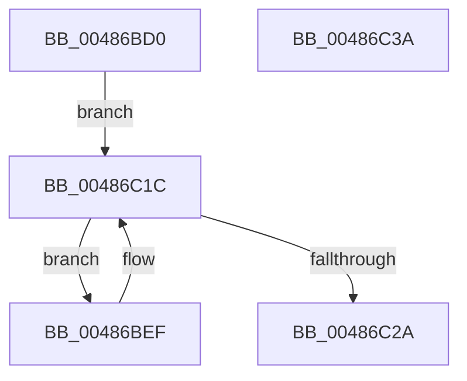

# sub_00486BD0

- RVA: `0x00486BD0`–`0x00486C3B` (길이 `107` bytes)
- VA: `0x0000000140486BD0`
- 실행 섹션: `.text`
- PDB 이름 있음: `아니요`; PDB Function 태그: `아니요`
- unwind 정보 RVA: `0x000794E0`
- 디코드: `30`개 명령, `107/107` bytes 표시
- 미해석 바이트: `0` (있으면 어셈블리에 `.byte`로 보존)

> 이 문서는 커널 이미지의 기계어와 PDB 기호를 분석해 생성했습니다. 4번과 5번은 함수 원형과 자료형을 바이너리 사용 방식에서 추정한 C 해석이며 원본 소스 복구 결과는 아닙니다.

## 1. Dependencies

- 직접 호출 지점: **2**; 고유 호출 대상: **2**
- 직접 호출자로 확인된 함수: **1**
- RIP 상대 이미지 참조: **0**

### Outgoing calls
- `0x00486C14` → [sub_00486D24](Unknown_function_00486D24.md) (function, `0x00486D24`)
- `0x00486C21` → [sub_00486C9C](Unknown_function_00486C9C.md) (function, `0x00486C9C`)

### Direct callers
- [sub_00486B70](Unknown_function_00486B70.md) at `0x00486BBB`

### Static image references
- 디코드된 RIP-relative 메모리 참조가 없습니다.

## 2. Other-region calls and transfers

- 다른 실행 섹션으로 향하는 call: **0**
- 별도 외부 분기/꼬리 이동을 확인하지 못했습니다.

## 3. Assembly (complete function range)

```asm
00486BD0  48 89 5C 24 08                  mov qword ptr [rsp + 8], rbx
00486BD5  48 89 74 24 10                  mov qword ptr [rsp + 0x10], rsi
00486BDA  57                              push rdi
00486BDB  48 83 EC 30                     sub rsp, 0x30
00486BDF  83 64 24 58 00                  and dword ptr [rsp + 0x58], 0
00486BE4  49 8B F8                        mov rdi, r8
00486BE7  48 8B F2                        mov rsi, rdx
00486BEA  48 8B D9                        mov rbx, rcx
00486BED  EB 2D                           jmp 0x140486c1c
00486BEF  44 8B 44 24 58                  mov r8d, dword ptr [rsp + 0x58]
00486BF4  4C 8B CF                        mov r9, rdi
00486BF7  41 8B D0                        mov edx, r8d
00486BFA  48 8B CB                        mov rcx, rbx
00486BFD  81 E2 FF FF FF 0F               and edx, 0xfffffff
00486C03  41 C1 E8 1C                     shr r8d, 0x1c
00486C07  48 03 53 1C                     add rdx, qword ptr [rbx + 0x1c]
00486C0B  48 8D 04 32                     lea rax, [rdx + rsi]
00486C0F  48 89 44 24 20                  mov qword ptr [rsp + 0x20], rax
00486C14  E8 0B 01 00 00                  call 0x140486d24
00486C19  48 8B CB                        mov rcx, rbx
00486C1C  48 8D 54 24 58                  lea rdx, [rsp + 0x58]
00486C21  E8 76 00 00 00                  call 0x140486c9c
00486C26  85 C0                           test eax, eax
00486C28  75 C5                           jne 0x140486bef
00486C2A  48 8B 5C 24 40                  mov rbx, qword ptr [rsp + 0x40]
00486C2F  48 8B 74 24 48                  mov rsi, qword ptr [rsp + 0x48]
00486C34  48 83 C4 30                     add rsp, 0x30
00486C38  5F                              pop rdi
00486C39  C3                              ret
00486C3A  CC                              int3
```

## 4. C-style interpretation (structured pseudocode)

```c
__int64 __fastcall sub_00486BD0(__int64 a1, __int64 a2, __int64 a3)
{
    __int64 result;
    __int64 v_rsp;
    unsigned __int64 v_stack_m18;
    unsigned __int64 v_stack_p10;
    unsigned int v_stack_p20;
    unsigned __int64 v_stack_p8;

    v_stack_p8 = v_rbx;
    v_stack_p10 = v_rsi;
    v_rsp = (v_rsp) - (48);
    goto loc_00486C1C;
loc_00486BEF:
    a2 = (unsigned int)(((unsigned int)((unsigned int)((unsigned int)(v_stack_p20)))) & (0xFFFFFFFULL));
    a3 = (unsigned int)(((unsigned int)(v_stack_p20)) >> (28));
    a2 = (a2) + (*(unsigned __int64 *)(a1 + 28));
    v_stack_m18 = a2 + a2 * 1;
    result = sub_00486D24(a1, a2, a3, a3);
loc_00486C1C:
    result = sub_00486C9C(a1, v_stack_p20, a3, a3);
    if ((unsigned int)(result) != 0) goto loc_00486BEF;
    v_rsp = (v_rsp) + (48);
    return result;
}
```

## 5. (Beta) C Style

```c
int64_t sub_00486BD0(void *Arg1, int64_t Arg2, int64_t Arg3)
{
    uint8_t *arg1 = (uint8_t *)Arg1;

    int64_t result;
    int64_t local_rsp;
    uint64_t v_stack_m18;
    uint64_t v_stack_p10;
    uint32_t v_stack_p20;
    uint64_t v_stack_p8;

    v_stack_p8 = local_rbx;
    v_stack_p10 = local_rsi;
    local_rsp = (local_rsp) - (48);
    goto loc_00486C1C;
loc_00486BEF:
    Arg2 = (uint32_t)(((uint32_t)((uint32_t)((uint32_t)(v_stack_p20)))) & (0xFFFFFFFULL));
    Arg3 = (uint32_t)(((uint32_t)(v_stack_p20)) >> (28));
    Arg2 = (Arg2) + (*(uint64_t *)(arg1 + 0x1C));
    v_stack_m18 = Arg2 + Arg2 * 1;
    result = sub_00486D24(Arg1, Arg2, Arg3, Arg3);
loc_00486C1C:
    result = sub_00486C9C(Arg1, v_stack_p20, Arg3, Arg3);
    if ((uint32_t)(result) != 0) goto loc_00486BEF;
    local_rsp = (local_rsp) + (48);
    return result;
}
```

### 관측된 메모리 오프셋

구조체 형식이 확인되지 않은 접근은 인자 기준의 오프셋으로만 기록했습니다.

| 기준 인자 | 오프셋 표현 | 폭 (bit) | 접근 |
|---|---:|---:|---|
| `Arg1` | `+ 0x1C` | `64` | `R` |

## 6. Execution-region graph

[열기: 2D/3D 그래프와 함수 탐색 컨트롤 패널](../../../control-panel.html?section=text&rva=0x00486BD0&view=graph)

- 2D 그래프는 위에서 아래로 흐르고, 3D 그래프는 빈 공간을 드래그해 회전합니다. Shift+드래그는 이동, 휠은 확대·축소, 함수 노드 선택은 대상 보고서 이동입니다.

### Static fallback


