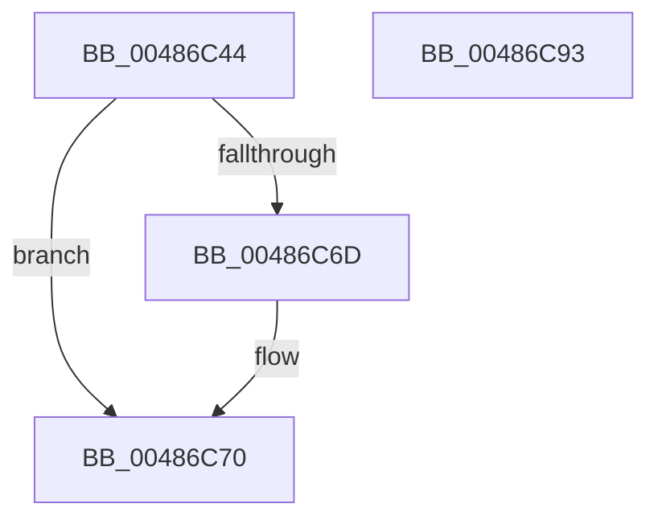

# sub_00486C44

- RVA: `0x00486C44`–`0x00486C94` (길이 `80` bytes)
- VA: `0x0000000140486C44`
- 실행 섹션: `.text`
- PDB 이름 있음: `아니요`; PDB Function 태그: `아니요`
- unwind 정보 RVA: `0x00060BC4`
- 디코드: `26`개 명령, `80/80` bytes 표시
- 미해석 바이트: `0` (있으면 어셈블리에 `.byte`로 보존)

> 이 문서는 커널 이미지의 기계어와 PDB 기호를 분석해 생성했습니다. 4번과 5번은 함수 원형과 자료형을 바이너리 사용 방식에서 추정한 C 해석이며 원본 소스 복구 결과는 아닙니다.

## 1. Dependencies

- 직접 호출 지점: **2**; 고유 호출 대상: **2**
- 직접 호출자로 확인된 함수: **1**
- RIP 상대 이미지 참조: **0**

### Outgoing calls
- `0x00486C5C` → [Feature_4168769850__private_IsEnabledDeviceUsageNoInline](../69/Feature_4168769850__private_IsEnabledDeviceUsageNoInline_function_0069BF9C.md) (function, `0x0069BF9C`)
- `0x00486C72` → [sub_0048004C](Unknown_function_0048004C.md) (function, `0x0048004C`)

### Direct callers
- [sub_00486B70](Unknown_function_00486B70.md) at `0x00486B9E`

### Static image references
- 디코드된 RIP-relative 메모리 참조가 없습니다.

## 2. Other-region calls and transfers

- 다른 실행 섹션으로 향하는 call: **0**
- 별도 외부 분기/꼬리 이동을 확인하지 못했습니다.

## 3. Assembly (complete function range)

```asm
00486C44  48 89 5C 24 08                  mov qword ptr [rsp + 8], rbx
00486C49  48 89 74 24 10                  mov qword ptr [rsp + 0x10], rsi
00486C4E  57                              push rdi
00486C4F  48 83 EC 20                     sub rsp, 0x20
00486C53  41 8B F0                        mov esi, r8d
00486C56  48 8B DA                        mov rbx, rdx
00486C59  48 8B F9                        mov rdi, rcx
00486C5C  E8 3B 53 21 00                  call 0x14069bf9c
00486C61  8B 4F 1C                        mov ecx, dword ptr [rdi + 0x1c]
00486C64  2B D9                           sub ebx, ecx
00486C66  48 8B CF                        mov rcx, rdi
00486C69  85 C0                           test eax, eax
00486C6B  74 03                           je 0x140486c70
00486C6D  89 5F 14                        mov dword ptr [rdi + 0x14], ebx
00486C70  8B D3                           mov edx, ebx
00486C72  E8 D5 93 FF FF                  call 0x14048004c
00486C77  89 47 0C                        mov dword ptr [rdi + 0xc], eax
00486C7A  8D 0C 33                        lea ecx, [rbx + rsi]
00486C7D  89 4F 10                        mov dword ptr [rdi + 0x10], ecx
00486C80  48 8B 5C 24 30                  mov rbx, qword ptr [rsp + 0x30]
00486C85  48 8B 74 24 38                  mov rsi, qword ptr [rsp + 0x38]
00486C8A  89 47 18                        mov dword ptr [rdi + 0x18], eax
00486C8D  48 83 C4 20                     add rsp, 0x20
00486C91  5F                              pop rdi
00486C92  C3                              ret
00486C93  CC                              int3
```

## 4. C-style interpretation (structured pseudocode)

```c
__int64 __fastcall sub_00486C44(__int64 a1, __int64 a2, int a3)
{
    __int64 result;
    __int64 v_rbx;
    __int64 v_rsp;
    unsigned __int64 v_stack_p10;
    unsigned __int64 v_stack_p8;

    v_stack_p8 = v_rbx;
    v_stack_p10 = v_rsi;
    v_rsp = (v_rsp) - (32);
    result = Feature_4168769850__private_IsEnabledDeviceUsageNoInline(a1, a2, a3, a4);
    v_rbx = (unsigned int)((a2) - ((unsigned int)((unsigned int)(*(unsigned int *)(a1 + 28)))));
    if ((unsigned int)(result) != 0) {
        *(unsigned int *)(a1 + 20) = (unsigned int)(v_rbx);
    }
    result = sub_0048004C(a1, (unsigned int)((unsigned int)(v_rbx)), a3, a4);
    *(unsigned int *)(a1 + 12) = (unsigned int)(result);
    *(unsigned int *)(a1 + 16) = (unsigned int)(v_rbx + (unsigned int)(a3) * 1);
    *(unsigned int *)(a1 + 24) = (unsigned int)(result);
    v_rsp = (v_rsp) + (32);
    return result;
}
```

## 5. (Beta) C Style

```c
int64_t sub_00486C44(void *Arg1, void *Arg2, int32_t Arg3)
{
    uint8_t *arg1 = (uint8_t *)Arg1;
    uint8_t *arg2 = (uint8_t *)Arg2;

    int64_t result;
    int64_t local_rbx;
    int64_t local_rsp;
    uint64_t v_stack_p10;
    uint64_t v_stack_p8;

    v_stack_p8 = local_rbx;
    v_stack_p10 = local_rsi;
    local_rsp = (local_rsp) - (32);
    result = Feature_4168769850__private_IsEnabledDeviceUsageNoInline(Arg1, Arg2, Arg3, a4);
    local_rbx = (uint32_t)((Arg2) - ((uint32_t)((uint32_t)(*(uint32_t *)(arg1 + 0x1C)))));
    if ((uint32_t)(result) != 0) {
        *(uint32_t *)(arg1 + 0x14) = (uint32_t)(local_rbx);
    }
    result = sub_0048004C(Arg1, (uint32_t)((uint32_t)(local_rbx)), Arg3, a4);
    *(uint32_t *)(arg1 + 0xC) = (uint32_t)(result);
    *(uint32_t *)(arg1 + 0x10) = (uint32_t)(local_rbx + (uint32_t)(Arg3) * 1);
    *(uint32_t *)(arg1 + 0x18) = (uint32_t)(result);
    local_rsp = (local_rsp) + (32);
    return result;
}
```

### 관측된 메모리 오프셋

구조체 형식이 확인되지 않은 접근은 인자 기준의 오프셋으로만 기록했습니다.

| 기준 인자 | 오프셋 표현 | 폭 (bit) | 접근 |
|---|---:|---:|---|
| `Arg1` | `+ 0xC` | `32` | `W` |
| `Arg1` | `+ 0x10` | `32` | `W` |
| `Arg1` | `+ 0x14` | `32` | `W` |
| `Arg1` | `+ 0x18` | `32` | `W` |
| `Arg1` | `+ 0x1C` | `32` | `R` |
| `Arg2` | `+ 0x0 + rsi*1` | `32` | `R` |

## 6. Execution-region graph

[열기: 2D/3D 그래프와 함수 탐색 컨트롤 패널](../../../control-panel.html?section=text&rva=0x00486C44&view=graph)

- 2D 그래프는 위에서 아래로 흐르고, 3D 그래프는 빈 공간을 드래그해 회전합니다. Shift+드래그는 이동, 휠은 확대·축소, 함수 노드 선택은 대상 보고서 이동입니다.

### Static fallback


