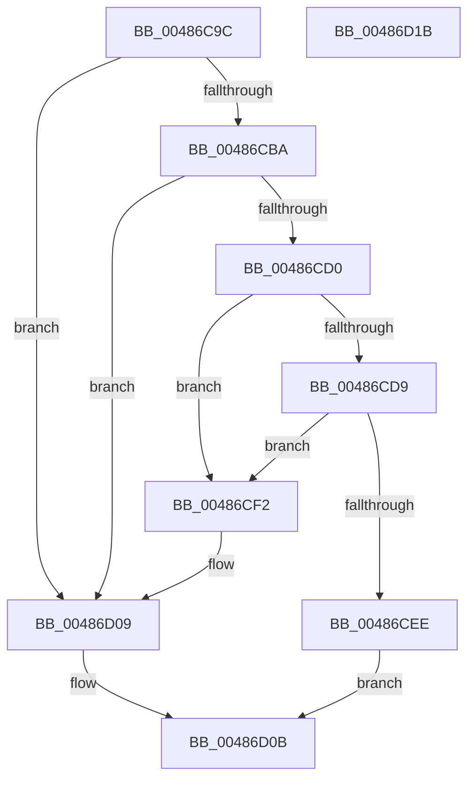

# sub_00486C9C

- RVA: `0x00486C9C`–`0x00486D1C` (길이 `128` bytes)
- VA: `0x0000000140486C9C`
- 실행 섹션: `.text`
- PDB 이름 있음: `아니요`; PDB Function 태그: `아니요`
- unwind 정보 RVA: `0x00060BC4`
- 디코드: `41`개 명령, `128/128` bytes 표시
- 미해석 바이트: `0` (있으면 어셈블리에 `.byte`로 보존)

> 이 문서는 커널 이미지의 기계어와 PDB 기호를 분석해 생성했습니다. 4번과 5번은 함수 원형과 자료형을 바이너리 사용 방식에서 추정한 C 해석이며 원본 소스 복구 결과는 아닙니다.

## 1. Dependencies

- 직접 호출 지점: **1**; 고유 호출 대상: **1**
- 직접 호출자로 확인된 함수: **1**
- RIP 상대 이미지 참조: **0**

### Outgoing calls
- `0x00486CD0` → [Feature_4168769850__private_IsEnabledDeviceUsageNoInline](../69/Feature_4168769850__private_IsEnabledDeviceUsageNoInline_function_0069BF9C.md) (function, `0x0069BF9C`)

### Direct callers
- [sub_00486BD0](Unknown_function_00486BD0.md) at `0x00486C21`

### Static image references
- 디코드된 RIP-relative 메모리 참조가 없습니다.

## 2. Other-region calls and transfers

- 다른 실행 섹션으로 향하는 call: **0**
- 별도 외부 분기/꼬리 이동을 확인하지 못했습니다.

## 3. Assembly (complete function range)

```asm
00486C9C  48 89 5C 24 08                  mov qword ptr [rsp + 8], rbx
00486CA1  48 89 74 24 10                  mov qword ptr [rsp + 0x10], rsi
00486CA6  57                              push rdi
00486CA7  48 83 EC 20                     sub rsp, 0x20
00486CAB  8B 41 18                        mov eax, dword ptr [rcx + 0x18]
00486CAE  33 FF                           xor edi, edi
00486CB0  48 8B F2                        mov rsi, rdx
00486CB3  48 8B D9                        mov rbx, rcx
00486CB6  3B 01                           cmp eax, dword ptr [rcx]
00486CB8  73 4F                           jae 0x140486d09
00486CBA  44 8B C0                        mov r8d, eax
00486CBD  48 8B 41 04                     mov rax, qword ptr [rcx + 4]
00486CC1  42 8B 14 80                     mov edx, dword ptr [rax + r8*4]
00486CC5  81 E2 FF FF FF 0F               and edx, 0xfffffff
00486CCB  3B 51 10                        cmp edx, dword ptr [rcx + 0x10]
00486CCE  73 39                           jae 0x140486d09
00486CD0  E8 C7 52 21 00                  call 0x14069bf9c
00486CD5  85 C0                           test eax, eax
00486CD7  74 19                           je 0x140486cf2
00486CD9  8B 4B 18                        mov ecx, dword ptr [rbx + 0x18]
00486CDC  48 8B 43 04                     mov rax, qword ptr [rbx + 4]
00486CE0  8B 14 88                        mov edx, dword ptr [rax + rcx*4]
00486CE3  81 E2 FF FF FF 0F               and edx, 0xfffffff
00486CE9  39 53 14                        cmp dword ptr [rbx + 0x14], edx
00486CEC  76 04                           jbe 0x140486cf2
00486CEE  33 C0                           xor eax, eax
00486CF0  EB 19                           jmp 0x140486d0b
00486CF2  8B 53 18                        mov edx, dword ptr [rbx + 0x18]
00486CF5  BF 01 00 00 00                  mov edi, 1
00486CFA  48 8B 43 04                     mov rax, qword ptr [rbx + 4]
00486CFE  8B 0C 90                        mov ecx, dword ptr [rax + rdx*4]
00486D01  8D 42 01                        lea eax, [rdx + 1]
00486D04  89 43 18                        mov dword ptr [rbx + 0x18], eax
00486D07  89 0E                           mov dword ptr [rsi], ecx
00486D09  8B C7                           mov eax, edi
00486D0B  48 8B 5C 24 30                  mov rbx, qword ptr [rsp + 0x30]
00486D10  48 8B 74 24 38                  mov rsi, qword ptr [rsp + 0x38]
00486D15  48 83 C4 20                     add rsp, 0x20
00486D19  5F                              pop rdi
00486D1A  C3                              ret
00486D1B  CC                              int3
```

## 4. C-style interpretation (structured pseudocode)

```c
__int64 __fastcall sub_00486C9C(__int64 a1, __int64 a2)
{
    __int64 result;
    __int64 v_rdi;
    __int64 v_rsp;
    unsigned __int64 v_stack_p10;
    unsigned __int64 v_stack_p8;

    v_stack_p8 = v_rbx;
    v_stack_p10 = v_rsi;
    v_rsp = (v_rsp) - (32);
    v_rdi = 0;
    if (((unsigned int)((unsigned int)(*(unsigned int *)(a1 + 24)))) >= (*(unsigned int *)(a1))) goto loc_00486D09;
    a2 = (unsigned int)(((unsigned int)(*(unsigned int *)(*(unsigned __int64 *)(a1 + 4) + (unsigned int)((unsigned int)((unsigned int)(*(unsigned int *)(a1 + 24)))) * 4))) & (0xFFFFFFFULL));
    if (((unsigned int)(a2)) >= (*(unsigned int *)(a1 + 16))) goto loc_00486D09;
    result = Feature_4168769850__private_IsEnabledDeviceUsageNoInline(a1, a2, (unsigned int)((unsigned int)((unsigned int)(*(unsigned int *)(a1 + 24)))), a4);
    if ((unsigned int)(result) == 0) goto loc_00486CF2;
    a2 = (unsigned int)(((unsigned int)(*(unsigned int *)(*(unsigned __int64 *)(a1 + 4) + (unsigned int)(*(unsigned int *)(a1 + 24)) * 4))) & (0xFFFFFFFULL));
    if ((*(unsigned int *)(a1 + 20)) <= ((unsigned int)(a2))) goto loc_00486CF2;
    result = 0;
    goto loc_00486D0B;
loc_00486CF2:
    *(unsigned int *)(a1 + 24) = (unsigned int)((unsigned int)(*(unsigned int *)(a1 + 24)) + 1);
    *(unsigned int *)(a2) = (unsigned int)((unsigned int)(*(unsigned int *)(*(unsigned __int64 *)(a1 + 4) + (unsigned int)(*(unsigned int *)(a1 + 24)) * 4)));
loc_00486D09:
loc_00486D0B:
    v_rsp = (v_rsp) + (32);
    return 1;
}
```

## 5. (Beta) C Style

```c
int64_t sub_00486C9C(void *Arg1, void *Arg2)
{
    uint8_t *arg1 = (uint8_t *)Arg1;
    uint8_t *arg2 = (uint8_t *)Arg2;

    int64_t result;
    int64_t local_rdi;
    int64_t local_rsp;
    uint64_t v_stack_p10;
    uint64_t v_stack_p8;

    v_stack_p8 = local_rbx;
    v_stack_p10 = local_rsi;
    local_rsp = (local_rsp) - (32);
    local_rdi = 0;
    if (((uint32_t)((uint32_t)(*(uint32_t *)(arg1 + 0x18)))) >= (*(uint32_t *)(arg1))) goto loc_00486D09;
    Arg2 = (uint32_t)(((uint32_t)(*(uint32_t *)(*(uint64_t *)(arg1 + 0x4) + (uint32_t)((uint32_t)((uint32_t)(*(uint32_t *)(arg1 + 0x18)))) * 4))) & (0xFFFFFFFULL));
    if (((uint32_t)(Arg2)) >= (*(uint32_t *)(arg1 + 0x10))) goto loc_00486D09;
    result = Feature_4168769850__private_IsEnabledDeviceUsageNoInline(Arg1, Arg2, (uint32_t)((uint32_t)((uint32_t)(*(uint32_t *)(arg1 + 0x18)))), a4);
    if ((uint32_t)(result) == 0) goto loc_00486CF2;
    Arg2 = (uint32_t)(((uint32_t)(*(uint32_t *)(*(uint64_t *)(arg1 + 0x4) + (uint32_t)(*(uint32_t *)(arg1 + 0x18)) * 4))) & (0xFFFFFFFULL));
    if ((*(uint32_t *)(arg1 + 0x14)) <= ((uint32_t)(Arg2))) goto loc_00486CF2;
    result = 0;
    goto loc_00486D0B;
loc_00486CF2:
    *(uint32_t *)(arg1 + 0x18) = (uint32_t)((uint32_t)(*(uint32_t *)(arg1 + 0x18)) + 1);
    *(uint32_t *)(arg2) = (uint32_t)((uint32_t)(*(uint32_t *)(*(uint64_t *)(arg1 + 0x4) + (uint32_t)(*(uint32_t *)(arg1 + 0x18)) * 4)));
loc_00486D09:
loc_00486D0B:
    local_rsp = (local_rsp) + (32);
    return 1;
}
```

### 관측된 메모리 오프셋

구조체 형식이 확인되지 않은 접근은 인자 기준의 오프셋으로만 기록했습니다.

| 기준 인자 | 오프셋 표현 | 폭 (bit) | 접근 |
|---|---:|---:|---|
| `Arg1` | `+ 0x0` | `32` | `R` |
| `Arg1` | `+ 0x4` | `64` | `R` |
| `Arg1` | `+ 0x10` | `32` | `R` |
| `Arg1` | `+ 0x14` | `32` | `R` |
| `Arg1` | `+ 0x18` | `32` | `R` |
| `Arg1` | `+ 0x18` | `32` | `W` |
| `Arg2` | `+ 0x0` | `32` | `W` |

## 6. Execution-region graph

[열기: 2D/3D 그래프와 함수 탐색 컨트롤 패널](../../../control-panel.html?section=text&rva=0x00486C9C&view=graph)

- 2D 그래프는 위에서 아래로 흐르고, 3D 그래프는 빈 공간을 드래그해 회전합니다. Shift+드래그는 이동, 휠은 확대·축소, 함수 노드 선택은 대상 보고서 이동입니다.

### Static fallback


