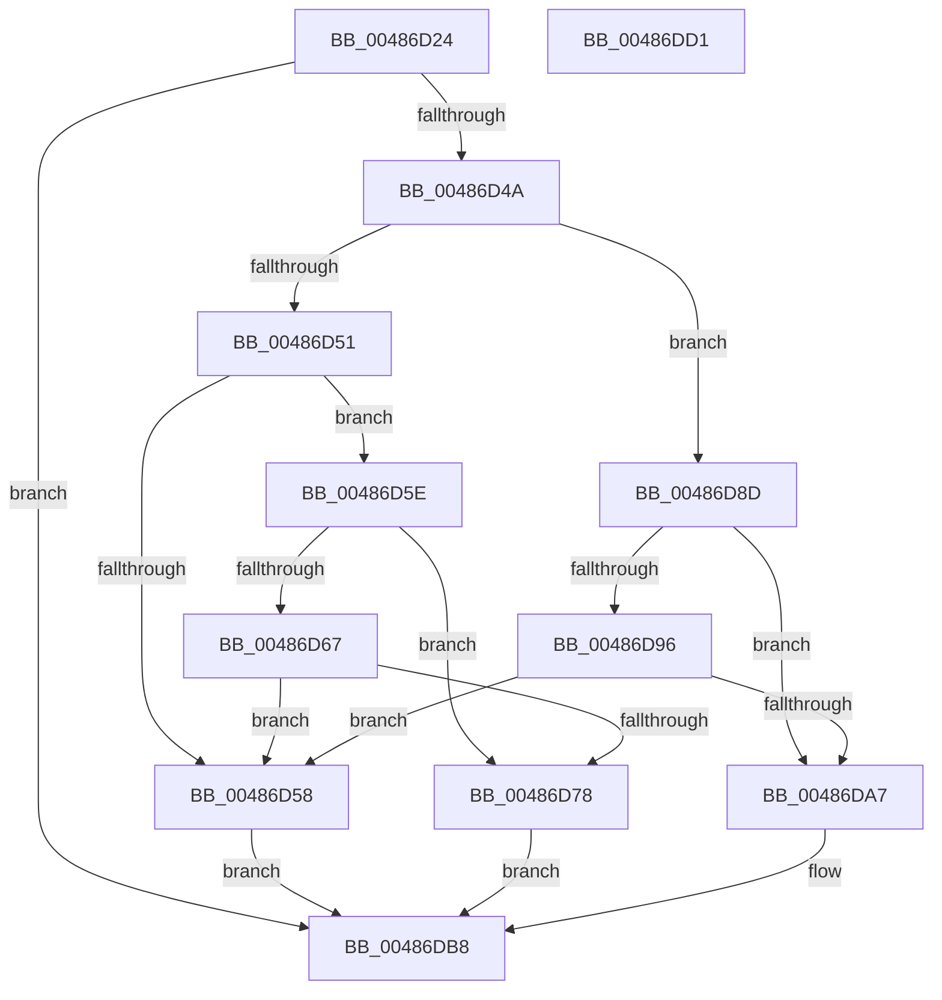

# sub_00486D24

- RVA: `0x00486D24`–`0x00486DD2` (길이 `174` bytes)
- VA: `0x0000000140486D24`
- 실행 섹션: `.text`
- PDB 이름 있음: `아니요`; PDB Function 태그: `아니요`
- unwind 정보 RVA: `0x0006F978`
- 디코드: `54`개 명령, `174/174` bytes 표시
- 미해석 바이트: `0` (있으면 어셈블리에 `.byte`로 보존)

> 이 문서는 커널 이미지의 기계어와 PDB 기호를 분석해 생성했습니다. 4번과 5번은 함수 원형과 자료형을 바이너리 사용 방식에서 추정한 C 해석이며 원본 소스 복구 결과는 아닙니다.

## 1. Dependencies

- 직접 호출 지점: **2**; 고유 호출 대상: **1**
- 직접 호출자로 확인된 함수: **1**
- RIP 상대 이미지 참조: **0**

### Outgoing calls
- `0x00486D5E` → [Feature_4168769850__private_IsEnabledDeviceUsageNoInline](../69/Feature_4168769850__private_IsEnabledDeviceUsageNoInline_function_0069BF9C.md) (function, `0x0069BF9C`)
- `0x00486D8D` → [Feature_4168769850__private_IsEnabledDeviceUsageNoInline](../69/Feature_4168769850__private_IsEnabledDeviceUsageNoInline_function_0069BF9C.md) (function, `0x0069BF9C`)

### Direct callers
- [sub_00486BD0](Unknown_function_00486BD0.md) at `0x00486C14`

### Static image references
- 디코드된 RIP-relative 메모리 참조가 없습니다.

## 2. Other-region calls and transfers

- 다른 실행 섹션으로 향하는 call: **0**
- 별도 외부 분기/꼬리 이동을 확인하지 못했습니다.

## 3. Assembly (complete function range)

```asm
00486D24  48 89 5C 24 08                  mov qword ptr [rsp + 8], rbx
00486D29  48 89 74 24 10                  mov qword ptr [rsp + 0x10], rsi
00486D2E  48 89 7C 24 18                  mov qword ptr [rsp + 0x18], rdi
00486D33  41 56                           push r14
00486D35  48 83 EC 20                     sub rsp, 0x20
00486D39  33 DB                           xor ebx, ebx
00486D3B  4D 8B F1                        mov r14, r9
00486D3E  48 8B FA                        mov rdi, rdx
00486D41  48 8B F1                        mov rsi, rcx
00486D44  66 45 85 C0                     test r8w, r8w
00486D48  74 6E                           je 0x140486db8
00486D4A  66 41 83 F8 03                  cmp r8w, 3
00486D4F  74 3C                           je 0x140486d8d
00486D51  66 41 83 F8 0A                  cmp r8w, 0xa
00486D56  74 06                           je 0x140486d5e
00486D58  48 83 CB FF                     or rbx, 0xffffffffffffffff
00486D5C  EB 5A                           jmp 0x140486db8
00486D5E  E8 39 52 21 00                  call 0x14069bf9c
00486D63  85 C0                           test eax, eax
00486D65  74 11                           je 0x140486d78
00486D67  8B 46 10                        mov eax, dword ptr [rsi + 0x10]
00486D6A  8B CF                           mov ecx, edi
00486D6C  2B 4E 1C                        sub ecx, dword ptr [rsi + 0x1c]
00486D6F  48 83 C1 08                     add rcx, 8
00486D73  48 3B C8                        cmp rcx, rax
00486D76  77 E0                           ja 0x140486d58
00486D78  48 8B 0F                        mov rcx, qword ptr [rdi]
00486D7B  BB 08 00 00 00                  mov ebx, 8
00486D80  48 8B 44 24 50                  mov rax, qword ptr [rsp + 0x50]
00486D85  49 03 CE                        add rcx, r14
00486D88  48 89 08                        mov qword ptr [rax], rcx
00486D8B  EB 2B                           jmp 0x140486db8
00486D8D  E8 0A 52 21 00                  call 0x14069bf9c
00486D92  85 C0                           test eax, eax
00486D94  74 11                           je 0x140486da7
00486D96  8B 46 10                        mov eax, dword ptr [rsi + 0x10]
00486D99  8B CF                           mov ecx, edi
00486D9B  2B 4E 1C                        sub ecx, dword ptr [rsi + 0x1c]
00486D9E  48 83 C1 04                     add rcx, 4
00486DA2  48 3B C8                        cmp rcx, rax
00486DA5  77 B1                           ja 0x140486d58
00486DA7  8B 0F                           mov ecx, dword ptr [rdi]
00486DA9  BB 04 00 00 00                  mov ebx, 4
00486DAE  48 8B 44 24 50                  mov rax, qword ptr [rsp + 0x50]
00486DB3  41 03 CE                        add ecx, r14d
00486DB6  89 08                           mov dword ptr [rax], ecx
00486DB8  48 8B 74 24 38                  mov rsi, qword ptr [rsp + 0x38]
00486DBD  48 8B C3                        mov rax, rbx
00486DC0  48 8B 5C 24 30                  mov rbx, qword ptr [rsp + 0x30]
00486DC5  48 8B 7C 24 40                  mov rdi, qword ptr [rsp + 0x40]
00486DCA  48 83 C4 20                     add rsp, 0x20
00486DCE  41 5E                           pop r14
00486DD0  C3                              ret
00486DD1  CC                              int3
```

## 4. C-style interpretation (structured pseudocode)

```c
__int64 __fastcall sub_00486D24(__int64 a1, __int64 a2, unsigned __int16 a3, __int64 a4, __int64 a5)
{
    __int64 result;
    __int64 v_rbx;
    __int64 v_rsp;
    unsigned __int64 v_stack_p10;
    unsigned __int64 v_stack_p18;
    unsigned __int64 v_stack_p8;

    v_stack_p8 = v_rbx;
    v_stack_p10 = v_rsi;
    v_stack_p18 = v_rdi;
    v_rsp = (v_rsp) - (32);
    v_rbx = 0;
    if (a3 == 0) goto loc_00486DB8;
    if (a3 == 3) goto loc_00486D8D;
    if (a3 == 10) goto loc_00486D5E;
loc_00486D58:
    v_rbx = (v_rbx) | (-1);
    goto loc_00486DB8;
loc_00486D5E:
    result = Feature_4168769850__private_IsEnabledDeviceUsageNoInline(a1, a2, a3, a4);
    if ((unsigned int)(result) == 0) goto loc_00486D78;
    a1 = (unsigned int)(((unsigned int)((unsigned int)(a2))) - (*(unsigned int *)(a1 + 28)));
    a1 = (a1) + (8);
    if (a1 > ((unsigned int)(*(unsigned int *)(a1 + 16)))) goto loc_00486D58;
loc_00486D78:
    a1 = (*(unsigned __int64 *)(a2)) + (a4);
    *(unsigned __int64 *)(a5) = a1;
    goto loc_00486DB8;
loc_00486D8D:
    result = Feature_4168769850__private_IsEnabledDeviceUsageNoInline(a1, a2, a3, a4);
    if ((unsigned int)(result) == 0) goto loc_00486DA7;
    a1 = (unsigned int)(((unsigned int)((unsigned int)(a2))) - (*(unsigned int *)(a1 + 28)));
    a1 = (a1) + (4);
    if (a1 > ((unsigned int)(*(unsigned int *)(a1 + 16)))) goto loc_00486D58;
loc_00486DA7:
    a1 = (unsigned int)(((unsigned int)(*(unsigned int *)(a2))) + ((unsigned int)(a4)));
    *(unsigned int *)(a5) = (unsigned int)(a1);
loc_00486DB8:
    v_rsp = (v_rsp) + (32);
    return 4;
}
```

## 5. (Beta) C Style

```c
int64_t sub_00486D24(void *Arg1, void *Arg2, uint16_t Arg3, int64_t Arg4, void *Arg5)
{
    uint8_t *arg1 = (uint8_t *)Arg1;
    uint8_t *arg2 = (uint8_t *)Arg2;
    uint8_t *arg5 = (uint8_t *)Arg5;

    int64_t result;
    int64_t local_rbx;
    int64_t local_rsp;
    uint64_t v_stack_p10;
    uint64_t v_stack_p18;
    uint64_t v_stack_p8;

    v_stack_p8 = local_rbx;
    v_stack_p10 = local_rsi;
    v_stack_p18 = local_rdi;
    local_rsp = (local_rsp) - (32);
    local_rbx = 0;
    if (Arg3 == 0) goto loc_00486DB8;
    if (Arg3 == 3) goto loc_00486D8D;
    if (Arg3 == 10) goto loc_00486D5E;
loc_00486D58:
    local_rbx = (local_rbx) | (-1);
    goto loc_00486DB8;
loc_00486D5E:
    result = Feature_4168769850__private_IsEnabledDeviceUsageNoInline(Arg1, Arg2, Arg3, Arg4);
    if ((uint32_t)(result) == 0) goto loc_00486D78;
    Arg1 = (uint32_t)(((uint32_t)((uint32_t)(Arg2))) - (*(uint32_t *)(arg1 + 0x1C)));
    Arg1 = (Arg1) + (8);
    if (Arg1 > ((uint32_t)(*(uint32_t *)(arg1 + 0x10)))) goto loc_00486D58;
loc_00486D78:
    Arg1 = (*(uint64_t *)(arg2)) + (Arg4);
    *(void **)(arg5) = Arg1;
    goto loc_00486DB8;
loc_00486D8D:
    result = Feature_4168769850__private_IsEnabledDeviceUsageNoInline(Arg1, Arg2, Arg3, Arg4);
    if ((uint32_t)(result) == 0) goto loc_00486DA7;
    Arg1 = (uint32_t)(((uint32_t)((uint32_t)(Arg2))) - (*(uint32_t *)(arg1 + 0x1C)));
    Arg1 = (Arg1) + (4);
    if (Arg1 > ((uint32_t)(*(uint32_t *)(arg1 + 0x10)))) goto loc_00486D58;
loc_00486DA7:
    Arg1 = (uint32_t)(((uint32_t)(*(uint32_t *)(arg2))) + ((uint32_t)(Arg4)));
    *(uint32_t *)(arg5) = (uint32_t)(Arg1);
loc_00486DB8:
    local_rsp = (local_rsp) + (32);
    return 4;
}
```

### 관측된 메모리 오프셋

구조체 형식이 확인되지 않은 접근은 인자 기준의 오프셋으로만 기록했습니다.

| 기준 인자 | 오프셋 표현 | 폭 (bit) | 접근 |
|---|---:|---:|---|
| `Arg1` | `+ 0x10` | `32` | `R` |
| `Arg1` | `+ 0x1C` | `32` | `R` |
| `Arg2` | `+ 0x0` | `32` | `R` |
| `Arg2` | `+ 0x0` | `64` | `R` |
| `Arg5` | `+ 0x0` | `32` | `W` |
| `Arg5` | `+ 0x0` | `64` | `W` |

## 6. Execution-region graph

[열기: 2D/3D 그래프와 함수 탐색 컨트롤 패널](../../../control-panel.html?section=text&rva=0x00486D24&view=graph)

- 2D 그래프는 위에서 아래로 흐르고, 3D 그래프는 빈 공간을 드래그해 회전합니다. Shift+드래그는 이동, 휠은 확대·축소, 함수 노드 선택은 대상 보고서 이동입니다.

### Static fallback


