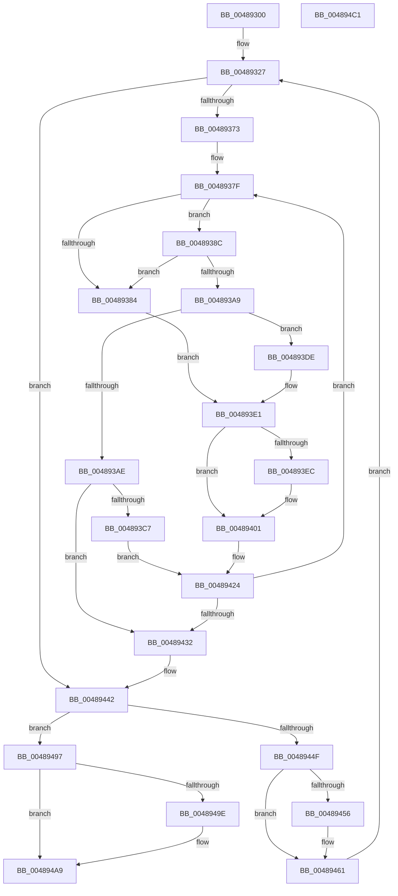

# VmpInvalidateSlatBatched

- RVA: `0x00489300`–`0x004894C2` (길이 `450` bytes)
- VA: `0x0000000140489300`
- 실행 섹션: `.text`
- PDB 이름 있음: `예`; PDB Function 태그: `아니요`
- unwind 정보 RVA: `0x000AFEC4`
- 디코드: `121`개 명령, `450/450` bytes 표시
- 미해석 바이트: `0` (있으면 어셈블리에 `.byte`로 보존)

> 이 문서는 커널 이미지의 기계어와 PDB 기호를 분석해 생성했습니다. 4번과 5번은 함수 원형과 자료형을 바이너리 사용 방식에서 추정한 C 해석이며 원본 소스 복구 결과는 아닙니다.

## 1. Dependencies

- 직접 호출 지점: **8**; 고유 호출 대상: **6**
- 직접 호출자로 확인된 함수: **2**
- RIP 상대 이미지 참조: **0**

### Outgoing calls
- `0x0048939B` → [VmpFindNextPinnedPageStateHelper](../64/VmpFindNextPinnedPageStateHelper_function_0064C7E4.md) (function, `0x0064C7E4`)
- `0x004893BC` → [VmpFindNextPinnedPageStateHelper](../64/VmpFindNextPinnedPageStateHelper_function_0064C7E4.md) (function, `0x0064C7E4`)
- `0x004893F5` → [VmpInvalidateOutstandingFaults](../46/VmpInvalidateOutstandingFaults_function_004639AC.md) (function, `0x004639AC`)
- `0x00489416` → [VmpInsertInvalidateListRange](../46/VmpInsertInvalidateListRange_function_00463B64.md) (function, `0x00463B64`)
- `0x0048945C` → [VmpProcessInvalidateList](../42/VmpProcessInvalidateList_function_00428A54.md) (function, `0x00428A54`)
- `0x0048946F` → [VmpProcessContextUnlockExclusive](VmpProcessContextUnlockExclusive_function_004894C8.md) (function, `0x004894C8`)
- `0x00489482` → [VmpProcessContextLockExclusive](../31/VmpProcessContextLockExclusive_function_003147A4.md) (function, `0x003147A4`)
- `0x004894A4` → [VmpProcessInvalidateList](../42/VmpProcessInvalidateList_function_00428A54.md) (function, `0x00428A54`)

### Direct callers
- [VmpRemoveMemoryRange](VmpRemoveMemoryRange_function_00489018.md) at `0x004890EB`
- [VmpUnpinMemoryRangeHelper](../64/VmpUnpinMemoryRangeHelper_function_0064D370.md) at `0x0064D4F4`

### Static image references
- 디코드된 RIP-relative 메모리 참조가 없습니다.

## 2. Other-region calls and transfers

- 다른 실행 섹션으로 향하는 call: **0**
- 별도 외부 분기/꼬리 이동을 확인하지 못했습니다.

## 3. Assembly (complete function range)

```asm
00489300  48 89 5C 24 08                  mov qword ptr [rsp + 8], rbx
00489305  4C 89 4C 24 20                  mov qword ptr [rsp + 0x20], r9
0048930A  4C 89 44 24 18                  mov qword ptr [rsp + 0x18], r8
0048930F  55                              push rbp
00489310  56                              push rsi
00489311  57                              push rdi
00489312  41 54                           push r12
00489314  41 55                           push r13
00489316  41 56                           push r14
00489318  41 57                           push r15
0048931A  48 83 EC 40                     sub rsp, 0x40
0048931E  4D 8B E9                        mov r13, r9
00489321  49 8B D8                        mov rbx, r8
00489324  48 8B E9                        mov rbp, rcx
00489327  65 48 8B 04 25 20 00 00 00      mov rax, qword ptr gs:[0x20]
00489330  49 8B F5                        mov rsi, r13
00489333  4C 8B F2                        mov r14, rdx
00489336  4C 8B E3                        mov r12, rbx
00489339  48 8B B8 50 8B 00 00            mov rdi, qword ptr [rax + 0x8b50]
00489340  B8 00 00 04 00                  mov eax, 0x40000
00489345  48 81 C7 00 12 00 00            add rdi, 0x1200
0048934C  4C 3B E8                        cmp r13, rax
0048934F  48 0F 47 F0                     cmova rsi, rax
00489353  45 33 FF                        xor r15d, r15d
00489356  48 8D 04 16                     lea rax, [rsi + rdx]
0048935A  48 89 84 24 88 00 00 00         mov qword ptr [rsp + 0x88], rax
00489362  48 FF C8                        dec rax
00489365  48 89 44 24 30                  mov qword ptr [rsp + 0x30], rax
0048936A  48 85 F6                        test rsi, rsi
0048936D  0F 84 CF 00 00 00               je 0x140489442
00489373  44 8B AC 24 A8 00 00 00         mov r13d, dword ptr [rsp + 0xa8]
0048937B  41 83 E5 04                     and r13d, 4
0048937F  45 85 ED                        test r13d, r13d
00489382  74 08                           je 0x14048938c
00489384  48 8B DE                        mov rbx, rsi
00489387  49 2B DF                        sub rbx, r15
0048938A  EB 55                           jmp 0x1404893e1
0048938C  41 B9 01 00 00 00               mov r9d, 1
00489392  4C 8B C0                        mov r8, rax
00489395  49 8B D6                        mov rdx, r14
00489398  48 8B CD                        mov rcx, rbp
0048939B  E8 44 34 1C 00                  call 0x14064c7e4
004893A0  48 8B D8                        mov rbx, rax
004893A3  48 83 F8 FF                     cmp rax, -1
004893A7  74 DB                           je 0x140489384
004893A9  49 3B C6                        cmp rax, r14
004893AC  75 30                           jne 0x1404893de
004893AE  4C 8B 44 24 30                  mov r8, qword ptr [rsp + 0x30]
004893B3  45 33 C9                        xor r9d, r9d
004893B6  49 8B D6                        mov rdx, r14
004893B9  48 8B CD                        mov rcx, rbp
004893BC  E8 23 34 1C 00                  call 0x14064c7e4
004893C1  48 83 F8 FF                     cmp rax, -1
004893C5  74 6B                           je 0x140489432
004893C7  48 8B C8                        mov rcx, rax
004893CA  49 2B CE                        sub rcx, r14
004893CD  4C 03 F9                        add r15, rcx
004893D0  48 8B C8                        mov rcx, rax
004893D3  49 2B CE                        sub rcx, r14
004893D6  4C 8B F0                        mov r14, rax
004893D9  4C 03 E1                        add r12, rcx
004893DC  EB 46                           jmp 0x140489424
004893DE  49 2B DE                        sub rbx, r14
004893E1  8B 84 24 A8 00 00 00            mov eax, dword ptr [rsp + 0xa8]
004893E8  A8 01                           test al, 1
004893EA  74 15                           je 0x140489401
004893EC  4C 8B C3                        mov r8, rbx
004893EF  49 8B D4                        mov rdx, r12
004893F2  48 8B CD                        mov rcx, rbp
004893F5  E8 B2 A5 FD FF                  call 0x1404639ac
004893FA  8B 84 24 A8 00 00 00            mov eax, dword ptr [rsp + 0xa8]
00489401  89 44 24 28                     mov dword ptr [rsp + 0x28], eax
00489405  4D 8B CC                        mov r9, r12
00489408  4D 8B C6                        mov r8, r14
0048940B  48 89 5C 24 20                  mov qword ptr [rsp + 0x20], rbx
00489410  48 8B D7                        mov rdx, rdi
00489413  48 8B CD                        mov rcx, rbp
00489416  E8 49 A7 FD FF                  call 0x140463b64
0048941B  4C 03 F3                        add r14, rbx
0048941E  4C 03 E3                        add r12, rbx
00489421  4C 03 FB                        add r15, rbx
00489424  48 8B 44 24 30                  mov rax, qword ptr [rsp + 0x30]
00489429  4C 3B FE                        cmp r15, rsi
0048942C  0F 82 4D FF FF FF               jb 0x14048937f
00489432  4C 8B AC 24 98 00 00 00         mov r13, qword ptr [rsp + 0x98]
0048943A  48 8B 9C 24 90 00 00 00         mov rbx, qword ptr [rsp + 0x90]
00489442  4C 2B EE                        sub r13, rsi
00489445  4C 89 AC 24 98 00 00 00         mov qword ptr [rsp + 0x98], r13
0048944D  74 48                           je 0x140489497
0048944F  48 83 7F 08 00                  cmp qword ptr [rdi + 8], 0
00489454  74 0B                           je 0x140489461
00489456  48 8B D7                        mov rdx, rdi
00489459  48 8B CD                        mov rcx, rbp
0048945C  E8 F3 F5 F9 FF                  call 0x140428a54
00489461  48 8B BC 24 A0 00 00 00         mov rdi, qword ptr [rsp + 0xa0]
00489469  48 8B CD                        mov rcx, rbp
0048946C  48 8B 17                        mov rdx, qword ptr [rdi]
0048946F  E8 54 00 00 00                  call 0x1404894c8
00489474  48 03 DE                        add rbx, rsi
00489477  48 8B CD                        mov rcx, rbp
0048947A  48 89 9C 24 90 00 00 00         mov qword ptr [rsp + 0x90], rbx
00489482  E8 1D B3 E8 FF                  call 0x1403147a4
00489487  48 8B 94 24 88 00 00 00         mov rdx, qword ptr [rsp + 0x88]
0048948F  48 89 07                        mov qword ptr [rdi], rax
00489492  E9 90 FE FF FF                  jmp 0x140489327
00489497  48 83 7F 08 00                  cmp qword ptr [rdi + 8], 0
0048949C  74 0B                           je 0x1404894a9
0048949E  48 8B D7                        mov rdx, rdi
004894A1  48 8B CD                        mov rcx, rbp
004894A4  E8 AB F5 F9 FF                  call 0x140428a54
004894A9  48 8B 9C 24 80 00 00 00         mov rbx, qword ptr [rsp + 0x80]
004894B1  48 83 C4 40                     add rsp, 0x40
004894B5  41 5F                           pop r15
004894B7  41 5E                           pop r14
004894B9  41 5D                           pop r13
004894BB  41 5C                           pop r12
004894BD  5F                              pop rdi
004894BE  5E                              pop rsi
004894BF  5D                              pop rbp
004894C0  C3                              ret
004894C1  CC                              int3
```

## 4. C-style interpretation (structured pseudocode)

```c
__int64 __fastcall VmpInvalidateSlatBatched(__int64 a1, __int64 a2, __int64 a3, __int64 a4, __int64 a5, unsigned int a6)
{
    __int64 result;
    __int64 v_r12;
    __int64 v_r13;
    __int64 v_r14;
    __int64 v_r15;
    __int64 v_rbx;
    __int64 v_rdi;
    __int64 v_rsp;
    unsigned __int64 v_stack_m48;
    unsigned int v_stack_m50;
    unsigned __int64 v_stack_m58;
    unsigned __int64 v_stack_p10;
    unsigned __int64 v_stack_p18;
    unsigned __int64 v_stack_p20;
    unsigned __int64 v_stack_p8;

    v_stack_p8 = v_rbx;
    v_stack_p20 = a4;
    v_stack_p18 = a3;
    v_rsp = (v_rsp) - (64);
loc_00489327:
    v_rdi = (*(unsigned __int64 *)(*(unsigned __int64 *)(gs_base + (0 + 32)) + 35664)) + (0x1200ULL);
    if (a4 > ((unsigned int)(0x40000ULL))) { a4 = (unsigned int)(0x40000ULL); }
    v_r15 = 0;
    v_stack_p10 = a4 + a2 * 1;
    result = (a4 + a2 * 1) - 1;
    v_stack_m48 = result;
    if (a4 == 0) goto loc_00489442;
    v_r13 = (unsigned int)(((unsigned int)(a6)) & (4));
loc_0048937F:
    if ((unsigned int)(v_r13) == 0) goto loc_0048938C;
loc_00489384:
    v_rbx = (a4) - (0);
    goto loc_004893E1;
loc_0048938C:
    result = VmpFindNextPinnedPageStateHelper(a1, a2, result, 1);
    if (result == -1) goto loc_00489384;
    if (result != a2) goto loc_004893DE;
    a4 = 0;
    result = VmpFindNextPinnedPageStateHelper(a1, a2, v_stack_m48, a4);
    if (result == -1) goto loc_00489432;
    a1 = (result) - (a2);
    v_r15 = (v_r15) + (a1);
    a1 = (result) - (a2);
    v_r12 = (a3) + (a1);
    goto loc_00489424;
loc_004893DE:
    v_rbx = (result) - (result);
loc_004893E1:
    result = (unsigned int)(a6);
    if ((((unsigned __int8)((unsigned int)(a6))) & (1)) != 0) {
        a3 = v_rbx;
        a2 = v_r12;
        a1 = a1;
        result = VmpInvalidateOutstandingFaults(a1, a2, a3, a4);
        result = a6;
    }
    v_stack_m50 = (unsigned int)(result);
    v_stack_m58 = v_rbx;
    result = VmpInsertInvalidateListRange(a1, v_rdi, result, v_r12);
    v_r14 = (result) + (v_rbx);
    v_r12 = (v_r12) + (v_rbx);
    v_r15 = (v_r15) + (v_rbx);
loc_00489424:
    if (v_r15 < 0) goto loc_0048937F;
loc_00489432:
loc_00489442:
    v_r13 = (v_stack_p20) - (0);
    v_stack_p20 = v_r13;
    if (condition_is_equal) goto loc_00489497;
    result = v_stack_m48;
    if ((*(unsigned __int64 *)(v_rdi + 8)) != 0) {
        a2 = v_rdi;
        a1 = a1;
        result = VmpProcessInvalidateList(a1, a2, result, v_r12);
    }
    result = VmpProcessContextUnlockExclusive(a1, *(unsigned __int64 *)(a5), result, v_r12);
    v_rbx = (v_stack_p18) + (0);
    v_stack_p18 = v_rbx;
    result = VmpProcessContextLockExclusive(a1, *(unsigned __int64 *)(a5), result, v_r12);
    *(unsigned __int64 *)(a5) = result;
    goto loc_00489327;
loc_00489497:
    if ((*(unsigned __int64 *)(a5 + 8)) != 0) {
        a2 = a5;
        a1 = a1;
        result = VmpProcessInvalidateList(a1, a2, result, v_r12);
    }
    v_rsp = (v_rsp) + (64);
    return result;
}
```

## 5. (Beta) C Style

```c
int64_t VmpInvalidateSlatBatched(int64_t Arg1, int64_t Arg2, int64_t Arg3, int64_t Arg4, void *Arg5, uint32_t Arg6)
{
    uint8_t *arg5 = (uint8_t *)Arg5;

    int64_t result;
    int64_t local_r12;
    int64_t local_r13;
    int64_t local_r14;
    int64_t local_r15;
    int64_t local_rbx;
    int64_t local_rdi;
    int64_t local_rsp;
    uint64_t v_stack_m48;
    uint32_t v_stack_m50;
    uint64_t v_stack_m58;
    uint64_t v_stack_p10;
    uint64_t v_stack_p18;
    uint64_t v_stack_p20;
    uint64_t v_stack_p8;

    v_stack_p8 = local_rbx;
    v_stack_p20 = Arg4;
    v_stack_p18 = Arg3;
    local_rsp = (local_rsp) - (64);
loc_00489327:
    local_rdi = (*(uint64_t *)(*(uint64_t *)(gs_base + (0 + 0x20)) + 0x8B50)) + (0x1200ULL);
    if (Arg4 > ((uint32_t)(0x40000ULL))) { Arg4 = (uint32_t)(0x40000ULL); }
    local_r15 = 0;
    v_stack_p10 = Arg4 + Arg2 * 1;
    result = (Arg4 + Arg2 * 1) - 1;
    v_stack_m48 = result;
    if (Arg4 == 0) goto loc_00489442;
    local_r13 = (uint32_t)(((uint32_t)(Arg6)) & (4));
loc_0048937F:
    if ((uint32_t)(local_r13) == 0) goto loc_0048938C;
loc_00489384:
    local_rbx = (Arg4) - (0);
    goto loc_004893E1;
loc_0048938C:
    result = VmpFindNextPinnedPageStateHelper(Arg1, Arg2, result, 1);
    if (result == -1) goto loc_00489384;
    if (result != Arg2) goto loc_004893DE;
    Arg4 = 0;
    result = VmpFindNextPinnedPageStateHelper(Arg1, Arg2, v_stack_m48, Arg4);
    if (result == -1) goto loc_00489432;
    Arg1 = (result) - (Arg2);
    local_r15 = (local_r15) + (Arg1);
    Arg1 = (result) - (Arg2);
    local_r12 = (Arg3) + (Arg1);
    goto loc_00489424;
loc_004893DE:
    local_rbx = (result) - (result);
loc_004893E1:
    result = (uint32_t)(Arg6);
    if ((((uint8_t)((uint32_t)(Arg6))) & (1)) != 0) {
        Arg3 = local_rbx;
        Arg2 = local_r12;
        Arg1 = Arg1;
        result = VmpInvalidateOutstandingFaults(Arg1, Arg2, Arg3, Arg4);
        result = Arg6;
    }
    v_stack_m50 = (uint32_t)(result);
    v_stack_m58 = local_rbx;
    result = VmpInsertInvalidateListRange(Arg1, local_rdi, result, local_r12);
    local_r14 = (result) + (local_rbx);
    local_r12 = (local_r12) + (local_rbx);
    local_r15 = (local_r15) + (local_rbx);
loc_00489424:
    if (local_r15 < 0) goto loc_0048937F;
loc_00489432:
loc_00489442:
    local_r13 = (v_stack_p20) - (0);
    v_stack_p20 = local_r13;
    if (condition_is_equal) goto loc_00489497;
    result = v_stack_m48;
    if ((*(uint64_t *)(local_rdi + 0x8)) != 0) {
        Arg2 = local_rdi;
        Arg1 = Arg1;
        result = VmpProcessInvalidateList(Arg1, Arg2, result, local_r12);
    }
    result = VmpProcessContextUnlockExclusive(Arg1, *(uint64_t *)(arg5), result, local_r12);
    local_rbx = (v_stack_p18) + (0);
    v_stack_p18 = local_rbx;
    result = VmpProcessContextLockExclusive(Arg1, *(uint64_t *)(arg5), result, local_r12);
    *(uint64_t *)(arg5) = result;
    goto loc_00489327;
loc_00489497:
    if ((*(uint64_t *)(arg5 + 0x8)) != 0) {
        Arg2 = Arg5;
        Arg1 = Arg1;
        result = VmpProcessInvalidateList(Arg1, Arg2, result, local_r12);
    }
    local_rsp = (local_rsp) + (64);
    return result;
}
```

### 관측된 메모리 오프셋

구조체 형식이 확인되지 않은 접근은 인자 기준의 오프셋으로만 기록했습니다.

| 기준 인자 | 오프셋 표현 | 폭 (bit) | 접근 |
|---|---:|---:|---|
| `Arg5` | `+ 0x0` | `64` | `R` |
| `Arg5` | `+ 0x0` | `64` | `W` |

## 6. Execution-region graph

[열기: 2D/3D 그래프와 함수 탐색 컨트롤 패널](../../../control-panel.html?section=text&rva=0x00489300&view=graph)

- 2D 그래프는 위에서 아래로 흐르고, 3D 그래프는 빈 공간을 드래그해 회전합니다. Shift+드래그는 이동, 휠은 확대·축소, 함수 노드 선택은 대상 보고서 이동입니다.

### Static fallback


