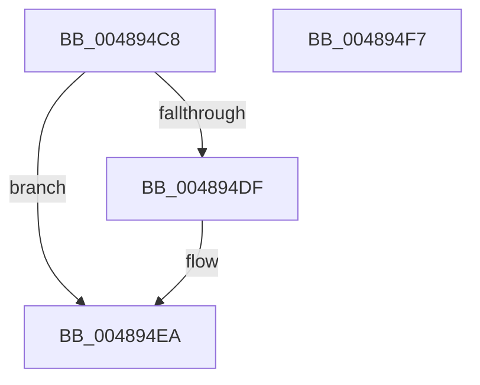

# VmpProcessContextUnlockExclusive

- RVA: `0x004894C8`–`0x004894F8` (길이 `48` bytes)
- VA: `0x00000001404894C8`
- 실행 섹션: `.text`
- PDB 이름 있음: `예`; PDB Function 태그: `아니요`
- unwind 정보 RVA: `0x0005CF00`
- 디코드: `15`개 명령, `48/48` bytes 표시
- 미해석 바이트: `0` (있으면 어셈블리에 `.byte`로 보존)

> 이 문서는 커널 이미지의 기계어와 PDB 기호를 분석해 생성했습니다. 4번과 5번은 함수 원형과 자료형을 바이너리 사용 방식에서 추정한 C 해석이며 원본 소스 복구 결과는 아닙니다.

## 1. Dependencies

- 직접 호출 지점: **2**; 고유 호출 대상: **2**
- 직접 호출자로 확인된 함수: **12**
- RIP 상대 이미지 참조: **1**

### Outgoing calls
- `0x004894D1` → [ExReleaseSpinLockExclusiveFromDpcLevel](../24/ExReleaseSpinLockExclusiveFromDpcLevel_function_002497E0.md) (function, `0x002497E0`)
- `0x004894E5` → [KiLowerIrqlProcessIrqlFlags](../4F/KiLowerIrqlProcessIrqlFlags_function_004F5698.md) (function, `0x004F5698`)

### Direct callers
- [VmpFlushTb](../31/VmpFlushTb_function_00311BD0.md) at `0x00311D1C`
- [sub_00314635](../31/Unknown_function_00314635.md) at `0x0031464D`
- [VmpRemoveMemoryRange](VmpRemoveMemoryRange_function_00489018.md) at `0x0048921C`
- [VmpInvalidateSlatBatched](VmpInvalidateSlatBatched_function_00489300.md) at `0x0048946F`
- [VmpMergeMemoryRanges](../4D/VmpMergeMemoryRanges_function_004D9EDC.md) at `0x004DA03A`
- [VmpMergeMemoryRanges](../4D/VmpMergeMemoryRanges_function_004D9EDC.md) at `0x004DA169`
- [VmpInsertMemoryRange](../64/VmpInsertMemoryRange_function_0064C9F0.md) at `0x0064CC95`
- [VmpPinMemoryRange](../64/VmpPinMemoryRange_function_0064CCD0.md) at `0x0064CE5F`
- [VmpPinMemoryRange](../64/VmpPinMemoryRange_function_0064CCD0.md) at `0x0064CF5F`
- [VmpPinMemoryRange](../64/VmpPinMemoryRange_function_0064CCD0.md) at `0x0064D058`
- [VmpPinMemoryRange](../64/VmpPinMemoryRange_function_0064CCD0.md) at `0x0064D0B5`
- [VmpPinMemoryRange](../64/VmpPinMemoryRange_function_0064CCD0.md) at `0x0064D10E`
- [VmpUnpinMemoryRangeHelper](../64/VmpUnpinMemoryRangeHelper_function_0064D370.md) at `0x0064D503`
- [VmpUnpinMemoryRangeHelper](../64/VmpUnpinMemoryRangeHelper_function_0064D370.md) at `0x0064D53B`
- [VmpUnpinMemoryRangeHelper](../64/VmpUnpinMemoryRangeHelper_function_0064D370.md) at `0x0064D5B0`
- [sub_006E0EF0](../6E/Unknown_function_006E0EF0.md) at `0x006E0EFA`
- [sub_006E0EF0](../6E/Unknown_function_006E0EF0.md) at `0x006E0F46`
- [sub_006E0EF0](../6E/Unknown_function_006E0EF0.md) at `0x006E0F92`
- [sub_006E123B](../6E/Unknown_function_006E123B.md) at `0x006E1245`
- [sub_006EE148](../6E/Unknown_function_006EE148.md) at `0x006EE220`
- [sub_006F5CAE](../6F/Unknown_function_006F5CAE.md) at `0x006F5D32`

### Static image references
- `0x004894D6` → RVA `0x00FC6D20` (`ALMOSTRO`; read)

## 2. Other-region calls and transfers

- 다른 실행 섹션으로 향하는 call: **0**
- 별도 외부 분기/꼬리 이동을 확인하지 못했습니다.

## 3. Assembly (complete function range)

```asm
004894C8  40 53                           push rbx
004894CA  48 83 EC 20                     sub rsp, 0x20
004894CE  48 8B DA                        mov rbx, rdx
004894D1  E8 0A 03 DC FF                  call 0x1402497e0
004894D6  83 3D 43 D8 B3 00 00            cmp dword ptr [rip + 0xb3d843], 0
004894DD  74 0B                           je 0x1404894ea
004894DF  44 0F 20 C1                     mov rcx, cr8
004894E3  8A D3                           mov dl, bl
004894E5  E8 AE C1 06 00                  call 0x1404f5698
004894EA  0F B6 C3                        movzx eax, bl
004894ED  44 0F 22 C0                     mov cr8, rax
004894F1  48 83 C4 20                     add rsp, 0x20
004894F5  5B                              pop rbx
004894F6  C3                              ret
004894F7  CC                              int3
```

## 4. C-style interpretation (structured pseudocode)

```c
__int64 __fastcall VmpProcessContextUnlockExclusive(__int64 a1, __int64 a2)
{
    __int64 result;
    __int64 v_rsp;

    v_rsp = (v_rsp) - (32);
    result = ExReleaseSpinLockExclusiveFromDpcLevel(a1, a2, a3, a4);
    if ((*(unsigned int *)(v_rip + 11786307)) != 0) {
        a1 = v_cr8;
        a2 = (unsigned __int8)(a2);
        result = KiLowerIrqlProcessIrqlFlags(a1, a2, a3, a4);
    }
    v_rsp = (v_rsp) + (32);
    return (unsigned __int8)(a2);
}
```

## 5. (Beta) C Style

```c
int64_t VmpProcessContextUnlockExclusive(int64_t Arg1, int64_t Arg2)
{
    int64_t result;
    int64_t local_rsp;

    local_rsp = (local_rsp) - (32);
    result = ExReleaseSpinLockExclusiveFromDpcLevel(Arg1, Arg2, a3, a4);
    if ((*(uint32_t *)(v_rip + 0xB3D843)) != 0) {
        Arg1 = v_cr8;
        Arg2 = (uint8_t)(Arg2);
        result = KiLowerIrqlProcessIrqlFlags(Arg1, Arg2, a3, a4);
    }
    local_rsp = (local_rsp) + (32);
    return (uint8_t)(Arg2);
}
```

## 6. Execution-region graph

[열기: 2D/3D 그래프와 함수 탐색 컨트롤 패널](../../../control-panel.html?section=text&rva=0x004894C8&view=graph)

- 2D 그래프는 위에서 아래로 흐르고, 3D 그래프는 빈 공간을 드래그해 회전합니다. Shift+드래그는 이동, 휠은 확대·축소, 함수 노드 선택은 대상 보고서 이동입니다.

### Static fallback


