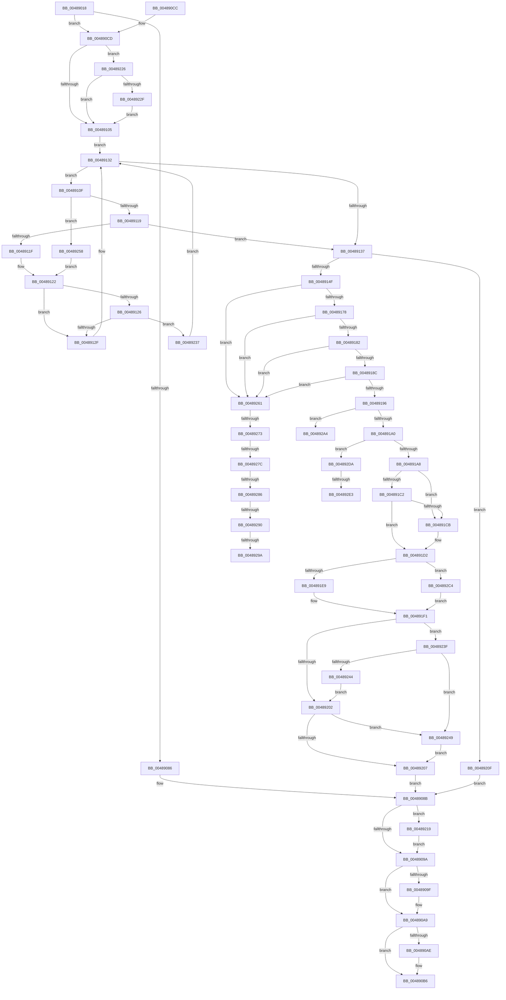

# VmpRemoveMemoryRange

- RVA: `0x00489018`–`0x004892FA` (길이 `738` bytes)
- VA: `0x0000000140489018`
- 실행 섹션: `.text`
- PDB 이름 있음: `예`; PDB Function 태그: `예`
- unwind 정보 RVA: `0x000AFE98`
- 디코드: `187`개 명령, `738/738` bytes 표시
- 미해석 바이트: `0` (있으면 어셈블리에 `.byte`로 보존)

> 이 문서는 커널 이미지의 기계어와 PDB 기호를 분석해 생성했습니다. 4번과 5번은 함수 원형과 자료형을 바이너리 사용 방식에서 추정한 C 해석이며 원본 소스 복구 결과는 아닙니다.

## 1. Dependencies

- 직접 호출 지점: **8**; 고유 호출 대상: **7**
- 직접 호출자로 확인된 함수: **1**
- RIP 상대 이미지 참조: **0**

### Outgoing calls
- `0x0048906E` → [VmpProcessContextLockExclusive](../31/VmpProcessContextLockExclusive_function_003147A4.md) (function, `0x003147A4`)
- `0x004890A4` → [ExFreePoolWithTag](../../poolcode/B8/ExFreePoolWithTag_function_00B82870.md) (function, `0x00B82870`)
- `0x004890B1` → [VmpFreeMemoryRanges](../../page/A7/VmpFreeMemoryRanges_function_00A75744.md) (function, `0x00A75744`)
- `0x004890EB` → [VmpInvalidateSlatBatched](VmpInvalidateSlatBatched_function_00489300.md) (function, `0x00489300`)
- `0x004891AF` → [RtlRbRemoveNode](../2E/RtlRbRemoveNode_function_002E4C10.md) (function, `0x002E4C10`)
- `0x0048921C` → [VmpProcessContextUnlockExclusive](VmpProcessContextUnlockExclusive_function_004894C8.md) (function, `0x004894C8`)
- `0x00489264` → [VmpVaRangeNumberOfGpaRanges](../42/VmpVaRangeNumberOfGpaRanges_function_00429E34.md) (function, `0x00429E34`)
- `0x004892CB` → [RtlRbRemoveNode](../2E/RtlRbRemoveNode_function_002E4C10.md) (function, `0x002E4C10`)

### Direct callers
- [VmDeleteMemoryRange](../../page/A7/VmDeleteMemoryRange_function_00A7AC50.md) at `0x00A7ACCC`

### Static image references
- 디코드된 RIP-relative 메모리 참조가 없습니다.

## 2. Other-region calls and transfers

- 다른 실행 섹션으로 향하는 call: **2**
  - `0x004890A4` → [ExFreePoolWithTag](../../poolcode/B8/ExFreePoolWithTag_function_00B82870.md) (`.text` → `POOLCODE`)
  - `0x004890B1` → [VmpFreeMemoryRanges](../../page/A7/VmpFreeMemoryRanges_function_00A75744.md) (`.text` → `PAGE`)
- call이 아닌 외부 분기/꼬리 이동: **9**
  - `0x0048926D` → [sub_006F5CAE + 0x115](../6F/Unknown_function_006F5CAE.md) (`tail-transfer`)
  - `0x00489276` → [sub_006F5CAE](../6F/Unknown_function_006F5CAE.md) (`tail-transfer`)
  - `0x00489280` → [sub_006F5CAE](../6F/Unknown_function_006F5CAE.md) (`tail-transfer`)
  - `0x0048928A` → [sub_006F5CAE + 0x4](../6F/Unknown_function_006F5CAE.md) (`tail-transfer`)
  - `0x00489294` → [sub_006F5CAE + 0x115](../6F/Unknown_function_006F5CAE.md) (`tail-transfer`)
  - `0x0048929F` → [sub_006F5CAE + 0x2C](../6F/Unknown_function_006F5CAE.md) (`tail-transfer`)
  - `0x004892BF` → [sub_006F5CAE + 0x38](../6F/Unknown_function_006F5CAE.md) (`tail-transfer`)
  - `0x004892DD` → [sub_006F5CAE + 0xF4](../6F/Unknown_function_006F5CAE.md) (`tail-transfer`)
  - `0x004892F5` → [sub_006F5CAE + 0x105](../6F/Unknown_function_006F5CAE.md) (`tail-transfer`)

## 3. Assembly (complete function range)

```asm
00489018  48 89 54 24 10                  mov qword ptr [rsp + 0x10], rdx
0048901D  53                              push rbx
0048901E  55                              push rbp
0048901F  56                              push rsi
00489020  57                              push rdi
00489021  41 54                           push r12
00489023  41 55                           push r13
00489025  41 56                           push r14
00489027  41 57                           push r15
00489029  48 81 EC 88 00 00 00            sub rsp, 0x88
00489030  45 33 F6                        xor r14d, r14d
00489033  4A 8D 04 0A                     lea rax, [rdx + r9]
00489037  48 89 44 24 70                  mov qword ptr [rsp + 0x70], rax
0048903C  49 8B D9                        mov rbx, r9
0048903F  48 FF C8                        dec rax
00489042  4C 89 B4 24 E0 00 00 00         mov qword ptr [rsp + 0xe0], r14
0048904A  48 89 84 24 E8 00 00 00         mov qword ptr [rsp + 0xe8], rax
00489052  4D 8B F8                        mov r15, r8
00489055  4B 8D 04 08                     lea rax, [r8 + r9]
00489059  4C 8B E2                        mov r12, rdx
0048905C  48 89 44 24 50                  mov qword ptr [rsp + 0x50], rax
00489061  4C 8D 68 FF                     lea r13, [rax - 1]
00489065  48 8B F1                        mov rsi, rcx
00489068  41 8B FE                        mov edi, r14d
0048906B  41 8B EE                        mov ebp, r14d
0048906E  E8 31 B7 E8 FF                  call 0x1403147a4
00489073  48 89 44 24 48                  mov qword ptr [rsp + 0x48], rax
00489078  48 8B 84 24 F0 00 00 00         mov rax, qword ptr [rsp + 0xf0]
00489080  48 39 46 68                     cmp qword ptr [rsi + 0x68], rax
00489084  74 47                           je 0x1404890cd
00489086  BB 19 07 00 C0                  mov ebx, 0xc0000719
0048908B  48 8B 54 24 48                  mov rdx, qword ptr [rsp + 0x48]
00489090  48 83 FA FF                     cmp rdx, -1
00489094  0F 85 7F 01 00 00               jne 0x140489219
0048909A  48 85 ED                        test rbp, rbp
0048909D  74 0A                           je 0x1404890a9
0048909F  33 D2                           xor edx, edx
004890A1  48 8B CD                        mov rcx, rbp
004890A4  E8 C7 97 6F 00                  call 0x140b82870
004890A9  48 85 FF                        test rdi, rdi
004890AC  74 08                           je 0x1404890b6
004890AE  48 8B CF                        mov rcx, rdi
004890B1  E8 8E C6 5E 00                  call 0x140a75744
004890B6  8B C3                           mov eax, ebx
004890B8  48 81 C4 88 00 00 00            add rsp, 0x88
004890BF  41 5F                           pop r15
004890C1  41 5E                           pop r14
004890C3  41 5D                           pop r13
004890C5  41 5C                           pop r12
004890C7  5F                              pop rdi
004890C8  5E                              pop rsi
004890C9  5D                              pop rbp
004890CA  5B                              pop rbx
004890CB  C3                              ret
004890CC  CC                              int3
004890CD  48 8D 44 24 48                  lea rax, [rsp + 0x48]
004890D2  C7 44 24 28 0C 00 00 00         mov dword ptr [rsp + 0x28], 0xc
004890DA  4C 8B CB                        mov r9, rbx
004890DD  48 89 44 24 20                  mov qword ptr [rsp + 0x20], rax
004890E2  4D 8B C4                        mov r8, r12
004890E5  49 8B D7                        mov rdx, r15
004890E8  48 8B CE                        mov rcx, rsi
004890EB  E8 10 02 00 00                  call 0x140489300
004890F0  4C 8D 76 08                     lea r14, [rsi + 8]
004890F4  45 33 D2                        xor r10d, r10d
004890F7  41 F6 46 08 01                  test byte ptr [r14 + 8], 1
004890FC  49 8B 0E                        mov rcx, qword ptr [r14]
004890FF  0F 85 21 01 00 00               jne 0x140489226
00489105  41 0F B6 56 08                  movzx edx, byte ptr [r14 + 8]
0048910A  83 E2 01                        and edx, 1
0048910D  EB 23                           jmp 0x140489132
0048910F  4C 3B 79 20                     cmp r15, qword ptr [rcx + 0x20]
00489113  0F 87 3F 01 00 00               ja 0x140489258
00489119  4C 3B 79 18                     cmp r15, qword ptr [rcx + 0x18]
0048911D  73 18                           jae 0x140489137
0048911F  48 8B 01                        mov rax, qword ptr [rcx]
00489122  85 D2                           test edx, edx
00489124  74 09                           je 0x14048912f
00489126  48 85 C0                        test rax, rax
00489129  0F 85 08 01 00 00               jne 0x140489237
0048912F  48 8B C8                        mov rcx, rax
00489132  48 85 C9                        test rcx, rcx
00489135  75 D8                           jne 0x14048910f
00489137  48 8D 41 E8                     lea rax, [rcx - 0x18]
0048913B  48 F7 D9                        neg rcx
0048913E  48 1B DB                        sbb rbx, rbx
00489141  48 23 D8                        and rbx, rax
00489144  48 89 5C 24 60                  mov qword ptr [rsp + 0x60], rbx
00489149  0F 84 C0 00 00 00               je 0x14048920f
0048914F  4C 8B 43 30                     mov r8, qword ptr [rbx + 0x30]
00489153  41 8B EA                        mov ebp, r10d
00489156  48 8B 7B 10                     mov rdi, qword ptr [rbx + 0x10]
0048915A  4C 8B 8C 24 E8 00 00 00         mov r9, qword ptr [rsp + 0xe8]
00489162  48 89 7C 24 68                  mov qword ptr [rsp + 0x68], rdi
00489167  44 89 94 24 D0 00 00 00         mov dword ptr [rsp + 0xd0], r10d
0048916F  4D 3B C7                        cmp r8, r15
00489172  0F 85 E9 00 00 00               jne 0x140489261
00489178  4C 39 6B 38                     cmp qword ptr [rbx + 0x38], r13
0048917C  0F 85 DF 00 00 00               jne 0x140489261
00489182  4C 39 67 18                     cmp qword ptr [rdi + 0x18], r12
00489186  0F 85 D5 00 00 00               jne 0x140489261
0048918C  4C 39 4F 20                     cmp qword ptr [rdi + 0x20], r9
00489190  0F 85 CB 00 00 00               jne 0x140489261
00489196  4C 39 57 38                     cmp qword ptr [rdi + 0x38], r10
0048919A  0F 85 04 01 00 00               jne 0x1404892a4
004891A0  85 ED                           test ebp, ebp
004891A2  0F 85 32 01 00 00               jne 0x1404892da
004891A8  48 8D 53 18                     lea rdx, [rbx + 0x18]
004891AC  49 8B CE                        mov rcx, r14
004891AF  E8 5C BA E5 FF                  call 0x1402e4c10
004891B4  48 83 4B 28 FF                  or qword ptr [rbx + 0x28], 0xffffffffffffffff
004891B9  48 8B 0B                        mov rcx, qword ptr [rbx]
004891BC  48 39 59 08                     cmp qword ptr [rcx + 8], rbx
004891C0  75 09                           jne 0x1404891cb
004891C2  48 8B 43 08                     mov rax, qword ptr [rbx + 8]
004891C6  48 39 18                        cmp qword ptr [rax], rbx
004891C9  74 07                           je 0x1404891d2
004891CB  B9 03 00 00 00                  mov ecx, 3
004891D0  CD 29                           int 0x29
004891D2  48 89 08                        mov qword ptr [rax], rcx
004891D5  48 8B EB                        mov rbp, rbx
004891D8  48 89 41 08                     mov qword ptr [rcx + 8], rax
004891DC  48 8D 47 28                     lea rax, [rdi + 0x28]
004891E0  48 39 00                        cmp qword ptr [rax], rax
004891E3  0F 84 DB 00 00 00               je 0x1404892c4
004891E9  48 8B BC 24 E0 00 00 00         mov rdi, qword ptr [rsp + 0xe0]
004891F1  45 33 D2                        xor r10d, r10d
004891F4  48 FF 46 48                     inc qword ptr [rsi + 0x48]
004891F8  41 F6 46 08 01                  test byte ptr [r14 + 8], 1
004891FD  49 8B 06                        mov rax, qword ptr [r14]
00489200  75 3D                           jne 0x14048923f
00489202  48 85 C0                        test rax, rax
00489205  74 42                           je 0x140489249
00489207  41 8B DA                        mov ebx, r10d
0048920A  E9 7C FE FF FF                  jmp 0x14048908b
0048920F  BB 8C 02 00 C0                  mov ebx, 0xc000028c
00489214  E9 72 FE FF FF                  jmp 0x14048908b
00489219  48 8B CE                        mov rcx, rsi
0048921C  E8 A7 02 00 00                  call 0x1404894c8
00489221  E9 74 FE FF FF                  jmp 0x14048909a
00489226  48 85 C9                        test rcx, rcx
00489229  0F 84 D6 FE FF FF               je 0x140489105
0048922F  49 33 CE                        xor rcx, r14
00489232  E9 CE FE FF FF                  jmp 0x140489105
00489237  48 33 C8                        xor rcx, rax
0048923A  E9 F3 FE FF FF                  jmp 0x140489132
0048923F  48 85 C0                        test rax, rax
00489242  74 05                           je 0x140489249
00489244  49 33 C6                        xor rax, r14
00489247  EB B9                           jmp 0x140489202
00489249  48 83 4E 68 FF                  or qword ptr [rsi + 0x68], 0xffffffffffffffff
0048924E  66 44 89 96 88 00 00 00         mov word ptr [rsi + 0x88], r10w
00489256  EB AF                           jmp 0x140489207
00489258  48 8B 41 08                     mov rax, qword ptr [rcx + 8]
0048925C  E9 C1 FE FF FF                  jmp 0x140489122
00489261  48 8B CF                        mov rcx, rdi
00489264  E8 CB 0B FA FF                  call 0x140429e34
00489269  48 83 F8 01                     cmp rax, 1
0048926D  0F 87 50 CB 26 00               ja 0x1406f5dc3
00489273  4D 3B F8                        cmp r15, r8
00489276  0F 85 32 CA 26 00               jne 0x1406f5cae
0048927C  4C 3B 67 18                     cmp r12, qword ptr [rdi + 0x18]
00489280  0F 85 28 CA 26 00               jne 0x1406f5cae
00489286  4C 3B 6B 38                     cmp r13, qword ptr [rbx + 0x38]
0048928A  0F 83 22 CA 26 00               jae 0x1406f5cb2
00489290  4C 3B 4F 20                     cmp r9, qword ptr [rdi + 0x20]
00489294  0F 83 29 CB 26 00               jae 0x1406f5dc3
0048929A  BD 01 00 00 00                  mov ebp, 1
0048929F  E9 36 CA 26 00                  jmp 0x1406f5cda
004892A4  4C 8B B4 24 D8 00 00 00         mov r14, qword ptr [rsp + 0xd8]
004892AC  4D 8B E7                        mov r12, r15
004892AF  48 8B 5C 24 50                  mov rbx, qword ptr [rsp + 0x50]
004892B4  49 8B FD                        mov rdi, r13
004892B7  48 8B AC 24 F0 00 00 00         mov rbp, qword ptr [rsp + 0xf0]
004892BF  E9 22 CA 26 00                  jmp 0x1406f5ce6
004892C4  48 8D 4E 18                     lea rcx, [rsi + 0x18]
004892C8  48 8B D7                        mov rdx, rdi
004892CB  E8 40 B9 E5 FF                  call 0x1402e4c10
004892D0  48 83 4F 10 FF                  or qword ptr [rdi + 0x10], 0xffffffffffffffff
004892D5  E9 17 FF FF FF                  jmp 0x1404891f1
004892DA  83 FD 01                        cmp ebp, 1
004892DD  0F 85 BF CA 26 00               jne 0x1406f5da2
004892E3  48 8B 44 24 50                  mov rax, qword ptr [rsp + 0x50]
004892E8  48 89 43 30                     mov qword ptr [rbx + 0x30], rax
004892EC  48 8B 44 24 70                  mov rax, qword ptr [rsp + 0x70]
004892F1  48 89 47 18                     mov qword ptr [rdi + 0x18], rax
004892F5  E9 B9 CA 26 00                  jmp 0x1406f5db3
```

## 4. C-style interpretation (structured pseudocode)

```c
__int64 __fastcall VmpRemoveMemoryRange(__int64 a1, __int64 a2, __int64 a3, __int64 a4, __int64 a5)
{
    __int64 result;
    __int64 v_r10;
    __int64 v_r14;
    __int64 v_rbx;
    __int64 v_rsp;
    unsigned __int64 v_stack_m58;
    unsigned __int64 v_stack_m78;
    unsigned __int64 v_stack_m80;
    unsigned __int64 v_stack_p10;
    unsigned __int64 v_stack_p18;
    unsigned __int64 v_stack_p20;
    unsigned int v_stack_p28;
    unsigned __int64 v_stack_p48;
    unsigned __int64 v_stack_p50;
    unsigned __int64 v_stack_p60;
    unsigned __int64 v_stack_p68;
    unsigned __int64 v_stack_p70;
    unsigned int v_stack_pD0;
    unsigned __int64 v_stack_pD8;
    unsigned __int64 v_stack_pE0;
    unsigned __int64 v_stack_pE8;

    v_stack_p10 = a2;
    v_rsp = (v_rsp) - (136);
    v_r14 = 0;
    v_stack_m58 = a2 + a4 * 1;
    result = (a2 + a4 * 1) - 1;
    v_stack_p18 = 0;
    v_stack_p20 = result;
    v_stack_m78 = a3 + a4 * 1;
    result = VmpProcessContextLockExclusive(a1, a2, a3, a4);
    v_stack_m80 = result;
    if ((*(unsigned __int64 *)(a1 + 104)) == a5) goto loc_004890CD;
loc_0048908B:
    if (v_stack_m80 != -1) goto loc_00489219;
loc_0048909A:
    result = a5;
    if (0 != 0) {
        a2 = 0;
        a1 = 0;
        result = ExFreePoolWithTag(a1, a2, a3, a4);
    }
    if (0 != 0) {
        a1 = 0;
        result = VmpFreeMemoryRanges(a1, a2, a3, a4);
    }
    v_rsp = (v_rsp) + (136);
    return (unsigned int)((unsigned int)((unsigned int)(0xC0000719ULL)));
loc_004890CD:
    v_stack_p28 = 12;
    v_stack_p20 = v_stack_p48;
    result = VmpInvalidateSlatBatched(a1, a3, 0, (unsigned int)(0xC0000719ULL));
    v_r10 = 0;
    if (((*(unsigned __int8 *)(a1 + 8 + 8)) & (1)) != 0) goto loc_00489226;
loc_00489105:
    a2 = (unsigned int)((*(unsigned __int8 *)(a1 + 8 + 8)) & (1));
    goto loc_00489132;
loc_0048910F:
    if (a3 > (*(unsigned __int64 *)(*(unsigned __int64 *)(a1 + 8) + 32))) goto loc_00489258;
    if (a3 >= (*(unsigned __int64 *)(*(unsigned __int64 *)(a1 + 8) + 24))) goto loc_00489137;
loc_00489122:
    if ((unsigned int)(a2) == 0) goto loc_0048912F;
    if (*(unsigned __int64 *)(*(unsigned __int64 *)(a1 + 8)) != 0) goto loc_00489237;
loc_0048912F:
loc_00489132:
    if (*(unsigned __int64 *)(*(unsigned __int64 *)(a1 + 8)) != 0) goto loc_0048910F;
loc_00489137:
    a1 = -(*(unsigned __int64 *)(*(unsigned __int64 *)(a1 + 8)));
    v_rbx = ((unsigned int)(0xC0000719ULL)) & (*(unsigned __int64 *)(*(unsigned __int64 *)(a1 + 8)) - 24);
    v_stack_p60 = v_rbx;
    if (condition_is_equal) goto loc_0048920F;
    v_stack_p68 = *(unsigned __int64 *)(v_rbx + 16);
    v_stack_pD0 = 0;
    if ((*(unsigned __int64 *)(v_rbx + 48)) != a3) goto loc_00489261;
    if ((*(unsigned __int64 *)(v_rbx + 56)) != (a3 + a4 * 1 - 1)) goto loc_00489261;
    if ((*(unsigned __int64 *)(*(unsigned __int64 *)(v_rbx + 16) + 24)) != a2) goto loc_00489261;
    if ((*(unsigned __int64 *)(*(unsigned __int64 *)(v_rbx + 16) + 32)) != v_stack_pE8) goto loc_00489261;
    if ((*(unsigned __int64 *)(*(unsigned __int64 *)(v_rbx + 16) + 56)) != 0) goto loc_004892A4;
    if (0 != 0) goto loc_004892DA;
    result = RtlRbRemoveNode(a1 + 8, v_rbx + 24, *(unsigned __int64 *)(v_rbx + 48), v_stack_pE8);
    if ((*(unsigned __int64 *)(*(unsigned __int64 *)(v_rbx) + 8)) != v_rbx) goto loc_004891CB;
    if ((*(unsigned __int64 *)(*(unsigned __int64 *)(v_rbx + 8))) != v_rbx) {
        a1 = 3;
    }
    *(unsigned __int64 *)(*(unsigned __int64 *)(v_rbx + 8)) = a1;
    *(unsigned __int64 *)(a1 + 8) = *(unsigned __int64 *)(v_rbx + 8);
    if ((*(unsigned __int64 *)(*(unsigned __int64 *)(v_rbx + 16) + 40)) == (*(unsigned __int64 *)(v_rbx + 16) + 40)) goto loc_004892C4;
loc_004891F1:
    v_r10 = 0;
    if (((*(unsigned __int8 *)(a1 + 8 + 8)) & (1)) != 0) goto loc_0048923F;
loc_00489202:
    if (*(unsigned __int64 *)(a1 + 8) == 0) goto loc_00489249;
loc_00489207:
    goto loc_0048908B;
loc_0048920F:
    goto loc_0048908B;
loc_00489219:
    result = VmpProcessContextUnlockExclusive(a1, v_rbx + 24, *(unsigned __int64 *)(v_rbx + 48), v_stack_pE8);
    goto loc_0048909A;
loc_00489226:
    if (a1 == 0) goto loc_00489105;
    a1 = (a1) ^ (a1 + 8);
    goto loc_00489105;
loc_00489237:
    a1 = (a1) ^ (result);
    goto loc_00489132;
loc_0048923F:
    if (result == 0) goto loc_00489249;
    result = (result) ^ (a1 + 8);
    goto loc_00489202;
loc_00489249:
    *(unsigned __int16 *)(a1 + 136) = 0;
    goto loc_00489207;
loc_00489258:
    goto loc_00489122;
loc_00489261:
    result = VmpVaRangeNumberOfGpaRanges(v_stack_pE0, v_rbx + 24, *(unsigned __int64 *)(v_rbx + 48), v_stack_pE8);
loc_004892A4:
loc_004892C4:
    result = RtlRbRemoveNode(a1 + 24, a3 + a4 * 1 - 1, *(unsigned __int64 *)(v_rbx + 48), v_stack_pE8);
    goto loc_004891F1;
loc_004892DA:
    *(unsigned __int64 *)(v_stack_p50 + 48) = v_stack_p50;
    *(unsigned __int64 *)(a3 + a4 * 1 - 1 + 24) = v_stack_p70;
}
```

## 5. (Beta) C Style

```c
int64_t VmpRemoveMemoryRange(void *Arg1, void *Arg2, void *Arg3, int64_t Arg4, int64_t Arg5)
{
    uint8_t *arg1 = (uint8_t *)Arg1;
    uint8_t *arg2 = (uint8_t *)Arg2;
    uint8_t *arg3 = (uint8_t *)Arg3;

    int64_t result;
    int64_t local_r10;
    int64_t local_r14;
    int64_t local_rbx;
    int64_t local_rsp;
    uint64_t v_stack_m58;
    uint64_t v_stack_m78;
    uint64_t v_stack_m80;
    uint64_t v_stack_p10;
    uint64_t v_stack_p18;
    uint64_t v_stack_p20;
    uint32_t v_stack_p28;
    uint64_t v_stack_p48;
    uint64_t v_stack_p50;
    uint64_t v_stack_p60;
    uint64_t v_stack_p68;
    uint64_t v_stack_p70;
    uint32_t v_stack_pD0;
    uint64_t v_stack_pD8;
    uint64_t v_stack_pE0;
    uint64_t v_stack_pE8;

    v_stack_p10 = Arg2;
    local_rsp = (local_rsp) - (136);
    local_r14 = 0;
    v_stack_m58 = Arg2 + Arg4 * 1;
    result = (Arg2 + Arg4 * 1) - 1;
    v_stack_p18 = 0;
    v_stack_p20 = result;
    v_stack_m78 = Arg3 + Arg4 * 1;
    result = VmpProcessContextLockExclusive(Arg1, Arg2, Arg3, Arg4);
    v_stack_m80 = result;
    if ((*(uint64_t *)(arg1 + 0x68)) == Arg5) goto loc_004890CD;
loc_0048908B:
    if (v_stack_m80 != -1) goto loc_00489219;
loc_0048909A:
    result = Arg5;
    if (0 != 0) {
        Arg2 = 0;
        Arg1 = 0;
        result = ExFreePoolWithTag(Arg1, Arg2, Arg3, Arg4);
    }
    if (0 != 0) {
        Arg1 = 0;
        result = VmpFreeMemoryRanges(Arg1, Arg2, Arg3, Arg4);
    }
    local_rsp = (local_rsp) + (136);
    return (uint32_t)((uint32_t)((uint32_t)(0xC0000719ULL)));
loc_004890CD:
    v_stack_p28 = 12;
    v_stack_p20 = v_stack_p48;
    result = VmpInvalidateSlatBatched(Arg1, Arg3, 0, (uint32_t)(0xC0000719ULL));
    local_r10 = 0;
    if (((*(uint8_t *)(arg1 + 0x8 + 0x8)) & (1)) != 0) goto loc_00489226;
loc_00489105:
    Arg2 = (uint32_t)((*(uint8_t *)(arg1 + 0x8 + 0x8)) & (1));
    goto loc_00489132;
loc_0048910F:
    if (Arg3 > (*(uint64_t *)(*(uint64_t *)(arg1 + 0x8) + 0x20))) goto loc_00489258;
    if (Arg3 >= (*(uint64_t *)(*(uint64_t *)(arg1 + 0x8) + 0x18))) goto loc_00489137;
loc_00489122:
    if ((uint32_t)(Arg2) == 0) goto loc_0048912F;
    if (*(uint64_t *)(*(uint64_t *)(arg1 + 0x8)) != 0) goto loc_00489237;
loc_0048912F:
loc_00489132:
    if (*(uint64_t *)(*(uint64_t *)(arg1 + 0x8)) != 0) goto loc_0048910F;
loc_00489137:
    Arg1 = -(*(uint64_t *)(*(uint64_t *)(arg1 + 0x8)));
    local_rbx = ((uint32_t)(0xC0000719ULL)) & (*(uint64_t *)(*(uint64_t *)(arg1 + 0x8)) - 24);
    v_stack_p60 = local_rbx;
    if (condition_is_equal) goto loc_0048920F;
    v_stack_p68 = *(uint64_t *)(local_rbx + 0x10);
    v_stack_pD0 = 0;
    if ((*(uint64_t *)(local_rbx + 0x30)) != Arg3) goto loc_00489261;
    if ((*(uint64_t *)(local_rbx + 0x38)) != (Arg3 + Arg4 * 1 - 1)) goto loc_00489261;
    if ((*(uint64_t *)(*(uint64_t *)(local_rbx + 0x10) + 0x18)) != Arg2) goto loc_00489261;
    if ((*(uint64_t *)(*(uint64_t *)(local_rbx + 0x10) + 0x20)) != v_stack_pE8) goto loc_00489261;
    if ((*(uint64_t *)(*(uint64_t *)(local_rbx + 0x10) + 0x38)) != 0) goto loc_004892A4;
    if (0 != 0) goto loc_004892DA;
    result = RtlRbRemoveNode(Arg1 + 8, local_rbx + 24, *(uint64_t *)(local_rbx + 0x30), v_stack_pE8);
    if ((*(uint64_t *)(*(uint64_t *)(local_rbx) + 0x8)) != local_rbx) goto loc_004891CB;
    if ((*(uint64_t *)(*(uint64_t *)(local_rbx + 0x8))) != local_rbx) {
        Arg1 = 3;
    }
    *(void **)(*(uint64_t *)(local_rbx + 0x8)) = Arg1;
    *(uint64_t *)(arg1 + 0x8) = *(uint64_t *)(local_rbx + 0x8);
    if ((*(uint64_t *)(*(uint64_t *)(local_rbx + 0x10) + 0x28)) == (*(uint64_t *)(local_rbx + 0x10) + 40)) goto loc_004892C4;
loc_004891F1:
    local_r10 = 0;
    if (((*(uint8_t *)(arg1 + 0x8 + 0x8)) & (1)) != 0) goto loc_0048923F;
loc_00489202:
    if (*(uint64_t *)(arg1 + 0x8) == 0) goto loc_00489249;
loc_00489207:
    goto loc_0048908B;
loc_0048920F:
    goto loc_0048908B;
loc_00489219:
    result = VmpProcessContextUnlockExclusive(Arg1, local_rbx + 24, *(uint64_t *)(local_rbx + 0x30), v_stack_pE8);
    goto loc_0048909A;
loc_00489226:
    if (Arg1 == NULL) goto loc_00489105;
    Arg1 = (Arg1) ^ (Arg1 + 8);
    goto loc_00489105;
loc_00489237:
    Arg1 = (Arg1) ^ (result);
    goto loc_00489132;
loc_0048923F:
    if (result == 0) goto loc_00489249;
    result = (result) ^ (Arg1 + 8);
    goto loc_00489202;
loc_00489249:
    *(uint16_t *)(arg1 + 0x88) = 0;
    goto loc_00489207;
loc_00489258:
    goto loc_00489122;
loc_00489261:
    result = VmpVaRangeNumberOfGpaRanges(v_stack_pE0, local_rbx + 24, *(uint64_t *)(local_rbx + 0x30), v_stack_pE8);
loc_004892A4:
loc_004892C4:
    result = RtlRbRemoveNode(Arg1 + 24, Arg3 + Arg4 * 1 - 1, *(uint64_t *)(local_rbx + 0x30), v_stack_pE8);
    goto loc_004891F1;
loc_004892DA:
    *(uint64_t *)(v_stack_p50 + 0x30) = v_stack_p50;
    *(uint64_t *)(arg3 + Arg4 * 1 - 0x1 + 0x18) = v_stack_p70;
}
```

### 관측된 메모리 오프셋

구조체 형식이 확인되지 않은 접근은 인자 기준의 오프셋으로만 기록했습니다.

| 기준 인자 | 오프셋 표현 | 폭 (bit) | 접근 |
|---|---:|---:|---|
| `Arg1` | `+ 0x0` | `64` | `R` |
| `Arg1` | `+ 0x8` | `8` | `R` |
| `Arg1` | `+ 0x8` | `64` | `R` |
| `Arg1` | `+ 0x18` | `64` | `R` |
| `Arg1` | `+ 0x48` | `64` | `R/W` |
| `Arg1` | `+ 0x68` | `64` | `R` |
| `Arg1` | `+ 0x68` | `64` | `R/W` |
| `Arg1` | `+ 0x88` | `16` | `W` |
| `Arg2` | `+ 0x0 + r9*1` | `64` | `R` |
| `Arg3` | `- 0x1` | `64` | `R` |
| `Arg3` | `+ 0x0 + r9*1` | `64` | `R` |

## 6. Execution-region graph

[열기: 2D/3D 그래프와 함수 탐색 컨트롤 패널](../../../control-panel.html?section=text&rva=0x00489018&view=graph)

- 2D 그래프는 위에서 아래로 흐르고, 3D 그래프는 빈 공간을 드래그해 회전합니다. Shift+드래그는 이동, 휠은 확대·축소, 함수 노드 선택은 대상 보고서 이동입니다.

### Static fallback


