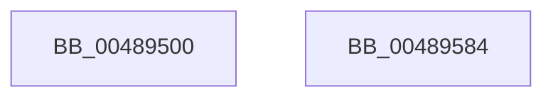

# VslApplySecureImageFixups

- RVA: `0x00489500`–`0x00489585` (길이 `133` bytes)
- VA: `0x0000000140489500`
- 실행 섹션: `.text`
- PDB 이름 있음: `예`; PDB Function 태그: `아니요`
- unwind 정보 RVA: `0x000AFF04`
- 디코드: `32`개 명령, `133/133` bytes 표시
- 미해석 바이트: `0` (있으면 어셈블리에 `.byte`로 보존)

> 이 문서는 커널 이미지의 기계어와 PDB 기호를 분석해 생성했습니다. 4번과 5번은 함수 원형과 자료형을 바이너리 사용 방식에서 추정한 C 해석이며 원본 소스 복구 결과는 아닙니다.

## 1. Dependencies

- 직접 호출 지점: **3**; 고유 호출 대상: **3**
- 직접 호출자로 확인된 함수: **1**
- RIP 상대 이미지 참조: **1**

### Outgoing calls
- `0x00489537` → [memset](../6C/memset_function_006C6C40.md) (function, `0x006C6C40`)
- `0x0048955A` → [VslpEnterIumSecureMode](../23/VslpEnterIumSecureMode_function_00235E50.md) (function, `0x00235E50`)
- `0x0048956A` → [_security_check_cookie](../6A/_security_check_cookie_function_006AC640.md) (function, `0x006AC640`)

### Direct callers
- [MiWalkEntireImage](../36/MiWalkEntireImage_function_00365D70.md) at `0x003664D5`
- [MiWalkEntireImage](../36/MiWalkEntireImage_function_00365D70.md) at `0x00366D42`

### Static image references
- `0x00489512` → RVA `0x00E0A740` (`.data`; read)

## 2. Other-region calls and transfers

- 다른 실행 섹션으로 향하는 call: **0**
- 별도 외부 분기/꼬리 이동을 확인하지 못했습니다.

## 3. Assembly (complete function range)

```asm
00489500  48 89 5C 24 08                  mov qword ptr [rsp + 8], rbx
00489505  48 89 74 24 10                  mov qword ptr [rsp + 0x10], rsi
0048950A  57                              push rdi
0048950B  48 81 EC A0 00 00 00            sub rsp, 0xa0
00489512  48 8B 05 27 12 98 00            mov rax, qword ptr [rip + 0x981227]
00489519  48 33 C4                        xor rax, rsp
0048951C  48 89 84 24 90 00 00 00         mov qword ptr [rsp + 0x90], rax
00489524  8B FA                           mov edi, edx
00489526  49 8B F0                        mov rsi, r8
00489529  33 D2                           xor edx, edx
0048952B  48 8B D9                        mov rbx, rcx
0048952E  48 8D 4C 24 20                  lea rcx, [rsp + 0x20]
00489533  44 8D 42 68                     lea r8d, [rdx + 0x68]
00489537  E8 04 D7 23 00                  call 0x1406c6c40
0048953C  BA 2D 00 00 00                  mov edx, 0x2d
00489541  48 89 5C 24 28                  mov qword ptr [rsp + 0x28], rbx
00489546  4C 8D 4C 24 20                  lea r9, [rsp + 0x20]
0048954B  48 89 7C 24 30                  mov qword ptr [rsp + 0x30], rdi
00489550  45 33 C0                        xor r8d, r8d
00489553  48 89 74 24 38                  mov qword ptr [rsp + 0x38], rsi
00489558  B1 02                           mov cl, 2
0048955A  E8 F1 C8 DA FF                  call 0x140235e50
0048955F  48 8B 8C 24 90 00 00 00         mov rcx, qword ptr [rsp + 0x90]
00489567  48 33 CC                        xor rcx, rsp
0048956A  E8 D1 30 22 00                  call 0x1406ac640
0048956F  4C 8D 9C 24 A0 00 00 00         lea r11, [rsp + 0xa0]
00489577  49 8B 5B 10                     mov rbx, qword ptr [r11 + 0x10]
0048957B  49 8B 73 18                     mov rsi, qword ptr [r11 + 0x18]
0048957F  49 8B E3                        mov rsp, r11
00489582  5F                              pop rdi
00489583  C3                              ret
00489584  CC                              int3
```

## 4. C-style interpretation (structured pseudocode)

```c
__int64 __fastcall VslApplySecureImageFixups(__int64 a1, int a2, __int64 a3)
{
    __int64 result;
    __int64 v_rsp;
    unsigned __int64 v_stack_m18;
    unsigned __int64 v_stack_m70;
    unsigned __int64 v_stack_m78;
    unsigned __int64 v_stack_m8;
    unsigned __int64 v_stack_m80;
    unsigned __int64 v_stack_m88;
    unsigned __int64 v_stack_p10;
    unsigned __int64 v_stack_p8;

    v_stack_p8 = v_rbx;
    v_stack_p10 = v_rsi;
    v_rsp = (v_rsp) - (160);
    result = (*(unsigned __int64 *)(v_rip + 9966119)) ^ (v_rsp);
    v_stack_m18 = result;
    a2 = 0;
    result = memset(v_stack_m88, a2, a2 + 104, a4);
    v_stack_m80 = a1;
    v_stack_m78 = (unsigned int)(a2);
    a3 = 0;
    v_stack_m70 = 0;
    result = VslpEnterIumSecureMode(2, 45, a3, v_stack_m88);
    a1 = (v_stack_m18) ^ (v_rsp);
    result = _security_check_cookie(a1, 45, a3, v_stack_m88);
    return result;
}
```

## 5. (Beta) C Style

```c
int64_t VslApplySecureImageFixups(int64_t Arg1, int32_t Arg2, int64_t Arg3)
{
    int64_t result;
    int64_t local_rsp;
    uint64_t v_stack_m18;
    uint64_t v_stack_m70;
    uint64_t v_stack_m78;
    uint64_t v_stack_m8;
    uint64_t v_stack_m80;
    uint64_t v_stack_m88;
    uint64_t v_stack_p10;
    uint64_t v_stack_p8;

    v_stack_p8 = local_rbx;
    v_stack_p10 = local_rsi;
    local_rsp = (local_rsp) - (160);
    result = (*(uint64_t *)(v_rip + 0x981227)) ^ (local_rsp);
    v_stack_m18 = result;
    Arg2 = 0;
    result = memset(v_stack_m88, Arg2, Arg2 + 104, a4);
    v_stack_m80 = Arg1;
    v_stack_m78 = (uint32_t)(Arg2);
    Arg3 = 0;
    v_stack_m70 = 0;
    result = VslpEnterIumSecureMode(2, 45, Arg3, v_stack_m88);
    Arg1 = (v_stack_m18) ^ (local_rsp);
    result = _security_check_cookie(Arg1, 45, Arg3, v_stack_m88);
    return result;
}
```

## 6. Execution-region graph

[열기: 2D/3D 그래프와 함수 탐색 컨트롤 패널](../../../control-panel.html?section=text&rva=0x00489500&view=graph)

- 2D 그래프는 위에서 아래로 흐르고, 3D 그래프는 빈 공간을 드래그해 회전합니다. Shift+드래그는 이동, 휠은 확대·축소, 함수 노드 선택은 대상 보고서 이동입니다.

### Static fallback


