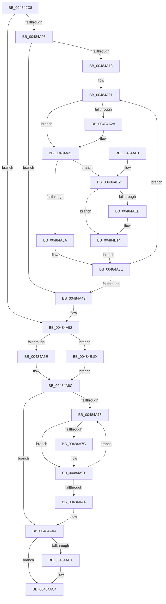

# WheapCompressErrorRecord

- RVA: `0x004849C8`–`0x00484B25` (길이 `349` bytes)
- VA: `0x00000001404849C8`
- 실행 섹션: `.text`
- PDB 이름 있음: `예`; PDB Function 태그: `아니요`
- unwind 정보 RVA: `0x000AF350`
- 디코드: `100`개 명령, `349/349` bytes 표시
- 미해석 바이트: `0` (있으면 어셈블리에 `.byte`로 보존)

> 이 문서는 커널 이미지의 기계어와 PDB 기호를 분석해 생성했습니다. 4번과 5번은 함수 원형과 자료형을 바이너리 사용 방식에서 추정한 C 해석이며 원본 소스 복구 결과는 아닙니다.

## 1. Dependencies

- 직접 호출 지점: **3**; 고유 호출 대상: **2**
- 직접 호출자로 확인된 함수: **4**
- RIP 상대 이미지 참조: **2**

### Outgoing calls
- `0x00484A89` → [memcpy](../6C/memcpy_function_006C6840.md) (function, `0x006C6840`)
- `0x00484AB8` → [memset](../6C/memset_function_006C6C40.md) (function, `0x006C6C40`)
- `0x00484AFC` → [memcpy](../6C/memcpy_function_006C6840.md) (function, `0x006C6840`)

### Direct callers
- [WheapGenerateETWEvents](WheapGenerateETWEvents_function_0048494C.md) at `0x0048496F`
- [WheaReportHwError](../4E/WheaReportHwError_function_004ED200.md) at `0x004ED426`
- [WheaReportHwError](../4E/WheaReportHwError_function_004ED200.md) at `0x004ED478`
- [WheaReportHwError](../4E/WheaReportHwError_function_004ED200.md) at `0x004ED4D7`
- [WheapReportBootError](../65/WheapReportBootError_function_0065DF58.md) at `0x0065DFDE`
- [WheaRecoveryBugCheck](../65/WheaRecoveryBugCheck_function_0065E110.md) at `0x0065E128`

### Static image references
- `0x00484A13` → RVA `0x0001A540` (`.rdata`; read)
- `0x00484A1A` → RVA `0x0001A538` (`.rdata`; read)

## 2. Other-region calls and transfers

- 다른 실행 섹션으로 향하는 call: **0**
- 별도 외부 분기/꼬리 이동을 확인하지 못했습니다.

## 3. Assembly (complete function range)

```asm
004849C8  48 89 5C 24 08                  mov qword ptr [rsp + 8], rbx
004849CD  48 89 6C 24 10                  mov qword ptr [rsp + 0x10], rbp
004849D2  48 89 74 24 18                  mov qword ptr [rsp + 0x18], rsi
004849D7  57                              push rdi
004849D8  41 54                           push r12
004849DA  41 55                           push r13
004849DC  41 56                           push r14
004849DE  41 57                           push r15
004849E0  48 83 EC 20                     sub rsp, 0x20
004849E4  44 0F B7 42 0A                  movzx r8d, word ptr [rdx + 0xa]
004849E9  4C 8D B2 80 00 00 00            lea r14, [rdx + 0x80]
004849F0  45 33 E4                        xor r12d, r12d
004849F3  48 8B F2                        mov rsi, rdx
004849F6  44 8B F9                        mov r15d, ecx
004849F9  45 8D 6C 24 01                  lea r13d, [r12 + 1]
004849FE  F6 C1 02                        test cl, 2
00484A01  74 4F                           je 0x140484a52
00484A03  49 8B DE                        mov rbx, r14
00484A06  41 0F B7 EC                     movzx ebp, r12w
00484A0A  41 8B FC                        mov edi, r12d
00484A0D  66 45 3B E0                     cmp r12w, r8w
00484A11  73 36                           jae 0x140484a49
00484A13  48 8B 0D 26 5B B9 FF            mov rcx, qword ptr [rip - 0x46a4da]
00484A1A  48 8B 15 17 5B B9 FF            mov rdx, qword ptr [rip - 0x46a4e9]
00484A21  48 8B 43 10                     mov rax, qword ptr [rbx + 0x10]
00484A25  48 2B C2                        sub rax, rdx
00484A28  75 07                           jne 0x140484a31
00484A2A  48 8B 43 18                     mov rax, qword ptr [rbx + 0x18]
00484A2E  48 2B C1                        sub rax, rcx
00484A31  48 85 C0                        test rax, rax
00484A34  0F 84 A8 00 00 00               je 0x140484ae2
00484A3A  48 83 C3 48                     add rbx, 0x48
00484A3E  41 03 FD                        add edi, r13d
00484A41  41 0F B7 C0                     movzx eax, r8w
00484A45  3B F8                           cmp edi, eax
00484A47  72 D8                           jb 0x140484a21
00484A49  66 44 2B C5                     sub r8w, bp
00484A4D  66 44 89 46 0A                  mov word ptr [rsi + 0xa], r8w
00484A52  41 8B FF                        mov edi, r15d
00484A55  41 23 FD                        and edi, r13d
00484A58  0F 84 BF 00 00 00               je 0x140484b1d
00484A5E  41 0F B7 C0                     movzx eax, r8w
00484A62  8D 0C C0                        lea ecx, [rax + rax*8]
00484A65  8D 1C CD 80 00 00 00            lea ebx, [rcx*8 + 0x80]
00484A6C  41 8B EC                        mov ebp, r12d
00484A6F  66 45 3B E0                     cmp r12w, r8w
00484A73  73 35                           jae 0x140484aaa
00484A75  41 8B 06                        mov eax, dword ptr [r14]
00484A78  3B D8                           cmp ebx, eax
00484A7A  73 15                           jae 0x140484a91
00484A7C  45 8B 46 04                     mov r8d, dword ptr [r14 + 4]
00484A80  48 8D 14 06                     lea rdx, [rsi + rax]
00484A84  8B CB                           mov ecx, ebx
00484A86  48 03 CE                        add rcx, rsi
00484A89  E8 B2 1D 24 00                  call 0x1406c6840
00484A8E  41 89 1E                        mov dword ptr [r14], ebx
00484A91  41 03 5E 04                     add ebx, dword ptr [r14 + 4]
00484A95  41 03 ED                        add ebp, r13d
00484A98  0F B7 46 0A                     movzx eax, word ptr [rsi + 0xa]
00484A9C  49 83 C6 48                     add r14, 0x48
00484AA0  3B E8                           cmp ebp, eax
00484AA2  72 D1                           jb 0x140484a75
00484AA4  41 8B FF                        mov edi, r15d
00484AA7  41 23 FD                        and edi, r13d
00484AAA  44 8B 46 14                     mov r8d, dword ptr [rsi + 0x14]
00484AAE  33 D2                           xor edx, edx
00484AB0  8B CB                           mov ecx, ebx
00484AB2  44 2B C3                        sub r8d, ebx
00484AB5  48 03 CE                        add rcx, rsi
00484AB8  E8 83 21 24 00                  call 0x1406c6c40
00484ABD  85 FF                           test edi, edi
00484ABF  74 03                           je 0x140484ac4
00484AC1  89 5E 14                        mov dword ptr [rsi + 0x14], ebx
00484AC4  48 8B 5C 24 50                  mov rbx, qword ptr [rsp + 0x50]
00484AC9  48 8B 6C 24 58                  mov rbp, qword ptr [rsp + 0x58]
00484ACE  48 8B 74 24 60                  mov rsi, qword ptr [rsp + 0x60]
00484AD3  48 83 C4 20                     add rsp, 0x20
00484AD7  41 5F                           pop r15
00484AD9  41 5E                           pop r14
00484ADB  41 5D                           pop r13
00484ADD  41 5C                           pop r12
00484ADF  5F                              pop rdi
00484AE0  C3                              ret
00484AE1  CC                              int3
00484AE2  41 0F B7 C0                     movzx eax, r8w
00484AE6  2B C7                           sub eax, edi
00484AE8  41 2B C5                        sub eax, r13d
00484AEB  74 27                           je 0x140484b14
00484AED  44 8D 04 C0                     lea r8d, [rax + rax*8]
00484AF1  48 8B CB                        mov rcx, rbx
00484AF4  41 C1 E0 03                     shl r8d, 3
00484AF8  48 8D 53 48                     lea rdx, [rbx + 0x48]
00484AFC  E8 3F 1D 24 00                  call 0x1406c6840
00484B01  44 0F B7 46 0A                  movzx r8d, word ptr [rsi + 0xa]
00484B06  48 8B 0D 33 5A B9 FF            mov rcx, qword ptr [rip - 0x46a5cd]
00484B0D  48 8B 15 24 5A B9 FF            mov rdx, qword ptr [rip - 0x46a5dc]
00484B14  66 41 03 ED                     add bp, r13w
00484B18  E9 21 FF FF FF                  jmp 0x140484a3e
00484B1D  41 8B 1E                        mov ebx, dword ptr [r14]
00484B20  E9 47 FF FF FF                  jmp 0x140484a6c
```

## 4. C-style interpretation (structured pseudocode)

```c
__int64 __fastcall WheapCompressErrorRecord(int a1, __int64 a2)
{
    __int64 result;
    __int64 v_r12;
    __int64 v_r14;
    __int64 v_rbp;
    __int64 v_rbx;
    __int64 v_rdi;
    __int64 v_rsp;
    unsigned __int64 v_stack_p10;
    unsigned __int64 v_stack_p18;
    unsigned __int64 v_stack_p8;

    v_stack_p8 = v_rbx;
    v_stack_p10 = v_rbp;
    v_stack_p18 = v_rsi;
    v_rsp = (v_rsp) - (32);
    v_r12 = 0;
    if ((((unsigned __int8)(a1)) & (2)) == 0) goto loc_00484A52;
    if (0 >= ((unsigned __int16)(*(unsigned __int16 *)(a2 + 10)))) goto loc_00484A49;
loc_00484A21:
    result = (*(unsigned __int64 *)(a2 + 128 + 16)) - (*(unsigned __int64 *)(v_rip - 4629737));
    if (!(condition_is_not_equal)) {
        result = *(unsigned __int64 *)(a2 + 128 + 24);
        result = (result) - (*(unsigned __int64 *)(v_rip - 4629722));
    }
    if (result == 0) goto loc_00484AE2;
    v_rbx = (a2 + 128) + (72);
loc_00484A3E:
    v_rdi = (unsigned int)((0) + ((unsigned int)(v_r12 + 1)));
    if (((unsigned int)(v_rdi)) < ((unsigned int)((unsigned __int16)(*(unsigned __int16 *)(a2 + 10))))) goto loc_00484A21;
loc_00484A49:
    a3 = (unsigned __int16)((*(unsigned __int16 *)(a2 + 10)) - (0));
    *(unsigned __int16 *)(a2 + 10) = (unsigned __int16)(a3);
loc_00484A52:
    v_rdi = (unsigned int)(((unsigned int)((unsigned int)((unsigned int)(a1)))) & ((unsigned int)(v_r12 + 1)));
    if (condition_is_equal) goto loc_00484B1D;
loc_00484A6C:
    if (0 >= ((unsigned __int16)(a3))) goto loc_00484AAA;
loc_00484A75:
    result = (unsigned int)(*(unsigned int *)(a2 + 128));
    if (((unsigned int)((unsigned __int16)(a3) + (unsigned __int16)(a3) * 8 * 8 + 128)) < ((unsigned int)((unsigned int)(*(unsigned int *)(a2 + 128))))) {
        a3 = *(unsigned int *)(a2 + 128 + 4);
        a2 = a2 + (unsigned int)(*(unsigned int *)(a2 + 128)) * 1;
        a1 = (unsigned int)((unsigned __int16)(a3) + (unsigned __int16)(a3) * 8 * 8 + 128);
        a1 = (a1) + (a2);
        result = memcpy(a1, a2, a3, a4);
        *(unsigned int *)(a2 + 128) = (unsigned int)((unsigned __int16)(a3) + (unsigned __int16)(a3) * 8 * 8 + 128);
    }
    v_rbx = (unsigned int)(((unsigned __int16)(a3) + (unsigned __int16)(a3) * 8 * 8 + 128) + (*(unsigned int *)(a2 + 128 + 4)));
    v_rbp = (unsigned int)((0) + ((unsigned int)(v_r12 + 1)));
    v_r14 = (a2 + 128) + (72);
    if (((unsigned int)(v_rbp)) < ((unsigned int)(*(unsigned __int16 *)(a2 + 10)))) goto loc_00484A75;
    v_rdi = (unsigned int)(((unsigned int)((unsigned int)((unsigned int)(a1)))) & ((unsigned int)(v_r12 + 1)));
loc_00484AAA:
    a2 = 0;
    a3 = (unsigned int)(((unsigned int)(*(unsigned int *)(a2 + 20))) - ((unsigned int)(v_rbx)));
    a1 = ((unsigned int)((unsigned int)(v_rbx))) + (0);
    result = memset(a1, a2, a3, a4);
    if ((unsigned int)(v_rdi) != 0) {
        *(unsigned int *)(a2 + 20) = (unsigned int)(v_rbx);
    }
    v_rsp = (v_rsp) + (32);
    return result;
loc_00484AE2:
    result = (unsigned int)(((unsigned __int16)(a3)) - ((unsigned int)(v_rdi)));
    result = (unsigned int)((result) - ((unsigned int)(v_r12 + 1)));
    if (!(condition_is_equal)) {
        a3 = result + result * 8;
        a1 = v_stack_p8;
        a3 = (unsigned int)((a3) << (3));
        a2 = v_stack_p8 + 72;
        result = memcpy(a1, a2, a3, a4);
        a3 = *(unsigned __int16 *)(v_stack_p18 + 10);
        a1 = *(unsigned __int64 *)(v_rip - 4629965);
        a2 = *(unsigned __int64 *)(v_rip - 4629980);
    }
    v_rbp = (unsigned __int16)((v_stack_p10) + ((unsigned __int16)(v_r12 + 1)));
    goto loc_00484A3E;
loc_00484B1D:
    goto loc_00484A6C;
}
```

## 5. (Beta) C Style

```c
int64_t WheapCompressErrorRecord(int32_t Arg1, void *Arg2)
{
    uint8_t *arg2 = (uint8_t *)Arg2;

    int64_t result;
    int64_t local_r12;
    int64_t local_r14;
    int64_t local_rbp;
    int64_t local_rbx;
    int64_t local_rdi;
    int64_t local_rsp;
    uint64_t v_stack_p10;
    uint64_t v_stack_p18;
    uint64_t v_stack_p8;

    v_stack_p8 = local_rbx;
    v_stack_p10 = local_rbp;
    v_stack_p18 = local_rsi;
    local_rsp = (local_rsp) - (32);
    local_r12 = 0;
    if ((((uint8_t)(Arg1)) & (2)) == 0) goto loc_00484A52;
    if (0 >= ((uint16_t)(*(uint16_t *)(arg2 + 0xA)))) goto loc_00484A49;
loc_00484A21:
    result = (*(uint64_t *)(arg2 + 0x80 + 0x10)) - (*(uint64_t *)(v_rip - 0x46A4E9));
    if (!(condition_is_not_equal)) {
        result = *(uint64_t *)(arg2 + 0x80 + 0x18);
        result = (result) - (*(uint64_t *)(v_rip - 0x46A4DA));
    }
    if (result == 0) goto loc_00484AE2;
    local_rbx = (Arg2 + 128) + (72);
loc_00484A3E:
    local_rdi = (uint32_t)((0) + ((uint32_t)(local_r12 + 1)));
    if (((uint32_t)(local_rdi)) < ((uint32_t)((uint16_t)(*(uint16_t *)(arg2 + 0xA))))) goto loc_00484A21;
loc_00484A49:
    a3 = (uint16_t)((*(uint16_t *)(arg2 + 0xA)) - (0));
    *(uint16_t *)(arg2 + 0xA) = (uint16_t)(a3);
loc_00484A52:
    local_rdi = (uint32_t)(((uint32_t)((uint32_t)((uint32_t)(Arg1)))) & ((uint32_t)(local_r12 + 1)));
    if (condition_is_equal) goto loc_00484B1D;
loc_00484A6C:
    if (0 >= ((uint16_t)(a3))) goto loc_00484AAA;
loc_00484A75:
    result = (uint32_t)(*(uint32_t *)(arg2 + 0x80));
    if (((uint32_t)((uint16_t)(a3) + (uint16_t)(a3) * 8 * 8 + 128)) < ((uint32_t)((uint32_t)(*(uint32_t *)(arg2 + 0x80))))) {
        a3 = *(uint32_t *)(arg2 + 0x80 + 0x4);
        Arg2 = Arg2 + (uint32_t)(*(uint32_t *)(arg2 + 0x80)) * 1;
        Arg1 = (uint32_t)((uint16_t)(a3) + (uint16_t)(a3) * 8 * 8 + 128);
        Arg1 = (Arg1) + (Arg2);
        result = memcpy(Arg1, Arg2, a3, a4);
        *(uint32_t *)(arg2 + 0x80) = (uint32_t)((uint16_t)(a3) + (uint16_t)(a3) * 8 * 8 + 128);
    }
    local_rbx = (uint32_t)(((uint16_t)(a3) + (uint16_t)(a3) * 8 * 8 + 128) + (*(uint32_t *)(arg2 + 0x80 + 0x4)));
    local_rbp = (uint32_t)((0) + ((uint32_t)(local_r12 + 1)));
    local_r14 = (Arg2 + 128) + (72);
    if (((uint32_t)(local_rbp)) < ((uint32_t)(*(uint16_t *)(arg2 + 0xA)))) goto loc_00484A75;
    local_rdi = (uint32_t)(((uint32_t)((uint32_t)((uint32_t)(Arg1)))) & ((uint32_t)(local_r12 + 1)));
loc_00484AAA:
    Arg2 = 0;
    a3 = (uint32_t)(((uint32_t)(*(uint32_t *)(arg2 + 0x14))) - ((uint32_t)(local_rbx)));
    Arg1 = ((uint32_t)((uint32_t)(local_rbx))) + (0);
    result = memset(Arg1, Arg2, a3, a4);
    if ((uint32_t)(local_rdi) != 0) {
        *(uint32_t *)(arg2 + 0x14) = (uint32_t)(local_rbx);
    }
    local_rsp = (local_rsp) + (32);
    return result;
loc_00484AE2:
    result = (uint32_t)(((uint16_t)(a3)) - ((uint32_t)(local_rdi)));
    result = (uint32_t)((result) - ((uint32_t)(local_r12 + 1)));
    if (!(condition_is_equal)) {
        a3 = result + result * 8;
        Arg1 = v_stack_p8;
        a3 = (uint32_t)((a3) << (3));
        Arg2 = v_stack_p8 + 72;
        result = memcpy(Arg1, Arg2, a3, a4);
        a3 = *(uint16_t *)(v_stack_p18 + 0xA);
        Arg1 = *(uint64_t *)(v_rip - 0x46A5CD);
        Arg2 = *(uint64_t *)(v_rip - 0x46A5DC);
    }
    local_rbp = (uint16_t)((v_stack_p10) + ((uint16_t)(local_r12 + 1)));
    goto loc_00484A3E;
loc_00484B1D:
    goto loc_00484A6C;
}
```

### 관측된 메모리 오프셋

구조체 형식이 확인되지 않은 접근은 인자 기준의 오프셋으로만 기록했습니다.

| 기준 인자 | 오프셋 표현 | 폭 (bit) | 접근 |
|---|---:|---:|---|
| `Arg2` | `+ 0x0` | `32` | `R` |
| `Arg2` | `+ 0x0` | `32` | `W` |
| `Arg2` | `+ 0x0 + rax*1` | `64` | `R` |
| `Arg2` | `+ 0x4` | `32` | `R` |
| `Arg2` | `+ 0xA` | `16` | `R` |
| `Arg2` | `+ 0xA` | `16` | `W` |
| `Arg2` | `+ 0x10` | `64` | `R` |
| `Arg2` | `+ 0x14` | `32` | `R` |
| `Arg2` | `+ 0x14` | `32` | `W` |
| `Arg2` | `+ 0x18` | `64` | `R` |
| `Arg2` | `+ 0x48` | `64` | `R` |
| `Arg2` | `+ 0x80` | `64` | `R` |

## 6. Execution-region graph

[열기: 2D/3D 그래프와 함수 탐색 컨트롤 패널](../../../control-panel.html?section=text&rva=0x004849C8&view=graph)

- 2D 그래프는 위에서 아래로 흐르고, 3D 그래프는 빈 공간을 드래그해 회전합니다. Shift+드래그는 이동, 휠은 확대·축소, 함수 노드 선택은 대상 보고서 이동입니다.

### Static fallback


