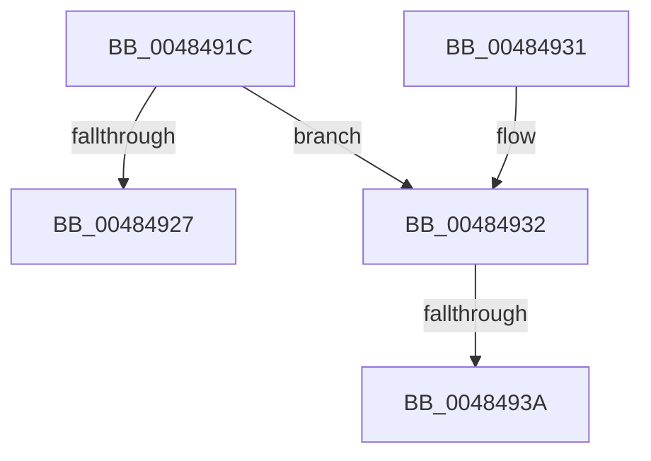

# WheapFreeErrorRecord

- RVA: `0x0048491C`–`0x00484944` (길이 `40` bytes)
- VA: `0x000000014048491C`
- 실행 섹션: `.text`
- PDB 이름 있음: `예`; PDB Function 태그: `예`
- unwind 정보 RVA: `0x0007A1AC`
- 디코드: `13`개 명령, `40/40` bytes 표시
- 미해석 바이트: `0` (있으면 어셈블리에 `.byte`로 보존)

> 이 문서는 커널 이미지의 기계어와 PDB 기호를 분석해 생성했습니다. 4번과 5번은 함수 원형과 자료형을 바이너리 사용 방식에서 추정한 C 해석이며 원본 소스 복구 결과는 아닙니다.

## 1. Dependencies

- 직접 호출 지점: **0**; 고유 호출 대상: **0**
- 직접 호출자로 확인된 함수: **3**
- RIP 상대 이미지 참조: **0**

### Outgoing calls
- 직접 디코드된 call 명령이 없습니다.

### Direct callers
- [WheapProcessWorkQueueItem](WheapProcessWorkQueueItem_function_00484820.md) at `0x00484861`
- [WheaReportHwError](../4E/WheaReportHwError_function_004ED200.md) at `0x004ED3F4`
- [WheaReportHwError](../4E/WheaReportHwError_function_004ED200.md) at `0x004ED459`
- [WheaReportHwError](../4E/WheaReportHwError_function_004ED200.md) at `0x004ED58C`
- [WheapProcessWaitingETWEvents](../../page/7D/WheapProcessWaitingETWEvents_function_007D8680.md) at `0x007D86F6`

### Static image references
- 디코드된 RIP-relative 메모리 참조가 없습니다.

## 2. Other-region calls and transfers

- 다른 실행 섹션으로 향하는 call: **0**
- call이 아닌 외부 분기/꼬리 이동: **2**
  - `0x00484934` → [sub_006F5408](../6F/Unknown_function_006F5408.md) (`tail-transfer`)
  - `0x0048493F` → [sub_006F5408 + 0x7](../6F/Unknown_function_006F5408.md) (`tail-transfer`)

## 3. Assembly (complete function range)

```asm
0048491C  48 83 EC 28                     sub rsp, 0x28
00484920  8B 41 18                        mov eax, dword ptr [rcx + 0x18]
00484923  A8 01                           test al, 1
00484925  74 0B                           je 0x140484932
00484927  33 C0                           xor eax, eax
00484929  87 41 1C                        xchg dword ptr [rcx + 0x1c], eax
0048492C  48 83 C4 28                     add rsp, 0x28
00484930  C3                              ret
00484931  CC                              int3
00484932  A8 02                           test al, 2
00484934  0F 84 CE 0A 27 00               je 0x1406f5408
0048493A  BA 57 68 65 61                  mov edx, 0x61656857
0048493F  E9 CB 0A 27 00                  jmp 0x1406f540f
```

## 4. C-style interpretation (structured pseudocode)

```c
__int64 __fastcall WheapFreeErrorRecord(__int64 a1)
{
    __int64 result;
    __int64 v_rsp;

    v_rsp = (v_rsp) - (40);
    if ((((unsigned __int8)((unsigned int)(*(unsigned int *)(a1 + 24)))) & (1)) == 0) goto loc_00484932;
    result = 0;
    v_rsp = (v_rsp) + (40);
    return result;
loc_00484932:
}
```

## 5. (Beta) C Style

```c
int64_t WheapFreeErrorRecord(void *Arg1)
{
    uint8_t *arg1 = (uint8_t *)Arg1;

    int64_t result;
    int64_t local_rsp;

    local_rsp = (local_rsp) - (40);
    if ((((uint8_t)((uint32_t)(*(uint32_t *)(arg1 + 0x18)))) & (1)) == 0) goto loc_00484932;
    result = 0;
    local_rsp = (local_rsp) + (40);
    return result;
loc_00484932:
}
```

### 관측된 메모리 오프셋

구조체 형식이 확인되지 않은 접근은 인자 기준의 오프셋으로만 기록했습니다.

| 기준 인자 | 오프셋 표현 | 폭 (bit) | 접근 |
|---|---:|---:|---|
| `Arg1` | `+ 0x18` | `32` | `R` |
| `Arg1` | `+ 0x1C` | `32` | `R/W` |

## 6. Execution-region graph

[열기: 2D/3D 그래프와 함수 탐색 컨트롤 패널](../../../control-panel.html?section=text&rva=0x0048491C&view=graph)

- 2D 그래프는 위에서 아래로 흐르고, 3D 그래프는 빈 공간을 드래그해 회전합니다. Shift+드래그는 이동, 휠은 확대·축소, 함수 노드 선택은 대상 보고서 이동입니다.

### Static fallback


