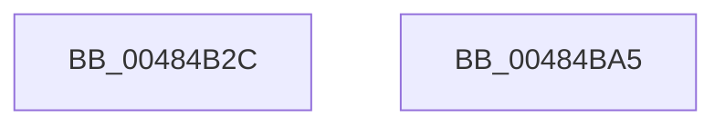

# WheapGenerateETWErrorRecord

- RVA: `0x00484B2C`–`0x00484BA6` (길이 `122` bytes)
- VA: `0x0000000140484B2C`
- 실행 섹션: `.text`
- PDB 이름 있음: `예`; PDB Function 태그: `아니요`
- unwind 정보 RVA: `0x000AF370`
- 디코드: `29`개 명령, `122/122` bytes 표시
- 미해석 바이트: `0` (있으면 어셈블리에 `.byte`로 보존)

> 이 문서는 커널 이미지의 기계어와 PDB 기호를 분석해 생성했습니다. 4번과 5번은 함수 원형과 자료형을 바이너리 사용 방식에서 추정한 C 해석이며 원본 소스 복구 결과는 아닙니다.

## 1. Dependencies

- 직접 호출 지점: **2**; 고유 호출 대상: **2**
- 직접 호출자로 확인된 함수: **1**
- RIP 상대 이미지 참조: **3**

### Outgoing calls
- `0x00484B8E` → [EtwWriteEx](../25/EtwWriteEx_function_0025F0D0.md) (function, `0x0025F0D0`)
- `0x00484B9B` → [_security_check_cookie](../6A/_security_check_cookie_function_006AC640.md) (function, `0x006AC640`)

### Direct callers
- [WheapGenerateETWEvents](WheapGenerateETWEvents_function_0048494C.md) at `0x00484980`

### Static image references
- `0x00484B33` → RVA `0x00E0A740` (`.data`; read)
- `0x00484B4A` → RVA `0x00EF9EF0` (`.data`; read)
- `0x00484B87` → RVA `0x0001A548` (`.rdata`; read)

## 2. Other-region calls and transfers

- 다른 실행 섹션으로 향하는 call: **0**
- 별도 외부 분기/꼬리 이동을 확인하지 못했습니다.

## 3. Assembly (complete function range)

```asm
00484B2C  4C 8B DC                        mov r11, rsp
00484B2F  48 83 EC 78                     sub rsp, 0x78
00484B33  48 8B 05 06 5C 98 00            mov rax, qword ptr [rip + 0x985c06]
00484B3A  48 33 C4                        xor rax, rsp
00484B3D  48 89 44 24 60                  mov qword ptr [rsp + 0x60], rax
00484B42  48 8D 41 14                     lea rax, [rcx + 0x14]
00484B46  49 89 4B D8                     mov qword ptr [r11 - 0x28], rcx
00484B4A  48 8B 0D 9F 53 A7 00            mov rcx, qword ptr [rip + 0xa7539f]
00484B51  33 D2                           xor edx, edx
00484B53  49 89 43 C8                     mov qword ptr [r11 - 0x38], rax
00484B57  45 33 C9                        xor r9d, r9d
00484B5A  8B 00                           mov eax, dword ptr [rax]
00484B5C  45 33 C0                        xor r8d, r8d
00484B5F  49 C7 43 D0 04 00 00 00         mov qword ptr [r11 - 0x30], 4
00484B67  89 44 24 58                     mov dword ptr [rsp + 0x58], eax
00484B6B  49 8D 43 C8                     lea rax, [r11 - 0x38]
00484B6F  49 89 43 C0                     mov qword ptr [r11 - 0x40], rax
00484B73  C7 44 24 30 02 00 00 00         mov dword ptr [rsp + 0x30], 2
00484B7B  49 89 53 B0                     mov qword ptr [r11 - 0x50], rdx
00484B7F  49 89 53 A8                     mov qword ptr [r11 - 0x58], rdx
00484B83  89 54 24 5C                     mov dword ptr [rsp + 0x5c], edx
00484B87  48 8D 15 BA 59 B9 FF            lea rdx, [rip - 0x46a646]
00484B8E  E8 3D A5 DD FF                  call 0x14025f0d0
00484B93  48 8B 4C 24 60                  mov rcx, qword ptr [rsp + 0x60]
00484B98  48 33 CC                        xor rcx, rsp
00484B9B  E8 A0 7A 22 00                  call 0x1406ac640
00484BA0  48 83 C4 78                     add rsp, 0x78
00484BA4  C3                              ret
00484BA5  CC                              int3
```

## 4. C-style interpretation (structured pseudocode)

```c
__int64 __fastcall WheapGenerateETWErrorRecord(__int64 a1, int a2, int a3, int a4)
{
    __int64 result;
    __int64 v_rsp;
    unsigned __int64 v_stack_m18;
    unsigned int v_stack_m1C;
    unsigned int v_stack_m20;
    unsigned int v_stack_m48;

    v_rsp = (v_rsp) - (120);
    result = (*(unsigned __int64 *)(v_rip + 9985030)) ^ (v_rsp);
    v_stack_m18 = result;
    *(unsigned __int64 *)(v_rsp - 40) = a1;
    a2 = 0;
    *(unsigned __int64 *)(v_rsp - 56) = a1 + 20;
    a4 = 0;
    a3 = 0;
    *(unsigned __int64 *)(v_rsp - 48) = 4;
    v_stack_m20 = (unsigned int)((unsigned int)(*(unsigned int *)(a1 + 20)));
    *(unsigned __int64 *)(v_rsp - 64) = v_rsp - 56;
    v_stack_m48 = 2;
    *(unsigned __int64 *)(v_rsp - 80) = 0;
    *(unsigned __int64 *)(v_rsp - 88) = 0;
    v_stack_m1C = 0;
    result = EtwWriteEx(*(unsigned __int64 *)(v_rip + 10965919), v_rip - 4630086, a3, a4);
    a1 = (v_stack_m18) ^ (v_rsp);
    result = _security_check_cookie(a1, v_rip - 4630086, a3, a4);
    v_rsp = (v_rsp) + (120);
    return result;
}
```

## 5. (Beta) C Style

```c
int64_t WheapGenerateETWErrorRecord(void *Arg1, int32_t Arg2, int32_t Arg3, int32_t Arg4)
{
    uint8_t *arg1 = (uint8_t *)Arg1;

    int64_t result;
    int64_t local_rsp;
    uint64_t v_stack_m18;
    uint32_t v_stack_m1C;
    uint32_t v_stack_m20;
    uint32_t v_stack_m48;

    local_rsp = (local_rsp) - (120);
    result = (*(uint64_t *)(v_rip + 0x985C06)) ^ (local_rsp);
    v_stack_m18 = result;
    *(void **)(local_rsp - 0x28) = Arg1;
    Arg2 = 0;
    *(void **)(local_rsp - 0x38) = Arg1 + 20;
    Arg4 = 0;
    Arg3 = 0;
    *(uint64_t *)(local_rsp - 0x30) = 4;
    v_stack_m20 = (uint32_t)((uint32_t)(*(uint32_t *)(arg1 + 0x14)));
    *(uint64_t *)(local_rsp - 0x40) = local_rsp - 56;
    v_stack_m48 = 2;
    *(uint64_t *)(local_rsp - 0x50) = 0;
    *(uint64_t *)(local_rsp - 0x58) = 0;
    v_stack_m1C = 0;
    result = EtwWriteEx(*(uint64_t *)(v_rip + 0xA7539F), v_rip - 4630086, Arg3, Arg4);
    Arg1 = (v_stack_m18) ^ (local_rsp);
    result = _security_check_cookie(Arg1, v_rip - 4630086, Arg3, Arg4);
    local_rsp = (local_rsp) + (120);
    return result;
}
```

### 관측된 메모리 오프셋

구조체 형식이 확인되지 않은 접근은 인자 기준의 오프셋으로만 기록했습니다.

| 기준 인자 | 오프셋 표현 | 폭 (bit) | 접근 |
|---|---:|---:|---|
| `Arg1` | `+ 0x0` | `32` | `R` |
| `Arg1` | `+ 0x14` | `64` | `R` |

## 6. Execution-region graph

[열기: 2D/3D 그래프와 함수 탐색 컨트롤 패널](../../../control-panel.html?section=text&rva=0x00484B2C&view=graph)

- 2D 그래프는 위에서 아래로 흐르고, 3D 그래프는 빈 공간을 드래그해 회전합니다. Shift+드래그는 이동, 휠은 확대·축소, 함수 노드 선택은 대상 보고서 이동입니다.

### Static fallback


