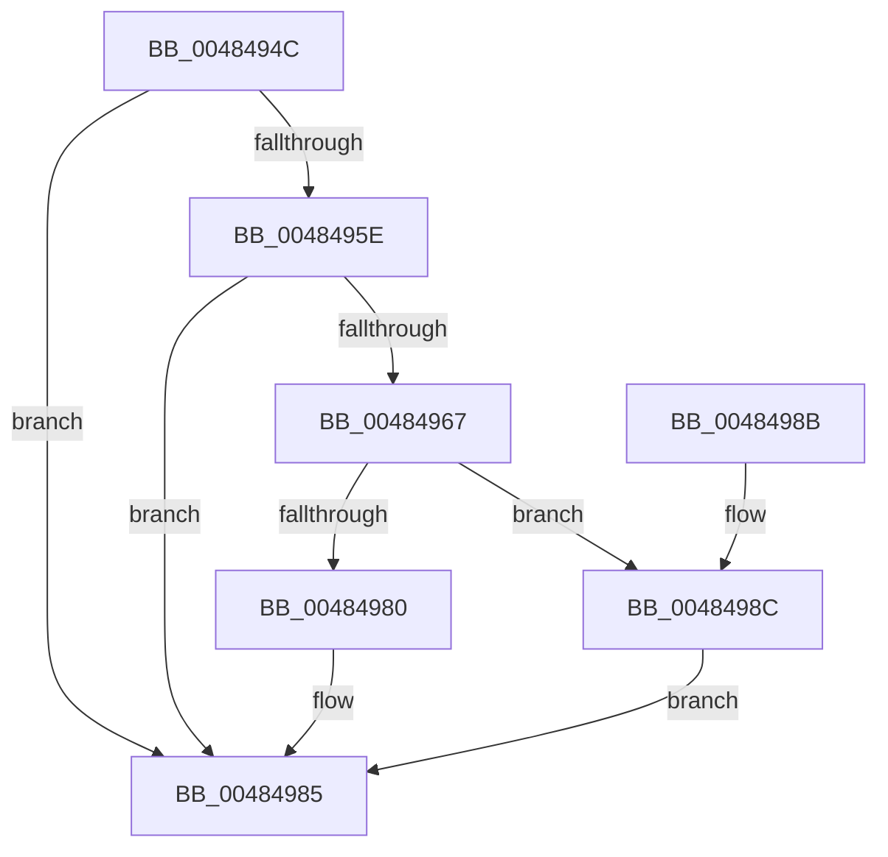

# WheapGenerateETWEvents

- RVA: `0x0048494C`–`0x00484993` (길이 `71` bytes)
- VA: `0x000000014048494C`
- 실행 섹션: `.text`
- PDB 이름 있음: `예`; PDB Function 태그: `아니요`
- unwind 정보 RVA: `0x0005DAC8`
- 디코드: `21`개 명령, `71/71` bytes 표시
- 미해석 바이트: `0` (있으면 어셈블리에 `.byte`로 보존)

> 이 문서는 커널 이미지의 기계어와 PDB 기호를 분석해 생성했습니다. 4번과 5번은 함수 원형과 자료형을 바이너리 사용 방식에서 추정한 C 해석이며 원본 소스 복구 결과는 아닙니다.

## 1. Dependencies

- 직접 호출 지점: **4**; 고유 호출 대상: **4**
- 직접 호출자로 확인된 함수: **3**
- RIP 상대 이미지 참조: **0**

### Outgoing calls
- `0x00484955` → [WheaIsCriticalState](WheaIsCriticalState_function_004849A0.md) (function, `0x004849A0`)
- `0x0048496F` → [WheapCompressErrorRecord](WheapCompressErrorRecord_function_004849C8.md) (function, `0x004849C8`)
- `0x00484980` → [WheapGenerateETWErrorRecord](WheapGenerateETWErrorRecord_function_00484B2C.md) (function, `0x00484B2C`)
- `0x0048498C` → [WheapGenerateETWErrorRecordLarge](../66/WheapGenerateETWErrorRecordLarge_function_006607D0.md) (function, `0x006607D0`)

### Direct callers
- [WheapProcessWorkQueueItem](WheapProcessWorkQueueItem_function_00484820.md) at `0x00484859`
- [WheaReportHwError](../4E/WheaReportHwError_function_004ED200.md) at `0x004ED451`
- [WheapProcessWaitingETWEvents](../../page/7D/WheapProcessWaitingETWEvents_function_007D8680.md) at `0x007D86EE`

### Static image references
- 디코드된 RIP-relative 메모리 참조가 없습니다.

## 2. Other-region calls and transfers

- 다른 실행 섹션으로 향하는 call: **0**
- 별도 외부 분기/꼬리 이동을 확인하지 못했습니다.

## 3. Assembly (complete function range)

```asm
0048494C  40 53                           push rbx
0048494E  48 83 EC 20                     sub rsp, 0x20
00484952  48 8B D9                        mov rbx, rcx
00484955  E8 46 00 00 00                  call 0x1404849a0
0048495A  84 C0                           test al, al
0048495C  75 27                           jne 0x140484985
0048495E  F7 43 68 00 01 00 00            test dword ptr [rbx + 0x68], 0x100
00484965  75 1E                           jne 0x140484985
00484967  48 8B D3                        mov rdx, rbx
0048496A  B9 03 00 00 00                  mov ecx, 3
0048496F  E8 54 00 00 00                  call 0x1404849c8
00484974  81 7B 14 FB EF 00 00            cmp dword ptr [rbx + 0x14], 0xeffb
0048497B  48 8B CB                        mov rcx, rbx
0048497E  77 0C                           ja 0x14048498c
00484980  E8 A7 01 00 00                  call 0x140484b2c
00484985  48 83 C4 20                     add rsp, 0x20
00484989  5B                              pop rbx
0048498A  C3                              ret
0048498B  CC                              int3
0048498C  E8 3F BE 1D 00                  call 0x1406607d0
00484991  EB F2                           jmp 0x140484985
```

## 4. C-style interpretation (structured pseudocode)

```c
__int64 __fastcall WheapGenerateETWEvents(__int64 a1)
{
    __int64 result;
    __int64 v_rsp;

    v_rsp = (v_rsp) - (32);
    result = WheaIsCriticalState(a1, a2, a3, a4);
    if ((unsigned __int8)(result) != 0) goto loc_00484985;
    if (((*(unsigned int *)(a1 + 104)) & (256)) != 0) goto loc_00484985;
    result = WheapCompressErrorRecord(3, a1, a3, a4);
    if ((*(unsigned int *)(a1 + 20)) > 0xEFFBULL) goto loc_0048498C;
    result = WheapGenerateETWErrorRecord(a1, a1, a3, a4);
loc_00484985:
    v_rsp = (v_rsp) + (32);
    return result;
loc_0048498C:
    result = WheapGenerateETWErrorRecordLarge(a1, a1, a3, a4);
    goto loc_00484985;
}
```

## 5. (Beta) C Style

```c
int64_t WheapGenerateETWEvents(void *Arg1)
{
    uint8_t *arg1 = (uint8_t *)Arg1;

    int64_t result;
    int64_t local_rsp;

    local_rsp = (local_rsp) - (32);
    result = WheaIsCriticalState(Arg1, a2, a3, a4);
    if ((uint8_t)(result) != 0) goto loc_00484985;
    if (((*(uint32_t *)(arg1 + 0x68)) & (256)) != 0) goto loc_00484985;
    result = WheapCompressErrorRecord(3, Arg1, a3, a4);
    if ((*(uint32_t *)(arg1 + 0x14)) > 0xEFFBULL) goto loc_0048498C;
    result = WheapGenerateETWErrorRecord(Arg1, Arg1, a3, a4);
loc_00484985:
    local_rsp = (local_rsp) + (32);
    return result;
loc_0048498C:
    result = WheapGenerateETWErrorRecordLarge(Arg1, Arg1, a3, a4);
    goto loc_00484985;
}
```

### 관측된 메모리 오프셋

구조체 형식이 확인되지 않은 접근은 인자 기준의 오프셋으로만 기록했습니다.

| 기준 인자 | 오프셋 표현 | 폭 (bit) | 접근 |
|---|---:|---:|---|
| `Arg1` | `+ 0x14` | `32` | `R` |
| `Arg1` | `+ 0x68` | `32` | `R` |

## 6. Execution-region graph

[열기: 2D/3D 그래프와 함수 탐색 컨트롤 패널](../../../control-panel.html?section=text&rva=0x0048494C&view=graph)

- 2D 그래프는 위에서 아래로 흐르고, 3D 그래프는 빈 공간을 드래그해 회전합니다. Shift+드래그는 이동, 휠은 확대·축소, 함수 노드 선택은 대상 보고서 이동입니다.

### Static fallback


