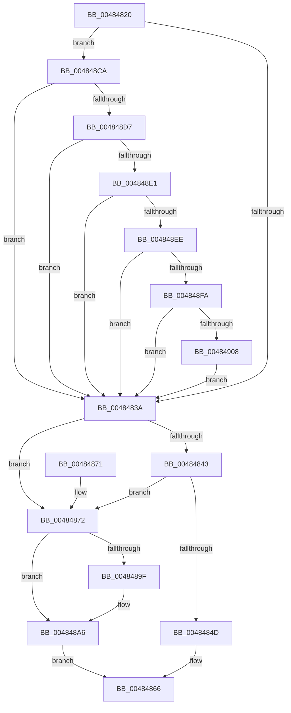

# WheapProcessWorkQueueItem

- RVA: `0x00484820`–`0x00484915` (길이 `245` bytes)
- VA: `0x0000000140484820`
- 실행 섹션: `.text`
- PDB 이름 있음: `예`; PDB Function 태그: `아니요`
- unwind 정보 RVA: `0x000AF330`
- 디코드: `59`개 명령, `245/245` bytes 표시
- 미해석 바이트: `0` (있으면 어셈블리에 `.byte`로 보존)

> 이 문서는 커널 이미지의 기계어와 PDB 기호를 분석해 생성했습니다. 4번과 5번은 함수 원형과 자료형을 바이너리 사용 방식에서 추정한 C 해석이며 원본 소스 복구 결과는 아닙니다.

## 1. Dependencies

- 직접 호출 지점: **6**; 고유 호출 대상: **6**
- 직접 호출자로 확인된 함수: **0**
- RIP 상대 이미지 참조: **6**

### Outgoing calls
- `0x00484850` → [WheapPredictiveFailureAnalysis](../../page/A5/WheapPredictiveFailureAnalysis_function_00A564AC.md) (function, `0x00A564AC`)
- `0x00484859` → [WheapGenerateETWEvents](WheapGenerateETWEvents_function_0048494C.md) (function, `0x0048494C`)
- `0x00484861` → [WheapFreeErrorRecord](WheapFreeErrorRecord_function_0048491C.md) (function, `0x0048491C`)
- `0x00484887` → [KeWaitForSingleObject](../20/KeWaitForSingleObject_function_0020E6B0.md) (function, `0x0020E6B0`)
- `0x004848C3` → [KeSetEvent](../33/KeSetEvent_function_0033F310.md) (function, `0x0033F310`)
- `0x0048490B` → [WheapCreateLiveDumpFromPreviousSession](../../pagelk/B7/WheapCreateLiveDumpFromPreviousSession_function_00B73698.md) (function, `0x00B73698`)

### Direct callers
- 이 함수 시작 RVA로 연결되는 직접 call은 확인되지 않았습니다. 간접 호출은 완전히 역산할 수 없습니다.

### Static image references
- `0x0048482A` → RVA `0x00EEEFF0` (`.data`; read)
- `0x0048483A` → RVA `0x00EF9F50` (`.data`; read)
- `0x00484878` → RVA `0x00EF9F20` (`.data`; read)
- `0x0048488C` → RVA `0x00EF9F48` (`.data`; read)
- `0x00484893` → RVA `0x00EF9F40` (`.data`; read)
- `0x004848BC` → RVA `0x00EF9F48` (`.data`; write)

## 2. Other-region calls and transfers

- 다른 실행 섹션으로 향하는 call: **2**
  - `0x00484850` → [WheapPredictiveFailureAnalysis](../../page/A5/WheapPredictiveFailureAnalysis_function_00A564AC.md) (`.text` → `PAGE`)
  - `0x0048490B` → [WheapCreateLiveDumpFromPreviousSession](../../pagelk/B7/WheapCreateLiveDumpFromPreviousSession_function_00B73698.md) (`.text` → `PAGELK`)
- 별도 외부 분기/꼬리 이동을 확인하지 못했습니다.

## 3. Assembly (complete function range)

```asm
00484820  48 89 5C 24 08                  mov qword ptr [rsp + 8], rbx
00484825  57                              push rdi
00484826  48 83 EC 30                     sub rsp, 0x30
0048482A  80 3D BF A7 A6 00 00            cmp byte ptr [rip + 0xa6a7bf], 0
00484831  48 8B DA                        mov rbx, rdx
00484834  0F 85 90 00 00 00               jne 0x1404848ca
0048483A  83 3D 0F 57 A7 00 00            cmp dword ptr [rip + 0xa7570f], 0
00484841  74 2F                           je 0x140484872
00484843  8A 83 90 00 00 00               mov al, byte ptr [rbx + 0x90]
00484849  84 C0                           test al, al
0048484B  78 25                           js 0x140484872
0048484D  48 8B CB                        mov rcx, rbx
00484850  E8 57 1C 5D 00                  call 0x140a564ac
00484855  48 8D 4B 28                     lea rcx, [rbx + 0x28]
00484859  E8 EE 00 00 00                  call 0x14048494c
0048485E  48 8B CB                        mov rcx, rbx
00484861  E8 B6 00 00 00                  call 0x14048491c
00484866  48 8B 5C 24 40                  mov rbx, qword ptr [rsp + 0x40]
0048486B  48 83 C4 30                     add rsp, 0x30
0048486F  5F                              pop rdi
00484870  C3                              ret
00484871  CC                              int3
00484872  48 83 64 24 20 00               and qword ptr [rsp + 0x20], 0
00484878  48 8D 0D A1 56 A7 00            lea rcx, [rip + 0xa756a1]
0048487F  45 33 C9                        xor r9d, r9d
00484882  45 33 C0                        xor r8d, r8d
00484885  33 D2                           xor edx, edx
00484887  E8 24 9E D8 FF                  call 0x14020e6b0
0048488C  48 8B 05 B5 56 A7 00            mov rax, qword ptr [rip + 0xa756b5]
00484893  48 8D 0D A6 56 A7 00            lea rcx, [rip + 0xa756a6]
0048489A  48 39 08                        cmp qword ptr [rax], rcx
0048489D  74 07                           je 0x1404848a6
0048489F  B9 03 00 00 00                  mov ecx, 3
004848A4  CD 29                           int 0x29
004848A6  48 89 0B                        mov qword ptr [rbx], rcx
004848A9  45 33 C0                        xor r8d, r8d
004848AC  48 89 43 08                     mov qword ptr [rbx + 8], rax
004848B0  48 8D 0D 69 56 A7 00            lea rcx, [rip + 0xa75669]
004848B7  48 89 18                        mov qword ptr [rax], rbx
004848BA  33 D2                           xor edx, edx
004848BC  48 89 1D 85 56 A7 00            mov qword ptr [rip + 0xa75685], rbx
004848C3  E8 48 AA EB FF                  call 0x14033f310
004848C8  EB 9C                           jmp 0x140484866
004848CA  F6 82 90 00 00 00 02            test byte ptr [rdx + 0x90], 2
004848D1  0F 84 63 FF FF FF               je 0x14048483a
004848D7  83 7A 34 01                     cmp dword ptr [rdx + 0x34], 1
004848DB  0F 87 59 FF FF FF               ja 0x14048483a
004848E1  48 8B 42 20                     mov rax, qword ptr [rdx + 0x20]
004848E5  48 85 C0                        test rax, rax
004848E8  0F 84 4C FF FF FF               je 0x14048483a
004848EE  8B 48 28                        mov ecx, dword ptr [rax + 0x28]
004848F1  83 F9 09                        cmp ecx, 9
004848F4  0F 87 40 FF FF FF               ja 0x14048483a
004848FA  B8 99 02 00 00                  mov eax, 0x299
004848FF  0F A3 C8                        bt eax, ecx
00484902  0F 83 32 FF FF FF               jae 0x14048483a
00484908  48 8B CB                        mov rcx, rbx
0048490B  E8 88 ED 6E 00                  call 0x140b73698
00484910  E9 25 FF FF FF                  jmp 0x14048483a
```

## 4. C-style interpretation (structured pseudocode)

```c
__int64 __fastcall WheapProcessWorkQueueItem(__int64 a1, __int64 a2, int a3, int a4)
{
    __int64 result;
    __int64 v_rsp;
    unsigned __int64 v_stack_p20;
    unsigned __int64 v_stack_p8;

    v_stack_p8 = v_rbx;
    v_rsp = (v_rsp) - (48);
    if ((*(unsigned __int8 *)(v_rip + 10921919)) != 0) goto loc_004848CA;
loc_0048483A:
    if ((*(unsigned int *)(v_rip + 10966799)) == 0) goto loc_00484872;
    if (sign_flag) goto loc_00484872;
    result = WheapPredictiveFailureAnalysis(a2, a2, a3, a4);
    result = WheapGenerateETWEvents(a2 + 40, a2, a3, a4);
    result = WheapFreeErrorRecord(a2, a2, a3, a4);
loc_00484866:
    v_rsp = (v_rsp) + (48);
    return result;
loc_00484872:
    a4 = 0;
    a3 = 0;
    a2 = 0;
    result = KeWaitForSingleObject(v_rip + 10966689, a2, a3, a4);
    if ((*(unsigned __int64 *)(*(unsigned __int64 *)(v_rip + 10966709))) != (v_rip + 10966694)) {
        a1 = 3;
    }
    *(unsigned __int64 *)(v_stack_p8) = a1;
    a3 = 0;
    *(unsigned __int64 *)(v_stack_p8 + 8) = *(unsigned __int64 *)(v_rip + 10966709);
    *(unsigned __int64 *)(*(unsigned __int64 *)(v_rip + 10966709)) = v_stack_p8;
    a2 = 0;
    *(unsigned __int64 *)(v_rip + 10966661) = v_stack_p8;
    result = KeSetEvent(v_rip + 10966633, a2, a3, a4);
    goto loc_00484866;
loc_004848CA:
    if (((*(unsigned __int8 *)(a2 + 144)) & (2)) == 0) goto loc_0048483A;
    if ((*(unsigned int *)(a2 + 52)) > 1) goto loc_0048483A;
    if (*(unsigned __int64 *)(a2 + 32) == 0) goto loc_0048483A;
    if (((unsigned int)((unsigned int)(*(unsigned int *)(*(unsigned __int64 *)(a2 + 32) + 40)))) > 9) goto loc_0048483A;
    if (((unsigned int)((unsigned int)(*(unsigned int *)(*(unsigned __int64 *)(a2 + 32) + 40)))) >= 9) goto loc_0048483A;
    result = WheapCreateLiveDumpFromPreviousSession(v_stack_p8, a2, a3, a4);
    goto loc_0048483A;
}
```

## 5. (Beta) C Style

```c
int64_t WheapProcessWorkQueueItem(int64_t Arg1, void *Arg2, int32_t Arg3, int32_t Arg4)
{
    uint8_t *arg2 = (uint8_t *)Arg2;

    int64_t result;
    int64_t local_rsp;
    uint64_t v_stack_p20;
    uint64_t v_stack_p8;

    v_stack_p8 = local_rbx;
    local_rsp = (local_rsp) - (48);
    if ((*(uint8_t *)(v_rip + 0xA6A7BF)) != 0) goto loc_004848CA;
loc_0048483A:
    if ((*(uint32_t *)(v_rip + 0xA7570F)) == 0) goto loc_00484872;
    if (sign_flag) goto loc_00484872;
    result = WheapPredictiveFailureAnalysis(Arg2, Arg2, Arg3, Arg4);
    result = WheapGenerateETWEvents(Arg2 + 40, Arg2, Arg3, Arg4);
    result = WheapFreeErrorRecord(Arg2, Arg2, Arg3, Arg4);
loc_00484866:
    local_rsp = (local_rsp) + (48);
    return result;
loc_00484872:
    Arg4 = 0;
    Arg3 = 0;
    Arg2 = 0;
    result = KeWaitForSingleObject(v_rip + 10966689, Arg2, Arg3, Arg4);
    if ((*(uint64_t *)(*(uint64_t *)(v_rip + 0xA756B5))) != (v_rip + 10966694)) {
        Arg1 = 3;
    }
    *(uint64_t *)(v_stack_p8) = Arg1;
    Arg3 = 0;
    *(uint64_t *)(v_stack_p8 + 0x8) = *(uint64_t *)(v_rip + 0xA756B5);
    *(uint64_t *)(*(uint64_t *)(v_rip + 0xA756B5)) = v_stack_p8;
    Arg2 = 0;
    *(uint64_t *)(v_rip + 0xA75685) = v_stack_p8;
    result = KeSetEvent(v_rip + 10966633, Arg2, Arg3, Arg4);
    goto loc_00484866;
loc_004848CA:
    if (((*(uint8_t *)(arg2 + 0x90)) & (2)) == 0) goto loc_0048483A;
    if ((*(uint32_t *)(arg2 + 0x34)) > 1) goto loc_0048483A;
    if (*(uint64_t *)(arg2 + 0x20) == 0) goto loc_0048483A;
    if (((uint32_t)((uint32_t)(*(uint32_t *)(*(uint64_t *)(arg2 + 0x20) + 0x28)))) > 9) goto loc_0048483A;
    if (((uint32_t)((uint32_t)(*(uint32_t *)(*(uint64_t *)(arg2 + 0x20) + 0x28)))) >= 9) goto loc_0048483A;
    result = WheapCreateLiveDumpFromPreviousSession(v_stack_p8, Arg2, Arg3, Arg4);
    goto loc_0048483A;
}
```

### 관측된 메모리 오프셋

구조체 형식이 확인되지 않은 접근은 인자 기준의 오프셋으로만 기록했습니다.

| 기준 인자 | 오프셋 표현 | 폭 (bit) | 접근 |
|---|---:|---:|---|
| `Arg2` | `+ 0x0` | `64` | `W` |
| `Arg2` | `+ 0x8` | `64` | `W` |
| `Arg2` | `+ 0x20` | `64` | `R` |
| `Arg2` | `+ 0x28` | `64` | `R` |
| `Arg2` | `+ 0x34` | `32` | `R` |
| `Arg2` | `+ 0x90` | `8` | `R` |

## 6. Execution-region graph

[열기: 2D/3D 그래프와 함수 탐색 컨트롤 패널](../../../control-panel.html?section=text&rva=0x00484820&view=graph)

- 2D 그래프는 위에서 아래로 흐르고, 3D 그래프는 빈 공간을 드래그해 회전합니다. Shift+드래그는 이동, 휠은 확대·축소, 함수 노드 선택은 대상 보고서 이동입니다.

### Static fallback


