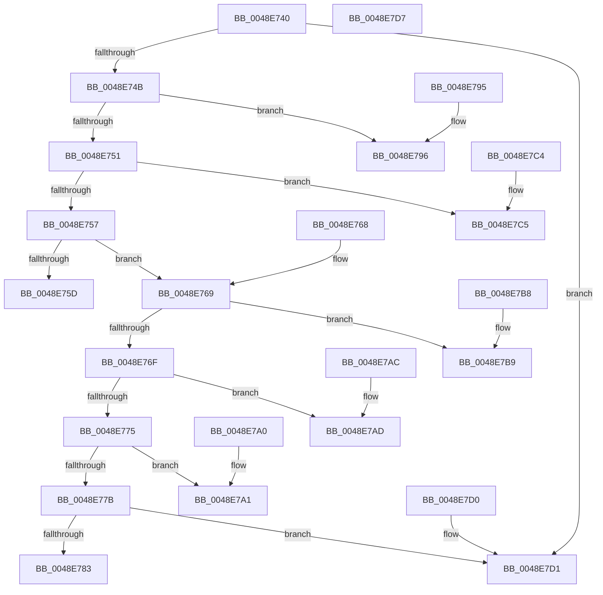

# wil_details_MapReportingKind

- RVA: `0x0048E740`–`0x0048E7D8` (길이 `152` bytes)
- VA: `0x000000014048E740`
- 실행 섹션: `.text`
- PDB 이름 있음: `예`; PDB Function 태그: `아니요`
- unwind 정보 RVA: `0x000DB714`
- 디코드: `65`개 명령, `152/152` bytes 표시
- 미해석 바이트: `0` (있으면 어셈블리에 `.byte`로 보존)

> 이 문서는 커널 이미지의 기계어와 PDB 기호를 분석해 생성했습니다. 4번과 5번은 함수 원형과 자료형을 바이너리 사용 방식에서 추정한 C 해석이며 원본 소스 복구 결과는 아닙니다.

## 1. Dependencies

- 직접 호출 지점: **0**; 고유 호출 대상: **0**
- 직접 호출자로 확인된 함수: **1**
- RIP 상대 이미지 참조: **0**

### Outgoing calls
- 직접 디코드된 call 명령이 없습니다.

### Direct callers
- [wil_details_FeatureReporting_ReportUsageToService](../53/wil_details_FeatureReporting_ReportUsageToService_function_0053E6E4.md) at `0x0053E70B`

### Static image references
- 디코드된 RIP-relative 메모리 참조가 없습니다.

## 2. Other-region calls and transfers

- 다른 실행 섹션으로 향하는 call: **0**
- 별도 외부 분기/꼬리 이동을 확인하지 못했습니다.

## 3. Assembly (complete function range)

```asm
0048E740  44 8B C1                        mov r8d, ecx
0048E743  85 C9                           test ecx, ecx
0048E745  0F 84 86 00 00 00               je 0x14048e7d1
0048E74B  41 83 E8 01                     sub r8d, 1
0048E74F  74 45                           je 0x14048e796
0048E751  41 83 E8 01                     sub r8d, 1
0048E755  74 6E                           je 0x14048e7c5
0048E757  41 83 E8 01                     sub r8d, 1
0048E75B  75 0C                           jne 0x14048e769
0048E75D  F7 DA                           neg edx
0048E75F  1B C0                           sbb eax, eax
0048E761  83 E0 FC                        and eax, 0xfffffffc
0048E764  83 C0 06                        add eax, 6
0048E767  C3                              ret
0048E768  CC                              int3
0048E769  41 83 E8 01                     sub r8d, 1
0048E76D  74 4A                           je 0x14048e7b9
0048E76F  41 83 E8 01                     sub r8d, 1
0048E773  74 38                           je 0x14048e7ad
0048E775  41 83 F8 01                     cmp r8d, 1
0048E779  74 26                           je 0x14048e7a1
0048E77B  80 E9 64                        sub cl, 0x64
0048E77E  80 F9 31                        cmp cl, 0x31
0048E781  77 4E                           ja 0x14048e7d1
0048E783  F7 DA                           neg edx
0048E785  0F B6 C9                        movzx ecx, cl
0048E788  1B C0                           sbb eax, eax
0048E78A  83 E0 CE                        and eax, 0xffffffce
0048E78D  05 96 00 00 00                  add eax, 0x96
0048E792  03 C1                           add eax, ecx
0048E794  C3                              ret
0048E795  CC                              int3
0048E796  F7 DA                           neg edx
0048E798  1B C0                           sbb eax, eax
0048E79A  F7 D0                           not eax
0048E79C  83 E0 04                        and eax, 4
0048E79F  C3                              ret
0048E7A0  CC                              int3
0048E7A1  F7 DA                           neg edx
0048E7A3  1B C0                           sbb eax, eax
0048E7A5  83 E0 FE                        and eax, 0xfffffffe
0048E7A8  83 C0 0B                        add eax, 0xb
0048E7AB  C3                              ret
0048E7AC  CC                              int3
0048E7AD  F7 DA                           neg edx
0048E7AF  1B C0                           sbb eax, eax
0048E7B1  83 E0 FE                        and eax, 0xfffffffe
0048E7B4  83 C0 0A                        add eax, 0xa
0048E7B7  C3                              ret
0048E7B8  CC                              int3
0048E7B9  F7 DA                           neg edx
0048E7BB  1B C0                           sbb eax, eax
0048E7BD  83 E0 FC                        and eax, 0xfffffffc
0048E7C0  83 C0 07                        add eax, 7
0048E7C3  C3                              ret
0048E7C4  CC                              int3
0048E7C5  F7 DA                           neg edx
0048E7C7  1B C0                           sbb eax, eax
0048E7C9  83 E0 FC                        and eax, 0xfffffffc
0048E7CC  83 C0 05                        add eax, 5
0048E7CF  C3                              ret
0048E7D0  CC                              int3
0048E7D1  B8 FF 00 00 00                  mov eax, 0xff
0048E7D6  C3                              ret
0048E7D7  CC                              int3
```

## 4. C-style interpretation (structured pseudocode)

```c
__int64 __fastcall wil_details_MapReportingKind(int a1, int a2)
{
    __int64 result;

    if (a1 == 0) goto loc_0048E7D1;
    a3 = (unsigned int)(((unsigned int)(a1)) - (1));
    if (condition_is_equal) goto loc_0048E796;
    a3 = (unsigned int)((a3) - (1));
    if (condition_is_equal) goto loc_0048E7C5;
    a3 = (unsigned int)((a3) - (1));
    if (condition_is_not_equal) goto loc_0048E769;
    a2 = (unsigned int)(-(a2));
    result = (unsigned int)((result) & (0xFFFFFFFCULL));
    result = (unsigned int)((result) + (6));
    return result;
loc_0048E769:
    a3 = (unsigned int)((a3) - (1));
    if (condition_is_equal) goto loc_0048E7B9;
    a3 = (unsigned int)((a3) - (1));
    if (condition_is_equal) goto loc_0048E7AD;
    if (((unsigned int)(a3)) == 1) goto loc_0048E7A1;
    a1 = (unsigned __int8)((a1) - (100));
    if (((unsigned __int8)(a1)) > 49) goto loc_0048E7D1;
    a2 = (unsigned int)(-(a2));
    result = (unsigned int)((result) & (0xFFFFFFCEULL));
    result = (unsigned int)((result) + (150));
    result = (unsigned int)((result) + ((unsigned int)((unsigned __int8)(a1))));
    return result;
loc_0048E796:
    a2 = (unsigned int)(-(a2));
    result = (unsigned int)(~(result));
    result = (unsigned int)((result) & (4));
    return result;
loc_0048E7A1:
    a2 = (unsigned int)(-(a2));
    result = (unsigned int)((result) & (0xFFFFFFFEULL));
    result = (unsigned int)((result) + (11));
    return result;
loc_0048E7AD:
    a2 = (unsigned int)(-(a2));
    result = (unsigned int)((result) & (0xFFFFFFFEULL));
    result = (unsigned int)((result) + (10));
    return result;
loc_0048E7B9:
    a2 = (unsigned int)(-(a2));
    result = (unsigned int)((result) & (0xFFFFFFFCULL));
    result = (unsigned int)((result) + (7));
    return result;
loc_0048E7C5:
    a2 = (unsigned int)(-(a2));
    result = (unsigned int)((result) & (0xFFFFFFFCULL));
    result = (unsigned int)((result) + (5));
    return result;
loc_0048E7D1:
    return 255;
}
```

## 5. (Beta) C Style

```c
int64_t wil_details_MapReportingKind(int32_t Arg1, int32_t Arg2)
{
    int64_t result;

    if (Arg1 == 0) goto loc_0048E7D1;
    a3 = (uint32_t)(((uint32_t)(Arg1)) - (1));
    if (condition_is_equal) goto loc_0048E796;
    a3 = (uint32_t)((a3) - (1));
    if (condition_is_equal) goto loc_0048E7C5;
    a3 = (uint32_t)((a3) - (1));
    if (condition_is_not_equal) goto loc_0048E769;
    Arg2 = (uint32_t)(-(Arg2));
    result = (uint32_t)((result) & (0xFFFFFFFCULL));
    result = (uint32_t)((result) + (6));
    return result;
loc_0048E769:
    a3 = (uint32_t)((a3) - (1));
    if (condition_is_equal) goto loc_0048E7B9;
    a3 = (uint32_t)((a3) - (1));
    if (condition_is_equal) goto loc_0048E7AD;
    if (((uint32_t)(a3)) == 1) goto loc_0048E7A1;
    Arg1 = (uint8_t)((Arg1) - (100));
    if (((uint8_t)(Arg1)) > 49) goto loc_0048E7D1;
    Arg2 = (uint32_t)(-(Arg2));
    result = (uint32_t)((result) & (0xFFFFFFCEULL));
    result = (uint32_t)((result) + (150));
    result = (uint32_t)((result) + ((uint32_t)((uint8_t)(Arg1))));
    return result;
loc_0048E796:
    Arg2 = (uint32_t)(-(Arg2));
    result = (uint32_t)(~(result));
    result = (uint32_t)((result) & (4));
    return result;
loc_0048E7A1:
    Arg2 = (uint32_t)(-(Arg2));
    result = (uint32_t)((result) & (0xFFFFFFFEULL));
    result = (uint32_t)((result) + (11));
    return result;
loc_0048E7AD:
    Arg2 = (uint32_t)(-(Arg2));
    result = (uint32_t)((result) & (0xFFFFFFFEULL));
    result = (uint32_t)((result) + (10));
    return result;
loc_0048E7B9:
    Arg2 = (uint32_t)(-(Arg2));
    result = (uint32_t)((result) & (0xFFFFFFFCULL));
    result = (uint32_t)((result) + (7));
    return result;
loc_0048E7C5:
    Arg2 = (uint32_t)(-(Arg2));
    result = (uint32_t)((result) & (0xFFFFFFFCULL));
    result = (uint32_t)((result) + (5));
    return result;
loc_0048E7D1:
    return 255;
}
```

## 6. Execution-region graph

[열기: 2D/3D 그래프와 함수 탐색 컨트롤 패널](../../../control-panel.html?section=text&rva=0x0048E740&view=graph)

- 2D 그래프는 위에서 아래로 흐르고, 3D 그래프는 빈 공간을 드래그해 회전합니다. Shift+드래그는 이동, 휠은 확대·축소, 함수 노드 선택은 대상 보고서 이동입니다.

### Static fallback


