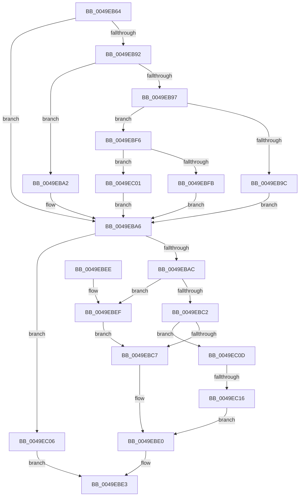

# Amd64IsModifiedByBadActorInternal

- RVA: `0x0049EB64`–`0x0049EC21` (길이 `189` bytes)
- VA: `0x000000014049EB64`
- 실행 섹션: `.text`
- PDB 이름 있음: `예`; PDB Function 태그: `예`
- unwind 정보 RVA: `0x000B52F4`
- 디코드: `57`개 명령, `189/189` bytes 표시
- 미해석 바이트: `0` (있으면 어셈블리에 `.byte`로 보존)

> 이 문서는 커널 이미지의 기계어와 PDB 기호를 분석해 생성했습니다. 4번과 5번은 함수 원형과 자료형을 바이너리 사용 방식에서 추정한 C 해석이며 원본 소스 복구 결과는 아닙니다.

## 1. Dependencies

- 직접 호출 지점: **0**; 고유 호출 대상: **0**
- 직접 호출자로 확인된 함수: **2**
- RIP 상대 이미지 참조: **1**

### Outgoing calls
- 직접 디코드된 call 명령이 없습니다.

### Direct callers
- [Amd64IsModifiedByBadActor](Amd64IsModifiedByBadActor_function_0049EA80.md) at `0x0049EAE4`
- [Amd64OverflowHandlerInternal](../56/Amd64OverflowHandlerInternal_function_0056D330.md) at `0x0056D776`

### Static image references
- `0x0049EB7C` → RVA `0x00FC8C40` (`ALMOSTRO`; read)

## 2. Other-region calls and transfers

- 다른 실행 섹션으로 향하는 call: **0**
- call이 아닌 외부 분기/꼬리 이동: **1**
  - `0x0049EC10` → [sub_006F8338](../6F/Unknown_function_006F8338.md) (`tail-transfer`)

## 3. Assembly (complete function range)

```asm
0049EB64  48 89 5C 24 08                  mov qword ptr [rsp + 8], rbx
0049EB69  48 89 7C 24 10                  mov qword ptr [rsp + 0x10], rdi
0049EB6E  65 8B 04 25 A4 01 00 00         mov eax, dword ptr gs:[0x1a4]
0049EB76  45 33 DB                        xor r11d, r11d
0049EB79  49 8B F8                        mov rdi, r8
0049EB7C  4C 8D 05 BD A0 B2 00            lea r8, [rip + 0xb2a0bd]
0049EB83  41 8B DB                        mov ebx, r11d
0049EB86  49 8B 04 C0                     mov rax, qword ptr [r8 + rax*8]
0049EB8A  4C 8B 50 58                     mov r10, qword ptr [rax + 0x58]
0049EB8E  85 D2                           test edx, edx
0049EB90  74 14                           je 0x14049eba6
0049EB92  83 EA 01                        sub edx, 1
0049EB95  74 0B                           je 0x14049eba2
0049EB97  83 EA 63                        sub edx, 0x63
0049EB9A  75 5A                           jne 0x14049ebf6
0049EB9C  49 83 C2 30                     add r10, 0x30
0049EBA0  EB 04                           jmp 0x14049eba6
0049EBA2  49 83 C2 18                     add r10, 0x18
0049EBA6  41 3B 4A 04                     cmp ecx, dword ptr [r10 + 4]
0049EBAA  73 5A                           jae 0x14049ec06
0049EBAC  4D 8B 42 10                     mov r8, qword ptr [r10 + 0x10]
0049EBB0  8B C1                           mov eax, ecx
0049EBB2  48 8D 14 40                     lea rdx, [rax + rax*2]
0049EBB6  48 03 D2                        add rdx, rdx
0049EBB9  41 8B 4C D0 18                  mov ecx, dword ptr [r8 + rdx*8 + 0x18]
0049EBBE  85 C9                           test ecx, ecx
0049EBC0  74 2D                           je 0x14049ebef
0049EBC2  83 E9 01                        sub ecx, 1
0049EBC5  75 46                           jne 0x14049ec0d
0049EBC7  0F AE E8                        lfence
0049EBCA  49 8B 4C D0 10                  mov rcx, qword ptr [r8 + rdx*8 + 0x10]
0049EBCF  48 0B 19                        or rbx, qword ptr [rcx]
0049EBD2  48 0F BA EB 16                  bts rbx, 0x16
0049EBD7  48 3B FB                        cmp rdi, rbx
0049EBDA  0F 95 C1                        setne cl
0049EBDD  41 88 09                        mov byte ptr [r9], cl
0049EBE0  41 8B C3                        mov eax, r11d
0049EBE3  48 8B 5C 24 08                  mov rbx, qword ptr [rsp + 8]
0049EBE8  48 8B 7C 24 10                  mov rdi, qword ptr [rsp + 0x10]
0049EBED  C3                              ret
0049EBEE  CC                              int3
0049EBEF  BB 00 00 10 00                  mov ebx, 0x100000
0049EBF4  EB D1                           jmp 0x14049ebc7
0049EBF6  83 FA 01                        cmp edx, 1
0049EBF9  75 06                           jne 0x14049ec01
0049EBFB  49 83 C2 48                     add r10, 0x48
0049EBFF  EB A5                           jmp 0x14049eba6
0049EC01  4D 8B D3                        mov r10, r11
0049EC04  EB A0                           jmp 0x14049eba6
0049EC06  B8 EF 00 00 C0                  mov eax, 0xc00000ef
0049EC0B  EB D6                           jmp 0x14049ebe3
0049EC0D  83 F9 01                        cmp ecx, 1
0049EC10  0F 84 22 97 25 00               je 0x1406f8338
0049EC16  48 85 FF                        test rdi, rdi
0049EC19  0F 95 C0                        setne al
0049EC1C  41 88 01                        mov byte ptr [r9], al
0049EC1F  EB BF                           jmp 0x14049ebe0
```

## 4. C-style interpretation (structured pseudocode)

```c
__int64 __fastcall Amd64IsModifiedByBadActorInternal(int a1, int a2, __int64 a3, __int64 a4)
{
    __int64 result;
    __int64 v_r10;
    __int64 v_r11;
    __int64 v_rbx;
    unsigned __int64 v_stack_p10;
    unsigned __int64 v_stack_p8;

    v_stack_p8 = v_rbx;
    v_stack_p10 = v_rdi;
    v_r11 = 0;
    if (a2 == 0) goto loc_0049EBA6;
    a2 = (unsigned int)((a2) - (1));
    if (condition_is_equal) goto loc_0049EBA2;
    a2 = (unsigned int)((a2) - (99));
    if (condition_is_not_equal) goto loc_0049EBF6;
    v_r10 = (*(unsigned __int64 *)(*(unsigned __int64 *)(v_rip + 11706557 + (unsigned int)(*(unsigned int *)(gs_base + (0 + 420))) * 8) + 88)) + (48);
    goto loc_0049EBA6;
loc_0049EBA2:
    v_r10 = (v_r10) + (24);
loc_0049EBA6:
    if (a1 >= (*(unsigned int *)(v_r10 + 4))) goto loc_0049EC06;
    a2 = ((unsigned int)(a1) + (unsigned int)(a1) * 2) + ((unsigned int)(a1) + (unsigned int)(a1) * 2);
    if ((unsigned int)((unsigned int)(*(unsigned int *)(*(unsigned __int64 *)(v_r10 + 16) + a2 * 8 + 24))) == 0) goto loc_0049EBEF;
    a1 = (unsigned int)(((unsigned int)(*(unsigned int *)(*(unsigned __int64 *)(v_r10 + 16) + a2 * 8 + 24))) - (1));
    if (condition_is_not_equal) goto loc_0049EC0D;
loc_0049EBC7:
    v_rbx = (0) | (*(unsigned __int64 *)(*(unsigned __int64 *)(*(unsigned __int64 *)(v_r10 + 16) + a2 * 8 + 16)));
    a1 = (a3 != v_rbx) ? 1 : 0;
    *(unsigned __int8 *)(a4) = (unsigned __int8)(a1);
loc_0049EBE0:
loc_0049EBE3:
    return 0;
loc_0049EBEF:
    goto loc_0049EBC7;
loc_0049EBF6:
    if (a2 != 1) goto loc_0049EC01;
    v_r10 = (v_r10) + (72);
    goto loc_0049EBA6;
loc_0049EC01:
    goto loc_0049EBA6;
loc_0049EC06:
    goto loc_0049EBE3;
loc_0049EC0D:
    result = (v_stack_p10 != 0) ? 1 : 0;
    *(unsigned __int8 *)(a4) = (unsigned __int8)(result);
    goto loc_0049EBE0;
}
```

## 5. (Beta) C Style

```c
int64_t Amd64IsModifiedByBadActorInternal(int32_t Arg1, int32_t Arg2, int64_t Arg3, void *Arg4)
{
    uint8_t *arg4 = (uint8_t *)Arg4;

    int64_t result;
    int64_t local_r10;
    int64_t local_r11;
    int64_t local_rbx;
    uint64_t v_stack_p10;
    uint64_t v_stack_p8;

    v_stack_p8 = local_rbx;
    v_stack_p10 = local_rdi;
    local_r11 = 0;
    if (Arg2 == 0) goto loc_0049EBA6;
    Arg2 = (uint32_t)((Arg2) - (1));
    if (condition_is_equal) goto loc_0049EBA2;
    Arg2 = (uint32_t)((Arg2) - (99));
    if (condition_is_not_equal) goto loc_0049EBF6;
    local_r10 = (*(uint64_t *)(*(uint64_t *)(v_rip + 0xB2A0BD + (uint32_t)(*(uint32_t *)(gs_base + (0 + 0x1A4))) * 8) + 0x58)) + (48);
    goto loc_0049EBA6;
loc_0049EBA2:
    local_r10 = (local_r10) + (24);
loc_0049EBA6:
    if (Arg1 >= (*(uint32_t *)(local_r10 + 0x4))) goto loc_0049EC06;
    Arg2 = ((uint32_t)(Arg1) + (uint32_t)(Arg1) * 2) + ((uint32_t)(Arg1) + (uint32_t)(Arg1) * 2);
    if ((uint32_t)((uint32_t)(*(uint32_t *)(*(uint64_t *)(local_r10 + 0x10) + Arg2 * 8 + 0x18))) == 0) goto loc_0049EBEF;
    Arg1 = (uint32_t)(((uint32_t)(*(uint32_t *)(*(uint64_t *)(local_r10 + 0x10) + Arg2 * 8 + 0x18))) - (1));
    if (condition_is_not_equal) goto loc_0049EC0D;
loc_0049EBC7:
    local_rbx = (0) | (*(uint64_t *)(*(uint64_t *)(*(uint64_t *)(local_r10 + 0x10) + Arg2 * 8 + 0x10)));
    Arg1 = (Arg3 != local_rbx) ? 1 : 0;
    *(uint8_t *)(arg4) = (uint8_t)(Arg1);
loc_0049EBE0:
loc_0049EBE3:
    return 0;
loc_0049EBEF:
    goto loc_0049EBC7;
loc_0049EBF6:
    if (Arg2 != 1) goto loc_0049EC01;
    local_r10 = (local_r10) + (72);
    goto loc_0049EBA6;
loc_0049EC01:
    goto loc_0049EBA6;
loc_0049EC06:
    goto loc_0049EBE3;
loc_0049EC0D:
    result = (v_stack_p10 != 0) ? 1 : 0;
    *(uint8_t *)(arg4) = (uint8_t)(result);
    goto loc_0049EBE0;
}
```

### 관측된 메모리 오프셋

구조체 형식이 확인되지 않은 접근은 인자 기준의 오프셋으로만 기록했습니다.

| 기준 인자 | 오프셋 표현 | 폭 (bit) | 접근 |
|---|---:|---:|---|
| `Arg4` | `+ 0x0` | `8` | `W` |

## 6. Execution-region graph

[열기: 2D/3D 그래프와 함수 탐색 컨트롤 패널](../../../control-panel.html?section=text&rva=0x0049EB64&view=graph)

- 2D 그래프는 위에서 아래로 흐르고, 3D 그래프는 빈 공간을 드래그해 회전합니다. Shift+드래그는 이동, 휠은 확대·축소, 함수 노드 선택은 대상 보고서 이동입니다.

### Static fallback


