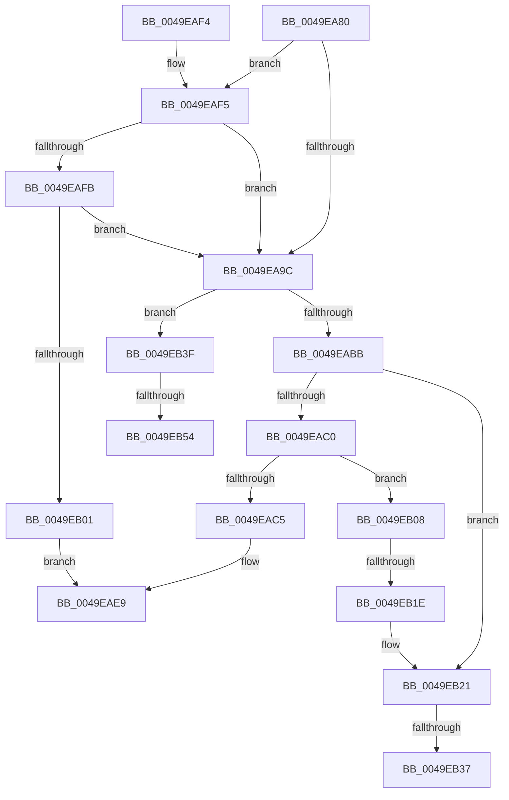

# Amd64IsModifiedByBadActor

- RVA: `0x0049EA80`–`0x0049EB5D` (길이 `221` bytes)
- VA: `0x000000014049EA80`
- 실행 섹션: `.text`
- PDB 이름 있음: `예`; PDB Function 태그: `예`
- unwind 정보 RVA: `0x000B52D4`
- 디코드: `58`개 명령, `221/221` bytes 표시
- 미해석 바이트: `0` (있으면 어셈블리에 `.byte`로 보존)

> 이 문서는 커널 이미지의 기계어와 PDB 기호를 분석해 생성했습니다. 4번과 5번은 함수 원형과 자료형을 바이너리 사용 방식에서 추정한 C 해석이며 원본 소스 복구 결과는 아닙니다.

## 1. Dependencies

- 직접 호출 지점: **1**; 고유 호출 대상: **1**
- 직접 호출자로 확인된 함수: **0**
- RIP 상대 이미지 참조: **1**

### Outgoing calls
- `0x0049EAE4` → [Amd64IsModifiedByBadActorInternal](Amd64IsModifiedByBadActorInternal_function_0049EB64.md) (function, `0x0049EB64`)

### Direct callers
- 이 함수 시작 RVA로 연결되는 직접 call은 확인되지 않았습니다. 간접 호출은 완전히 역산할 수 없습니다.

### Static image references
- `0x0049EAA5` → RVA `0x00000000` (`image boundary/outside`; read)

## 2. Other-region calls and transfers

- 다른 실행 섹션으로 향하는 call: **0**
- call이 아닌 외부 분기/꼬리 이동: **5**
  - `0x0049EB18` → [sub_006F831E](../6F/Unknown_function_006F831E.md) (`tail-transfer`)
  - `0x0049EB31` → [sub_006F831E + 0x8](../6F/Unknown_function_006F831E.md) (`tail-transfer`)
  - `0x0049EB3A` → [sub_006F831E + 0xB](../6F/Unknown_function_006F831E.md) (`tail-transfer`)
  - `0x0049EB4E` → [sub_006F831E + 0x12](../6F/Unknown_function_006F831E.md) (`tail-transfer`)
  - `0x0049EB58` → [sub_006F831E + 0x12](../6F/Unknown_function_006F831E.md) (`tail-transfer`)

## 3. Assembly (complete function range)

```asm
0049EA80  48 89 5C 24 08                  mov qword ptr [rsp + 8], rbx
0049EA85  57                              push rdi
0049EA86  48 83 EC 20                     sub rsp, 0x20
0049EA8A  45 33 C9                        xor r9d, r9d
0049EA8D  49 8B F8                        mov rdi, r8
0049EA90  44 8B DA                        mov r11d, edx
0049EA93  8B D9                           mov ebx, ecx
0049EA95  44 8B D2                        mov r10d, edx
0049EA98  85 D2                           test edx, edx
0049EA9A  75 59                           jne 0x14049eaf5
0049EA9C  65 44 8B 04 25 A4 01 00 00      mov r8d, dword ptr gs:[0x1a4]
0049EAA5  4C 8D 15 54 15 B6 FF            lea r10, [rip - 0x49eaac]
0049EAAC  41 8B CB                        mov ecx, r11d
0049EAAF  41 8B D1                        mov edx, r9d
0049EAB2  83 E9 01                        sub ecx, 1
0049EAB5  0F 84 84 00 00 00               je 0x14049eb3f
0049EABB  83 E9 63                        sub ecx, 0x63
0049EABE  74 61                           je 0x14049eb21
0049EAC0  83 F9 01                        cmp ecx, 1
0049EAC3  74 43                           je 0x14049eb08
0049EAC5  8D 04 1A                        lea eax, [rdx + rbx]
0049EAC8  41 8B 8C 82 40 F9 F8 00         mov ecx, dword ptr [r10 + rax*4 + 0xf8f940]
0049EAD0  0F 32                           rdmsr
0049EAD2  48 C1 E2 20                     shl rdx, 0x20
0049EAD6  4C 8B CF                        mov r9, rdi
0049EAD9  48 0B C2                        or rax, rdx
0049EADC  8B CB                           mov ecx, ebx
0049EADE  4C 8B C0                        mov r8, rax
0049EAE1  41 8B D3                        mov edx, r11d
0049EAE4  E8 7B 00 00 00                  call 0x14049eb64
0049EAE9  48 8B 5C 24 30                  mov rbx, qword ptr [rsp + 0x30]
0049EAEE  48 83 C4 20                     add rsp, 0x20
0049EAF2  5F                              pop rdi
0049EAF3  C3                              ret
0049EAF4  CC                              int3
0049EAF5  41 83 EA 64                     sub r10d, 0x64
0049EAF9  74 A1                           je 0x14049ea9c
0049EAFB  41 83 FA 01                     cmp r10d, 1
0049EAFF  74 9B                           je 0x14049ea9c
0049EB01  B8 F0 00 00 C0                  mov eax, 0xc00000f0
0049EB06  EB E1                           jmp 0x14049eae9
0049EB08  4B 8B 84 C2 40 8C FC 00         mov rax, qword ptr [r10 + r8*8 + 0xfc8c40]
0049EB10  48 8B 50 58                     mov rdx, qword ptr [rax + 0x58]
0049EB14  48 83 C2 30                     add rdx, 0x30
0049EB18  0F 85 00 98 25 00               jne 0x1406f831e
0049EB1E  41 8B D1                        mov edx, r9d
0049EB21  4B 8B 84 C2 40 8C FC 00         mov rax, qword ptr [r10 + r8*8 + 0xfc8c40]
0049EB29  48 8B 40 58                     mov rax, qword ptr [rax + 0x58]
0049EB2D  48 83 C0 18                     add rax, 0x18
0049EB31  0F 85 EF 97 25 00               jne 0x1406f8326
0049EB37  41 8B C1                        mov eax, r9d
0049EB3A  E9 EA 97 25 00                  jmp 0x1406f8329
0049EB3F  4B 8B 84 C2 40 8C FC 00         mov rax, qword ptr [r10 + r8*8 + 0xfc8c40]
0049EB47  48 8B 48 58                     mov rcx, qword ptr [rax + 0x58]
0049EB4B  48 85 C9                        test rcx, rcx
0049EB4E  0F 84 DC 97 25 00               je 0x1406f8330
0049EB54  44 8B 49 04                     mov r9d, dword ptr [rcx + 4]
0049EB58  E9 D3 97 25 00                  jmp 0x1406f8330
```

## 4. C-style interpretation (structured pseudocode)

```c
__int64 __fastcall Amd64IsModifiedByBadActor(int a1, int a2, __int64 a3, int a4)
{
    __int64 result;
    __int64 v_r10;
    __int64 v_rsp;
    unsigned __int64 v_stack_p8;

    v_stack_p8 = v_rbx;
    v_rsp = (v_rsp) - (32);
    a4 = 0;
    if (a2 != 0) goto loc_0049EAF5;
loc_0049EA9C:
    a1 = (unsigned int)(((unsigned int)((unsigned int)((unsigned int)(a2)))) - (1));
    if (condition_is_equal) goto loc_0049EB3F;
    a1 = (unsigned int)((a1) - (99));
    if (condition_is_equal) goto loc_0049EB21;
    if (a1 == 1) goto loc_0049EB08;
    a2 = (0) << (32);
    result = (0 + (unsigned int)(a1) * 1) | (a2);
    result = Amd64IsModifiedByBadActorInternal((unsigned int)((unsigned int)((unsigned int)(a1))), (unsigned int)((unsigned int)((unsigned int)(a2))), result, a3);
loc_0049EAE9:
    v_rsp = (v_rsp) + (32);
    return result;
loc_0049EAF5:
    v_r10 = (unsigned int)((v_rip - 4844204) - (100));
    if (condition_is_equal) goto loc_0049EA9C;
    if (((unsigned int)(v_r10)) == 1) goto loc_0049EA9C;
    goto loc_0049EAE9;
loc_0049EB08:
    a2 = (*(unsigned __int64 *)(*(unsigned __int64 *)(v_r10 + result * 8 + 16550976) + 88)) + (48);
loc_0049EB21:
    result = (*(unsigned __int64 *)(*(unsigned __int64 *)(v_r10 + result * 8 + 16550976) + 88)) + (24);
loc_0049EB3F:
}
```

## 5. (Beta) C Style

```c
int64_t Amd64IsModifiedByBadActor(int32_t Arg1, int32_t Arg2, int64_t Arg3, int32_t Arg4)
{
    int64_t result;
    int64_t local_r10;
    int64_t local_rsp;
    uint64_t v_stack_p8;

    v_stack_p8 = local_rbx;
    local_rsp = (local_rsp) - (32);
    Arg4 = 0;
    if (Arg2 != 0) goto loc_0049EAF5;
loc_0049EA9C:
    Arg1 = (uint32_t)(((uint32_t)((uint32_t)((uint32_t)(Arg2)))) - (1));
    if (condition_is_equal) goto loc_0049EB3F;
    Arg1 = (uint32_t)((Arg1) - (99));
    if (condition_is_equal) goto loc_0049EB21;
    if (Arg1 == 1) goto loc_0049EB08;
    Arg2 = (0) << (32);
    result = (0 + (uint32_t)(Arg1) * 1) | (Arg2);
    result = Amd64IsModifiedByBadActorInternal((uint32_t)((uint32_t)((uint32_t)(Arg1))), (uint32_t)((uint32_t)((uint32_t)(Arg2))), result, Arg3);
loc_0049EAE9:
    local_rsp = (local_rsp) + (32);
    return result;
loc_0049EAF5:
    local_r10 = (uint32_t)((v_rip - 4844204) - (100));
    if (condition_is_equal) goto loc_0049EA9C;
    if (((uint32_t)(local_r10)) == 1) goto loc_0049EA9C;
    goto loc_0049EAE9;
loc_0049EB08:
    Arg2 = (*(uint64_t *)(*(uint64_t *)(local_r10 + result * 8 + 0xFC8C40) + 0x58)) + (48);
loc_0049EB21:
    result = (*(uint64_t *)(*(uint64_t *)(local_r10 + result * 8 + 0xFC8C40) + 0x58)) + (24);
loc_0049EB3F:
}
```

## 6. Execution-region graph

[열기: 2D/3D 그래프와 함수 탐색 컨트롤 패널](../../../control-panel.html?section=text&rva=0x0049EA80&view=graph)

- 2D 그래프는 위에서 아래로 흐르고, 3D 그래프는 빈 공간을 드래그해 회전합니다. Shift+드래그는 이동, 휠은 확대·축소, 함수 노드 선택은 대상 보고서 이동입니다.

### Static fallback


