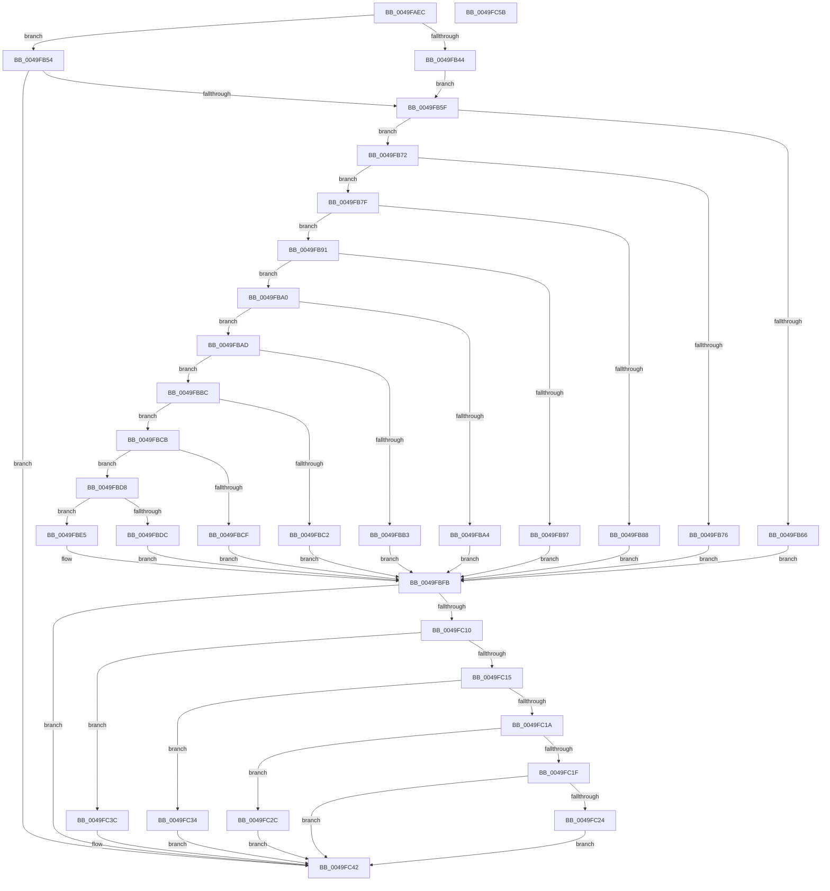

# AppModelPolicy_GetPolicy_Internal

- RVA: `0x0049FAEC`–`0x0049FC5C` (길이 `368` bytes)
- VA: `0x000000014049FAEC`
- 실행 섹션: `.text`
- PDB 이름 있음: `예`; PDB Function 태그: `아니요`
- unwind 정보 RVA: `0x000B5530`
- 디코드: `102`개 명령, `368/368` bytes 표시
- 미해석 바이트: `0` (있으면 어셈블리에 `.byte`로 보존)

> 이 문서는 커널 이미지의 기계어와 PDB 기호를 분석해 생성했습니다. 4번과 5번은 함수 원형과 자료형을 바이너리 사용 방식에서 추정한 C 해석이며 원본 소스 복구 결과는 아닙니다.

## 1. Dependencies

- 직접 호출 지점: **1**; 고유 호출 대상: **1**
- 직접 호출자로 확인된 함수: **2**
- RIP 상대 이미지 참조: **11**

### Outgoing calls
- `0x0049FB35` → [RtlQueryPackageClaimsEx](../5E/RtlQueryPackageClaimsEx_function_005EDFE8.md) (function, `0x005EDFE8`)

### Direct callers
- [SeQuerySigningPolicyWorker](../../page/A1/SeQuerySigningPolicyWorker_function_00A13788.md) at `0x00A137E3`
- [PspAllocateProcess](../../page/A1/PspAllocateProcess_function_00A13B3C.md) at `0x00A15AFA`

### Static image references
- `0x0049FB66` → RVA `0x0002BA08` (`.rdata`; read)
- `0x0049FB76` → RVA `0x0002BA20` (`.rdata`; read)
- `0x0049FB88` → RVA `0x0002BA1C` (`.rdata`; read)
- `0x0049FB97` → RVA `0x0002BA24` (`.rdata`; read)
- `0x0049FBA4` → RVA `0x0002BA04` (`.rdata`; read)
- `0x0049FBB3` → RVA `0x0002BA14` (`.rdata`; read)
- `0x0049FBC2` → RVA `0x0002BA18` (`.rdata`; read)
- `0x0049FBCF` → RVA `0x0002BA10` (`.rdata`; read)
- `0x0049FBDC` → RVA `0x0002BA0C` (`.rdata`; read)
- `0x0049FBE9` → RVA `0x0002BA28` (`.rdata`; read)
- `0x0049FBF0` → RVA `0x0002BA00` (`.rdata`; read)

## 2. Other-region calls and transfers

- 다른 실행 섹션으로 향하는 call: **0**
- 별도 외부 분기/꼬리 이동을 확인하지 못했습니다.

## 3. Assembly (complete function range)

```asm
0049FAEC  48 8B C4                        mov rax, rsp
0049FAEF  48 89 58 08                     mov qword ptr [rax + 8], rbx
0049FAF3  48 89 70 10                     mov qword ptr [rax + 0x10], rsi
0049FAF7  48 89 78 20                     mov qword ptr [rax + 0x20], rdi
0049FAFB  41 56                           push r14
0049FAFD  48 83 EC 50                     sub rsp, 0x50
0049FB01  48 8B B4 24 80 00 00 00         mov rsi, qword ptr [rsp + 0x80]
0049FB09  4D 8B F1                        mov r14, r9
0049FB0C  48 89 70 F0                     mov qword ptr [rax - 0x10], rsi
0049FB10  49 8B F8                        mov rdi, r8
0049FB13  4C 89 48 E8                     mov qword ptr [rax - 0x18], r9
0049FB17  8B DA                           mov ebx, edx
0049FB19  48 83 60 E0 00                  and qword ptr [rax - 0x20], 0
0049FB1E  45 33 C9                        xor r9d, r9d
0049FB21  48 83 60 D8 00                  and qword ptr [rax - 0x28], 0
0049FB26  45 33 C0                        xor r8d, r8d
0049FB29  48 83 60 D0 00                  and qword ptr [rax - 0x30], 0
0049FB2E  33 D2                           xor edx, edx
0049FB30  48 83 60 C8 00                  and qword ptr [rax - 0x38], 0
0049FB35  E8 AE E4 14 00                  call 0x1405edfe8
0049FB3A  44 8B C0                        mov r8d, eax
0049FB3D  3D 25 02 00 C0                  cmp eax, 0xc0000225
0049FB42  75 10                           jne 0x14049fb54
0049FB44  48 83 26 00                     and qword ptr [rsi], 0
0049FB48  45 33 C0                        xor r8d, r8d
0049FB4B  41 83 26 00                     and dword ptr [r14], 0
0049FB4F  44 21 07                        and dword ptr [rdi], r8d
0049FB52  EB 0B                           jmp 0x14049fb5f
0049FB54  83 27 00                        and dword ptr [rdi], 0
0049FB57  85 C0                           test eax, eax
0049FB59  0F 88 E3 00 00 00               js 0x14049fc42
0049FB5F  48 8B 06                        mov rax, qword ptr [rsi]
0049FB62  A8 01                           test al, 1
0049FB64  75 0C                           jne 0x14049fb72
0049FB66  48 8D 15 9B BE B8 FF            lea rdx, [rip - 0x474165]
0049FB6D  E9 89 00 00 00                  jmp 0x14049fbfb
0049FB72  A8 08                           test al, 8
0049FB74  74 09                           je 0x14049fb7f
0049FB76  48 8D 15 A3 BE B8 FF            lea rdx, [rip - 0x47415d]
0049FB7D  EB 7C                           jmp 0x14049fbfb
0049FB7F  41 8B 06                        mov eax, dword ptr [r14]
0049FB82  0F BA E0 10                     bt eax, 0x10
0049FB86  73 09                           jae 0x14049fb91
0049FB88  48 8D 15 8D BE B8 FF            lea rdx, [rip - 0x474173]
0049FB8F  EB 6A                           jmp 0x14049fbfb
0049FB91  0F BA E0 0E                     bt eax, 0xe
0049FB95  73 09                           jae 0x14049fba0
0049FB97  48 8D 15 86 BE B8 FF            lea rdx, [rip - 0x47417a]
0049FB9E  EB 5B                           jmp 0x14049fbfb
0049FBA0  A8 04                           test al, 4
0049FBA2  74 09                           je 0x14049fbad
0049FBA4  48 8D 15 59 BE B8 FF            lea rdx, [rip - 0x4741a7]
0049FBAB  EB 4E                           jmp 0x14049fbfb
0049FBAD  0F BA E0 0A                     bt eax, 0xa
0049FBB1  73 09                           jae 0x14049fbbc
0049FBB3  48 8D 15 5A BE B8 FF            lea rdx, [rip - 0x4741a6]
0049FBBA  EB 3F                           jmp 0x14049fbfb
0049FBBC  0F BA E0 0B                     bt eax, 0xb
0049FBC0  73 09                           jae 0x14049fbcb
0049FBC2  48 8D 15 4F BE B8 FF            lea rdx, [rip - 0x4741b1]
0049FBC9  EB 30                           jmp 0x14049fbfb
0049FBCB  A8 40                           test al, 0x40
0049FBCD  74 09                           je 0x14049fbd8
0049FBCF  48 8D 15 3A BE B8 FF            lea rdx, [rip - 0x4741c6]
0049FBD6  EB 23                           jmp 0x14049fbfb
0049FBD8  A8 08                           test al, 8
0049FBDA  74 09                           je 0x14049fbe5
0049FBDC  48 8D 15 29 BE B8 FF            lea rdx, [rip - 0x4741d7]
0049FBE3  EB 16                           jmp 0x14049fbfb
0049FBE5  0F BA E0 12                     bt eax, 0x12
0049FBE9  48 8D 15 38 BE B8 FF            lea rdx, [rip - 0x4741c8]
0049FBF0  48 8D 05 09 BE B8 FF            lea rax, [rip - 0x4741f7]
0049FBF7  48 0F 43 D0                     cmovae rdx, rax
0049FBFB  8D 4B FF                        lea ecx, [rbx - 1]
0049FBFE  48 6B C1 2C                     imul rax, rcx, 0x2c
0049FC02  8B 0C 10                        mov ecx, dword ptr [rax + rdx]
0049FC05  89 0F                           mov dword ptr [rdi], ecx
0049FC07  41 F7 06 00 00 10 00            test dword ptr [r14], 0x100000
0049FC0E  74 32                           je 0x14049fc42
0049FC10  83 EB 01                        sub ebx, 1
0049FC13  74 27                           je 0x14049fc3c
0049FC15  83 EB 0A                        sub ebx, 0xa
0049FC18  74 1A                           je 0x14049fc34
0049FC1A  83 EB 11                        sub ebx, 0x11
0049FC1D  74 0D                           je 0x14049fc2c
0049FC1F  83 FB 1E                        cmp ebx, 0x1e
0049FC22  75 1E                           jne 0x14049fc42
0049FC24  C7 07 00 00 3A 00               mov dword ptr [rdi], 0x3a0000
0049FC2A  EB 16                           jmp 0x14049fc42
0049FC2C  C7 07 00 00 1C 00               mov dword ptr [rdi], 0x1c0000
0049FC32  EB 0E                           jmp 0x14049fc42
0049FC34  C7 07 01 00 0B 00               mov dword ptr [rdi], 0xb0001
0049FC3A  EB 06                           jmp 0x14049fc42
0049FC3C  C7 07 01 00 01 00               mov dword ptr [rdi], 0x10001
0049FC42  48 8B 5C 24 60                  mov rbx, qword ptr [rsp + 0x60]
0049FC47  41 8B C0                        mov eax, r8d
0049FC4A  48 8B 74 24 68                  mov rsi, qword ptr [rsp + 0x68]
0049FC4F  48 8B 7C 24 78                  mov rdi, qword ptr [rsp + 0x78]
0049FC54  48 83 C4 50                     add rsp, 0x50
0049FC58  41 5E                           pop r14
0049FC5A  C3                              ret
0049FC5B  CC                              int3
```

## 4. C-style interpretation (structured pseudocode)

```c
__int64 __fastcall AppModelPolicy_GetPolicy_Internal(__int64 a1, int a2, __int64 a3, __int64 a4, __int64 a5)
{
    __int64 result;
    __int64 v_rbx;
    __int64 v_rsp;
    unsigned __int64 v_stack_p10;
    unsigned __int64 v_stack_p20;
    unsigned __int64 v_stack_p8;

    *(unsigned __int64 *)(v_rsp + 8) = v_rbx;
    *(unsigned __int64 *)(v_rsp + 16) = v_rsi;
    *(unsigned __int64 *)(v_rsp + 32) = v_rdi;
    v_rsp = (v_rsp) - (80);
    *(unsigned __int64 *)(v_rsp - 16) = a5;
    *(unsigned __int64 *)(v_rsp - 24) = a4;
    a4 = 0;
    a3 = 0;
    a2 = 0;
    result = RtlQueryPackageClaimsEx(a1, a2, a3, a4);
    if (((unsigned int)(result)) != 0xC0000225ULL) goto loc_0049FB54;
    a3 = 0;
    goto loc_0049FB5F;
loc_0049FB54:
    if (sign_flag) goto loc_0049FC42;
loc_0049FB5F:
    if ((((unsigned __int8)(*(unsigned __int64 *)(a5))) & (1)) != 0) goto loc_0049FB72;
    goto loc_0049FBFB;
loc_0049FB72:
    if ((((unsigned __int8)(*(unsigned __int64 *)(a5))) & (8)) == 0) goto loc_0049FB7F;
    goto loc_0049FBFB;
loc_0049FB7F:
    if (condition_is_above_or_equal) goto loc_0049FB91;
    goto loc_0049FBFB;
loc_0049FB91:
    if (condition_is_above_or_equal) goto loc_0049FBA0;
    goto loc_0049FBFB;
loc_0049FBA0:
    if ((((unsigned __int8)((unsigned int)(*(unsigned int *)(a4)))) & (4)) == 0) goto loc_0049FBAD;
    goto loc_0049FBFB;
loc_0049FBAD:
    if (condition_is_above_or_equal) goto loc_0049FBBC;
    goto loc_0049FBFB;
loc_0049FBBC:
    if (condition_is_above_or_equal) goto loc_0049FBCB;
    goto loc_0049FBFB;
loc_0049FBCB:
    if ((((unsigned __int8)((unsigned int)(*(unsigned int *)(a4)))) & (64)) == 0) goto loc_0049FBD8;
    goto loc_0049FBFB;
loc_0049FBD8:
    if ((((unsigned __int8)((unsigned int)(*(unsigned int *)(a4)))) & (8)) == 0) goto loc_0049FBE5;
    goto loc_0049FBFB;
loc_0049FBE5:
    a2 = v_rip - 4669896;
    if (condition_is_above_or_equal) { a2 = v_rip - 4669943; }
loc_0049FBFB:
    result = (v_rip - 4669943) * ((unsigned int)(a2) - 1);
    *(unsigned int *)(a3) = (unsigned int)((unsigned int)(*(unsigned int *)(result + a2 * 1)));
    if (((*(unsigned int *)(a4)) & (0x100000ULL)) == 0) goto loc_0049FC42;
    v_rbx = (unsigned int)(((unsigned int)(a2)) - (1));
    if (condition_is_equal) goto loc_0049FC3C;
    v_rbx = (unsigned int)((v_rbx) - (10));
    if (condition_is_equal) goto loc_0049FC34;
    v_rbx = (unsigned int)((v_rbx) - (17));
    if (condition_is_equal) goto loc_0049FC2C;
    if (((unsigned int)(v_rbx)) != 30) goto loc_0049FC42;
    *(unsigned int *)(a3) = 0x3A0000ULL;
    goto loc_0049FC42;
loc_0049FC2C:
    *(unsigned int *)(a3) = 0x1C0000ULL;
    goto loc_0049FC42;
loc_0049FC34:
    *(unsigned int *)(a3) = 0xB0001ULL;
    goto loc_0049FC42;
loc_0049FC3C:
    *(unsigned int *)(a3) = 0x10001ULL;
loc_0049FC42:
    v_rsp = (v_rsp) + (80);
    return 0;
}
```

## 5. (Beta) C Style

```c
int64_t AppModelPolicy_GetPolicy_Internal(int64_t Arg1, void *Arg2, void *Arg3, void *Arg4, void *Arg5)
{
    uint8_t *arg2 = (uint8_t *)Arg2;
    uint8_t *arg3 = (uint8_t *)Arg3;
    uint8_t *arg4 = (uint8_t *)Arg4;
    uint8_t *arg5 = (uint8_t *)Arg5;

    int64_t result;
    int64_t local_rbx;
    int64_t local_rsp;
    uint64_t v_stack_p10;
    uint64_t v_stack_p20;
    uint64_t v_stack_p8;

    *(uint64_t *)(local_rsp + 0x8) = local_rbx;
    *(uint64_t *)(local_rsp + 0x10) = local_rsi;
    *(uint64_t *)(local_rsp + 0x20) = local_rdi;
    local_rsp = (local_rsp) - (80);
    *(void **)(local_rsp - 0x10) = Arg5;
    *(void **)(local_rsp - 0x18) = Arg4;
    Arg4 = 0;
    Arg3 = 0;
    Arg2 = 0;
    result = RtlQueryPackageClaimsEx(Arg1, Arg2, Arg3, Arg4);
    if (((uint32_t)(result)) != 0xC0000225ULL) goto loc_0049FB54;
    Arg3 = 0;
    goto loc_0049FB5F;
loc_0049FB54:
    if (sign_flag) goto loc_0049FC42;
loc_0049FB5F:
    if ((((uint8_t)(*(uint64_t *)(arg5))) & (1)) != 0) goto loc_0049FB72;
    goto loc_0049FBFB;
loc_0049FB72:
    if ((((uint8_t)(*(uint64_t *)(arg5))) & (8)) == 0) goto loc_0049FB7F;
    goto loc_0049FBFB;
loc_0049FB7F:
    if (condition_is_above_or_equal) goto loc_0049FB91;
    goto loc_0049FBFB;
loc_0049FB91:
    if (condition_is_above_or_equal) goto loc_0049FBA0;
    goto loc_0049FBFB;
loc_0049FBA0:
    if ((((uint8_t)((uint32_t)(*(uint32_t *)(arg4)))) & (4)) == 0) goto loc_0049FBAD;
    goto loc_0049FBFB;
loc_0049FBAD:
    if (condition_is_above_or_equal) goto loc_0049FBBC;
    goto loc_0049FBFB;
loc_0049FBBC:
    if (condition_is_above_or_equal) goto loc_0049FBCB;
    goto loc_0049FBFB;
loc_0049FBCB:
    if ((((uint8_t)((uint32_t)(*(uint32_t *)(arg4)))) & (64)) == 0) goto loc_0049FBD8;
    goto loc_0049FBFB;
loc_0049FBD8:
    if ((((uint8_t)((uint32_t)(*(uint32_t *)(arg4)))) & (8)) == 0) goto loc_0049FBE5;
    goto loc_0049FBFB;
loc_0049FBE5:
    Arg2 = v_rip - 4669896;
    if (condition_is_above_or_equal) { Arg2 = v_rip - 4669943; }
loc_0049FBFB:
    result = (v_rip - 4669943) * ((uint32_t)(Arg2) - 1);
    *(uint32_t *)(arg3) = (uint32_t)((uint32_t)(*(uint32_t *)(result + arg2 * 1)));
    if (((*(uint32_t *)(arg4)) & (0x100000ULL)) == 0) goto loc_0049FC42;
    local_rbx = (uint32_t)(((uint32_t)(Arg2)) - (1));
    if (condition_is_equal) goto loc_0049FC3C;
    local_rbx = (uint32_t)((local_rbx) - (10));
    if (condition_is_equal) goto loc_0049FC34;
    local_rbx = (uint32_t)((local_rbx) - (17));
    if (condition_is_equal) goto loc_0049FC2C;
    if (((uint32_t)(local_rbx)) != 30) goto loc_0049FC42;
    *(uint32_t *)(arg3) = 0x3A0000ULL;
    goto loc_0049FC42;
loc_0049FC2C:
    *(uint32_t *)(arg3) = 0x1C0000ULL;
    goto loc_0049FC42;
loc_0049FC34:
    *(uint32_t *)(arg3) = 0xB0001ULL;
    goto loc_0049FC42;
loc_0049FC3C:
    *(uint32_t *)(arg3) = 0x10001ULL;
loc_0049FC42:
    local_rsp = (local_rsp) + (80);
    return 0;
}
```

### 관측된 메모리 오프셋

구조체 형식이 확인되지 않은 접근은 인자 기준의 오프셋으로만 기록했습니다.

| 기준 인자 | 오프셋 표현 | 폭 (bit) | 접근 |
|---|---:|---:|---|
| `Arg2` | `- 0x1` | `32` | `R` |
| `Arg3` | `+ 0x0` | `32` | `R/W` |
| `Arg3` | `+ 0x0` | `32` | `W` |
| `Arg4` | `+ 0x0` | `32` | `R` |
| `Arg4` | `+ 0x0` | `32` | `R/W` |
| `Arg5` | `+ 0x0` | `64` | `R` |
| `Arg5` | `+ 0x0` | `64` | `R/W` |

## 6. Execution-region graph

[열기: 2D/3D 그래프와 함수 탐색 컨트롤 패널](../../../control-panel.html?section=text&rva=0x0049FAEC&view=graph)

- 2D 그래프는 위에서 아래로 흐르고, 3D 그래프는 빈 공간을 드래그해 회전합니다. Shift+드래그는 이동, 휠은 확대·축소, 함수 노드 선택은 대상 보고서 이동입니다.

### Static fallback


