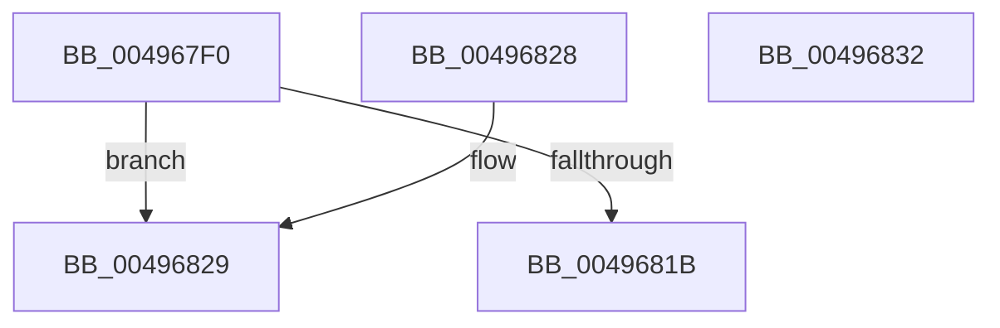

# CcGetCurrentNumaNode

- RVA: `0x004967F0`–`0x00496833` (길이 `67` bytes)
- VA: `0x00000001404967F0`
- 실행 섹션: `.text`
- PDB 이름 있음: `예`; PDB Function 태그: `아니요`
- unwind 정보 RVA: `0x000DB714`
- 디코드: `15`개 명령, `67/67` bytes 표시
- 미해석 바이트: `0` (있으면 어셈블리에 `.byte`로 보존)

> 이 문서는 커널 이미지의 기계어와 PDB 기호를 분석해 생성했습니다. 4번과 5번은 함수 원형과 자료형을 바이너리 사용 방식에서 추정한 C 해석이며 원본 소스 복구 결과는 아닙니다.

## 1. Dependencies

- 직접 호출 지점: **0**; 고유 호출 대상: **0**
- 직접 호출자로 확인된 함수: **3**
- RIP 상대 이미지 참조: **2**

### Outgoing calls
- 직접 디코드된 call 명령이 없습니다.

### Direct callers
- [CcAdjustWriteBehindThreadPoolIfNeeded](../38/CcAdjustWriteBehindThreadPoolIfNeeded_function_00386D94.md) at `0x00386DF0`
- [CcScheduleReadAheadNuma](../38/CcScheduleReadAheadNuma_function_0038883C.md) at `0x003889E7`
- [CcAdjustWriteBehindThreadPool](../57/CcAdjustWriteBehindThreadPool_function_0057B684.md) at `0x0057B6A2`

### Static image references
- `0x0049680C` → RVA `0x00E0A874` (`.data`; read)
- `0x00496812` → RVA `0x00E65B88` (`.data`; read)

## 2. Other-region calls and transfers

- 다른 실행 섹션으로 향하는 call: **0**
- 별도 외부 분기/꼬리 이동을 확인하지 못했습니다.

## 3. Assembly (complete function range)

```asm
004967F0  65 48 8B 04 25 20 00 00 00      mov rax, qword ptr gs:[0x20]
004967F9  4C 8B C2                        mov r8, rdx
004967FC  33 D2                           xor edx, edx
004967FE  48 8B 80 C0 00 00 00            mov rax, qword ptr [rax + 0xc0]
00496805  0F B7 80 8A 00 00 00            movzx eax, word ptr [rax + 0x8a]
0049680C  F7 35 62 40 97 00               div dword ptr [rip + 0x974062]
00496812  80 3D 6F F3 9C 00 00            cmp byte ptr [rip + 0x9cf36f], 0
00496819  74 0E                           je 0x140496829
0049681B  49 8B 80 58 02 00 00            mov rax, qword ptr [r8 + 0x258]
00496822  48 8B 44 D0 40                  mov rax, qword ptr [rax + rdx*8 + 0x40]
00496827  C3                              ret
00496828  CC                              int3
00496829  48 8B 84 D1 80 00 00 00         mov rax, qword ptr [rcx + rdx*8 + 0x80]
00496831  C3                              ret
00496832  CC                              int3
```

## 4. C-style interpretation (structured pseudocode)

```c
__int64 __fastcall CcGetCurrentNumaNode(__int64 a1, __int64 a2)
{
    a2 = 0;
    if ((*(unsigned __int8 *)(v_rip + 10285935)) == 0) goto loc_00496829;
    return *(unsigned __int64 *)(*(unsigned __int64 *)(a2 + 600) + a2 * 8 + 64);
loc_00496829:
    return *(unsigned __int64 *)(a1 + a2 * 8 + 128);
}
```

## 5. (Beta) C Style

```c
int64_t CcGetCurrentNumaNode(void *Arg1, void *Arg2)
{
    uint8_t *arg1 = (uint8_t *)Arg1;
    uint8_t *arg2 = (uint8_t *)Arg2;

    Arg2 = 0;
    if ((*(uint8_t *)(v_rip + 0x9CF36F)) == 0) goto loc_00496829;
    return *(uint64_t *)(*(uint64_t *)(arg2 + 0x258) + arg2 * 8 + 0x40);
loc_00496829:
    return *(uint64_t *)(arg1 + arg2 * 8 + 0x80);
}
```

### 관측된 메모리 오프셋

구조체 형식이 확인되지 않은 접근은 인자 기준의 오프셋으로만 기록했습니다.

| 기준 인자 | 오프셋 표현 | 폭 (bit) | 접근 |
|---|---:|---:|---|
| `Arg1` | `+ 0x80 + rdx*8` | `64` | `R` |
| `Arg2` | `+ 0x258` | `64` | `R` |

## 6. Execution-region graph

[열기: 2D/3D 그래프와 함수 탐색 컨트롤 패널](../../../control-panel.html?section=text&rva=0x004967F0&view=graph)

- 2D 그래프는 위에서 아래로 흐르고, 3D 그래프는 빈 공간을 드래그해 회전합니다. Shift+드래그는 이동, 휠은 확대·축소, 함수 노드 선택은 대상 보고서 이동입니다.

### Static fallback


