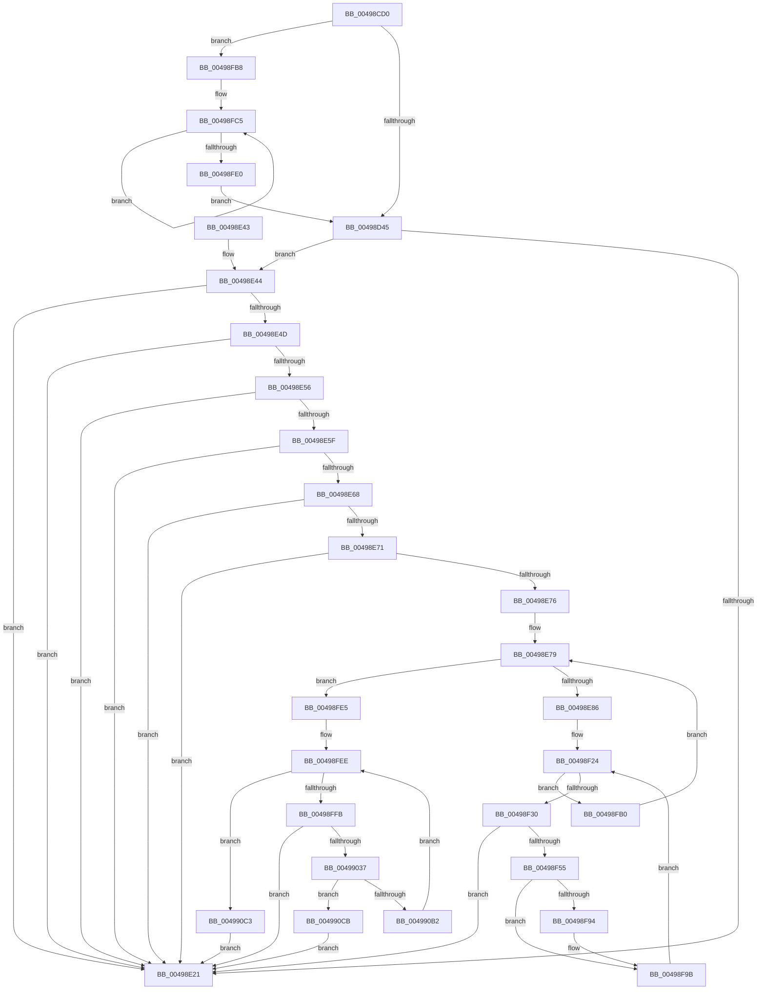

# CcInitializeAsyncReadForNodeHelper

- RVA: `0x00498CD0`–`0x004990E6` (길이 `1,046` bytes)
- VA: `0x0000000140498CD0`
- 실행 섹션: `.text`
- PDB 이름 있음: `예`; PDB Function 태그: `아니요`
- unwind 정보 RVA: `0x000B4324`
- 디코드: `253`개 명령, `1,046/1,046` bytes 표시
- 미해석 바이트: `0` (있으면 어셈블리에 `.byte`로 보존)

> 이 문서는 커널 이미지의 기계어와 PDB 기호를 분석해 생성했습니다. 4번과 5번은 함수 원형과 자료형을 바이너리 사용 방식에서 추정한 C 해석이며 원본 소스 복구 결과는 아닙니다.

## 1. Dependencies

- 직접 호출 지점: **15**; 고유 호출 대상: **7**
- 직접 호출자로 확인된 함수: **0**
- RIP 상대 이미지 참조: **4**

### Outgoing calls
- `0x00498D30` → [ExAllocatePoolWithTagFromNode](../35/ExAllocatePoolWithTagFromNode_function_0035A944.md) (function, `0x0035A944`)
- `0x00498D5B` → [ExAllocatePoolWithTagFromNode](../35/ExAllocatePoolWithTagFromNode_function_0035A944.md) (function, `0x0035A944`)
- `0x00498D7D` → [ExAllocatePoolWithTagFromNode](../35/ExAllocatePoolWithTagFromNode_function_0035A944.md) (function, `0x0035A944`)
- `0x00498DA2` → [ExAllocatePoolWithTagFromNode](../35/ExAllocatePoolWithTagFromNode_function_0035A944.md) (function, `0x0035A944`)
- `0x00498DC8` → [ExAllocatePoolWithTagFromNode](../35/ExAllocatePoolWithTagFromNode_function_0035A944.md) (function, `0x0035A944`)
- `0x00498DEA` → [ExAllocatePoolWithTagFromNode](../35/ExAllocatePoolWithTagFromNode_function_0035A944.md) (function, `0x0035A944`)
- `0x00498E0C` → [ExAllocatePoolWithTagFromNode](../35/ExAllocatePoolWithTagFromNode_function_0035A944.md) (function, `0x0035A944`)
- `0x00498F10` → [memset](../6C/memset_function_006C6C40.md) (function, `0x006C6C40`)
- `0x00498F44` → [ExAllocatePoolWithTagFromNode](../35/ExAllocatePoolWithTagFromNode_function_0035A944.md) (function, `0x0035A944`)
- `0x00499026` → [ExAllocatePoolWithTagFromNode](../35/ExAllocatePoolWithTagFromNode_function_0035A944.md) (function, `0x0035A944`)
- `0x00499076` → [CcReferencePartitionAndPrivateVolumeCacheMap](../38/CcReferencePartitionAndPrivateVolumeCacheMap_function_0038B9E0.md) (function, `0x0038B9E0`)
- `0x004990A9` → [PsCreateSystemThread](../../page/9E/PsCreateSystemThread_function_009ED0D0.md) (function, `0x009ED0D0`)
- `0x004990B6` → [ZwClose](../6A/ZwClose_function_006AD2B0.md) (function, `0x006AD2B0`)
- `0x004990D1` → [ExFreePoolWithTag](../../poolcode/B8/ExFreePoolWithTag_function_00B82870.md) (function, `0x00B82870`)
- `0x004990DC` → [CcDereferencePartitionAndPrivateVolumeCacheMap](../38/CcDereferencePartitionAndPrivateVolumeCacheMap_function_0038B94C.md) (function, `0x0038B94C`)

### Direct callers
- 이 함수 시작 RVA로 연결되는 직접 call은 확인되지 않았습니다. 간접 호출은 완전히 역산할 수 없습니다.

### Static image references
- `0x00498CF3` → RVA `0x00F8F520` (`.data`; read)
- `0x00498E8D` → RVA `0x00F8F51C` (`.data`; read)
- `0x00498F6F` → RVA `0x0057F560` (`CcAsyncReadWorkerThread`; read)
- `0x0049907F` → RVA `0x0045DB10` (`CcAsyncReadWorker`; read)

## 2. Other-region calls and transfers

- 다른 실행 섹션으로 향하는 call: **2**
  - `0x004990A9` → [PsCreateSystemThread](../../page/9E/PsCreateSystemThread_function_009ED0D0.md) (`.text` → `PAGE`)
  - `0x004990D1` → [ExFreePoolWithTag](../../poolcode/B8/ExFreePoolWithTag_function_00B82870.md) (`.text` → `POOLCODE`)
- 별도 외부 분기/꼬리 이동을 확인하지 못했습니다.

## 3. Assembly (complete function range)

```asm
00498CD0  48 89 5C 24 08                  mov qword ptr [rsp + 8], rbx
00498CD5  4C 89 4C 24 20                  mov qword ptr [rsp + 0x20], r9
00498CDA  55                              push rbp
00498CDB  56                              push rsi
00498CDC  57                              push rdi
00498CDD  41 54                           push r12
00498CDF  41 55                           push r13
00498CE1  41 56                           push r14
00498CE3  41 57                           push r15
00498CE5  48 8B EC                        mov rbp, rsp
00498CE8  48 83 EC 70                     sub rsp, 0x70
00498CEC  45 8B 48 18                     mov r9d, dword ptr [r8 + 0x18]
00498CF0  4C 8B EA                        mov r13, rdx
00498CF3  8B 15 27 68 AF 00               mov edx, dword ptr [rip + 0xaf6827]
00498CF9  33 C0                           xor eax, eax
00498CFB  0F 57 C0                        xorps xmm0, xmm0
00498CFE  48 89 45 F0                     mov qword ptr [rbp - 0x10], rax
00498D02  33 FF                           xor edi, edi
00498D04  89 45 F8                        mov dword ptr [rbp - 8], eax
00498D07  49 8B F0                        mov rsi, r8
00498D0A  48 89 7D 50                     mov qword ptr [rbp + 0x50], rdi
00498D0E  BB 00 00 00 80                  mov ebx, 0x80000000
00498D13  41 BC 43 63 57 71               mov r12d, 0x71576343
00498D19  44 0B CB                        or r9d, ebx
00498D1C  45 8B C4                        mov r8d, r12d
00498D1F  FF C2                           inc edx
00498D21  4C 8B F9                        mov r15, rcx
00498D24  48 C1 E2 04                     shl rdx, 4
00498D28  0F 11 45 D0                     movups xmmword ptr [rbp - 0x30], xmm0
00498D2C  0F 11 45 E0                     movups xmmword ptr [rbp - 0x20], xmm0
00498D30  E8 0F 1C EC FF                  call 0x14035a944
00498D35  48 89 86 E8 00 00 00            mov qword ptr [rsi + 0xe8], rax
00498D3C  48 85 C0                        test rax, rax
00498D3F  0F 85 73 02 00 00               jne 0x140498fb8
00498D45  8B 15 D5 67 AF 00               mov edx, dword ptr [rip + 0xaf67d5]
00498D4B  45 8B C4                        mov r8d, r12d
00498D4E  44 8B 4E 18                     mov r9d, dword ptr [rsi + 0x18]
00498D52  44 0B CB                        or r9d, ebx
00498D55  FF C2                           inc edx
00498D57  48 C1 E2 04                     shl rdx, 4
00498D5B  E8 E4 1B EC FF                  call 0x14035a944
00498D60  8B 15 BA 67 AF 00               mov edx, dword ptr [rip + 0xaf67ba]
00498D66  45 8B C4                        mov r8d, r12d
00498D69  44 8B 4E 18                     mov r9d, dword ptr [rsi + 0x18]
00498D6D  44 0B CB                        or r9d, ebx
00498D70  48 89 86 00 01 00 00            mov qword ptr [rsi + 0x100], rax
00498D77  FF C2                           inc edx
00498D79  48 C1 E2 04                     shl rdx, 4
00498D7D  E8 C2 1B EC FF                  call 0x14035a944
00498D82  8B 0D 98 67 AF 00               mov ecx, dword ptr [rip + 0xaf6798]
00498D88  45 8B C4                        mov r8d, r12d
00498D8B  44 8B 4E 18                     mov r9d, dword ptr [rsi + 0x18]
00498D8F  44 0B CB                        or r9d, ebx
00498D92  48 89 86 08 01 00 00            mov qword ptr [rsi + 0x108], rax
00498D99  FF C1                           inc ecx
00498D9B  48 69 D1 94 01 00 00            imul rdx, rcx, 0x194
00498DA2  E8 9D 1B EC FF                  call 0x14035a944
00498DA7  44 8B 4E 18                     mov r9d, dword ptr [rsi + 0x18]
00498DAB  45 8B C4                        mov r8d, r12d
00498DAE  48 89 86 18 01 00 00            mov qword ptr [rsi + 0x118], rax
00498DB5  44 0B CB                        or r9d, ebx
00498DB8  8B 05 62 67 AF 00               mov eax, dword ptr [rip + 0xaf6762]
00498DBE  FF C0                           inc eax
00498DC0  48 8D 14 40                     lea rdx, [rax + rax*2]
00498DC4  48 C1 E2 03                     shl rdx, 3
00498DC8  E8 77 1B EC FF                  call 0x14035a944
00498DCD  8B 15 4D 67 AF 00               mov edx, dword ptr [rip + 0xaf674d]
00498DD3  45 8B C4                        mov r8d, r12d
00498DD6  44 8B 4E 18                     mov r9d, dword ptr [rsi + 0x18]
00498DDA  44 0B CB                        or r9d, ebx
00498DDD  48 89 86 10 01 00 00            mov qword ptr [rsi + 0x110], rax
00498DE4  FF C2                           inc edx
00498DE6  48 C1 E2 02                     shl rdx, 2
00498DEA  E8 55 1B EC FF                  call 0x14035a944
00498DEF  8B 15 2B 67 AF 00               mov edx, dword ptr [rip + 0xaf672b]
00498DF5  45 8B C4                        mov r8d, r12d
00498DF8  44 8B 4E 18                     mov r9d, dword ptr [rsi + 0x18]
00498DFC  44 0B CB                        or r9d, ebx
00498DFF  48 89 86 F0 00 00 00            mov qword ptr [rsi + 0xf0], rax
00498E06  FF C2                           inc edx
00498E08  48 C1 E2 02                     shl rdx, 2
00498E0C  E8 33 1B EC FF                  call 0x14035a944
00498E11  48 89 86 F8 00 00 00            mov qword ptr [rsi + 0xf8], rax
00498E18  48 39 BE E8 00 00 00            cmp qword ptr [rsi + 0xe8], rdi
00498E1F  75 23                           jne 0x140498e44
00498E21  48 8B 45 58                     mov rax, qword ptr [rbp + 0x58]
00498E25  48 8B 9C 24 B0 00 00 00         mov rbx, qword ptr [rsp + 0xb0]
00498E2D  40 88 38                        mov byte ptr [rax], dil
00498E30  40 8A C7                        mov al, dil
00498E33  48 83 C4 70                     add rsp, 0x70
00498E37  41 5F                           pop r15
00498E39  41 5E                           pop r14
00498E3B  41 5D                           pop r13
00498E3D  41 5C                           pop r12
00498E3F  5F                              pop rdi
00498E40  5E                              pop rsi
00498E41  5D                              pop rbp
00498E42  C3                              ret
00498E43  CC                              int3
00498E44  48 39 BE 00 01 00 00            cmp qword ptr [rsi + 0x100], rdi
00498E4B  74 D4                           je 0x140498e21
00498E4D  48 39 BE 08 01 00 00            cmp qword ptr [rsi + 0x108], rdi
00498E54  74 CB                           je 0x140498e21
00498E56  48 39 BE 18 01 00 00            cmp qword ptr [rsi + 0x118], rdi
00498E5D  74 C2                           je 0x140498e21
00498E5F  48 39 BE 10 01 00 00            cmp qword ptr [rsi + 0x110], rdi
00498E66  74 B9                           je 0x140498e21
00498E68  48 39 BE F0 00 00 00            cmp qword ptr [rsi + 0xf0], rdi
00498E6F  74 B0                           je 0x140498e21
00498E71  48 85 C0                        test rax, rax
00498E74  74 AB                           je 0x140498e21
00498E76  44 8B F7                        mov r14d, edi
00498E79  44 3B 35 A0 66 AF 00            cmp r14d, dword ptr [rip + 0xaf66a0]
00498E80  0F 87 5F 01 00 00               ja 0x140498fe5
00498E86  48 8B 8E 00 01 00 00            mov rcx, qword ptr [rsi + 0x100]
00498E8D  44 8B 05 88 66 AF 00            mov r8d, dword ptr [rip + 0xaf6688]
00498E94  41 8B D6                        mov edx, r14d
00498E97  48 69 DA 94 01 00 00            imul rbx, rdx, 0x194
00498E9E  45 8B E6                        mov r12d, r14d
00498EA1  49 C1 E4 04                     shl r12, 4
00498EA5  49 03 CC                        add rcx, r12
00498EA8  49 C1 E0 02                     shl r8, 2
00498EAC  48 89 49 08                     mov qword ptr [rcx + 8], rcx
00498EB0  48 89 09                        mov qword ptr [rcx], rcx
00498EB3  48 8B 8E 08 01 00 00            mov rcx, qword ptr [rsi + 0x108]
00498EBA  49 03 CC                        add rcx, r12
00498EBD  48 89 49 08                     mov qword ptr [rcx + 8], rcx
00498EC1  48 89 09                        mov qword ptr [rcx], rcx
00498EC4  48 8D 0C 52                     lea rcx, [rdx + rdx*2]
00498EC8  48 8B 86 10 01 00 00            mov rax, qword ptr [rsi + 0x110]
00498ECF  66 C7 04 C8 01 00               mov word ptr [rax + rcx*8], 1
00498ED5  C6 44 C8 02 06                  mov byte ptr [rax + rcx*8 + 2], 6
00498EDA  89 7C C8 04                     mov dword ptr [rax + rcx*8 + 4], edi
00498EDE  48 8D 04 C8                     lea rax, [rax + rcx*8]
00498EE2  48 83 C0 08                     add rax, 8
00498EE6  48 89 40 08                     mov qword ptr [rax + 8], rax
00498EEA  48 89 00                        mov qword ptr [rax], rax
00498EED  48 8B 86 F0 00 00 00            mov rax, qword ptr [rsi + 0xf0]
00498EF4  89 3C 90                        mov dword ptr [rax + rdx*4], edi
00498EF7  48 8B 86 F8 00 00 00            mov rax, qword ptr [rsi + 0xf8]
00498EFE  89 3C 90                        mov dword ptr [rax + rdx*4], edi
00498F01  BA FF 00 00 00                  mov edx, 0xff
00498F06  48 8B 8E 18 01 00 00            mov rcx, qword ptr [rsi + 0x118]
00498F0D  48 03 CB                        add rcx, rbx
00498F10  E8 2B DD 22 00                  call 0x1406c6c40
00498F15  48 8B 86 18 01 00 00            mov rax, qword ptr [rsi + 0x118]
00498F1C  89 3C 03                        mov dword ptr [rbx + rax], edi
00498F1F  BB 01 00 00 00                  mov ebx, 1
00498F24  3B 1D F2 65 AF 00               cmp ebx, dword ptr [rip + 0xaf65f2]
00498F2A  0F 83 80 00 00 00               jae 0x140498fb0
00498F30  44 8B 4E 18                     mov r9d, dword ptr [rsi + 0x18]
00498F34  BA 50 00 00 00                  mov edx, 0x50
00498F39  41 0F BA E9 1F                  bts r9d, 0x1f
00498F3E  41 B8 43 63 57 71               mov r8d, 0x71576343
00498F44  E8 FB 19 EC FF                  call 0x14035a944
00498F49  48 8B C8                        mov rcx, rax
00498F4C  48 85 C0                        test rax, rax
00498F4F  0F 84 CC FE FF FF               je 0x140498e21
00498F55  C7 40 20 03 00 00 00            mov dword ptr [rax + 0x20], 3
00498F5C  4C 89 78 38                     mov qword ptr [rax + 0x38], r15
00498F60  4C 89 68 40                     mov qword ptr [rax + 0x40], r13
00498F64  48 89 70 48                     mov qword ptr [rax + 0x48], rsi
00498F68  89 58 28                        mov dword ptr [rax + 0x28], ebx
00498F6B  44 89 70 24                     mov dword ptr [rax + 0x24], r14d
00498F6F  48 8D 05 EA 65 0E 00            lea rax, [rip + 0xe65ea]
00498F76  48 89 41 10                     mov qword ptr [rcx + 0x10], rax
00498F7A  48 89 49 18                     mov qword ptr [rcx + 0x18], rcx
00498F7E  48 89 39                        mov qword ptr [rcx], rdi
00498F81  48 8B 96 E8 00 00 00            mov rdx, qword ptr [rsi + 0xe8]
00498F88  49 03 D4                        add rdx, r12
00498F8B  48 8B 42 08                     mov rax, qword ptr [rdx + 8]
00498F8F  48 39 10                        cmp qword ptr [rax], rdx
00498F92  74 07                           je 0x140498f9b
00498F94  B9 03 00 00 00                  mov ecx, 3
00498F99  CD 29                           int 0x29
00498F9B  48 89 11                        mov qword ptr [rcx], rdx
00498F9E  FF C3                           inc ebx
00498FA0  48 89 41 08                     mov qword ptr [rcx + 8], rax
00498FA4  48 89 08                        mov qword ptr [rax], rcx
00498FA7  48 89 4A 08                     mov qword ptr [rdx + 8], rcx
00498FAB  E9 74 FF FF FF                  jmp 0x140498f24
00498FB0  41 FF C6                        inc r14d
00498FB3  E9 C1 FE FF FF                  jmp 0x140498e79
00498FB8  44 8B 05 61 65 AF 00            mov r8d, dword ptr [rip + 0xaf6561]
00498FBF  48 8B D7                        mov rdx, rdi
00498FC2  41 FF C0                        inc r8d
00498FC5  48 8B 8E E8 00 00 00            mov rcx, qword ptr [rsi + 0xe8]
00498FCC  48 03 CA                        add rcx, rdx
00498FCF  48 83 C2 10                     add rdx, 0x10
00498FD3  48 89 49 08                     mov qword ptr [rcx + 8], rcx
00498FD7  48 89 09                        mov qword ptr [rcx], rcx
00498FDA  49 83 E8 01                     sub r8, 1
00498FDE  75 E5                           jne 0x140498fc5
00498FE0  E9 60 FD FF FF                  jmp 0x140498d45
00498FE5  44 8B F7                        mov r14d, edi
00498FE8  41 BC 43 63 57 71               mov r12d, 0x71576343
00498FEE  44 3B 35 2B 65 AF 00            cmp r14d, dword ptr [rip + 0xaf652b]
00498FF5  0F 87 C8 00 00 00               ja 0x1404990c3
00498FFB  44 8B 4E 18                     mov r9d, dword ptr [rsi + 0x18]
00498FFF  0F 57 C0                        xorps xmm0, xmm0
00499002  41 0F BA E9 1F                  bts r9d, 0x1f
00499007  C7 45 D0 30 00 00 00            mov dword ptr [rbp - 0x30], 0x30
0049900E  45 8B C4                        mov r8d, r12d
00499011  48 89 7D D8                     mov qword ptr [rbp - 0x28], rdi
00499015  BA 50 00 00 00                  mov edx, 0x50
0049901A  89 7D E8                        mov dword ptr [rbp - 0x18], edi
0049901D  48 89 7D E0                     mov qword ptr [rbp - 0x20], rdi
00499021  F3 0F 7F 45 F0                  movdqu xmmword ptr [rbp - 0x10], xmm0
00499026  E8 19 19 EC FF                  call 0x14035a944
0049902B  48 8B D8                        mov rbx, rax
0049902E  48 85 C0                        test rax, rax
00499031  0F 84 EA FD FF FF               je 0x140498e21
00499037  C7 40 20 03 00 00 00            mov dword ptr [rax + 0x20], 3
0049903E  49 8B D5                        mov rdx, r13
00499041  4C 89 78 38                     mov qword ptr [rax + 0x38], r15
00499045  4C 89 68 40                     mov qword ptr [rax + 0x40], r13
00499049  48 89 70 48                     mov qword ptr [rax + 0x48], rsi
0049904D  89 78 28                        mov dword ptr [rax + 0x28], edi
00499050  44 89 70 24                     mov dword ptr [rax + 0x24], r14d
00499054  48 8D 05 05 65 0E 00            lea rax, [rip + 0xe6505]
0049905B  48 89 43 10                     mov qword ptr [rbx + 0x10], rax
0049905F  48 89 5B 18                     mov qword ptr [rbx + 0x18], rbx
00499063  48 89 3B                        mov qword ptr [rbx], rdi
00499066  48 8B 86 F0 00 00 00            mov rax, qword ptr [rsi + 0xf0]
0049906D  41 8B CE                        mov ecx, r14d
00499070  FF 04 88                        inc dword ptr [rax + rcx*4]
00499073  49 8B CF                        mov rcx, r15
00499076  E8 65 29 EF FF                  call 0x14038b9e0
0049907B  49 8B 57 08                     mov rdx, qword ptr [r15 + 8]
0049907F  48 8D 05 8A 4A FC FF            lea rax, [rip - 0x3b576]
00499086  48 89 5C 24 30                  mov qword ptr [rsp + 0x30], rbx
0049908B  4C 8D 45 D0                     lea r8, [rbp - 0x30]
0049908F  48 89 44 24 28                  mov qword ptr [rsp + 0x28], rax
00499094  48 8D 4D 50                     lea rcx, [rbp + 0x50]
00499098  48 89 7C 24 20                  mov qword ptr [rsp + 0x20], rdi
0049909D  4C 8B 8A 80 00 00 00            mov r9, qword ptr [rdx + 0x80]
004990A4  BA FF FF 1F 00                  mov edx, 0x1fffff
004990A9  E8 22 40 55 00                  call 0x1409ed0d0
004990AE  85 C0                           test eax, eax
004990B0  78 19                           js 0x1404990cb
004990B2  48 8B 4D 50                     mov rcx, qword ptr [rbp + 0x50]
004990B6  E8 F5 41 21 00                  call 0x1406ad2b0
004990BB  41 FF C6                        inc r14d
004990BE  E9 2B FF FF FF                  jmp 0x140498fee
004990C3  40 B7 01                        mov dil, 1
004990C6  E9 56 FD FF FF                  jmp 0x140498e21
004990CB  41 8B D4                        mov edx, r12d
004990CE  48 8B CB                        mov rcx, rbx
004990D1  E8 9A 97 6E 00                  call 0x140b82870
004990D6  49 8B D5                        mov rdx, r13
004990D9  49 8B CF                        mov rcx, r15
004990DC  E8 6B 28 EF FF                  call 0x14038b94c
004990E1  E9 3B FD FF FF                  jmp 0x140498e21
```

## 4. C-style interpretation (structured pseudocode)

```c
__int64 __fastcall CcInitializeAsyncReadForNodeHelper(__int64 a1, __int64 a2, __int64 a3, __int64 a4)
{
    __int64 result;
    __int64 v_r12;
    __int64 v_r14;
    __int64 v_rbx;
    __int64 v_rdi;
    __int64 v_rsp;
    unsigned int v_stack_m40;
    unsigned __int64 v_stack_m48;
    unsigned int v_stack_m50;
    unsigned __int64 v_stack_m58;
    unsigned __int64 v_stack_m60;
    unsigned __int64 v_stack_m68;
    unsigned __int64 v_stack_p18;
    unsigned __int64 v_stack_p20;
    unsigned __int64 v_stack_p28;
    unsigned __int64 v_stack_p30;
    unsigned __int64 v_stack_p8;

    v_stack_p8 = v_rbx;
    v_stack_p20 = a4;
    v_rsp = (v_rsp) - (112);
    result = 0;
    v_stack_m48 = 0;
    v_rdi = 0;
    v_stack_m40 = 0;
    v_stack_p18 = 0;
    a4 = (unsigned int)(((unsigned int)(*(unsigned int *)(a3 + 24))) | ((unsigned int)((unsigned int)(0x80000000ULL))));
    a2 = (unsigned int)(((unsigned int)(*(unsigned int *)(v_rip + 11495463))) + 1);
    a2 = (a2) << (4);
    v_stack_m68 = v_xmm0;
    v_stack_m58 = v_xmm0;
    result = ExAllocatePoolWithTagFromNode(a1, a2, (unsigned int)((unsigned int)((unsigned int)(0x71576343ULL))), a4);
    *(unsigned __int64 *)(a3 + 232) = result;
    if (result != 0) goto loc_00498FB8;
loc_00498D45:
    a4 = (unsigned int)(((unsigned int)(*(unsigned int *)(a3 + 24))) | ((unsigned int)((unsigned int)(0x80000000ULL))));
    a2 = (unsigned int)(((unsigned int)(*(unsigned int *)(v_rip + 11495381))) + 1);
    a2 = (a2) << (4);
    result = ExAllocatePoolWithTagFromNode(a1, a2, (unsigned int)((unsigned int)((unsigned int)(0x71576343ULL))), a4);
    a4 = (unsigned int)(((unsigned int)(*(unsigned int *)(a3 + 24))) | ((unsigned int)((unsigned int)(0x80000000ULL))));
    *(unsigned __int64 *)(a3 + 256) = result;
    a2 = (unsigned int)(((unsigned int)(*(unsigned int *)(v_rip + 11495354))) + 1);
    a2 = (a2) << (4);
    result = ExAllocatePoolWithTagFromNode(a1, a2, (unsigned int)((unsigned int)((unsigned int)(0x71576343ULL))), a4);
    a4 = (unsigned int)(((unsigned int)(*(unsigned int *)(a3 + 24))) | ((unsigned int)((unsigned int)(0x80000000ULL))));
    *(unsigned __int64 *)(a3 + 264) = result;
    a1 = (unsigned int)(((unsigned int)(*(unsigned int *)(v_rip + 11495320))) + 1);
    a2 = (a2) * (a1);
    result = ExAllocatePoolWithTagFromNode(a1, a2, (unsigned int)((unsigned int)((unsigned int)(0x71576343ULL))), a4);
    *(unsigned __int64 *)(a3 + 280) = result;
    a4 = (unsigned int)(((unsigned int)(*(unsigned int *)(a3 + 24))) | ((unsigned int)((unsigned int)(0x80000000ULL))));
    result = (unsigned int)(((unsigned int)(*(unsigned int *)(v_rip + 11495266))) + 1);
    a2 = (result + result * 2) << (3);
    result = ExAllocatePoolWithTagFromNode(a1, a2, (unsigned int)((unsigned int)((unsigned int)(0x71576343ULL))), a4);
    a4 = (unsigned int)(((unsigned int)(*(unsigned int *)(a3 + 24))) | ((unsigned int)((unsigned int)(0x80000000ULL))));
    *(unsigned __int64 *)(a3 + 272) = result;
    a2 = (unsigned int)(((unsigned int)(*(unsigned int *)(v_rip + 11495245))) + 1);
    a2 = (a2) << (2);
    result = ExAllocatePoolWithTagFromNode(a1, a2, (unsigned int)((unsigned int)((unsigned int)(0x71576343ULL))), a4);
    a4 = (unsigned int)(((unsigned int)(*(unsigned int *)(a3 + 24))) | ((unsigned int)((unsigned int)(0x80000000ULL))));
    *(unsigned __int64 *)(a3 + 240) = result;
    a2 = (unsigned int)(((unsigned int)(*(unsigned int *)(v_rip + 11495211))) + 1);
    a2 = (a2) << (2);
    result = ExAllocatePoolWithTagFromNode(a1, a2, (unsigned int)((unsigned int)((unsigned int)(0x71576343ULL))), a4);
    *(unsigned __int64 *)(a3 + 248) = result;
    if ((*(unsigned __int64 *)(a3 + 232)) != 0) goto loc_00498E44;
loc_00498E21:
    *(unsigned __int8 *)(v_stack_p20) = 0;
    v_rsp = (v_rsp) + (112);
    return 0;
loc_00498E44:
    if ((*(unsigned __int64 *)(a3 + 256)) == 0) goto loc_00498E21;
    if ((*(unsigned __int64 *)(a3 + 264)) == 0) goto loc_00498E21;
    if ((*(unsigned __int64 *)(a3 + 280)) == 0) goto loc_00498E21;
    if ((*(unsigned __int64 *)(a3 + 272)) == 0) goto loc_00498E21;
    if ((*(unsigned __int64 *)(a3 + 240)) == 0) goto loc_00498E21;
    if (0 == 0) goto loc_00498E21;
loc_00498E79:
    if (0 > (*(unsigned int *)(v_rip + 11495072))) goto loc_00498FE5;
    v_rbx = (v_stack_p8) * (0);
    v_r12 = (0) << (4);
    a1 = (*(unsigned __int64 *)(a3 + 256)) + (v_r12);
    a3 = ((unsigned int)(*(unsigned int *)(v_rip + 11495048))) << (2);
    *(unsigned __int64 *)(a1 + 8) = a1;
    *(unsigned __int64 *)(a1) = a1;
    a1 = (*(unsigned __int64 *)(a3 + 264)) + (v_r12);
    *(unsigned __int64 *)(a1 + 8) = a1;
    *(unsigned __int64 *)(a1) = a1;
    *(unsigned __int16 *)(*(unsigned __int64 *)(a3 + 272) + 0 + 0 * 2 * 8) = 1;
    *(unsigned __int8 *)(*(unsigned __int64 *)(a3 + 272) + 0 + 0 * 2 * 8 + 2) = 6;
    *(unsigned int *)(*(unsigned __int64 *)(a3 + 272) + 0 + 0 * 2 * 8 + 4) = 0;
    result = (*(unsigned __int64 *)(a3 + 272) + 0 + 0 * 2 * 8) + (8);
    *(unsigned __int64 *)(result + 8) = result;
    *(unsigned __int64 *)(result) = result;
    *(unsigned int *)(*(unsigned __int64 *)(a3 + 240) + 0 * 4) = 0;
    *(unsigned int *)(*(unsigned __int64 *)(a3 + 248) + 0 * 4) = 0;
    a1 = (*(unsigned __int64 *)(a3 + 280)) + (v_rbx);
    result = memset(a1, 255, a3, a4);
    *(unsigned int *)(v_rbx + *(unsigned __int64 *)(a3 + 280) * 1) = 0;
loc_00498F24:
    if (1 >= (*(unsigned int *)(v_rip + 11494898))) goto loc_00498FB0;
    result = ExAllocatePoolWithTagFromNode(a1, 80, (unsigned int)(0x71576343ULL), (unsigned int)(*(unsigned int *)(a3 + 24)));
    if (result == 0) goto loc_00498E21;
    *(unsigned int *)(result + 32) = 3;
    *(unsigned __int64 *)(result + 56) = a1;
    *(unsigned __int64 *)(result + 64) = a2;
    *(unsigned __int64 *)(result + 72) = a3;
    *(unsigned int *)(result + 40) = 1;
    *(unsigned int *)(result + 36) = 0;
    *(unsigned __int64 *)(result + 16) = v_rip + 943594;
    *(unsigned __int64 *)(result + 24) = result;
    *(unsigned __int64 *)(result) = 0;
    a2 = (*(unsigned __int64 *)(a3 + 232)) + (v_r12);
    if ((*(unsigned __int64 *)(*(unsigned __int64 *)(a2 + 8))) != a2) {
        a1 = 3;
    }
    *(unsigned __int64 *)(a1) = a2;
    v_rbx = (unsigned int)((1) + 1);
    *(unsigned __int64 *)(a1 + 8) = *(unsigned __int64 *)(a2 + 8);
    *(unsigned __int64 *)(*(unsigned __int64 *)(a2 + 8)) = a1;
    *(unsigned __int64 *)(a2 + 8) = a1;
    goto loc_00498F24;
loc_00498FB0:
    v_r14 = (unsigned int)((0) + 1);
    goto loc_00498E79;
loc_00498FB8:
    a3 = (unsigned int)(((unsigned int)(*(unsigned int *)(v_rip + 11494753))) + 1);
loc_00498FC5:
    a1 = (*(unsigned __int64 *)(a3 + 232)) + (0);
    a2 = (0) + (16);
    *(unsigned __int64 *)(a1 + 8) = a1;
    *(unsigned __int64 *)(a1) = a1;
    a3 = (a3) - (1);
    if (condition_is_not_equal) goto loc_00498FC5;
    goto loc_00498D45;
loc_00498FE5:
loc_00498FEE:
    if (0 > (*(unsigned int *)(v_rip + 11494699))) goto loc_004990C3;
    v_stack_m68 = 48;
    v_stack_m60 = 0;
    v_stack_m50 = 0;
    v_stack_m58 = 0;
    v_stack_m48 = v_xmm0;
    result = ExAllocatePoolWithTagFromNode(a1, 80, (unsigned int)((unsigned int)((unsigned int)(0x71576343ULL))), (unsigned int)(*(unsigned int *)(a3 + 24)));
    if (result == 0) goto loc_00498E21;
    *(unsigned int *)(result + 32) = 3;
    *(unsigned __int64 *)(result + 56) = a1;
    *(unsigned __int64 *)(result + 64) = a2;
    *(unsigned __int64 *)(result + 72) = a3;
    *(unsigned int *)(result + 40) = 0;
    *(unsigned int *)(result + 36) = 0;
    *(unsigned __int64 *)(result + 16) = v_rip + 943365;
    *(unsigned __int64 *)(result + 24) = result;
    *(unsigned __int64 *)(result) = 0;
    result = CcReferencePartitionAndPrivateVolumeCacheMap(a1, a2, (unsigned int)((unsigned int)((unsigned int)(0x71576343ULL))), (unsigned int)(*(unsigned int *)(a3 + 24)));
    v_stack_p30 = result;
    v_stack_p28 = v_rip - 243062;
    v_stack_p20 = 0;
    result = PsCreateSystemThread(v_stack_p18, (unsigned int)(0x1FFFFFULL), v_stack_m68, *(unsigned __int64 *)(*(unsigned __int64 *)(a1 + 8) + 128));
    if (sign_flag) goto loc_004990CB;
    result = ZwClose(v_stack_p18, (unsigned int)(0x1FFFFFULL), v_stack_m68, *(unsigned __int64 *)(*(unsigned __int64 *)(a1 + 8) + 128));
    v_r14 = (unsigned int)((0) + 1);
    goto loc_00498FEE;
loc_004990C3:
    goto loc_00498E21;
loc_004990CB:
    result = ExFreePoolWithTag(result, (unsigned int)((unsigned int)((unsigned int)(0x71576343ULL))), v_stack_m68, *(unsigned __int64 *)(*(unsigned __int64 *)(a1 + 8) + 128));
    result = CcDereferencePartitionAndPrivateVolumeCacheMap(a1, a2, v_stack_m68, *(unsigned __int64 *)(*(unsigned __int64 *)(a1 + 8) + 128));
    goto loc_00498E21;
}
```

## 5. (Beta) C Style

```c
int64_t CcInitializeAsyncReadForNodeHelper(void *Arg1, int64_t Arg2, void *Arg3, int64_t Arg4)
{
    uint8_t *arg1 = (uint8_t *)Arg1;
    uint8_t *arg3 = (uint8_t *)Arg3;

    int64_t result;
    int64_t local_r12;
    int64_t local_r14;
    int64_t local_rbx;
    int64_t local_rdi;
    int64_t local_rsp;
    uint32_t v_stack_m40;
    uint64_t v_stack_m48;
    uint32_t v_stack_m50;
    uint64_t v_stack_m58;
    uint64_t v_stack_m60;
    uint64_t v_stack_m68;
    uint64_t v_stack_p18;
    uint64_t v_stack_p20;
    uint64_t v_stack_p28;
    uint64_t v_stack_p30;
    uint64_t v_stack_p8;

    v_stack_p8 = local_rbx;
    v_stack_p20 = Arg4;
    local_rsp = (local_rsp) - (112);
    result = 0;
    v_stack_m48 = 0;
    local_rdi = 0;
    v_stack_m40 = 0;
    v_stack_p18 = 0;
    Arg4 = (uint32_t)(((uint32_t)(*(uint32_t *)(arg3 + 0x18))) | ((uint32_t)((uint32_t)(0x80000000ULL))));
    Arg2 = (uint32_t)(((uint32_t)(*(uint32_t *)(v_rip + 0xAF6827))) + 1);
    Arg2 = (Arg2) << (4);
    v_stack_m68 = v_xmm0;
    v_stack_m58 = v_xmm0;
    result = ExAllocatePoolWithTagFromNode(Arg1, Arg2, (uint32_t)((uint32_t)((uint32_t)(0x71576343ULL))), Arg4);
    *(uint64_t *)(arg3 + 0xE8) = result;
    if (result != 0) goto loc_00498FB8;
loc_00498D45:
    Arg4 = (uint32_t)(((uint32_t)(*(uint32_t *)(arg3 + 0x18))) | ((uint32_t)((uint32_t)(0x80000000ULL))));
    Arg2 = (uint32_t)(((uint32_t)(*(uint32_t *)(v_rip + 0xAF67D5))) + 1);
    Arg2 = (Arg2) << (4);
    result = ExAllocatePoolWithTagFromNode(Arg1, Arg2, (uint32_t)((uint32_t)((uint32_t)(0x71576343ULL))), Arg4);
    Arg4 = (uint32_t)(((uint32_t)(*(uint32_t *)(arg3 + 0x18))) | ((uint32_t)((uint32_t)(0x80000000ULL))));
    *(uint64_t *)(arg3 + 0x100) = result;
    Arg2 = (uint32_t)(((uint32_t)(*(uint32_t *)(v_rip + 0xAF67BA))) + 1);
    Arg2 = (Arg2) << (4);
    result = ExAllocatePoolWithTagFromNode(Arg1, Arg2, (uint32_t)((uint32_t)((uint32_t)(0x71576343ULL))), Arg4);
    Arg4 = (uint32_t)(((uint32_t)(*(uint32_t *)(arg3 + 0x18))) | ((uint32_t)((uint32_t)(0x80000000ULL))));
    *(uint64_t *)(arg3 + 0x108) = result;
    Arg1 = (uint32_t)(((uint32_t)(*(uint32_t *)(v_rip + 0xAF6798))) + 1);
    Arg2 = (Arg2) * (Arg1);
    result = ExAllocatePoolWithTagFromNode(Arg1, Arg2, (uint32_t)((uint32_t)((uint32_t)(0x71576343ULL))), Arg4);
    *(uint64_t *)(arg3 + 0x118) = result;
    Arg4 = (uint32_t)(((uint32_t)(*(uint32_t *)(arg3 + 0x18))) | ((uint32_t)((uint32_t)(0x80000000ULL))));
    result = (uint32_t)(((uint32_t)(*(uint32_t *)(v_rip + 0xAF6762))) + 1);
    Arg2 = (result + result * 2) << (3);
    result = ExAllocatePoolWithTagFromNode(Arg1, Arg2, (uint32_t)((uint32_t)((uint32_t)(0x71576343ULL))), Arg4);
    Arg4 = (uint32_t)(((uint32_t)(*(uint32_t *)(arg3 + 0x18))) | ((uint32_t)((uint32_t)(0x80000000ULL))));
    *(uint64_t *)(arg3 + 0x110) = result;
    Arg2 = (uint32_t)(((uint32_t)(*(uint32_t *)(v_rip + 0xAF674D))) + 1);
    Arg2 = (Arg2) << (2);
    result = ExAllocatePoolWithTagFromNode(Arg1, Arg2, (uint32_t)((uint32_t)((uint32_t)(0x71576343ULL))), Arg4);
    Arg4 = (uint32_t)(((uint32_t)(*(uint32_t *)(arg3 + 0x18))) | ((uint32_t)((uint32_t)(0x80000000ULL))));
    *(uint64_t *)(arg3 + 0xF0) = result;
    Arg2 = (uint32_t)(((uint32_t)(*(uint32_t *)(v_rip + 0xAF672B))) + 1);
    Arg2 = (Arg2) << (2);
    result = ExAllocatePoolWithTagFromNode(Arg1, Arg2, (uint32_t)((uint32_t)((uint32_t)(0x71576343ULL))), Arg4);
    *(uint64_t *)(arg3 + 0xF8) = result;
    if ((*(uint64_t *)(arg3 + 0xE8)) != 0) goto loc_00498E44;
loc_00498E21:
    *(uint8_t *)(v_stack_p20) = 0;
    local_rsp = (local_rsp) + (112);
    return 0;
loc_00498E44:
    if ((*(uint64_t *)(arg3 + 0x100)) == 0) goto loc_00498E21;
    if ((*(uint64_t *)(arg3 + 0x108)) == 0) goto loc_00498E21;
    if ((*(uint64_t *)(arg3 + 0x118)) == 0) goto loc_00498E21;
    if ((*(uint64_t *)(arg3 + 0x110)) == 0) goto loc_00498E21;
    if ((*(uint64_t *)(arg3 + 0xF0)) == 0) goto loc_00498E21;
    if (0 == 0) goto loc_00498E21;
loc_00498E79:
    if (0 > (*(uint32_t *)(v_rip + 0xAF66A0))) goto loc_00498FE5;
    local_rbx = (v_stack_p8) * (0);
    local_r12 = (0) << (4);
    Arg1 = (*(uint64_t *)(arg3 + 0x100)) + (local_r12);
    Arg3 = ((uint32_t)(*(uint32_t *)(v_rip + 0xAF6688))) << (2);
    *(void **)(arg1 + 0x8) = Arg1;
    *(void **)(arg1) = Arg1;
    Arg1 = (*(uint64_t *)(arg3 + 0x108)) + (local_r12);
    *(void **)(arg1 + 0x8) = Arg1;
    *(void **)(arg1) = Arg1;
    *(uint16_t *)(*(uint64_t *)(arg3 + 0x110) + 0x0 + 0x0 * 2 * 8) = 1;
    *(uint8_t *)(*(uint64_t *)(arg3 + 0x110) + 0x0 + 0x0 * 2 * 8 + 0x2) = 6;
    *(uint32_t *)(*(uint64_t *)(arg3 + 0x110) + 0x0 + 0x0 * 2 * 8 + 0x4) = 0;
    result = (*(uint64_t *)(arg3 + 0x110) + 0 + 0 * 2 * 8) + (8);
    *(uint64_t *)(result + 0x8) = result;
    *(uint64_t *)(result) = result;
    *(uint32_t *)(*(uint64_t *)(arg3 + 0xF0) + 0x0 * 4) = 0;
    *(uint32_t *)(*(uint64_t *)(arg3 + 0xF8) + 0x0 * 4) = 0;
    Arg1 = (*(uint64_t *)(arg3 + 0x118)) + (local_rbx);
    result = memset(Arg1, 255, Arg3, Arg4);
    *(uint32_t *)(local_rbx + *(uint64_t *)(arg3 + 0x118) * 1) = 0;
loc_00498F24:
    if (1 >= (*(uint32_t *)(v_rip + 0xAF65F2))) goto loc_00498FB0;
    result = ExAllocatePoolWithTagFromNode(Arg1, 80, (uint32_t)(0x71576343ULL), (uint32_t)(*(uint32_t *)(arg3 + 0x18)));
    if (result == 0) goto loc_00498E21;
    *(uint32_t *)(result + 0x20) = 3;
    *(void **)(result + 0x38) = Arg1;
    *(uint64_t *)(result + 0x40) = Arg2;
    *(void **)(result + 0x48) = Arg3;
    *(uint32_t *)(result + 0x28) = 1;
    *(uint32_t *)(result + 0x24) = 0;
    *(uint64_t *)(result + 0x10) = v_rip + 943594;
    *(uint64_t *)(result + 0x18) = result;
    *(uint64_t *)(result) = 0;
    Arg2 = (*(uint64_t *)(arg3 + 0xE8)) + (local_r12);
    if ((*(uint64_t *)(*(uint64_t *)(Arg2 + 0x8))) != Arg2) {
        Arg1 = 3;
    }
    *(uint64_t *)(arg1) = Arg2;
    local_rbx = (uint32_t)((1) + 1);
    *(uint64_t *)(arg1 + 0x8) = *(uint64_t *)(Arg2 + 0x8);
    *(void **)(*(uint64_t *)(Arg2 + 0x8)) = Arg1;
    *(void **)(Arg2 + 0x8) = Arg1;
    goto loc_00498F24;
loc_00498FB0:
    local_r14 = (uint32_t)((0) + 1);
    goto loc_00498E79;
loc_00498FB8:
    Arg3 = (uint32_t)(((uint32_t)(*(uint32_t *)(v_rip + 0xAF6561))) + 1);
loc_00498FC5:
    Arg1 = (*(uint64_t *)(arg3 + 0xE8)) + (0);
    Arg2 = (0) + (16);
    *(void **)(arg1 + 0x8) = Arg1;
    *(void **)(arg1) = Arg1;
    Arg3 = (Arg3) - (1);
    if (condition_is_not_equal) goto loc_00498FC5;
    goto loc_00498D45;
loc_00498FE5:
loc_00498FEE:
    if (0 > (*(uint32_t *)(v_rip + 0xAF652B))) goto loc_004990C3;
    v_stack_m68 = 48;
    v_stack_m60 = 0;
    v_stack_m50 = 0;
    v_stack_m58 = 0;
    v_stack_m48 = v_xmm0;
    result = ExAllocatePoolWithTagFromNode(Arg1, 80, (uint32_t)((uint32_t)((uint32_t)(0x71576343ULL))), (uint32_t)(*(uint32_t *)(arg3 + 0x18)));
    if (result == 0) goto loc_00498E21;
    *(uint32_t *)(result + 0x20) = 3;
    *(void **)(result + 0x38) = Arg1;
    *(uint64_t *)(result + 0x40) = Arg2;
    *(void **)(result + 0x48) = Arg3;
    *(uint32_t *)(result + 0x28) = 0;
    *(uint32_t *)(result + 0x24) = 0;
    *(uint64_t *)(result + 0x10) = v_rip + 943365;
    *(uint64_t *)(result + 0x18) = result;
    *(uint64_t *)(result) = 0;
    result = CcReferencePartitionAndPrivateVolumeCacheMap(Arg1, Arg2, (uint32_t)((uint32_t)((uint32_t)(0x71576343ULL))), (uint32_t)(*(uint32_t *)(arg3 + 0x18)));
    v_stack_p30 = result;
    v_stack_p28 = v_rip - 243062;
    v_stack_p20 = 0;
    result = PsCreateSystemThread(v_stack_p18, (uint32_t)(0x1FFFFFULL), v_stack_m68, *(uint64_t *)(*(uint64_t *)(arg1 + 0x8) + 0x80));
    if (sign_flag) goto loc_004990CB;
    result = ZwClose(v_stack_p18, (uint32_t)(0x1FFFFFULL), v_stack_m68, *(uint64_t *)(*(uint64_t *)(arg1 + 0x8) + 0x80));
    local_r14 = (uint32_t)((0) + 1);
    goto loc_00498FEE;
loc_004990C3:
    goto loc_00498E21;
loc_004990CB:
    result = ExFreePoolWithTag(result, (uint32_t)((uint32_t)((uint32_t)(0x71576343ULL))), v_stack_m68, *(uint64_t *)(*(uint64_t *)(arg1 + 0x8) + 0x80));
    result = CcDereferencePartitionAndPrivateVolumeCacheMap(Arg1, Arg2, v_stack_m68, *(uint64_t *)(*(uint64_t *)(arg1 + 0x8) + 0x80));
    goto loc_00498E21;
}
```

### 관측된 메모리 오프셋

구조체 형식이 확인되지 않은 접근은 인자 기준의 오프셋으로만 기록했습니다.

| 기준 인자 | 오프셋 표현 | 폭 (bit) | 접근 |
|---|---:|---:|---|
| `Arg1` | `+ 0x8` | `64` | `R` |
| `Arg3` | `+ 0x18` | `32` | `R` |
| `Arg3` | `+ 0xE8` | `64` | `R` |
| `Arg3` | `+ 0xE8` | `64` | `W` |
| `Arg3` | `+ 0xF0` | `64` | `R` |
| `Arg3` | `+ 0xF0` | `64` | `W` |
| `Arg3` | `+ 0xF8` | `64` | `R` |
| `Arg3` | `+ 0xF8` | `64` | `W` |
| `Arg3` | `+ 0x100` | `64` | `R` |
| `Arg3` | `+ 0x100` | `64` | `W` |
| `Arg3` | `+ 0x108` | `64` | `R` |
| `Arg3` | `+ 0x108` | `64` | `W` |
| `Arg3` | `+ 0x110` | `64` | `R` |
| `Arg3` | `+ 0x110` | `64` | `W` |
| `Arg3` | `+ 0x118` | `64` | `R` |
| `Arg3` | `+ 0x118` | `64` | `W` |

## 6. Execution-region graph

[열기: 2D/3D 그래프와 함수 탐색 컨트롤 패널](../../../control-panel.html?section=text&rva=0x00498CD0&view=graph)

- 2D 그래프는 위에서 아래로 흐르고, 3D 그래프는 빈 공간을 드래그해 회전합니다. Shift+드래그는 이동, 휠은 확대·축소, 함수 노드 선택은 대상 보고서 이동입니다.

### Static fallback


