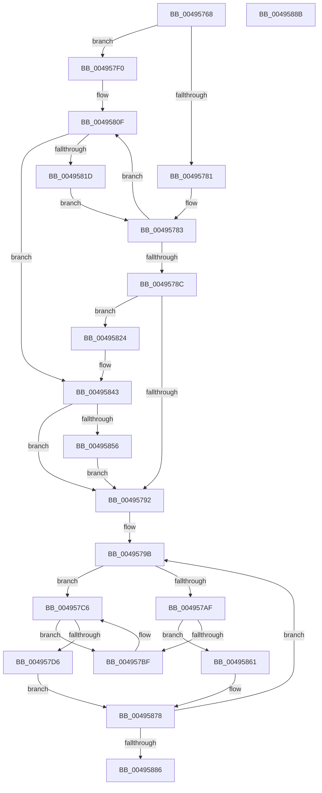

# CcInsertVacbArray

- RVA: `0x00495768`–`0x0049588C` (길이 `292` bytes)
- VA: `0x0000000140495768`
- 실행 섹션: `.text`
- PDB 이름 있음: `예`; PDB Function 태그: `아니요`
- unwind 정보 RVA: `0x0005D2F4`
- 디코드: `68`개 명령, `292/292` bytes 표시
- 미해석 바이트: `0` (있으면 어셈블리에 `.byte`로 보존)

> 이 문서는 커널 이미지의 기계어와 PDB 기호를 분석해 생성했습니다. 4번과 5번은 함수 원형과 자료형을 바이너리 사용 방식에서 추정한 C 해석이며 원본 소스 복구 결과는 아닙니다.

## 1. Dependencies

- 직접 호출 지점: **2**; 고유 호출 대상: **1**
- 직접 호출자로 확인된 함수: **2**
- RIP 상대 이미지 참조: **8**

### Outgoing calls
- `0x00495809` → [KeBugCheckEx](../4F/KeBugCheckEx_function_004FD660.md) (function, `0x004FD660`)
- `0x0049583D` → [KeBugCheckEx](../4F/KeBugCheckEx_function_004FD660.md) (function, `0x004FD660`)

### Direct callers
- [CcInitializePartitionVacbs](../57/CcInitializePartitionVacbs_function_0057EB60.md) at `0x0057EBDA`
- [sub_006E206A](../6E/Unknown_function_006E206A.md) at `0x006E207D`

### Static image references
- `0x00495775` → RVA `0x00F8F4B4` (`.data`; read)
- `0x00495794` → RVA `0x00F8F4C0` (`.data`; read)
- `0x004957AF` → RVA `0x00F8F4C8` (`.data`; read)
- `0x0049580F` → RVA `0x00F8F4A0` (`.data`; read)
- `0x00495843` → RVA `0x00E65BB0` (`.data`; read)
- `0x00495856` → RVA `0x00E65BB0` (`.data`; write)
- `0x0049586B` → RVA `0x00F8F4A8` (`.data`; read/write)
- `0x00495871` → RVA `0x00F8F4C8` (`.data`; write)

## 2. Other-region calls and transfers

- 다른 실행 섹션으로 향하는 call: **0**
- 별도 외부 분기/꼬리 이동을 확인하지 못했습니다.

## 3. Assembly (complete function range)

```asm
00495768  48 83 EC 38                     sub rsp, 0x38
0049576C  41 B9 00 05 00 00               mov r9d, 0x500
00495772  4C 8B C2                        mov r8, rdx
00495775  44 39 0D 38 9D AF 00            cmp dword ptr [rip + 0xaf9d38], r9d
0049577C  4C 8B D1                        mov r10, rcx
0049577F  77 6F                           ja 0x1404957f0
00495781  33 C0                           xor eax, eax
00495783  41 3B C1                        cmp eax, r9d
00495786  0F 82 83 00 00 00               jb 0x14049580f
0049578C  0F 84 92 00 00 00               je 0x140495824
00495792  33 D2                           xor edx, edx
00495794  4C 8D 1D 25 9D AF 00            lea r11, [rip + 0xaf9d25]
0049579B  48 8D 0C 92                     lea rcx, [rdx + rdx*4]
0049579F  49 83 7C C8 10 00               cmp qword ptr [r8 + rcx*8 + 0x10], 0
004957A5  49 8D 40 20                     lea rax, [r8 + 0x20]
004957A9  48 8D 04 C8                     lea rax, [rax + rcx*8]
004957AD  75 17                           jne 0x1404957c6
004957AF  48 8B 0D 12 9D AF 00            mov rcx, qword ptr [rip + 0xaf9d12]
004957B6  4C 39 19                        cmp qword ptr [rcx], r11
004957B9  0F 84 A2 00 00 00               je 0x140495861
004957BF  B9 03 00 00 00                  mov ecx, 3
004957C4  CD 29                           int 0x29
004957C6  49 8D 8A D0 04 00 00            lea rcx, [r10 + 0x4d0]
004957CD  4C 8B 49 08                     mov r9, qword ptr [rcx + 8]
004957D1  49 39 09                        cmp qword ptr [r9], rcx
004957D4  75 E9                           jne 0x1404957bf
004957D6  48 89 08                        mov qword ptr [rax], rcx
004957D9  4C 89 48 08                     mov qword ptr [rax + 8], r9
004957DD  49 89 01                        mov qword ptr [r9], rax
004957E0  48 89 41 08                     mov qword ptr [rcx + 8], rax
004957E4  41 FF 82 E0 04 00 00            inc dword ptr [r10 + 0x4e0]
004957EB  E9 88 00 00 00                  jmp 0x140495878
004957F0  48 83 64 24 20 00               and qword ptr [rsp + 0x20], 0
004957F6  45 33 C9                        xor r9d, r9d
004957F9  BA EA 01 00 00                  mov edx, 0x1ea
004957FE  49 C7 C0 20 04 00 C0            mov r8, 0xffffffffc0000420
00495805  41 8D 49 34                     lea ecx, [r9 + 0x34]
00495809  E8 52 7E 06 00                  call 0x1404fd660
0049580E  CC                              int3
0049580F  48 8B 15 8A 9C AF 00            mov rdx, qword ptr [rip + 0xaf9c8a]
00495816  48 83 3C C2 00                  cmp qword ptr [rdx + rax*8], 0
0049581B  74 26                           je 0x140495843
0049581D  FF C0                           inc eax
0049581F  E9 5F FF FF FF                  jmp 0x140495783
00495824  48 83 64 24 20 00               and qword ptr [rsp + 0x20], 0
0049582A  45 33 C9                        xor r9d, r9d
0049582D  BA 07 02 00 00                  mov edx, 0x207
00495832  49 C7 C0 20 04 00 C0            mov r8, 0xffffffffc0000420
00495839  41 8D 49 34                     lea ecx, [r9 + 0x34]
0049583D  E8 1E 7E 06 00                  call 0x1404fd660
00495842  CC                              int3
00495843  3B 05 67 03 9D 00               cmp eax, dword ptr [rip + 0x9d0367]
00495849  4C 89 04 C2                     mov qword ptr [rdx + rax*8], r8
0049584D  41 89 00                        mov dword ptr [r8], eax
00495850  0F 86 3C FF FF FF               jbe 0x140495792
00495856  89 05 54 03 9D 00               mov dword ptr [rip + 0x9d0354], eax
0049585C  E9 31 FF FF FF                  jmp 0x140495792
00495861  4C 89 18                        mov qword ptr [rax], r11
00495864  48 89 48 08                     mov qword ptr [rax + 8], rcx
00495868  48 89 01                        mov qword ptr [rcx], rax
0049586B  FF 05 37 9C AF 00               inc dword ptr [rip + 0xaf9c37]
00495871  48 89 05 50 9C AF 00            mov qword ptr [rip + 0xaf9c50], rax
00495878  FF C2                           inc edx
0049587A  81 FA CC 0C 00 00               cmp edx, 0xccc
00495880  0F 82 15 FF FF FF               jb 0x14049579b
00495886  48 83 C4 38                     add rsp, 0x38
0049588A  C3                              ret
0049588B  CC                              int3
```

## 4. C-style interpretation (structured pseudocode)

```c
__int64 __fastcall CcInsertVacbArray(__int64 a1, __int64 a2)
{
    __int64 result;
    __int64 v_rsp;
    unsigned __int64 v_stack_m18;

    v_rsp = (v_rsp) - (56);
    if ((*(unsigned int *)(v_rip + 11509048)) > ((unsigned int)((unsigned int)(0x500ULL)))) goto loc_004957F0;
    result = 0;
loc_00495783:
    if (0 < ((unsigned int)((unsigned int)(0x500ULL)))) goto loc_0049580F;
    if (0 == ((unsigned int)((unsigned int)(0x500ULL)))) goto loc_00495824;
loc_00495792:
    a2 = 0;
loc_0049579B:
    if ((*(unsigned __int64 *)(a2 + a2 + a2 * 4 * 8 + 16)) != 0) goto loc_004957C6;
    if ((*(unsigned __int64 *)(*(unsigned __int64 *)(v_rip + 11509010))) == (v_rip + 11509029)) goto loc_00495861;
loc_004957BF:
loc_004957C6:
    if ((*(unsigned __int64 *)(*(unsigned __int64 *)(a1 + 1232 + 8))) != (a1 + 1232)) goto loc_004957BF;
    *(unsigned __int64 *)(a2 + 32 + a2 + a2 * 4 * 8) = a1 + 1232;
    *(unsigned __int64 *)(a2 + 32 + a2 + a2 * 4 * 8 + 8) = *(unsigned __int64 *)(a1 + 1232 + 8);
    *(unsigned __int64 *)(*(unsigned __int64 *)(a1 + 1232 + 8)) = a2 + 32 + a2 + a2 * 4 * 8;
    *(unsigned __int64 *)(a1 + 1232 + 8) = a2 + 32 + a2 + a2 * 4 * 8;
    goto loc_00495878;
loc_004957F0:
    a4 = 0;
    result = KeBugCheckEx(a4 + 52, 490, 0xFFFFFFFFC0000420ULL, a4);
loc_0049580F:
    if ((*(unsigned __int64 *)(*(unsigned __int64 *)(v_rip + 11508874) + result * 8)) == 0) goto loc_00495843;
    result = (unsigned int)((result) + 1);
    goto loc_00495783;
loc_00495824:
    a4 = 0;
    result = KeBugCheckEx(a4 + 52, 519, 0xFFFFFFFFC0000420ULL, a4);
loc_00495843:
    *(unsigned __int64 *)(519 + result * 8) = 0xFFFFFFFFC0000420ULL;
    *(unsigned int *)(0xFFFFFFFFC0000420ULL) = (unsigned int)(result);
    if (((unsigned int)(result)) <= (*(unsigned int *)(v_rip + 10290023))) goto loc_00495792;
    *(unsigned int *)(v_rip + 10290004) = (unsigned int)(result);
    goto loc_00495792;
loc_00495861:
    *(unsigned __int64 *)(result) = v_rip + 11509029;
    *(unsigned __int64 *)(result + 8) = a4 + 52;
    *(unsigned __int64 *)(a4 + 52) = result;
    *(unsigned __int64 *)(v_rip + 11508816) = result;
loc_00495878:
    a2 = (unsigned int)((519) + 1);
    if (((unsigned int)(a2)) < 0xCCCULL) goto loc_0049579B;
    v_rsp = (v_rsp) + (56);
    return result;
}
```

## 5. (Beta) C Style

```c
int64_t CcInsertVacbArray(int64_t Arg1, int64_t Arg2)
{
    int64_t result;
    int64_t local_rsp;
    uint64_t v_stack_m18;

    local_rsp = (local_rsp) - (56);
    if ((*(uint32_t *)(v_rip + 0xAF9D38)) > ((uint32_t)((uint32_t)(0x500ULL)))) goto loc_004957F0;
    result = 0;
loc_00495783:
    if (0 < ((uint32_t)((uint32_t)(0x500ULL)))) goto loc_0049580F;
    if (0 == ((uint32_t)((uint32_t)(0x500ULL)))) goto loc_00495824;
loc_00495792:
    Arg2 = 0;
loc_0049579B:
    if ((*(uint64_t *)(Arg2 + Arg2 + Arg2 * 4 * 8 + 0x10)) != 0) goto loc_004957C6;
    if ((*(uint64_t *)(*(uint64_t *)(v_rip + 0xAF9D12))) == (v_rip + 11509029)) goto loc_00495861;
loc_004957BF:
loc_004957C6:
    if ((*(uint64_t *)(*(uint64_t *)(Arg1 + 0x4D0 + 0x8))) != (Arg1 + 1232)) goto loc_004957BF;
    *(uint64_t *)(Arg2 + 0x20 + Arg2 + Arg2 * 4 * 8) = Arg1 + 1232;
    *(uint64_t *)(Arg2 + 0x20 + Arg2 + Arg2 * 4 * 8 + 0x8) = *(uint64_t *)(Arg1 + 0x4D0 + 0x8);
    *(uint64_t *)(*(uint64_t *)(Arg1 + 0x4D0 + 0x8)) = Arg2 + 32 + Arg2 + Arg2 * 4 * 8;
    *(uint64_t *)(Arg1 + 0x4D0 + 0x8) = Arg2 + 32 + Arg2 + Arg2 * 4 * 8;
    goto loc_00495878;
loc_004957F0:
    a4 = 0;
    result = KeBugCheckEx(a4 + 52, 490, 0xFFFFFFFFC0000420ULL, a4);
loc_0049580F:
    if ((*(uint64_t *)(*(uint64_t *)(v_rip + 0xAF9C8A) + result * 8)) == 0) goto loc_00495843;
    result = (uint32_t)((result) + 1);
    goto loc_00495783;
loc_00495824:
    a4 = 0;
    result = KeBugCheckEx(a4 + 52, 519, 0xFFFFFFFFC0000420ULL, a4);
loc_00495843:
    *(uint64_t *)(519 + result * 8) = 0xFFFFFFFFC0000420ULL;
    *(uint32_t *)(0xFFFFFFFFC0000420ULL) = (uint32_t)(result);
    if (((uint32_t)(result)) <= (*(uint32_t *)(v_rip + 0x9D0367))) goto loc_00495792;
    *(uint32_t *)(v_rip + 0x9D0354) = (uint32_t)(result);
    goto loc_00495792;
loc_00495861:
    *(uint64_t *)(result) = v_rip + 11509029;
    *(uint64_t *)(result + 0x8) = a4 + 52;
    *(uint64_t *)(a4 + 0x34) = result;
    *(uint64_t *)(v_rip + 0xAF9C50) = result;
loc_00495878:
    Arg2 = (uint32_t)((519) + 1);
    if (((uint32_t)(Arg2)) < 0xCCCULL) goto loc_0049579B;
    local_rsp = (local_rsp) + (56);
    return result;
}
```

## 6. Execution-region graph

[열기: 2D/3D 그래프와 함수 탐색 컨트롤 패널](../../../control-panel.html?section=text&rva=0x00495768&view=graph)

- 2D 그래프는 위에서 아래로 흐르고, 3D 그래프는 빈 공간을 드래그해 회전합니다. Shift+드래그는 이동, 휠은 확대·축소, 함수 노드 선택은 대상 보고서 이동입니다.

### Static fallback


