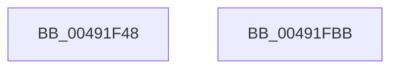

# CcPerfLogReadAhead

- RVA: `0x00491F48`–`0x00491FBC` (길이 `116` bytes)
- VA: `0x0000000140491F48`
- 실행 섹션: `.text`
- PDB 이름 있음: `예`; PDB Function 태그: `아니요`
- unwind 정보 RVA: `0x000AF370`
- 디코드: `27`개 명령, `116/116` bytes 표시
- 미해석 바이트: `0` (있으면 어셈블리에 `.byte`로 보존)

> 이 문서는 커널 이미지의 기계어와 PDB 기호를 분석해 생성했습니다. 4번과 5번은 함수 원형과 자료형을 바이너리 사용 방식에서 추정한 C 해석이며 원본 소스 복구 결과는 아닙니다.

## 1. Dependencies

- 직접 호출 지점: **2**; 고유 호출 대상: **2**
- 직접 호출자로 확인된 함수: **1**
- RIP 상대 이미지 참조: **1**

### Outgoing calls
- `0x00491FA4` → [EtwTraceKernelEvent](../23/EtwTraceKernelEvent_function_00235350.md) (function, `0x00235350`)
- `0x00491FB1` → [_security_check_cookie](../6A/_security_check_cookie_function_006AC640.md) (function, `0x006AC640`)

### Direct callers
- [CcPerformReadAhead](../48/CcPerformReadAhead_function_0048F738.md) at `0x0048FBE3`

### Static image references
- `0x00491F4F` → RVA `0x00E0A740` (`.data`; read)

## 2. Other-region calls and transfers

- 다른 실행 섹션으로 향하는 call: **0**
- 별도 외부 분기/꼬리 이동을 확인하지 못했습니다.

## 3. Assembly (complete function range)

```asm
00491F48  4C 8B DC                        mov r11, rsp
00491F4B  48 83 EC 78                     sub rsp, 0x78
00491F4F  48 8B 05 EA 87 97 00            mov rax, qword ptr [rip + 0x9787ea]
00491F56  48 33 C4                        xor rax, rsp
00491F59  48 89 44 24 60                  mov qword ptr [rsp + 0x60], rax
00491F5E  48 8B 02                        mov rax, qword ptr [rdx]
00491F61  45 33 D2                        xor r10d, r10d
00491F64  49 89 43 D0                     mov qword ptr [r11 - 0x30], rax
00491F68  49 8D 43 C8                     lea rax, [r11 - 0x38]
00491F6C  45 89 43 D8                     mov dword ptr [r11 - 0x28], r8d
00491F70  41 B8 00 00 02 80               mov r8d, 0x80020000
00491F76  49 89 4B C8                     mov qword ptr [r11 - 0x38], rcx
00491F7A  49 8D 4B B8                     lea rcx, [r11 - 0x48]
00491F7E  45 89 4B DC                     mov dword ptr [r11 - 0x24], r9d
00491F82  41 8D 52 01                     lea edx, [r10 + 1]
00491F86  41 B9 03 16 00 00               mov r9d, 0x1603
00491F8C  4D 89 53 E0                     mov qword ptr [r11 - 0x20], r10
00491F90  49 89 43 B8                     mov qword ptr [r11 - 0x48], rax
00491F94  49 C7 43 C0 20 00 00 00         mov qword ptr [r11 - 0x40], 0x20
00491F9C  C7 44 24 20 02 19 50 00         mov dword ptr [rsp + 0x20], 0x501902
00491FA4  E8 A7 33 DA FF                  call 0x140235350
00491FA9  48 8B 4C 24 60                  mov rcx, qword ptr [rsp + 0x60]
00491FAE  48 33 CC                        xor rcx, rsp
00491FB1  E8 8A A6 21 00                  call 0x1406ac640
00491FB6  48 83 C4 78                     add rsp, 0x78
00491FBA  C3                              ret
00491FBB  CC                              int3
```

## 4. C-style interpretation (structured pseudocode)

```c
__int64 __fastcall CcPerfLogReadAhead(__int64 a1, __int64 a2, int a3, int a4)
{
    __int64 result;
    __int64 v_r10;
    __int64 v_rsp;
    unsigned __int64 v_stack_m18;
    unsigned int v_stack_m58;

    v_rsp = (v_rsp) - (120);
    result = (*(unsigned __int64 *)(v_rip + 9930730)) ^ (v_rsp);
    v_stack_m18 = result;
    v_r10 = 0;
    *(unsigned __int64 *)(v_rsp - 48) = *(unsigned __int64 *)(a2);
    *(unsigned int *)(v_rsp - 40) = a3;
    *(unsigned __int64 *)(v_rsp - 56) = a1;
    *(unsigned int *)(v_rsp - 36) = a4;
    *(unsigned __int64 *)(v_rsp - 32) = 0;
    *(unsigned __int64 *)(v_rsp - 72) = v_rsp - 56;
    *(unsigned __int64 *)(v_rsp - 64) = 32;
    v_stack_m58 = 0x501902ULL;
    result = EtwTraceKernelEvent(v_rsp - 72, v_r10 + 1, (unsigned int)(0x80020000ULL), (unsigned int)(0x1603ULL));
    a1 = (v_stack_m18) ^ (v_rsp);
    result = _security_check_cookie(a1, v_r10 + 1, (unsigned int)(0x80020000ULL), (unsigned int)(0x1603ULL));
    v_rsp = (v_rsp) + (120);
    return result;
}
```

## 5. (Beta) C Style

```c
int64_t CcPerfLogReadAhead(int64_t Arg1, void *Arg2, int32_t Arg3, int32_t Arg4)
{
    uint8_t *arg2 = (uint8_t *)Arg2;

    int64_t result;
    int64_t local_r10;
    int64_t local_rsp;
    uint64_t v_stack_m18;
    uint32_t v_stack_m58;

    local_rsp = (local_rsp) - (120);
    result = (*(uint64_t *)(v_rip + 0x9787EA)) ^ (local_rsp);
    v_stack_m18 = result;
    local_r10 = 0;
    *(uint64_t *)(local_rsp - 0x30) = *(uint64_t *)(arg2);
    *(uint32_t *)(local_rsp - 0x28) = Arg3;
    *(uint64_t *)(local_rsp - 0x38) = Arg1;
    *(uint32_t *)(local_rsp - 0x24) = Arg4;
    *(uint64_t *)(local_rsp - 0x20) = 0;
    *(uint64_t *)(local_rsp - 0x48) = local_rsp - 56;
    *(uint64_t *)(local_rsp - 0x40) = 32;
    v_stack_m58 = 0x501902ULL;
    result = EtwTraceKernelEvent(local_rsp - 72, local_r10 + 1, (uint32_t)(0x80020000ULL), (uint32_t)(0x1603ULL));
    Arg1 = (v_stack_m18) ^ (local_rsp);
    result = _security_check_cookie(Arg1, local_r10 + 1, (uint32_t)(0x80020000ULL), (uint32_t)(0x1603ULL));
    local_rsp = (local_rsp) + (120);
    return result;
}
```

### 관측된 메모리 오프셋

구조체 형식이 확인되지 않은 접근은 인자 기준의 오프셋으로만 기록했습니다.

| 기준 인자 | 오프셋 표현 | 폭 (bit) | 접근 |
|---|---:|---:|---|
| `Arg2` | `+ 0x0` | `64` | `R` |

## 6. Execution-region graph

[열기: 2D/3D 그래프와 함수 탐색 컨트롤 패널](../../../control-panel.html?section=text&rva=0x00491F48&view=graph)

- 2D 그래프는 위에서 아래로 흐르고, 3D 그래프는 빈 공간을 드래그해 회전합니다. Shift+드래그는 이동, 휠은 확대·축소, 함수 노드 선택은 대상 보고서 이동입니다.

### Static fallback


