# CcPrepareMdlWrite

- RVA: `0x004996D0`–`0x00499A47` (길이 `887` bytes)
- VA: `0x00000001404996D0`
- 실행 섹션: `.text`
- PDB 이름 있음: `예`; PDB Function 태그: `아니요`
- unwind 정보 RVA: `0x000B44EC`
- 디코드: `210`개 명령, `887/887` bytes 표시
- 미해석 바이트: `0` (있으면 어셈블리에 `.byte`로 보존)

> 이 문서는 커널 이미지의 기계어와 PDB 기호를 분석해 생성했습니다. 4번과 5번은 함수 원형과 자료형을 바이너리 사용 방식에서 추정한 C 해석이며 원본 소스 복구 결과는 아닙니다.

## 1. Dependencies

- 직접 호출 지점: **14**; 고유 호출 대상: **11**
- 직접 호출자로 확인된 함수: **1**
- RIP 상대 이미지 참조: **0**

### Outgoing calls
- `0x00499743` → [CcForceWriteThrough](../38/CcForceWriteThrough_function_00389E50.md) (function, `0x00389E50`)
- `0x00499793` → [CcGetVirtualAddress](../34/CcGetVirtualAddress_function_00340C9C.md) (function, `0x00340C9C`)
- `0x00499800` → [ExAcquireFastMutex](../20/ExAcquireFastMutex_function_0020E5A0.md) (function, `0x0020E5A0`)
- `0x00499816` → [ExReleaseFastMutex](../25/ExReleaseFastMutex_function_002519C0.md) (function, `0x002519C0`)
- `0x0049983D` → [CcMapAndRead](../2F/CcMapAndRead_function_002F6AC0.md) (function, `0x002F6AC0`)
- `0x00499856` → [IoAllocateMdl](../29/IoAllocateMdl_function_0029EBF0.md) (function, `0x0029EBF0`)
- `0x004998AB` → [MmProbeAndLockPages](../23/MmProbeAndLockPages_function_0023B990.md) (function, `0x0023B990`)
- `0x004998CF` → [ExAcquireFastMutex](../20/ExAcquireFastMutex_function_0020E5A0.md) (function, `0x0020E5A0`)
- `0x004998E1` → [ExReleaseFastMutex](../25/ExReleaseFastMutex_function_002519C0.md) (function, `0x002519C0`)
- `0x0049990F` → [KeSetEvent](../33/KeSetEvent_function_0033F310.md) (function, `0x0033F310`)
- `0x004999AE` → [RtlRaiseStatus](../2F/RtlRaiseStatus_function_002F6A50.md) (function, `0x002F6A50`)
- `0x00499A08` → [KeAcquireInStackQueuedSpinLock](../27/KeAcquireInStackQueuedSpinLock_function_002757A0.md) (function, `0x002757A0`)
- `0x00499A23` → [KeReleaseInStackQueuedSpinLock](../34/KeReleaseInStackQueuedSpinLock_function_00342CE0.md) (function, `0x00342CE0`)
- `0x00499A41` → [RtlRaiseStatus](../2F/RtlRaiseStatus_function_002F6A50.md) (function, `0x002F6A50`)

### Direct callers
- [FsRtlPrepareMdlWriteDev](../../page/71/FsRtlPrepareMdlWriteDev_function_00713BB0.md) at `0x00713E6D`

### Static image references
- 디코드된 RIP-relative 메모리 참조가 없습니다.

## 2. Other-region calls and transfers

- 다른 실행 섹션으로 향하는 call: **0**
- 별도 외부 분기/꼬리 이동을 확인하지 못했습니다.

## 3. Assembly (complete function range)

```asm
004996D0  4C 8B DC                        mov r11, rsp
004996D3  4D 89 4B 20                     mov qword ptr [r11 + 0x20], r9
004996D7  45 89 43 18                     mov dword ptr [r11 + 0x18], r8d
004996DB  49 89 53 10                     mov qword ptr [r11 + 0x10], rdx
004996DF  53                              push rbx
004996E0  56                              push rsi
004996E1  57                              push rdi
004996E2  41 54                           push r12
004996E4  41 55                           push r13
004996E6  41 56                           push r14
004996E8  41 57                           push r15
004996EA  48 81 EC C0 00 00 00            sub rsp, 0xc0
004996F1  4D 8B E9                        mov r13, r9
004996F4  41 8B F8                        mov edi, r8d
004996F7  48 8B DA                        mov rbx, rdx
004996FA  45 33 C0                        xor r8d, r8d
004996FD  4C 89 44 24 48                  mov qword ptr [rsp + 0x48], r8
00499702  4C 89 44 24 40                  mov qword ptr [rsp + 0x40], r8
00499707  44 89 44 24 34                  mov dword ptr [rsp + 0x34], r8d
0049970C  45 8B F8                        mov r15d, r8d
0049970F  44 89 44 24 3C                  mov dword ptr [rsp + 0x3c], r8d
00499714  4C 89 44 24 50                  mov qword ptr [rsp + 0x50], r8
00499719  0F 57 C0                        xorps xmm0, xmm0
0049971C  33 C0                           xor eax, eax
0049971E  41 0F 11 43 88                  movups xmmword ptr [r11 - 0x78], xmm0
00499723  49 89 43 98                     mov qword ptr [r11 - 0x68], rax
00499727  48 8B 41 28                     mov rax, qword ptr [rcx + 0x28]
0049972B  48 8B 70 08                     mov rsi, qword ptr [rax + 8]
0049972F  48 89 74 24 60                  mov qword ptr [rsp + 0x60], rsi
00499734  8B 41 50                        mov eax, dword ptr [rcx + 0x50]
00499737  A8 10                           test al, 0x10
00499739  75 18                           jne 0x140499753
0049973B  45 33 C9                        xor r9d, r9d
0049973E  4C 8B C6                        mov r8, rsi
00499741  8B D7                           mov edx, edi
00499743  E8 08 07 EF FF                  call 0x140389e50
00499748  45 33 C0                        xor r8d, r8d
0049974B  84 C0                           test al, al
0049974D  0F 85 E9 02 00 00               jne 0x140499a3c
00499753  48 8B 1B                        mov rbx, qword ptr [rbx]
00499756  48 89 5C 24 58                  mov qword ptr [rsp + 0x58], rbx
0049975B  4C 8B F3                        mov r14, rbx
0049975E  4C 8B E3                        mov r12, rbx
00499761  85 FF                           test edi, edi
00499763  0F 84 77 02 00 00               je 0x1404999e0
00499769  44 89 84 24 00 01 00 00         mov dword ptr [rsp + 0x100], r8d
00499771  4C 89 44 24 68                  mov qword ptr [rsp + 0x68], r8
00499776  44 89 44 24 28                  mov dword ptr [rsp + 0x28], r8d
0049977B  44 89 44 24 20                  mov dword ptr [rsp + 0x20], r8d
00499780  4C 8D 8C 24 00 01 00 00         lea r9, [rsp + 0x100]
00499788  4C 8D 44 24 50                  lea r8, [rsp + 0x50]
0049978D  48 8B D3                        mov rdx, rbx
00499790  48 8B CE                        mov rcx, rsi
00499793  E8 04 75 EA FF                  call 0x140340c9c
00499798  48 89 44 24 70                  mov qword ptr [rsp + 0x70], rax
0049979D  49 8B CE                        mov rcx, r14
004997A0  44 8B BC 24 00 01 00 00         mov r15d, dword ptr [rsp + 0x100]
004997A8  44 3B FF                        cmp r15d, edi
004997AB  76 0D                           jbe 0x1404997ba
004997AD  44 8B FF                        mov r15d, edi
004997B0  89 BC 24 00 01 00 00            mov dword ptr [rsp + 0x100], edi
004997B7  49 8B CC                        mov rcx, r12
004997BA  45 8B F7                        mov r14d, r15d
004997BD  4C 03 F1                        add r14, rcx
004997C0  4C 89 74 24 68                  mov qword ptr [rsp + 0x68], r14
004997C5  BF 02 00 00 00                  mov edi, 2
004997CA  89 7C 24 30                     mov dword ptr [rsp + 0x30], edi
004997CE  B9 FF 0F 00 00                  mov ecx, 0xfff
004997D3  85 D9                           test ecx, ebx
004997D5  0F 84 A6 01 00 00               je 0x140499981
004997DB  44 85 F1                        test ecx, r14d
004997DE  75 07                           jne 0x1404997e7
004997E0  83 CF 04                        or edi, 4
004997E3  89 7C 24 30                     mov dword ptr [rsp + 0x30], edi
004997E7  48 89 5C 24 40                  mov qword ptr [rsp + 0x40], rbx
004997EC  81 E3 00 F0 FF FF               and ebx, 0xfffff000
004997F2  89 5C 24 40                     mov dword ptr [rsp + 0x40], ebx
004997F6  4C 8D A6 20 01 00 00            lea r12, [rsi + 0x120]
004997FD  49 8B CC                        mov rcx, r12
00499800  E8 9B 4D D7 FF                  call 0x14020e5a0
00499805  48 8B 5E 30                     mov rbx, qword ptr [rsi + 0x30]
00499809  48 2B 5C 24 40                  sub rbx, qword ptr [rsp + 0x40]
0049980E  48 89 5C 24 40                  mov qword ptr [rsp + 0x40], rbx
00499813  49 8B CC                        mov rcx, r12
00499816  E8 A5 81 DB FF                  call 0x1402519c0
0049981B  48 85 DB                        test rbx, rbx
0049981E  0F 8E 51 01 00 00               jle 0x140499975
00499824  81 FB 00 10 00 00               cmp ebx, 0x1000
0049982A  0F 86 69 01 00 00               jbe 0x140499999
00499830  4C 8B 4C 24 70                  mov r9, qword ptr [rsp + 0x70]
00499835  41 B0 01                        mov r8b, 1
00499838  8B D7                           mov edx, edi
0049983A  41 8B CF                        mov ecx, r15d
0049983D  E8 7E D2 E5 FF                  call 0x1402f6ac0
00499842  48 83 64 24 20 00               and qword ptr [rsp + 0x20], 0
00499848  45 33 C9                        xor r9d, r9d
0049984B  45 33 C0                        xor r8d, r8d
0049984E  41 8B D7                        mov edx, r15d
00499851  48 8B 4C 24 70                  mov rcx, qword ptr [rsp + 0x70]
00499856  E8 95 53 E0 FF                  call 0x14029ebf0
0049985B  48 89 44 24 48                  mov qword ptr [rsp + 0x48], rax
00499860  48 85 C0                        test rax, rax
00499863  0F 84 40 01 00 00               je 0x1404999a9
00499869  65 48 8B 04 25 88 01 00 00      mov rax, qword ptr gs:[0x188]
00499872  48 89 84 24 98 00 00 00         mov qword ptr [rsp + 0x98], rax
0049987A  0F B6 98 AD 05 00 00            movzx ebx, byte ptr [rax + 0x5ad]
00499881  8D 43 02                        lea eax, [rbx + 2]
00499884  89 44 24 34                     mov dword ptr [rsp + 0x34], eax
00499888  65 48 8B 04 25 88 01 00 00      mov rax, qword ptr gs:[0x188]
00499891  48 89 84 24 A0 00 00 00         mov qword ptr [rsp + 0xa0], rax
00499899  C6 80 AD 05 00 00 01            mov byte ptr [rax + 0x5ad], 1
004998A0  33 D2                           xor edx, edx
004998A2  44 8D 42 01                     lea r8d, [rdx + 1]
004998A6  48 8B 4C 24 48                  mov rcx, qword ptr [rsp + 0x48]
004998AB  E8 E0 20 DA FF                  call 0x14023b990
004998B0  65 48 8B 04 25 88 01 00 00      mov rax, qword ptr gs:[0x188]
004998B9  48 89 84 24 A8 00 00 00         mov qword ptr [rsp + 0xa8], rax
004998C1  88 98 AD 05 00 00               mov byte ptr [rax + 0x5ad], bl
004998C7  83 64 24 34 00                  and dword ptr [rsp + 0x34], 0
004998CC  49 8B CC                        mov rcx, r12
004998CF  E8 CC 4C D7 FF                  call 0x14020e5a0
004998D4  4C 3B 76 30                     cmp r14, qword ptr [rsi + 0x30]
004998D8  0F 8F D5 00 00 00               jg 0x1404999b3
004998DE  49 8B CC                        mov rcx, r12
004998E1  E8 DA 80 DB FF                  call 0x1402519c0
004998E6  48 8B 44 24 50                  mov rax, qword ptr [rsp + 0x50]
004998EB  48 8B 58 08                     mov rbx, qword ptr [rax + 8]
004998EF  83 C9 FF                        or ecx, 0xffffffff
004998F2  F0 0F C1 48 10                  lock xadd dword ptr [rax + 0x10], ecx
004998F7  FF C9                           dec ecx
004998F9  45 33 C0                        xor r8d, r8d
004998FC  66 85 C9                        test cx, cx
004998FF  75 1D                           jne 0x14049991e
00499901  48 8B 8B C0 00 00 00            mov rcx, qword ptr [rbx + 0xc0]
00499908  48 85 C9                        test rcx, rcx
0049990B  74 0A                           je 0x140499917
0049990D  33 D2                           xor edx, edx
0049990F  E8 FC 59 EA FF                  call 0x14033f310
00499914  45 33 C0                        xor r8d, r8d
00499917  F0 FF 8B 28 02 00 00            lock dec dword ptr [rbx + 0x228]
0049991E  4C 89 44 24 50                  mov qword ptr [rsp + 0x50], r8
00499923  49 8B 4D 00                     mov rcx, qword ptr [r13]
00499927  48 85 C9                        test rcx, rcx
0049992A  0F 85 8C 00 00 00               jne 0x1404999bc
00499930  48 8B 44 24 48                  mov rax, qword ptr [rsp + 0x48]
00499935  49 89 45 00                     mov qword ptr [r13], rax
00499939  4C 89 44 24 48                  mov qword ptr [rsp + 0x48], r8
0049993E  49 8B DE                        mov rbx, r14
00499941  48 89 5C 24 58                  mov qword ptr [rsp + 0x58], rbx
00499946  4D 8B E6                        mov r12, r14
00499949  44 8B 7C 24 3C                  mov r15d, dword ptr [rsp + 0x3c]
0049994E  44 03 BC 24 00 01 00 00         add r15d, dword ptr [rsp + 0x100]
00499956  44 89 7C 24 3C                  mov dword ptr [rsp + 0x3c], r15d
0049995B  8B BC 24 10 01 00 00            mov edi, dword ptr [rsp + 0x110]
00499962  2B BC 24 00 01 00 00            sub edi, dword ptr [rsp + 0x100]
00499969  89 BC 24 10 01 00 00            mov dword ptr [rsp + 0x110], edi
00499970  E9 EC FD FF FF                  jmp 0x140499761
00499975  83 CF 07                        or edi, 7
00499978  89 7C 24 30                     mov dword ptr [rsp + 0x30], edi
0049997C  E9 AF FE FF FF                  jmp 0x140499830
00499981  B8 03 00 00 00                  mov eax, 3
00499986  41 81 FF 00 10 00 00            cmp r15d, 0x1000
0049998D  0F 43 F8                        cmovae edi, eax
00499990  89 7C 24 30                     mov dword ptr [rsp + 0x30], edi
00499994  E9 42 FE FF FF                  jmp 0x1404997db
00499999  83 7C 24 44 00                  cmp dword ptr [rsp + 0x44], 0
0049999E  0F 85 8C FE FF FF               jne 0x140499830
004999A4  83 CF 06                        or edi, 6
004999A7  EB CF                           jmp 0x140499978
004999A9  B9 9A 00 00 C0                  mov ecx, 0xc000009a
004999AE  E8 9D D0 E5 FF                  call 0x1402f6a50
004999B3  4C 89 76 30                     mov qword ptr [rsi + 0x30], r14
004999B7  E9 22 FF FF FF                  jmp 0x1404998de
004999BC  48 89 4C 24 78                  mov qword ptr [rsp + 0x78], rcx
004999C1  48 8B 01                        mov rax, qword ptr [rcx]
004999C4  48 85 C0                        test rax, rax
004999C7  74 0A                           je 0x1404999d3
004999C9  48 8B C8                        mov rcx, rax
004999CC  48 89 44 24 78                  mov qword ptr [rsp + 0x78], rax
004999D1  EB EE                           jmp 0x1404999c1
004999D3  48 8B 44 24 48                  mov rax, qword ptr [rsp + 0x48]
004999D8  48 89 01                        mov qword ptr [rcx], rax
004999DB  E9 59 FF FF FF                  jmp 0x140499939
004999E0  48 8B 96 18 02 00 00            mov rdx, qword ptr [rsi + 0x218]
004999E7  48 8B 8C 24 20 01 00 00         mov rcx, qword ptr [rsp + 0x120]
004999EF  44 89 01                        mov dword ptr [rcx], r8d
004999F2  41 8B C7                        mov eax, r15d
004999F5  48 89 41 08                     mov qword ptr [rcx + 8], rax
004999F9  48 8D 8A 00 03 00 00            lea rcx, [rdx + 0x300]
00499A00  48 8D 94 24 80 00 00 00         lea rdx, [rsp + 0x80]
00499A08  E8 93 BD DD FF                  call 0x1402757a0
00499A0D  8B 46 04                        mov eax, dword ptr [rsi + 4]
00499A10  FF C0                           inc eax
00499A12  89 46 04                        mov dword ptr [rsi + 4], eax
00499A15  FF 86 20 02 00 00               inc dword ptr [rsi + 0x220]
00499A1B  48 8D 8C 24 80 00 00 00         lea rcx, [rsp + 0x80]
00499A23  E8 B8 92 EA FF                  call 0x140342ce0
00499A28  48 81 C4 C0 00 00 00            add rsp, 0xc0
00499A2F  41 5F                           pop r15
00499A31  41 5E                           pop r14
00499A33  41 5D                           pop r13
00499A35  41 5C                           pop r12
00499A37  5F                              pop rdi
00499A38  5E                              pop rsi
00499A39  5B                              pop rbx
00499A3A  C3                              ret
00499A3B  CC                              int3
00499A3C  B9 9A 00 00 C0                  mov ecx, 0xc000009a
00499A41  E8 0A D0 E5 FF                  call 0x1402f6a50
00499A46  90                              nop
```

## 4. C-style interpretation (structured pseudocode)

```c
__int64 __fastcall CcPrepareMdlWrite(__int64 a1, __int64 a2, int a3, __int64 a4, __int64 a5)
{
    __int64 result;
    __int64 v_r14;
    __int64 v_r15;
    __int64 v_rbx;
    __int64 v_rdi;
    __int64 v_rsp;
    unsigned __int64 v_stack_m50;
    unsigned __int64 v_stack_m58;
    unsigned __int64 v_stack_m60;
    unsigned __int64 v_stack_m78;
    unsigned __int64 v_stack_m80;
    unsigned __int64 v_stack_m88;
    unsigned __int64 v_stack_m90;
    unsigned __int64 v_stack_m98;
    unsigned __int64 v_stack_mA0;
    unsigned __int64 v_stack_mA8;
    unsigned __int64 v_stack_mB0;
    unsigned int v_stack_mB4;
    unsigned __int64 v_stack_mB8;
    unsigned int v_stack_mBC;
    unsigned int v_stack_mC4;
    unsigned int v_stack_mC8;
    unsigned int v_stack_mD0;
    unsigned int v_stack_mD8;
    unsigned int v_stack_p18;
    unsigned int v_stack_p8;

    *(unsigned __int64 *)(v_rsp + 32) = a4;
    *(unsigned int *)(v_rsp + 24) = a3;
    *(unsigned __int64 *)(v_rsp + 16) = a2;
    v_rsp = (v_rsp) - (192);
    a3 = 0;
    v_stack_mB0 = 0;
    v_stack_mB8 = 0;
    v_stack_mC4 = 0;
    v_stack_mBC = 0;
    v_stack_mA8 = 0;
    result = 0;
    *(unsigned __int64 *)(v_rsp - 120) = v_xmm0;
    *(unsigned __int64 *)(v_rsp - 104) = 0;
    v_stack_m98 = *(unsigned __int64 *)(*(unsigned __int64 *)(a1 + 40) + 8);
    if ((((unsigned __int8)((unsigned int)(*(unsigned int *)(a1 + 80)))) & (16)) != 0) goto loc_00499753;
    a4 = 0;
    result = CcForceWriteThrough(a1, (unsigned int)((unsigned int)((unsigned int)(a3))), *(unsigned __int64 *)(*(unsigned __int64 *)(a1 + 40) + 8), a4);
    a3 = 0;
    if ((unsigned __int8)(result) != 0) goto loc_00499A3C;
loc_00499753:
    v_stack_mA0 = *(unsigned __int64 *)(a2);
loc_00499761:
    if ((unsigned int)((unsigned int)(a3)) == 0) goto loc_004999E0;
    v_stack_p8 = 0;
    v_stack_m90 = 0;
    v_stack_mD0 = 0;
    v_stack_mD8 = 0;
    result = CcGetVirtualAddress(*(unsigned __int64 *)(*(unsigned __int64 *)(a1 + 40) + 8), *(unsigned __int64 *)(a2), v_stack_mA8, v_stack_p8);
    v_stack_m88 = result;
    v_r15 = (unsigned int)(v_stack_p8);
    if (((unsigned int)((unsigned int)(v_stack_p8))) >= = ((unsigned int)((unsigned int)(a3)))) {
        v_r15 = (unsigned int)((unsigned int)(a3));
        v_stack_p8 = (unsigned int)((unsigned int)(a3));
        a1 = *(unsigned __int64 *)(a2);
    }
    v_r14 = ((unsigned int)((unsigned int)(v_r15))) + (a1);
    v_stack_m90 = v_r14;
    v_stack_mC8 = 2;
    if ((((unsigned int)((unsigned int)(0xFFFULL))) & ((unsigned int)(*(unsigned __int64 *)(a2)))) == 0) goto loc_00499981;
loc_004997DB:
    v_rdi = 2;
    if ((((unsigned int)((unsigned int)(0xFFFULL))) & ((unsigned int)(v_r14))) == 0) {
        v_rdi = (unsigned int)((2) | (4));
        v_stack_mC8 = (unsigned int)(v_rdi);
    }
    v_stack_mB8 = *(unsigned __int64 *)(a2);
    v_rbx = (unsigned int)((*(unsigned __int64 *)(a2)) & (0xFFFFF000ULL));
    v_stack_mB8 = (unsigned int)(v_rbx);
    result = ExAcquireFastMutex(*(unsigned __int64 *)(*(unsigned __int64 *)(a1 + 40) + 8) + 288, *(unsigned __int64 *)(a2), v_stack_mA8, v_stack_p8);
    v_rbx = (*(unsigned __int64 *)(*(unsigned __int64 *)(*(unsigned __int64 *)(a1 + 40) + 8) + 48)) - (v_stack_mB8);
    v_stack_mB8 = v_rbx;
    result = ExReleaseFastMutex(*(unsigned __int64 *)(*(unsigned __int64 *)(a1 + 40) + 8) + 288, *(unsigned __int64 *)(a2), v_stack_mA8, v_stack_p8);
    if (condition_is_less_or_equal) goto loc_00499975;
    if (((unsigned int)(v_rbx)) <= 0x1000ULL) goto loc_00499999;
loc_00499830:
    result = CcMapAndRead((unsigned int)((unsigned int)(v_r15)), (unsigned int)((unsigned int)(v_rdi)), 1, v_stack_m88);
    a4 = 0;
    a3 = 0;
    result = IoAllocateMdl(v_stack_m88, (unsigned int)((unsigned int)(v_r15)), a3, a4);
    v_stack_mB0 = result;
    if (result == 0) goto loc_004999A9;
    v_stack_m60 = *(unsigned __int64 *)(gs_base + (0 + 392));
    v_stack_mC4 = (unsigned int)(*(unsigned __int8 *)(*(unsigned __int64 *)(gs_base + (0 + 392)) + 1453) + 2);
    v_stack_m58 = *(unsigned __int64 *)(gs_base + (0 + 392));
    *(unsigned __int8 *)(*(unsigned __int64 *)(gs_base + (0 + 392)) + 1453) = 1;
    a2 = 0;
    result = MmProbeAndLockPages(v_stack_mB0, a2, a2 + 1, a4);
    v_stack_m50 = *(unsigned __int64 *)(gs_base + (0 + 392));
    *(unsigned __int8 *)(*(unsigned __int64 *)(gs_base + (0 + 392)) + 1453) = (unsigned __int8)(*(unsigned __int8 *)(*(unsigned __int64 *)(gs_base + (0 + 392)) + 1453));
    result = ExAcquireFastMutex(*(unsigned __int64 *)(*(unsigned __int64 *)(a1 + 40) + 8) + 288, a2, a2 + 1, a4);
    if (v_r14 > (*(unsigned __int64 *)(*(unsigned __int64 *)(*(unsigned __int64 *)(a1 + 40) + 8) + 48))) goto loc_004999B3;
loc_004998DE:
    result = ExReleaseFastMutex(*(unsigned __int64 *)(*(unsigned __int64 *)(a1 + 40) + 8) + 288, a2, a2 + 1, a4);
    a1 = (unsigned int)((*(unsigned __int64 *)(*(unsigned __int64 *)(a1 + 40) + 8) + 288) | (0xFFFFFFFFULL));
    a1 = (unsigned int)((a1) - 1);
    a3 = 0;
    if ((unsigned __int16)(a1) != 0) goto loc_0049991E;
    result = v_stack_mA8;
    if (*(unsigned __int64 *)(*(unsigned __int64 *)(v_stack_mA8 + 8) + 192) != 0) {
        a2 = 0;
        result = KeSetEvent(*(unsigned __int64 *)(*(unsigned __int64 *)(v_stack_mA8 + 8) + 192), a2, a3, a4);
        a3 = 0;
    }
loc_0049991E:
    v_stack_mA8 = 0;
    if (*(unsigned __int64 *)(a4) != 0) goto loc_004999BC;
    *(unsigned __int64 *)(a4) = v_stack_mB0;
loc_00499939:
    v_stack_mB0 = 0;
    v_stack_mA0 = v_r14;
    v_r15 = (unsigned int)(((unsigned int)(v_stack_mBC)) + (v_stack_p8));
    v_stack_mBC = (unsigned int)(v_r15);
    v_rdi = (unsigned int)(((unsigned int)(v_stack_p18)) - (v_stack_p8));
    v_stack_p18 = (unsigned int)(v_rdi);
    goto loc_00499761;
loc_00499975:
    v_rdi = (unsigned int)((v_rdi) | (7));
loc_00499978:
    v_stack_mC8 = (unsigned int)(v_rdi);
    goto loc_00499830;
loc_00499981:
    if (((unsigned int)(v_r15)) >= 0x1000ULL) { v_rdi = 3; }
    v_stack_mC8 = (unsigned int)(v_rdi);
    goto loc_004997DB;
loc_00499999:
    if (v_stack_mB4 != 0) goto loc_00499830;
    v_rdi = (unsigned int)((v_rdi) | (6));
    goto loc_00499978;
loc_004999A9:
    result = RtlRaiseStatus((unsigned int)(0xC000009AULL), a2, a3, a4);
loc_004999B3:
    *(unsigned __int64 *)(*(unsigned __int64 *)(*(unsigned __int64 *)(a1 + 40) + 8) + 48) = v_r14;
    goto loc_004998DE;
loc_004999BC:
    v_stack_m80 = (unsigned int)(0xC000009AULL);
loc_004999C1:
    if (*(unsigned __int64 *)((unsigned int)(0xC000009AULL)) == 0) goto loc_004999D3;
    v_stack_m80 = *(unsigned __int64 *)((unsigned int)(0xC000009AULL));
    goto loc_004999C1;
loc_004999D3:
    *(unsigned __int64 *)(*(unsigned __int64 *)((unsigned int)(0xC000009AULL))) = v_stack_mB0;
    goto loc_00499939;
loc_004999E0:
    *(unsigned int *)(a5) = 0;
    *(unsigned __int64 *)(a5 + 8) = (unsigned int)((unsigned int)(v_r15));
    result = KeAcquireInStackQueuedSpinLock(*(unsigned __int64 *)(*(unsigned __int64 *)(*(unsigned __int64 *)(a1 + 40) + 8) + 536) + 768, v_stack_m78, a3, a4);
    result = (unsigned int)(((unsigned int)(*(unsigned int *)(*(unsigned __int64 *)(*(unsigned __int64 *)(a1 + 40) + 8) + 4))) + 1);
    *(unsigned int *)(*(unsigned __int64 *)(*(unsigned __int64 *)(a1 + 40) + 8) + 4) = (unsigned int)(result);
    result = KeReleaseInStackQueuedSpinLock(v_stack_m78, v_stack_m78, a3, a4);
    v_rsp = (v_rsp) + (192);
    return result;
loc_00499A3C:
    result = RtlRaiseStatus((unsigned int)(0xC000009AULL), v_stack_m78, a3, a4);
    return result;
}
```

## 5. (Beta) C Style

```c
int64_t CcPrepareMdlWrite(void *Arg1, void *Arg2, int32_t Arg3, void *Arg4, void *Arg5)
{
    uint8_t *arg1 = (uint8_t *)Arg1;
    uint8_t *arg2 = (uint8_t *)Arg2;
    uint8_t *arg4 = (uint8_t *)Arg4;
    uint8_t *arg5 = (uint8_t *)Arg5;

    int64_t result;
    int64_t local_r14;
    int64_t local_r15;
    int64_t local_rbx;
    int64_t local_rdi;
    int64_t local_rsp;
    uint64_t v_stack_m50;
    uint64_t v_stack_m58;
    uint64_t v_stack_m60;
    uint64_t v_stack_m78;
    uint64_t v_stack_m80;
    uint64_t v_stack_m88;
    uint64_t v_stack_m90;
    uint64_t v_stack_m98;
    uint64_t v_stack_mA0;
    uint64_t v_stack_mA8;
    uint64_t v_stack_mB0;
    uint32_t v_stack_mB4;
    uint64_t v_stack_mB8;
    uint32_t v_stack_mBC;
    uint32_t v_stack_mC4;
    uint32_t v_stack_mC8;
    uint32_t v_stack_mD0;
    uint32_t v_stack_mD8;
    uint32_t v_stack_p18;
    uint32_t v_stack_p8;

    *(void **)(local_rsp + 0x20) = Arg4;
    *(uint32_t *)(local_rsp + 0x18) = Arg3;
    *(void **)(local_rsp + 0x10) = Arg2;
    local_rsp = (local_rsp) - (192);
    Arg3 = 0;
    v_stack_mB0 = 0;
    v_stack_mB8 = 0;
    v_stack_mC4 = 0;
    v_stack_mBC = 0;
    v_stack_mA8 = 0;
    result = 0;
    *(uint64_t *)(local_rsp - 0x78) = v_xmm0;
    *(uint64_t *)(local_rsp - 0x68) = 0;
    v_stack_m98 = *(uint64_t *)(*(uint64_t *)(arg1 + 0x28) + 0x8);
    if ((((uint8_t)((uint32_t)(*(uint32_t *)(arg1 + 0x50)))) & (16)) != 0) goto loc_00499753;
    Arg4 = 0;
    result = CcForceWriteThrough(Arg1, (uint32_t)((uint32_t)((uint32_t)(Arg3))), *(uint64_t *)(*(uint64_t *)(arg1 + 0x28) + 0x8), Arg4);
    Arg3 = 0;
    if ((uint8_t)(result) != 0) goto loc_00499A3C;
loc_00499753:
    v_stack_mA0 = *(uint64_t *)(arg2);
loc_00499761:
    if ((uint32_t)((uint32_t)(Arg3)) == 0) goto loc_004999E0;
    v_stack_p8 = 0;
    v_stack_m90 = 0;
    v_stack_mD0 = 0;
    v_stack_mD8 = 0;
    result = CcGetVirtualAddress(*(uint64_t *)(*(uint64_t *)(arg1 + 0x28) + 0x8), *(uint64_t *)(arg2), v_stack_mA8, v_stack_p8);
    v_stack_m88 = result;
    local_r15 = (uint32_t)(v_stack_p8);
    if (((uint32_t)((uint32_t)(v_stack_p8))) >= = ((uint32_t)((uint32_t)(Arg3)))) {
        local_r15 = (uint32_t)((uint32_t)(Arg3));
        v_stack_p8 = (uint32_t)((uint32_t)(Arg3));
        Arg1 = *(uint64_t *)(arg2);
    }
    local_r14 = ((uint32_t)((uint32_t)(local_r15))) + (Arg1);
    v_stack_m90 = local_r14;
    v_stack_mC8 = 2;
    if ((((uint32_t)((uint32_t)(0xFFFULL))) & ((uint32_t)(*(uint64_t *)(arg2)))) == 0) goto loc_00499981;
loc_004997DB:
    local_rdi = 2;
    if ((((uint32_t)((uint32_t)(0xFFFULL))) & ((uint32_t)(local_r14))) == 0) {
        local_rdi = (uint32_t)((2) | (4));
        v_stack_mC8 = (uint32_t)(local_rdi);
    }
    v_stack_mB8 = *(uint64_t *)(arg2);
    local_rbx = (uint32_t)((*(uint64_t *)(arg2)) & (0xFFFFF000ULL));
    v_stack_mB8 = (uint32_t)(local_rbx);
    result = ExAcquireFastMutex(*(uint64_t *)(*(uint64_t *)(arg1 + 0x28) + 0x8) + 288, *(uint64_t *)(arg2), v_stack_mA8, v_stack_p8);
    local_rbx = (*(uint64_t *)(*(uint64_t *)(*(uint64_t *)(arg1 + 0x28) + 0x8) + 0x30)) - (v_stack_mB8);
    v_stack_mB8 = local_rbx;
    result = ExReleaseFastMutex(*(uint64_t *)(*(uint64_t *)(arg1 + 0x28) + 0x8) + 288, *(uint64_t *)(arg2), v_stack_mA8, v_stack_p8);
    if (condition_is_less_or_equal) goto loc_00499975;
    if (((uint32_t)(local_rbx)) <= 0x1000ULL) goto loc_00499999;
loc_00499830:
    result = CcMapAndRead((uint32_t)((uint32_t)(local_r15)), (uint32_t)((uint32_t)(local_rdi)), 1, v_stack_m88);
    Arg4 = 0;
    Arg3 = 0;
    result = IoAllocateMdl(v_stack_m88, (uint32_t)((uint32_t)(local_r15)), Arg3, Arg4);
    v_stack_mB0 = result;
    if (result == 0) goto loc_004999A9;
    v_stack_m60 = *(uint64_t *)(gs_base + (0 + 0x188));
    v_stack_mC4 = (uint32_t)(*(uint8_t *)(*(uint64_t *)(gs_base + (0 + 0x188)) + 0x5AD) + 2);
    v_stack_m58 = *(uint64_t *)(gs_base + (0 + 0x188));
    *(uint8_t *)(*(uint64_t *)(gs_base + (0 + 0x188)) + 0x5AD) = 1;
    Arg2 = 0;
    result = MmProbeAndLockPages(v_stack_mB0, Arg2, Arg2 + 1, Arg4);
    v_stack_m50 = *(uint64_t *)(gs_base + (0 + 0x188));
    *(uint8_t *)(*(uint64_t *)(gs_base + (0 + 0x188)) + 0x5AD) = (uint8_t)(*(uint8_t *)(*(uint64_t *)(gs_base + (0 + 0x188)) + 0x5AD));
    result = ExAcquireFastMutex(*(uint64_t *)(*(uint64_t *)(arg1 + 0x28) + 0x8) + 288, Arg2, Arg2 + 1, Arg4);
    if (local_r14 > (*(uint64_t *)(*(uint64_t *)(*(uint64_t *)(arg1 + 0x28) + 0x8) + 0x30))) goto loc_004999B3;
loc_004998DE:
    result = ExReleaseFastMutex(*(uint64_t *)(*(uint64_t *)(arg1 + 0x28) + 0x8) + 288, Arg2, Arg2 + 1, Arg4);
    Arg1 = (uint32_t)((*(uint64_t *)(*(uint64_t *)(arg1 + 0x28) + 0x8) + 288) | (0xFFFFFFFFULL));
    Arg1 = (uint32_t)((Arg1) - 1);
    Arg3 = 0;
    if ((uint16_t)(Arg1) != 0) goto loc_0049991E;
    result = v_stack_mA8;
    if (*(uint64_t *)(*(uint64_t *)(v_stack_mA8 + 0x8) + 0xC0) != 0) {
        Arg2 = 0;
        result = KeSetEvent(*(uint64_t *)(*(uint64_t *)(v_stack_mA8 + 0x8) + 0xC0), Arg2, Arg3, Arg4);
        Arg3 = 0;
    }
loc_0049991E:
    v_stack_mA8 = 0;
    if (*(uint64_t *)(arg4) != 0) goto loc_004999BC;
    *(uint64_t *)(arg4) = v_stack_mB0;
loc_00499939:
    v_stack_mB0 = 0;
    v_stack_mA0 = local_r14;
    local_r15 = (uint32_t)(((uint32_t)(v_stack_mBC)) + (v_stack_p8));
    v_stack_mBC = (uint32_t)(local_r15);
    local_rdi = (uint32_t)(((uint32_t)(v_stack_p18)) - (v_stack_p8));
    v_stack_p18 = (uint32_t)(local_rdi);
    goto loc_00499761;
loc_00499975:
    local_rdi = (uint32_t)((local_rdi) | (7));
loc_00499978:
    v_stack_mC8 = (uint32_t)(local_rdi);
    goto loc_00499830;
loc_00499981:
    if (((uint32_t)(local_r15)) >= 0x1000ULL) { local_rdi = 3; }
    v_stack_mC8 = (uint32_t)(local_rdi);
    goto loc_004997DB;
loc_00499999:
    if (v_stack_mB4 != 0) goto loc_00499830;
    local_rdi = (uint32_t)((local_rdi) | (6));
    goto loc_00499978;
loc_004999A9:
    result = RtlRaiseStatus((uint32_t)(0xC000009AULL), Arg2, Arg3, Arg4);
loc_004999B3:
    *(uint64_t *)(*(uint64_t *)(*(uint64_t *)(arg1 + 0x28) + 0x8) + 0x30) = local_r14;
    goto loc_004998DE;
loc_004999BC:
    v_stack_m80 = (uint32_t)(0xC000009AULL);
loc_004999C1:
    if (*(uint64_t *)((uint32_t)(0xC000009AULL)) == 0) goto loc_004999D3;
    v_stack_m80 = *(uint64_t *)((uint32_t)(0xC000009AULL));
    goto loc_004999C1;
loc_004999D3:
    *(uint64_t *)(*(uint64_t *)((uint32_t)(0xC000009AULL))) = v_stack_mB0;
    goto loc_00499939;
loc_004999E0:
    *(uint32_t *)(arg5) = 0;
    *(uint64_t *)(arg5 + 0x8) = (uint32_t)((uint32_t)(local_r15));
    result = KeAcquireInStackQueuedSpinLock(*(uint64_t *)(*(uint64_t *)(*(uint64_t *)(arg1 + 0x28) + 0x8) + 0x218) + 768, v_stack_m78, Arg3, Arg4);
    result = (uint32_t)(((uint32_t)(*(uint32_t *)(*(uint64_t *)(*(uint64_t *)(arg1 + 0x28) + 0x8) + 0x4))) + 1);
    *(uint32_t *)(*(uint64_t *)(*(uint64_t *)(arg1 + 0x28) + 0x8) + 0x4) = (uint32_t)(result);
    result = KeReleaseInStackQueuedSpinLock(v_stack_m78, v_stack_m78, Arg3, Arg4);
    local_rsp = (local_rsp) + (192);
    return result;
loc_00499A3C:
    result = RtlRaiseStatus((uint32_t)(0xC000009AULL), v_stack_m78, Arg3, Arg4);
    return result;
}
```

### 관측된 메모리 오프셋

구조체 형식이 확인되지 않은 접근은 인자 기준의 오프셋으로만 기록했습니다.

| 기준 인자 | 오프셋 표현 | 폭 (bit) | 접근 |
|---|---:|---:|---|
| `Arg1` | `+ 0x28` | `64` | `R` |
| `Arg1` | `+ 0x50` | `32` | `R` |
| `Arg2` | `+ 0x0` | `64` | `R` |
| `Arg4` | `+ 0x0` | `64` | `R` |
| `Arg4` | `+ 0x0` | `64` | `W` |
| `Arg5` | `+ 0x0` | `32` | `W` |
| `Arg5` | `+ 0x8` | `64` | `W` |

## 6. Execution-region graph

[열기: 2D/3D 그래프와 함수 탐색 컨트롤 패널](../../../control-panel.html?section=text&rva=0x004996D0&view=graph)

- 2D 그래프는 위에서 아래로 흐르고, 3D 그래프는 빈 공간을 드래그해 회전합니다. Shift+드래그는 이동, 휠은 확대·축소, 함수 노드 선택은 대상 보고서 이동입니다.

### Static fallback

```mermaid
flowchart TD
  bb_004996D0[BB_004996D0]
  bb_0049973B[BB_0049973B]
  bb_00499753[BB_00499753]
  bb_00499761[BB_00499761]
  bb_00499769[BB_00499769]
  bb_004997AD[BB_004997AD]
  bb_004997BA[BB_004997BA]
  bb_004997DB[BB_004997DB]
  bb_004997E0[BB_004997E0]
  bb_004997E7[BB_004997E7]
  bb_00499824[BB_00499824]
  bb_00499830[BB_00499830]
  bb_00499869[BB_00499869]
  bb_004998DE[BB_004998DE]
  bb_00499901[BB_00499901]
  bb_0049990D[BB_0049990D]
  bb_00499917[BB_00499917]
  bb_0049991E[BB_0049991E]
  bb_00499930[BB_00499930]
  bb_00499939[BB_00499939]
  bb_00499975[BB_00499975]
  bb_00499978[BB_00499978]
  bb_00499981[BB_00499981]
  bb_00499999[BB_00499999]
  bb_004999A4[BB_004999A4]
  bb_004999A9[BB_004999A9]
  bb_004999B3[BB_004999B3]
  bb_004999BC[BB_004999BC]
  bb_004999C1[BB_004999C1]
  bb_004999C9[BB_004999C9]
  bb_004999D3[BB_004999D3]
  bb_004999E0[BB_004999E0]
  bb_00499A3B[BB_00499A3B]
  bb_00499A3C[BB_00499A3C]
  bb_004996D0 -->|branch| bb_00499753
  bb_004996D0 -->|fallthrough| bb_0049973B
  bb_0049973B -->|branch| bb_00499A3C
  bb_0049973B -->|fallthrough| bb_00499753
  bb_00499753 -->|flow| bb_00499761
  bb_00499761 -->|branch| bb_004999E0
  bb_00499761 -->|fallthrough| bb_00499769
  bb_00499769 -->|branch| bb_004997BA
  bb_00499769 -->|fallthrough| bb_004997AD
  bb_004997AD -->|flow| bb_004997BA
  bb_004997BA -->|branch| bb_00499981
  bb_004997BA -->|fallthrough| bb_004997DB
  bb_004997DB -->|branch| bb_004997E7
  bb_004997DB -->|fallthrough| bb_004997E0
  bb_004997E0 -->|flow| bb_004997E7
  bb_004997E7 -->|branch| bb_00499975
  bb_004997E7 -->|fallthrough| bb_00499824
  bb_00499824 -->|branch| bb_00499999
  bb_00499824 -->|fallthrough| bb_00499830
  bb_00499830 -->|branch| bb_004999A9
  bb_00499830 -->|fallthrough| bb_00499869
  bb_00499869 -->|branch| bb_004999B3
  bb_00499869 -->|fallthrough| bb_004998DE
  bb_004998DE -->|branch| bb_0049991E
  bb_004998DE -->|fallthrough| bb_00499901
  bb_00499901 -->|branch| bb_00499917
  bb_00499901 -->|fallthrough| bb_0049990D
  bb_0049990D -->|flow| bb_00499917
  bb_00499917 -->|flow| bb_0049991E
  bb_0049991E -->|branch| bb_004999BC
  bb_0049991E -->|fallthrough| bb_00499930
  bb_00499930 -->|flow| bb_00499939
  bb_00499939 -->|branch| bb_00499761
  bb_00499975 -->|flow| bb_00499978
  bb_00499978 -->|branch| bb_00499830
  bb_00499981 -->|branch| bb_004997DB
  bb_00499999 -->|branch| bb_00499830
  bb_00499999 -->|fallthrough| bb_004999A4
  bb_004999A4 -->|branch| bb_00499978
  bb_004999A9 -->|flow| bb_004999B3
  bb_004999B3 -->|branch| bb_004998DE
  bb_004999BC -->|flow| bb_004999C1
  bb_004999C1 -->|branch| bb_004999D3
  bb_004999C1 -->|fallthrough| bb_004999C9
  bb_004999C9 -->|branch| bb_004999C1
  bb_004999D3 -->|branch| bb_00499939
  bb_00499A3B -->|flow| bb_00499A3C
```


