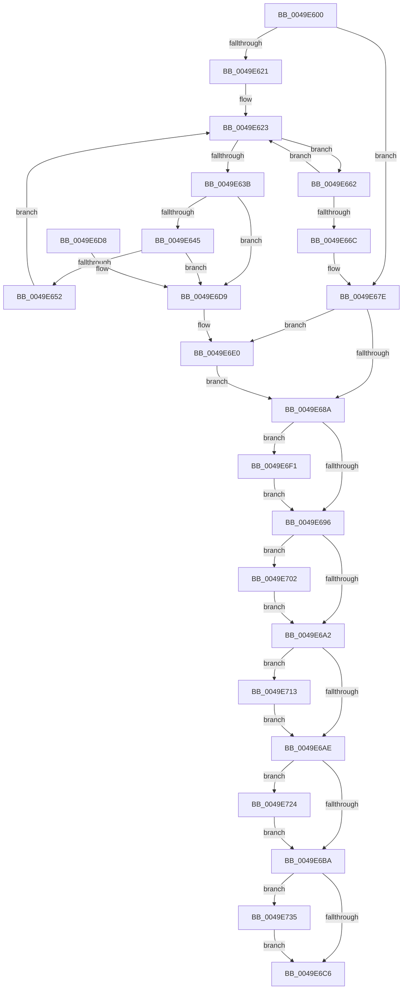

# CcUnInitializeAsyncReadForNodeHelper

- RVA: `0x0049E600`–`0x0049E746` (길이 `326` bytes)
- VA: `0x000000014049E600`
- 실행 섹션: `.text`
- PDB 이름 있음: `예`; PDB Function 태그: `아니요`
- unwind 정보 RVA: `0x000B51D0`
- 디코드: `84`개 명령, `326/326` bytes 표시
- 미해석 바이트: `0` (있으면 어셈블리에 `.byte`로 보존)

> 이 문서는 커널 이미지의 기계어와 PDB 기호를 분석해 생성했습니다. 4번과 5번은 함수 원형과 자료형을 바이너리 사용 방식에서 추정한 C 해석이며 원본 소스 복구 결과는 아닙니다.

## 1. Dependencies

- 직접 호출 지점: **8**; 고유 호출 대상: **1**
- 직접 호출자로 확인된 함수: **0**
- RIP 상대 이미지 참조: **1**

### Outgoing calls
- `0x0049E65B` → [ExFreePoolWithTag](../../poolcode/B8/ExFreePoolWithTag_function_00B82870.md) (function, `0x00B82870`)
- `0x0049E671` → [ExFreePoolWithTag](../../poolcode/B8/ExFreePoolWithTag_function_00B82870.md) (function, `0x00B82870`)
- `0x0049E6E2` → [ExFreePoolWithTag](../../poolcode/B8/ExFreePoolWithTag_function_00B82870.md) (function, `0x00B82870`)
- `0x0049E6F3` → [ExFreePoolWithTag](../../poolcode/B8/ExFreePoolWithTag_function_00B82870.md) (function, `0x00B82870`)
- `0x0049E704` → [ExFreePoolWithTag](../../poolcode/B8/ExFreePoolWithTag_function_00B82870.md) (function, `0x00B82870`)
- `0x0049E715` → [ExFreePoolWithTag](../../poolcode/B8/ExFreePoolWithTag_function_00B82870.md) (function, `0x00B82870`)
- `0x0049E726` → [ExFreePoolWithTag](../../poolcode/B8/ExFreePoolWithTag_function_00B82870.md) (function, `0x00B82870`)
- `0x0049E737` → [ExFreePoolWithTag](../../poolcode/B8/ExFreePoolWithTag_function_00B82870.md) (function, `0x00B82870`)

### Direct callers
- 이 함수 시작 RVA로 연결되는 직접 call은 확인되지 않았습니다. 간접 호출은 완전히 역산할 수 없습니다.

### Static image references
- `0x0049E664` → RVA `0x00F8F520` (`.data`; read)

## 2. Other-region calls and transfers

- 다른 실행 섹션으로 향하는 call: **8**
  - `0x0049E65B` → [ExFreePoolWithTag](../../poolcode/B8/ExFreePoolWithTag_function_00B82870.md) (`.text` → `POOLCODE`)
  - `0x0049E671` → [ExFreePoolWithTag](../../poolcode/B8/ExFreePoolWithTag_function_00B82870.md) (`.text` → `POOLCODE`)
  - `0x0049E6E2` → [ExFreePoolWithTag](../../poolcode/B8/ExFreePoolWithTag_function_00B82870.md) (`.text` → `POOLCODE`)
  - `0x0049E6F3` → [ExFreePoolWithTag](../../poolcode/B8/ExFreePoolWithTag_function_00B82870.md) (`.text` → `POOLCODE`)
  - `0x0049E704` → [ExFreePoolWithTag](../../poolcode/B8/ExFreePoolWithTag_function_00B82870.md) (`.text` → `POOLCODE`)
  - `0x0049E715` → [ExFreePoolWithTag](../../poolcode/B8/ExFreePoolWithTag_function_00B82870.md) (`.text` → `POOLCODE`)
  - `0x0049E726` → [ExFreePoolWithTag](../../poolcode/B8/ExFreePoolWithTag_function_00B82870.md) (`.text` → `POOLCODE`)
  - `0x0049E737` → [ExFreePoolWithTag](../../poolcode/B8/ExFreePoolWithTag_function_00B82870.md) (`.text` → `POOLCODE`)
- 별도 외부 분기/꼬리 이동을 확인하지 못했습니다.

## 3. Assembly (complete function range)

```asm
0049E600  48 89 5C 24 08                  mov qword ptr [rsp + 8], rbx
0049E605  48 89 6C 24 10                  mov qword ptr [rsp + 0x10], rbp
0049E60A  57                              push rdi
0049E60B  48 83 EC 20                     sub rsp, 0x20
0049E60F  49 83 B8 E8 00 00 00 00         cmp qword ptr [r8 + 0xe8], 0
0049E617  49 8B D8                        mov rbx, r8
0049E61A  BD 43 63 57 71                  mov ebp, 0x71576343
0049E61F  74 5D                           je 0x14049e67e
0049E621  33 FF                           xor edi, edi
0049E623  4C 8B 83 E8 00 00 00            mov r8, qword ptr [rbx + 0xe8]
0049E62A  8B D7                           mov edx, edi
0049E62C  48 C1 E2 04                     shl rdx, 4
0049E630  49 03 D0                        add rdx, r8
0049E633  48 8B 0A                        mov rcx, qword ptr [rdx]
0049E636  48 3B CA                        cmp rcx, rdx
0049E639  74 27                           je 0x14049e662
0049E63B  48 39 51 08                     cmp qword ptr [rcx + 8], rdx
0049E63F  0F 85 94 00 00 00               jne 0x14049e6d9
0049E645  48 8B 01                        mov rax, qword ptr [rcx]
0049E648  48 39 48 08                     cmp qword ptr [rax + 8], rcx
0049E64C  0F 85 87 00 00 00               jne 0x14049e6d9
0049E652  48 89 02                        mov qword ptr [rdx], rax
0049E655  48 89 50 08                     mov qword ptr [rax + 8], rdx
0049E659  8B D5                           mov edx, ebp
0049E65B  E8 10 42 6E 00                  call 0x140b82870
0049E660  EB C1                           jmp 0x14049e623
0049E662  FF C7                           inc edi
0049E664  3B 3D B6 0E AF 00               cmp edi, dword ptr [rip + 0xaf0eb6]
0049E66A  76 B7                           jbe 0x14049e623
0049E66C  8B D5                           mov edx, ebp
0049E66E  49 8B C8                        mov rcx, r8
0049E671  E8 FA 41 6E 00                  call 0x140b82870
0049E676  48 83 A3 E8 00 00 00 00         and qword ptr [rbx + 0xe8], 0
0049E67E  48 8B 8B 00 01 00 00            mov rcx, qword ptr [rbx + 0x100]
0049E685  48 85 C9                        test rcx, rcx
0049E688  75 56                           jne 0x14049e6e0
0049E68A  48 8B 8B 08 01 00 00            mov rcx, qword ptr [rbx + 0x108]
0049E691  48 85 C9                        test rcx, rcx
0049E694  75 5B                           jne 0x14049e6f1
0049E696  48 8B 8B 18 01 00 00            mov rcx, qword ptr [rbx + 0x118]
0049E69D  48 85 C9                        test rcx, rcx
0049E6A0  75 60                           jne 0x14049e702
0049E6A2  48 8B 8B 10 01 00 00            mov rcx, qword ptr [rbx + 0x110]
0049E6A9  48 85 C9                        test rcx, rcx
0049E6AC  75 65                           jne 0x14049e713
0049E6AE  48 8B 8B F0 00 00 00            mov rcx, qword ptr [rbx + 0xf0]
0049E6B5  48 85 C9                        test rcx, rcx
0049E6B8  75 6A                           jne 0x14049e724
0049E6BA  48 8B 8B F8 00 00 00            mov rcx, qword ptr [rbx + 0xf8]
0049E6C1  48 85 C9                        test rcx, rcx
0049E6C4  75 6F                           jne 0x14049e735
0049E6C6  48 8B 5C 24 30                  mov rbx, qword ptr [rsp + 0x30]
0049E6CB  B0 01                           mov al, 1
0049E6CD  48 8B 6C 24 38                  mov rbp, qword ptr [rsp + 0x38]
0049E6D2  48 83 C4 20                     add rsp, 0x20
0049E6D6  5F                              pop rdi
0049E6D7  C3                              ret
0049E6D8  CC                              int3
0049E6D9  B9 03 00 00 00                  mov ecx, 3
0049E6DE  CD 29                           int 0x29
0049E6E0  8B D5                           mov edx, ebp
0049E6E2  E8 89 41 6E 00                  call 0x140b82870
0049E6E7  48 83 A3 00 01 00 00 00         and qword ptr [rbx + 0x100], 0
0049E6EF  EB 99                           jmp 0x14049e68a
0049E6F1  8B D5                           mov edx, ebp
0049E6F3  E8 78 41 6E 00                  call 0x140b82870
0049E6F8  48 83 A3 08 01 00 00 00         and qword ptr [rbx + 0x108], 0
0049E700  EB 94                           jmp 0x14049e696
0049E702  8B D5                           mov edx, ebp
0049E704  E8 67 41 6E 00                  call 0x140b82870
0049E709  48 83 A3 18 01 00 00 00         and qword ptr [rbx + 0x118], 0
0049E711  EB 8F                           jmp 0x14049e6a2
0049E713  8B D5                           mov edx, ebp
0049E715  E8 56 41 6E 00                  call 0x140b82870
0049E71A  48 83 A3 10 01 00 00 00         and qword ptr [rbx + 0x110], 0
0049E722  EB 8A                           jmp 0x14049e6ae
0049E724  8B D5                           mov edx, ebp
0049E726  E8 45 41 6E 00                  call 0x140b82870
0049E72B  48 83 A3 F0 00 00 00 00         and qword ptr [rbx + 0xf0], 0
0049E733  EB 85                           jmp 0x14049e6ba
0049E735  8B D5                           mov edx, ebp
0049E737  E8 34 41 6E 00                  call 0x140b82870
0049E73C  48 83 A3 F8 00 00 00 00         and qword ptr [rbx + 0xf8], 0
0049E744  EB 80                           jmp 0x14049e6c6
```

## 4. C-style interpretation (structured pseudocode)

```c
__int64 __fastcall CcUnInitializeAsyncReadForNodeHelper(__int64 a1, __int64 a2, __int64 a3)
{
    __int64 result;
    __int64 v_rdi;
    __int64 v_rsp;
    unsigned __int64 v_stack_p10;
    unsigned __int64 v_stack_p8;

    v_stack_p8 = v_rbx;
    v_stack_p10 = v_rbp;
    v_rsp = (v_rsp) - (32);
    if ((*(unsigned __int64 *)(a3 + 232)) == 0) goto loc_0049E67E;
    v_rdi = 0;
loc_0049E623:
    a2 = (0) << (4);
    a2 = (a2) + (*(unsigned __int64 *)(a3 + 232));
    if ((*(unsigned __int64 *)(a2)) == a2) goto loc_0049E662;
    if ((*(unsigned __int64 *)(*(unsigned __int64 *)(a2) + 8)) != a2) goto loc_0049E6D9;
    if ((*(unsigned __int64 *)(*(unsigned __int64 *)(*(unsigned __int64 *)(a2)) + 8)) != (*(unsigned __int64 *)(a2))) goto loc_0049E6D9;
    *(unsigned __int64 *)(a2) = *(unsigned __int64 *)(*(unsigned __int64 *)(a2));
    *(unsigned __int64 *)(*(unsigned __int64 *)(*(unsigned __int64 *)(a2)) + 8) = a2;
    result = ExFreePoolWithTag(*(unsigned __int64 *)(a2), (unsigned int)((unsigned int)((unsigned int)(0x71576343ULL))), *(unsigned __int64 *)(a3 + 232), a4);
    goto loc_0049E623;
loc_0049E662:
    v_rdi = (unsigned int)((v_rdi) + 1);
    if (((unsigned int)(v_rdi)) <= (*(unsigned int *)(v_rip + 11472566))) goto loc_0049E623;
    result = ExFreePoolWithTag(*(unsigned __int64 *)(a3 + 232), (unsigned int)((unsigned int)((unsigned int)(0x71576343ULL))), *(unsigned __int64 *)(a3 + 232), a4);
loc_0049E67E:
    if (*(unsigned __int64 *)(a3 + 256) != 0) goto loc_0049E6E0;
loc_0049E68A:
    if (*(unsigned __int64 *)(a3 + 264) != 0) goto loc_0049E6F1;
loc_0049E696:
    if (*(unsigned __int64 *)(a3 + 280) != 0) goto loc_0049E702;
loc_0049E6A2:
    if (*(unsigned __int64 *)(a3 + 272) != 0) goto loc_0049E713;
loc_0049E6AE:
    if (*(unsigned __int64 *)(a3 + 240) != 0) goto loc_0049E724;
loc_0049E6BA:
    if (*(unsigned __int64 *)(a3 + 248) != 0) goto loc_0049E735;
loc_0049E6C6:
    v_rsp = (v_rsp) + (32);
    return 1;
loc_0049E6D9:
loc_0049E6E0:
    result = ExFreePoolWithTag(3, (unsigned int)((unsigned int)(v_stack_p10)), *(unsigned __int64 *)(a3 + 232), a4);
    goto loc_0049E68A;
loc_0049E6F1:
    result = ExFreePoolWithTag(3, (unsigned int)((unsigned int)(v_stack_p10)), *(unsigned __int64 *)(a3 + 232), a4);
    goto loc_0049E696;
loc_0049E702:
    result = ExFreePoolWithTag(3, (unsigned int)((unsigned int)(v_stack_p10)), *(unsigned __int64 *)(a3 + 232), a4);
    goto loc_0049E6A2;
loc_0049E713:
    result = ExFreePoolWithTag(3, (unsigned int)((unsigned int)(v_stack_p10)), *(unsigned __int64 *)(a3 + 232), a4);
    goto loc_0049E6AE;
loc_0049E724:
    result = ExFreePoolWithTag(3, (unsigned int)((unsigned int)(v_stack_p10)), *(unsigned __int64 *)(a3 + 232), a4);
    goto loc_0049E6BA;
loc_0049E735:
    result = ExFreePoolWithTag(3, (unsigned int)((unsigned int)(v_stack_p10)), *(unsigned __int64 *)(a3 + 232), a4);
    goto loc_0049E6C6;
}
```

## 5. (Beta) C Style

```c
int64_t CcUnInitializeAsyncReadForNodeHelper(int64_t Arg1, int64_t Arg2, void *Arg3)
{
    uint8_t *arg3 = (uint8_t *)Arg3;

    int64_t result;
    int64_t local_rdi;
    int64_t local_rsp;
    uint64_t v_stack_p10;
    uint64_t v_stack_p8;

    v_stack_p8 = local_rbx;
    v_stack_p10 = local_rbp;
    local_rsp = (local_rsp) - (32);
    if ((*(uint64_t *)(arg3 + 0xE8)) == 0) goto loc_0049E67E;
    local_rdi = 0;
loc_0049E623:
    Arg2 = (0) << (4);
    Arg2 = (Arg2) + (*(uint64_t *)(arg3 + 0xE8));
    if ((*(uint64_t *)(Arg2)) == Arg2) goto loc_0049E662;
    if ((*(uint64_t *)(*(uint64_t *)(Arg2) + 0x8)) != Arg2) goto loc_0049E6D9;
    if ((*(uint64_t *)(*(uint64_t *)(*(uint64_t *)(Arg2)) + 0x8)) != (*(uint64_t *)(Arg2))) goto loc_0049E6D9;
    *(uint64_t *)(Arg2) = *(uint64_t *)(*(uint64_t *)(Arg2));
    *(uint64_t *)(*(uint64_t *)(*(uint64_t *)(Arg2)) + 0x8) = Arg2;
    result = ExFreePoolWithTag(*(uint64_t *)(Arg2), (uint32_t)((uint32_t)((uint32_t)(0x71576343ULL))), *(uint64_t *)(arg3 + 0xE8), a4);
    goto loc_0049E623;
loc_0049E662:
    local_rdi = (uint32_t)((local_rdi) + 1);
    if (((uint32_t)(local_rdi)) <= (*(uint32_t *)(v_rip + 0xAF0EB6))) goto loc_0049E623;
    result = ExFreePoolWithTag(*(uint64_t *)(arg3 + 0xE8), (uint32_t)((uint32_t)((uint32_t)(0x71576343ULL))), *(uint64_t *)(arg3 + 0xE8), a4);
loc_0049E67E:
    if (*(uint64_t *)(arg3 + 0x100) != 0) goto loc_0049E6E0;
loc_0049E68A:
    if (*(uint64_t *)(arg3 + 0x108) != 0) goto loc_0049E6F1;
loc_0049E696:
    if (*(uint64_t *)(arg3 + 0x118) != 0) goto loc_0049E702;
loc_0049E6A2:
    if (*(uint64_t *)(arg3 + 0x110) != 0) goto loc_0049E713;
loc_0049E6AE:
    if (*(uint64_t *)(arg3 + 0xF0) != 0) goto loc_0049E724;
loc_0049E6BA:
    if (*(uint64_t *)(arg3 + 0xF8) != 0) goto loc_0049E735;
loc_0049E6C6:
    local_rsp = (local_rsp) + (32);
    return 1;
loc_0049E6D9:
loc_0049E6E0:
    result = ExFreePoolWithTag(3, (uint32_t)((uint32_t)(v_stack_p10)), *(uint64_t *)(arg3 + 0xE8), a4);
    goto loc_0049E68A;
loc_0049E6F1:
    result = ExFreePoolWithTag(3, (uint32_t)((uint32_t)(v_stack_p10)), *(uint64_t *)(arg3 + 0xE8), a4);
    goto loc_0049E696;
loc_0049E702:
    result = ExFreePoolWithTag(3, (uint32_t)((uint32_t)(v_stack_p10)), *(uint64_t *)(arg3 + 0xE8), a4);
    goto loc_0049E6A2;
loc_0049E713:
    result = ExFreePoolWithTag(3, (uint32_t)((uint32_t)(v_stack_p10)), *(uint64_t *)(arg3 + 0xE8), a4);
    goto loc_0049E6AE;
loc_0049E724:
    result = ExFreePoolWithTag(3, (uint32_t)((uint32_t)(v_stack_p10)), *(uint64_t *)(arg3 + 0xE8), a4);
    goto loc_0049E6BA;
loc_0049E735:
    result = ExFreePoolWithTag(3, (uint32_t)((uint32_t)(v_stack_p10)), *(uint64_t *)(arg3 + 0xE8), a4);
    goto loc_0049E6C6;
}
```

### 관측된 메모리 오프셋

구조체 형식이 확인되지 않은 접근은 인자 기준의 오프셋으로만 기록했습니다.

| 기준 인자 | 오프셋 표현 | 폭 (bit) | 접근 |
|---|---:|---:|---|
| `Arg3` | `+ 0xE8` | `64` | `R` |
| `Arg3` | `+ 0xE8` | `64` | `R/W` |
| `Arg3` | `+ 0xF0` | `64` | `R` |
| `Arg3` | `+ 0xF0` | `64` | `R/W` |
| `Arg3` | `+ 0xF8` | `64` | `R` |
| `Arg3` | `+ 0xF8` | `64` | `R/W` |
| `Arg3` | `+ 0x100` | `64` | `R` |
| `Arg3` | `+ 0x100` | `64` | `R/W` |
| `Arg3` | `+ 0x108` | `64` | `R` |
| `Arg3` | `+ 0x108` | `64` | `R/W` |
| `Arg3` | `+ 0x110` | `64` | `R` |
| `Arg3` | `+ 0x110` | `64` | `R/W` |
| `Arg3` | `+ 0x118` | `64` | `R` |
| `Arg3` | `+ 0x118` | `64` | `R/W` |

## 6. Execution-region graph

[열기: 2D/3D 그래프와 함수 탐색 컨트롤 패널](../../../control-panel.html?section=text&rva=0x0049E600&view=graph)

- 2D 그래프는 위에서 아래로 흐르고, 3D 그래프는 빈 공간을 드래그해 회전합니다. Shift+드래그는 이동, 휠은 확대·축소, 함수 노드 선택은 대상 보고서 이동입니다.

### Static fallback


