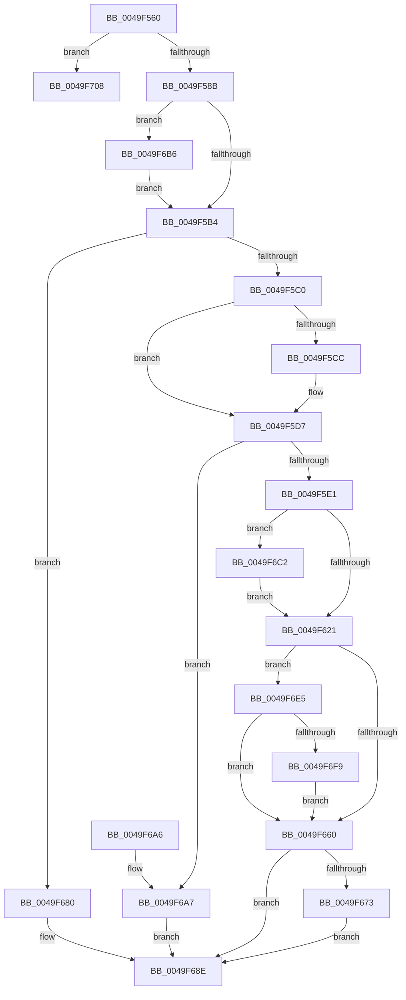

# CcUnpinRepinnedBcb

- RVA: `0x0049F560`–`0x0049F727` (길이 `455` bytes)
- VA: `0x000000014049F560`
- 실행 섹션: `.text`
- PDB 이름 있음: `예`; PDB Function 태그: `아니요`
- unwind 정보 RVA: `0x000B5460`
- 디코드: `110`개 명령, `455/455` bytes 표시
- 미해석 바이트: `0` (있으면 어셈블리에 `.byte`로 보존)

> 이 문서는 커널 이미지의 기계어와 PDB 기호를 분석해 생성했습니다. 4번과 5번은 함수 원형과 자료형을 바이너리 사용 방식에서 추정한 C 해석이며 원본 소스 복구 결과는 아닙니다.

## 1. Dependencies

- 직접 호출 지점: **14**; 고유 호출 대상: **11**
- 직접 호출자로 확인된 함수: **0**
- RIP 상대 이미지 참조: **2**

### Outgoing calls
- `0x0049F5D2` → [ExAcquireResourceExclusiveLite](../21/ExAcquireResourceExclusiveLite_function_00214E20.md) (function, `0x00214E20`)
- `0x0049F5EB` → [MmSetAddressRangeModifiedEx](../23/MmSetAddressRangeModifiedEx_function_00236F20.md) (function, `0x00236F20`)
- `0x0049F5FB` → [CcUnpinFileDataEx](../35/CcUnpinFileDataEx_function_00359DEC.md) (function, `0x00359DEC`)
- `0x0049F603` → [CcReferenceSharedCacheMapFileObject](../23/CcReferenceSharedCacheMapFileObject_function_002379BC.md) (function, `0x002379BC`)
- `0x0049F63C` → [MmFlushSection](../23/MmFlushSection_function_002375E4.md) (function, `0x002375E4`)
- `0x0049F650` → [ObFastDereferenceObjectDeferDelete](../23/ObFastDereferenceObjectDeferDelete_function_002378C0.md) (function, `0x002378C0`)
- `0x0049F668` → [CcUnpinFileDataEx](../35/CcUnpinFileDataEx_function_00359DEC.md) (function, `0x00359DEC`)
- `0x0049F679` → [CcPostDeferredWrites](../35/CcPostDeferredWrites_function_003590FC.md) (function, `0x003590FC`)
- `0x0049F685` → [CcUnpinFileDataEx](../35/CcUnpinFileDataEx_function_00359DEC.md) (function, `0x00359DEC`)
- `0x0049F6AF` → [CcUnpinFileDataEx](../35/CcUnpinFileDataEx_function_00359DEC.md) (function, `0x00359DEC`)
- `0x0049F6D6` → [CcPerfLogFlushSection](../47/CcPerfLogFlushSection_function_0047CE0C.md) (function, `0x0047CE0C`)
- `0x0049F6EC` → [CcIsFatalWriteError](../40/CcIsFatalWriteError_function_0040855C.md) (function, `0x0040855C`)
- `0x0049F6FE` → [CcSetDirtyPinnedData](../35/CcSetDirtyPinnedData_function_0035A120.md) (function, `0x0035A120`)
- `0x0049F721` → [KeBugCheckEx](../4F/KeBugCheckEx_function_004FD660.md) (function, `0x004FD660`)

### Direct callers
- 이 함수 시작 RVA로 연결되는 직접 call은 확인되지 않았습니다. 간접 호출은 완전히 역산할 수 없습니다.

### Static image references
- `0x0049F58B` → RVA `0x00E65B88` (`.data`; read)
- `0x0049F608` → RVA `0x00FC6B10` (`ALMOSTRO`; read)

## 2. Other-region calls and transfers

- 다른 실행 섹션으로 향하는 call: **0**
- 별도 외부 분기/꼬리 이동을 확인하지 못했습니다.

## 3. Assembly (complete function range)

```asm
0049F560  48 89 5C 24 10                  mov qword ptr [rsp + 0x10], rbx
0049F565  48 89 6C 24 18                  mov qword ptr [rsp + 0x18], rbp
0049F56A  56                              push rsi
0049F56B  41 54                           push r12
0049F56D  41 55                           push r13
0049F56F  41 56                           push r14
0049F571  41 57                           push r15
0049F573  48 83 EC 30                     sub rsp, 0x30
0049F577  B8 FD 02 00 00                  mov eax, 0x2fd
0049F57C  4D 8B F0                        mov r14, r8
0049F57F  48 8B D9                        mov rbx, rcx
0049F582  66 39 01                        cmp word ptr [rcx], ax
0049F585  0F 85 7D 01 00 00               jne 0x14049f708
0049F58B  80 3D F6 65 9C 00 00            cmp byte ptr [rip + 0x9c65f6], 0
0049F592  48 8B B1 B0 00 00 00            mov rsi, qword ptr [rcx + 0xb0]
0049F599  4C 8B AE 58 02 00 00            mov r13, qword ptr [rsi + 0x258]
0049F5A0  4C 8B BE 18 02 00 00            mov r15, qword ptr [rsi + 0x218]
0049F5A7  49 8D AD 50 04 00 00            lea rbp, [r13 + 0x450]
0049F5AE  0F 84 02 01 00 00               je 0x14049f6b6
0049F5B4  41 83 20 00                     and dword ptr [r8], 0
0049F5B8  84 D2                           test dl, dl
0049F5BA  0F 84 C0 00 00 00               je 0x14049f680
0049F5C0  F7 86 98 00 00 00 00 02 00 00   test dword ptr [rsi + 0x98], 0x200
0049F5CA  74 0B                           je 0x14049f5d7
0049F5CC  48 83 C1 48                     add rcx, 0x48
0049F5D0  B2 01                           mov dl, 1
0049F5D2  E8 49 58 D7 FF                  call 0x140214e20
0049F5D7  80 7B 02 00                     cmp byte ptr [rbx + 2], 0
0049F5DB  0F 84 C6 00 00 00               je 0x14049f6a7
0049F5E1  8B 53 04                        mov edx, dword ptr [rbx + 4]
0049F5E4  48 8B 8B B8 00 00 00            mov rcx, qword ptr [rbx + 0xb8]
0049F5EB  E8 30 79 D9 FF                  call 0x140236f20
0049F5F0  41 B8 02 00 00 00               mov r8d, 2
0049F5F6  B2 01                           mov dl, 1
0049F5F8  48 8B CB                        mov rcx, rbx
0049F5FB  E8 EC A7 EB FF                  call 0x140359dec
0049F600  48 8B CE                        mov rcx, rsi
0049F603  E8 B4 83 D9 FF                  call 0x1402379bc
0049F608  F7 05 FE 74 B2 00 00 00 02 00   test dword ptr [rip + 0xb274fe], 0x20000
0049F612  4C 8D 63 08                     lea r12, [rbx + 8]
0049F616  48 89 44 24 60                  mov qword ptr [rsp + 0x60], rax
0049F61B  0F 85 A1 00 00 00               jne 0x14049f6c2
0049F621  44 8B 43 04                     mov r8d, dword ptr [rbx + 4]
0049F625  45 33 C9                        xor r9d, r9d
0049F628  48 8B 48 28                     mov rcx, qword ptr [rax + 0x28]
0049F62C  49 8B D4                        mov rdx, r12
0049F62F  C7 44 24 28 01 00 00 00         mov dword ptr [rsp + 0x28], 1
0049F637  4C 89 74 24 20                  mov qword ptr [rsp + 0x20], r14
0049F63C  E8 A3 7F D9 FF                  call 0x1402375e4
0049F641  48 8B 54 24 60                  mov rdx, qword ptr [rsp + 0x60]
0049F646  48 8D 4E 60                     lea rcx, [rsi + 0x60]
0049F64A  41 B8 43 63 53 63               mov r8d, 0x63536343
0049F650  E8 6B 82 D9 FF                  call 0x1402378c0
0049F655  41 8B 16                        mov edx, dword ptr [r14]
0049F658  85 D2                           test edx, edx
0049F65A  0F 88 85 00 00 00               js 0x14049f6e5
0049F660  45 33 C0                        xor r8d, r8d
0049F663  33 D2                           xor edx, edx
0049F665  48 8B CB                        mov rcx, rbx
0049F668  E8 7F A7 EB FF                  call 0x140359dec
0049F66D  48 39 6D 00                     cmp qword ptr [rbp], rbp
0049F671  74 1B                           je 0x14049f68e
0049F673  49 8B D5                        mov rdx, r13
0049F676  49 8B CF                        mov rcx, r15
0049F679  E8 7E 9A EB FF                  call 0x1403590fc
0049F67E  EB 0E                           jmp 0x14049f68e
0049F680  45 33 C0                        xor r8d, r8d
0049F683  B2 01                           mov dl, 1
0049F685  E8 62 A7 EB FF                  call 0x140359dec
0049F68A  41 83 26 00                     and dword ptr [r14], 0
0049F68E  48 8B 5C 24 68                  mov rbx, qword ptr [rsp + 0x68]
0049F693  48 8B 6C 24 70                  mov rbp, qword ptr [rsp + 0x70]
0049F698  48 83 C4 30                     add rsp, 0x30
0049F69C  41 5F                           pop r15
0049F69E  41 5E                           pop r14
0049F6A0  41 5D                           pop r13
0049F6A2  41 5C                           pop r12
0049F6A4  5E                              pop rsi
0049F6A5  C3                              ret
0049F6A6  CC                              int3
0049F6A7  45 33 C0                        xor r8d, r8d
0049F6AA  33 D2                           xor edx, edx
0049F6AC  48 8B CB                        mov rcx, rbx
0049F6AF  E8 38 A7 EB FF                  call 0x140359dec
0049F6B4  EB D8                           jmp 0x14049f68e
0049F6B6  49 8D AF 90 04 00 00            lea rbp, [r15 + 0x490]
0049F6BD  E9 F2 FE FF FF                  jmp 0x14049f5b4
0049F6C2  44 8B 4B 04                     mov r9d, dword ptr [rbx + 4]
0049F6C6  4D 8B C4                        mov r8, r12
0049F6C9  48 8B D6                        mov rdx, rsi
0049F6CC  C7 44 24 20 01 00 00 00         mov dword ptr [rsp + 0x20], 1
0049F6D4  33 C9                           xor ecx, ecx
0049F6D6  E8 31 D7 FD FF                  call 0x14047ce0c
0049F6DB  48 8B 44 24 60                  mov rax, qword ptr [rsp + 0x60]
0049F6E0  E9 3C FF FF FF                  jmp 0x14049f621
0049F6E5  48 8B 8B B0 00 00 00            mov rcx, qword ptr [rbx + 0xb0]
0049F6EC  E8 6B 8E F6 FF                  call 0x14040855c
0049F6F1  84 C0                           test al, al
0049F6F3  0F 85 67 FF FF FF               jne 0x14049f660
0049F6F9  33 D2                           xor edx, edx
0049F6FB  48 8B CB                        mov rcx, rbx
0049F6FE  E8 1D AA EB FF                  call 0x14035a120
0049F703  E9 58 FF FF FF                  jmp 0x14049f660
0049F708  48 83 64 24 20 00               and qword ptr [rsp + 0x20], 0
0049F70E  45 33 C9                        xor r9d, r9d
0049F711  BA 6C 26 00 00                  mov edx, 0x266c
0049F716  49 C7 C0 20 04 00 C0            mov r8, 0xffffffffc0000420
0049F71D  41 8D 49 34                     lea ecx, [r9 + 0x34]
0049F721  E8 3A DF 05 00                  call 0x1404fd660
0049F726  CC                              int3
```

## 4. C-style interpretation (structured pseudocode)

```c
__int64 __fastcall CcUnpinRepinnedBcb(__int64 a1, unsigned __int8 a2, __int64 a3, int a4)
{
    __int64 result;
    __int64 v_rsp;
    unsigned int v_stack_m30;
    unsigned __int64 v_stack_m38;
    unsigned __int64 v_stack_p10;
    unsigned __int64 v_stack_p18;
    unsigned int v_stack_p20;
    unsigned __int64 v_stack_p60;
    unsigned __int64 v_stack_p8;

    v_stack_p10 = v_rbx;
    v_stack_p18 = v_rbp;
    v_rsp = (v_rsp) - (48);
    if ((*(unsigned __int16 *)(a1)) != 765) goto loc_0049F708;
    if ((*(unsigned __int8 *)(v_rip + 10249718)) == 0) goto loc_0049F6B6;
loc_0049F5B4:
    if (a2 == 0) goto loc_0049F680;
    result = 765;
    if (((*(unsigned int *)(*(unsigned __int64 *)(a1 + 176) + 152)) & (512)) != 0) {
        a1 = (a1) + (72);
        a2 = 1;
        result = ExAcquireResourceExclusiveLite(a1, a2, a3, a4);
    }
    if ((*(unsigned __int8 *)(a1 + 2)) == 0) goto loc_0049F6A7;
    result = MmSetAddressRangeModifiedEx(*(unsigned __int64 *)(a1 + 184), (unsigned int)(*(unsigned int *)(a1 + 4)), a3, a4);
    result = CcUnpinFileDataEx(a1, 1, 2, a4);
    result = CcReferenceSharedCacheMapFileObject(*(unsigned __int64 *)(a1 + 176), 1, 2, a4);
    v_stack_p8 = result;
    if (((*(unsigned int *)(v_rip + 11695358)) & (0x20000ULL)) != 0) goto loc_0049F6C2;
loc_0049F621:
    a4 = 0;
    v_stack_m30 = 1;
    v_stack_m38 = a3;
    result = MmFlushSection(*(unsigned __int64 *)(result + 40), a1 + 8, (unsigned int)(*(unsigned int *)(a1 + 4)), a4);
    result = ObFastDereferenceObjectDeferDelete(*(unsigned __int64 *)(a1 + 176) + 96, v_stack_p8, (unsigned int)(0x63536343ULL), a4);
    if (sign_flag) goto loc_0049F6E5;
loc_0049F660:
    a3 = 0;
    a2 = 0;
    result = CcUnpinFileDataEx(a1, a2, a3, a4);
    if ((*(unsigned __int64 *)(*(unsigned __int64 *)(*(unsigned __int64 *)(a1 + 176) + 600) + 1104)) == (*(unsigned __int64 *)(*(unsigned __int64 *)(a1 + 176) + 600) + 1104)) goto loc_0049F68E;
    result = CcPostDeferredWrites(*(unsigned __int64 *)(*(unsigned __int64 *)(a1 + 176) + 536), *(unsigned __int64 *)(*(unsigned __int64 *)(a1 + 176) + 600), a3, a4);
    goto loc_0049F68E;
loc_0049F680:
    a3 = 0;
    result = CcUnpinFileDataEx(*(unsigned __int64 *)(*(unsigned __int64 *)(a1 + 176) + 536), 1, a3, a4);
loc_0049F68E:
    v_rsp = (v_rsp) + (48);
    return result;
loc_0049F6A7:
    a3 = 0;
    a2 = 0;
    result = CcUnpinFileDataEx(v_stack_p10, a2, a3, a4);
    goto loc_0049F68E;
loc_0049F6B6:
    goto loc_0049F5B4;
loc_0049F6C2:
    v_stack_p20 = 1;
    a1 = 0;
    result = CcPerfLogFlushSection(a1, *(unsigned __int64 *)(a1 + 176), a1 + 8, (unsigned int)(*(unsigned int *)(v_stack_p10 + 4)));
    goto loc_0049F621;
loc_0049F6E5:
    result = CcIsFatalWriteError(*(unsigned __int64 *)(v_stack_p10 + 176), *(unsigned __int64 *)(a1 + 176), a1 + 8, (unsigned int)(*(unsigned int *)(v_stack_p10 + 4)));
    if ((unsigned __int8)(result) != 0) goto loc_0049F660;
    a2 = 0;
    result = CcSetDirtyPinnedData(v_stack_p10, a2, a1 + 8, (unsigned int)(*(unsigned int *)(v_stack_p10 + 4)));
    goto loc_0049F660;
loc_0049F708:
    a4 = 0;
    result = KeBugCheckEx(a4 + 52, (unsigned int)(0x266CULL), 0xFFFFFFFFC0000420ULL, a4);
    return result;
}
```

## 5. (Beta) C Style

```c
int64_t CcUnpinRepinnedBcb(void *Arg1, uint8_t Arg2, void *Arg3, int32_t Arg4)
{
    uint8_t *arg1 = (uint8_t *)Arg1;
    uint8_t *arg3 = (uint8_t *)Arg3;

    int64_t result;
    int64_t local_rsp;
    uint32_t v_stack_m30;
    uint64_t v_stack_m38;
    uint64_t v_stack_p10;
    uint64_t v_stack_p18;
    uint32_t v_stack_p20;
    uint64_t v_stack_p60;
    uint64_t v_stack_p8;

    v_stack_p10 = local_rbx;
    v_stack_p18 = local_rbp;
    local_rsp = (local_rsp) - (48);
    if ((*(uint16_t *)(arg1)) != 765) goto loc_0049F708;
    if ((*(uint8_t *)(v_rip + 0x9C65F6)) == 0) goto loc_0049F6B6;
loc_0049F5B4:
    if (Arg2 == 0) goto loc_0049F680;
    result = 765;
    if (((*(uint32_t *)(*(uint64_t *)(arg1 + 0xB0) + 0x98)) & (512)) != 0) {
        Arg1 = (Arg1) + (72);
        Arg2 = 1;
        result = ExAcquireResourceExclusiveLite(Arg1, Arg2, Arg3, Arg4);
    }
    if ((*(uint8_t *)(arg1 + 0x2)) == 0) goto loc_0049F6A7;
    result = MmSetAddressRangeModifiedEx(*(uint64_t *)(arg1 + 0xB8), (uint32_t)(*(uint32_t *)(arg1 + 0x4)), Arg3, Arg4);
    result = CcUnpinFileDataEx(Arg1, 1, 2, Arg4);
    result = CcReferenceSharedCacheMapFileObject(*(uint64_t *)(arg1 + 0xB0), 1, 2, Arg4);
    v_stack_p8 = result;
    if (((*(uint32_t *)(v_rip + 0xB274FE)) & (0x20000ULL)) != 0) goto loc_0049F6C2;
loc_0049F621:
    Arg4 = 0;
    v_stack_m30 = 1;
    v_stack_m38 = Arg3;
    result = MmFlushSection(*(uint64_t *)(result + 0x28), Arg1 + 8, (uint32_t)(*(uint32_t *)(arg1 + 0x4)), Arg4);
    result = ObFastDereferenceObjectDeferDelete(*(uint64_t *)(arg1 + 0xB0) + 96, v_stack_p8, (uint32_t)(0x63536343ULL), Arg4);
    if (sign_flag) goto loc_0049F6E5;
loc_0049F660:
    Arg3 = 0;
    Arg2 = 0;
    result = CcUnpinFileDataEx(Arg1, Arg2, Arg3, Arg4);
    if ((*(uint64_t *)(*(uint64_t *)(*(uint64_t *)(arg1 + 0xB0) + 0x258) + 0x450)) == (*(uint64_t *)(*(uint64_t *)(arg1 + 0xB0) + 0x258) + 1104)) goto loc_0049F68E;
    result = CcPostDeferredWrites(*(uint64_t *)(*(uint64_t *)(arg1 + 0xB0) + 0x218), *(uint64_t *)(*(uint64_t *)(arg1 + 0xB0) + 0x258), Arg3, Arg4);
    goto loc_0049F68E;
loc_0049F680:
    Arg3 = 0;
    result = CcUnpinFileDataEx(*(uint64_t *)(*(uint64_t *)(arg1 + 0xB0) + 0x218), 1, Arg3, Arg4);
loc_0049F68E:
    local_rsp = (local_rsp) + (48);
    return result;
loc_0049F6A7:
    Arg3 = 0;
    Arg2 = 0;
    result = CcUnpinFileDataEx(v_stack_p10, Arg2, Arg3, Arg4);
    goto loc_0049F68E;
loc_0049F6B6:
    goto loc_0049F5B4;
loc_0049F6C2:
    v_stack_p20 = 1;
    Arg1 = 0;
    result = CcPerfLogFlushSection(Arg1, *(uint64_t *)(arg1 + 0xB0), Arg1 + 8, (uint32_t)(*(uint32_t *)(v_stack_p10 + 0x4)));
    goto loc_0049F621;
loc_0049F6E5:
    result = CcIsFatalWriteError(*(uint64_t *)(v_stack_p10 + 0xB0), *(uint64_t *)(arg1 + 0xB0), Arg1 + 8, (uint32_t)(*(uint32_t *)(v_stack_p10 + 0x4)));
    if ((uint8_t)(result) != 0) goto loc_0049F660;
    Arg2 = 0;
    result = CcSetDirtyPinnedData(v_stack_p10, Arg2, Arg1 + 8, (uint32_t)(*(uint32_t *)(v_stack_p10 + 0x4)));
    goto loc_0049F660;
loc_0049F708:
    Arg4 = 0;
    result = KeBugCheckEx(Arg4 + 52, (uint32_t)(0x266CULL), 0xFFFFFFFFC0000420ULL, Arg4);
    return result;
}
```

### 관측된 메모리 오프셋

구조체 형식이 확인되지 않은 접근은 인자 기준의 오프셋으로만 기록했습니다.

| 기준 인자 | 오프셋 표현 | 폭 (bit) | 접근 |
|---|---:|---:|---|
| `Arg1` | `+ 0x0` | `16` | `R` |
| `Arg1` | `+ 0x2` | `8` | `R` |
| `Arg1` | `+ 0x4` | `32` | `R` |
| `Arg1` | `+ 0x8` | `64` | `R` |
| `Arg1` | `+ 0xB0` | `64` | `R` |
| `Arg1` | `+ 0xB8` | `64` | `R` |
| `Arg3` | `+ 0x0` | `32` | `R` |
| `Arg3` | `+ 0x0` | `32` | `R/W` |

## 6. Execution-region graph

[열기: 2D/3D 그래프와 함수 탐색 컨트롤 패널](../../../control-panel.html?section=text&rva=0x0049F560&view=graph)

- 2D 그래프는 위에서 아래로 흐르고, 3D 그래프는 빈 공간을 드래그해 회전합니다. Shift+드래그는 이동, 휠은 확대·축소, 함수 노드 선택은 대상 보고서 이동입니다.

### Static fallback


