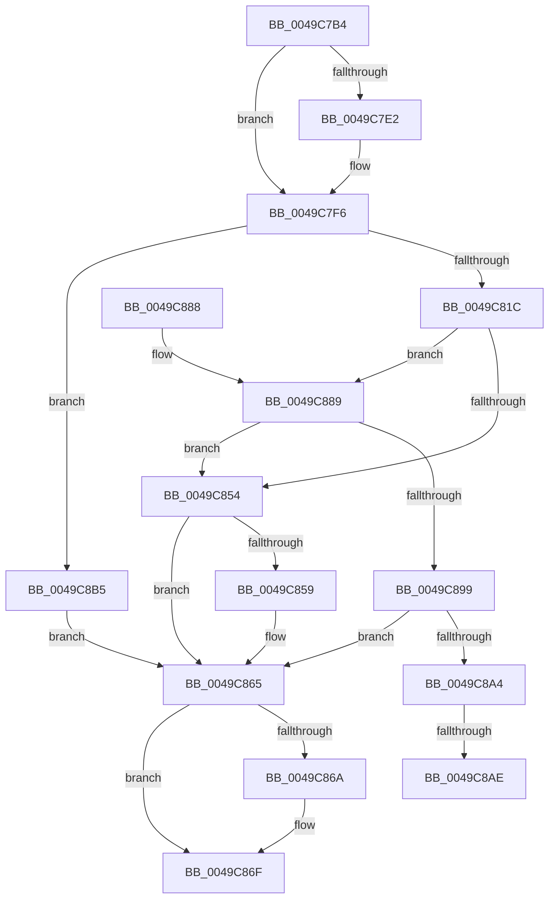

# CmFcManagerRecordFeatureUsage

- RVA: `0x0049C7B4`–`0x0049C8C5` (길이 `273` bytes)
- VA: `0x000000014049C7B4`
- 실행 섹션: `.text`
- PDB 이름 있음: `예`; PDB Function 태그: `예`
- unwind 정보 RVA: `0x000B4C68`
- 디코드: `74`개 명령, `273/273` bytes 표시
- 미해석 바이트: `0` (있으면 어셈블리에 `.byte`로 보존)

> 이 문서는 커널 이미지의 기계어와 PDB 기호를 분석해 생성했습니다. 4번과 5번은 함수 원형과 자료형을 바이너리 사용 방식에서 추정한 C 해석이며 원본 소스 복구 결과는 아닙니다.

## 1. Dependencies

- 직접 호출 지점: **7**; 고유 호출 대상: **6**
- 직접 호출자로 확인된 함수: **1**
- RIP 상대 이미지 참조: **4**

### Outgoing calls
- `0x0049C7D6` → [KeGetEffectiveIrql](../2F/KeGetEffectiveIrql_function_002F8030.md) (function, `0x002F8030`)
- `0x0049C7FD` → [RtlAcquireSwapReference](../37/RtlAcquireSwapReference_function_00378684.md) (function, `0x00378684`)
- `0x0049C833` → [RtlpFcAddFeatureUsageDataToBuffer](RtlpFcAddFeatureUsageDataToBuffer_function_0049C8CC.md) (function, `0x0049C8CC`)
- `0x0049C84A` → [RtlReleaseSwapReference](../37/RtlReleaseSwapReference_function_0037885C.md) (function, `0x0037885C`)
- `0x0049C860` → [CmFcpManagerArmFeatureUsageProviderFlushNotification](CmFcpManagerArmFeatureUsageProviderFlushNotification_function_0049C978.md) (function, `0x0049C978`)
- `0x0049C86A` → [KeLeaveCriticalRegion](../25/KeLeaveCriticalRegion_function_0025D8B0.md) (function, `0x0025D8B0`)
- `0x0049C8BE` → [RtlReleaseSwapReference](../37/RtlReleaseSwapReference_function_0037885C.md) (function, `0x0037885C`)

### Direct callers
- [RtlRecordFeatureUsage](RtlRecordFeatureUsage_function_0049C790.md) at `0x0049C7A5`

### Static image references
- `0x0049C7F6` → RVA `0x00EF7690` (`.data`; read)
- `0x0049C804` → RVA `0x00EF72E0` (`.data`; read)
- `0x0049C838` → RVA `0x00EF7A10` (`.data`; read)
- `0x0049C899` → RVA `0x00EF7A40` (`.data`; read)

## 2. Other-region calls and transfers

- 다른 실행 섹션으로 향하는 call: **0**
- call이 아닌 외부 분기/꼬리 이동: **2**
  - `0x0049C8A8` → [sub_006F7E00](../6F/Unknown_function_006F7E00.md) (`tail-transfer`)
  - `0x0049C8B0` → [sub_006F7E00 + 0xF](../6F/Unknown_function_006F7E00.md) (`tail-transfer`)

## 3. Assembly (complete function range)

```asm
0049C7B4  48 8B C4                        mov rax, rsp
0049C7B7  48 89 58 08                     mov qword ptr [rax + 8], rbx
0049C7BB  48 89 68 10                     mov qword ptr [rax + 0x10], rbp
0049C7BF  48 89 70 20                     mov qword ptr [rax + 0x20], rsi
0049C7C3  4C 89 40 18                     mov qword ptr [rax + 0x18], r8
0049C7C7  57                              push rdi
0049C7C8  41 56                           push r14
0049C7CA  41 57                           push r15
0049C7CC  48 83 EC 20                     sub rsp, 0x20
0049C7D0  48 8B DA                        mov rbx, rdx
0049C7D3  40 32 ED                        xor bpl, bpl
0049C7D6  E8 55 B8 E5 FF                  call 0x1402f8030
0049C7DB  40 8A F8                        mov dil, al
0049C7DE  3C 02                           cmp al, 2
0049C7E0  73 14                           jae 0x14049c7f6
0049C7E2  65 48 8B 0C 25 88 01 00 00      mov rcx, qword ptr gs:[0x188]
0049C7EB  40 B5 01                        mov bpl, 1
0049C7EE  66 FF 89 E4 01 00 00            dec word ptr [rcx + 0x1e4]
0049C7F5  90                              nop
0049C7F6  48 8D 0D 93 AE A5 00            lea rcx, [rip + 0xa5ae93]
0049C7FD  E8 82 BE ED FF                  call 0x140378684
0049C802  8B F0                           mov esi, eax
0049C804  48 8D 05 D5 AA A5 00            lea rax, [rip + 0xa5aad5]
0049C80B  48 8B 8C F0 88 05 00 00         mov rcx, qword ptr [rax + rsi*8 + 0x588]
0049C813  48 85 C9                        test rcx, rcx
0049C816  0F 84 99 00 00 00               je 0x14049c8b5
0049C81C  8B 51 1C                        mov edx, dword ptr [rcx + 0x1c]
0049C81F  4C 8D 44 24 50                  lea r8, [rsp + 0x50]
0049C824  44 8B F2                        mov r14d, edx
0049C827  D1 EA                           shr edx, 1
0049C829  41 C1 EE 02                     shr r14d, 2
0049C82D  44 03 F2                        add r14d, edx
0049C830  48 8B D3                        mov rdx, rbx
0049C833  E8 94 00 00 00                  call 0x14049c8cc
0049C838  8B 1D D2 B1 A5 00               mov ebx, dword ptr [rip + 0xa5b1d2]
0049C83E  48 8D 0D 4B AE A5 00            lea rcx, [rip + 0xa5ae4b]
0049C845  8B D6                           mov edx, esi
0049C847  44 8B F8                        mov r15d, eax
0049C84A  E8 0D C0 ED FF                  call 0x14037885c
0049C84F  45 3B FE                        cmp r15d, r14d
0049C852  72 35                           jb 0x14049c889
0049C854  F6 C3 20                        test bl, 0x20
0049C857  75 0C                           jne 0x14049c865
0049C859  45 33 C0                        xor r8d, r8d
0049C85C  41 8D 50 01                     lea edx, [r8 + 1]
0049C860  E8 13 01 00 00                  call 0x14049c978
0049C865  40 84 ED                        test bpl, bpl
0049C868  74 05                           je 0x14049c86f
0049C86A  E8 41 10 DC FF                  call 0x14025d8b0
0049C86F  48 8B 5C 24 40                  mov rbx, qword ptr [rsp + 0x40]
0049C874  48 8B 6C 24 48                  mov rbp, qword ptr [rsp + 0x48]
0049C879  48 8B 74 24 58                  mov rsi, qword ptr [rsp + 0x58]
0049C87E  48 83 C4 20                     add rsp, 0x20
0049C882  41 5F                           pop r15
0049C884  41 5E                           pop r14
0049C886  5F                              pop rdi
0049C887  C3                              ret
0049C888  CC                              int3
0049C889  49 8B CF                        mov rcx, r15
0049C88C  41 8B C6                        mov eax, r14d
0049C88F  48 03 4C 24 50                  add rcx, qword ptr [rsp + 0x50]
0049C894  48 3B C1                        cmp rax, rcx
0049C897  77 BB                           ja 0x14049c854
0049C899  8B 05 A1 B1 A5 00               mov eax, dword ptr [rip + 0xa5b1a1]
0049C89F  83 F8 01                        cmp eax, 1
0049C8A2  75 C1                           jne 0x14049c865
0049C8A4  40 80 FF 02                     cmp dil, 2
0049C8A8  0F 83 52 B5 25 00               jae 0x1406f7e00
0049C8AE  8B D0                           mov edx, eax
0049C8B0  E9 5A B5 25 00                  jmp 0x1406f7e0f
0049C8B5  8B D6                           mov edx, esi
0049C8B7  48 8D 0D D2 AD A5 00            lea rcx, [rip + 0xa5add2]
0049C8BE  E8 99 BF ED FF                  call 0x14037885c
0049C8C3  EB A0                           jmp 0x14049c865
```

## 4. C-style interpretation (structured pseudocode)

```c
__int64 __fastcall CmFcManagerRecordFeatureUsage(__int64 a1, __int64 a2, __int64 a3)
{
    __int64 result;
    __int64 v_r14;
    __int64 v_rbp;
    __int64 v_rsp;
    unsigned __int64 v_stack_p10;
    unsigned __int64 v_stack_p18;
    unsigned __int64 v_stack_p20;
    unsigned __int64 v_stack_p50;
    unsigned __int64 v_stack_p8;

    *(unsigned __int64 *)(v_rsp + 8) = v_rbx;
    *(unsigned __int64 *)(v_rsp + 16) = v_rbp;
    *(unsigned __int64 *)(v_rsp + 32) = v_rsi;
    *(unsigned __int64 *)(v_rsp + 24) = a3;
    v_rsp = (v_rsp) - (32);
    v_rbp = 0;
    result = KeGetEffectiveIrql(a1, a2, a3, a4);
    if (((unsigned __int8)(result)) < 2) {
        a1 = *(unsigned __int64 *)(gs_base + (0 + 392));
        v_rbp = 1;
    }
    result = RtlAcquireSwapReference(v_rip + 10858131, a2, a3, a4);
    if (*(unsigned __int64 *)(v_rip + 10857173 + (unsigned int)((unsigned int)(result)) * 8 + 1416) == 0) goto loc_0049C8B5;
    a2 = (unsigned int)(((unsigned int)(*(unsigned int *)(*(unsigned __int64 *)(v_rip + 10857173 + (unsigned int)((unsigned int)(result)) * 8 + 1416) + 28))) >> (1));
    v_r14 = (unsigned int)(((unsigned int)((unsigned int)((unsigned int)(*(unsigned int *)(*(unsigned __int64 *)(v_rip + 10857173 + (unsigned int)((unsigned int)(result)) * 8 + 1416) + 28))))) >> (2));
    v_r14 = (unsigned int)((v_r14) + ((unsigned int)(a2)));
    result = RtlpFcAddFeatureUsageDataToBuffer(*(unsigned __int64 *)(v_rip + 10857173 + (unsigned int)((unsigned int)(result)) * 8 + 1416), a2, v_stack_p18, a4);
    result = RtlReleaseSwapReference(v_rip + 10858059, (unsigned int)((unsigned int)((unsigned int)((unsigned int)(result)))), v_stack_p18, a4);
    if (((unsigned int)((unsigned int)((unsigned int)(result)))) < ((unsigned int)(v_r14))) goto loc_0049C889;
loc_0049C854:
    if ((((unsigned __int8)((unsigned int)(*(unsigned int *)(v_rip + 10858962)))) & (32)) == 0) {
        a3 = 0;
        a2 = a3 + 1;
        result = CmFcpManagerArmFeatureUsageProviderFlushNotification(v_rip + 10858059, a2, a3, a4);
    }
    if ((unsigned __int8)(v_rbp) != 0) {
        result = KeLeaveCriticalRegion(v_rip + 10858059, a2, a3, a4);
    }
    v_rsp = (v_rsp) + (32);
    return result;
loc_0049C889:
    a1 = ((unsigned int)((unsigned int)(result))) + (v_stack_p50);
    if (((unsigned int)((unsigned int)(v_r14))) > a1) goto loc_0049C854;
    if (((unsigned int)((unsigned int)(*(unsigned int *)(v_rip + 10858913)))) != 1) goto loc_0049C865;
loc_0049C8B5:
    result = RtlReleaseSwapReference(v_rip + 10857938, (unsigned int)((unsigned int)(v_stack_p20)), a3, a4);
    goto loc_0049C865;
}
```

## 5. (Beta) C Style

```c
int64_t CmFcManagerRecordFeatureUsage(int64_t Arg1, int64_t Arg2, int64_t Arg3)
{
    int64_t result;
    int64_t local_r14;
    int64_t local_rbp;
    int64_t local_rsp;
    uint64_t v_stack_p10;
    uint64_t v_stack_p18;
    uint64_t v_stack_p20;
    uint64_t v_stack_p50;
    uint64_t v_stack_p8;

    *(uint64_t *)(local_rsp + 0x8) = local_rbx;
    *(uint64_t *)(local_rsp + 0x10) = local_rbp;
    *(uint64_t *)(local_rsp + 0x20) = local_rsi;
    *(uint64_t *)(local_rsp + 0x18) = Arg3;
    local_rsp = (local_rsp) - (32);
    local_rbp = 0;
    result = KeGetEffectiveIrql(Arg1, Arg2, Arg3, a4);
    if (((uint8_t)(result)) < 2) {
        Arg1 = *(uint64_t *)(gs_base + (0 + 0x188));
        local_rbp = 1;
    }
    result = RtlAcquireSwapReference(v_rip + 10858131, Arg2, Arg3, a4);
    if (*(uint64_t *)(v_rip + 0xA5AAD5 + (uint32_t)((uint32_t)(result)) * 8 + 0x588) == 0) goto loc_0049C8B5;
    Arg2 = (uint32_t)(((uint32_t)(*(uint32_t *)(*(uint64_t *)(v_rip + 0xA5AAD5 + (uint32_t)((uint32_t)(result)) * 8 + 0x588) + 0x1C))) >> (1));
    local_r14 = (uint32_t)(((uint32_t)((uint32_t)((uint32_t)(*(uint32_t *)(*(uint64_t *)(v_rip + 0xA5AAD5 + (uint32_t)((uint32_t)(result)) * 8 + 0x588) + 0x1C))))) >> (2));
    local_r14 = (uint32_t)((local_r14) + ((uint32_t)(Arg2)));
    result = RtlpFcAddFeatureUsageDataToBuffer(*(uint64_t *)(v_rip + 0xA5AAD5 + (uint32_t)((uint32_t)(result)) * 8 + 0x588), Arg2, v_stack_p18, a4);
    result = RtlReleaseSwapReference(v_rip + 10858059, (uint32_t)((uint32_t)((uint32_t)((uint32_t)(result)))), v_stack_p18, a4);
    if (((uint32_t)((uint32_t)((uint32_t)(result)))) < ((uint32_t)(local_r14))) goto loc_0049C889;
loc_0049C854:
    if ((((uint8_t)((uint32_t)(*(uint32_t *)(v_rip + 0xA5B1D2)))) & (32)) == 0) {
        Arg3 = 0;
        Arg2 = Arg3 + 1;
        result = CmFcpManagerArmFeatureUsageProviderFlushNotification(v_rip + 10858059, Arg2, Arg3, a4);
    }
    if ((uint8_t)(local_rbp) != 0) {
        result = KeLeaveCriticalRegion(v_rip + 10858059, Arg2, Arg3, a4);
    }
    local_rsp = (local_rsp) + (32);
    return result;
loc_0049C889:
    Arg1 = ((uint32_t)((uint32_t)(result))) + (v_stack_p50);
    if (((uint32_t)((uint32_t)(local_r14))) > Arg1) goto loc_0049C854;
    if (((uint32_t)((uint32_t)(*(uint32_t *)(v_rip + 0xA5B1A1)))) != 1) goto loc_0049C865;
loc_0049C8B5:
    result = RtlReleaseSwapReference(v_rip + 10857938, (uint32_t)((uint32_t)(v_stack_p20)), Arg3, a4);
    goto loc_0049C865;
}
```

## 6. Execution-region graph

[열기: 2D/3D 그래프와 함수 탐색 컨트롤 패널](../../../control-panel.html?section=text&rva=0x0049C7B4&view=graph)

- 2D 그래프는 위에서 아래로 흐르고, 3D 그래프는 빈 공간을 드래그해 회전합니다. Shift+드래그는 이동, 휠은 확대·축소, 함수 노드 선택은 대상 보고서 이동입니다.

### Static fallback


