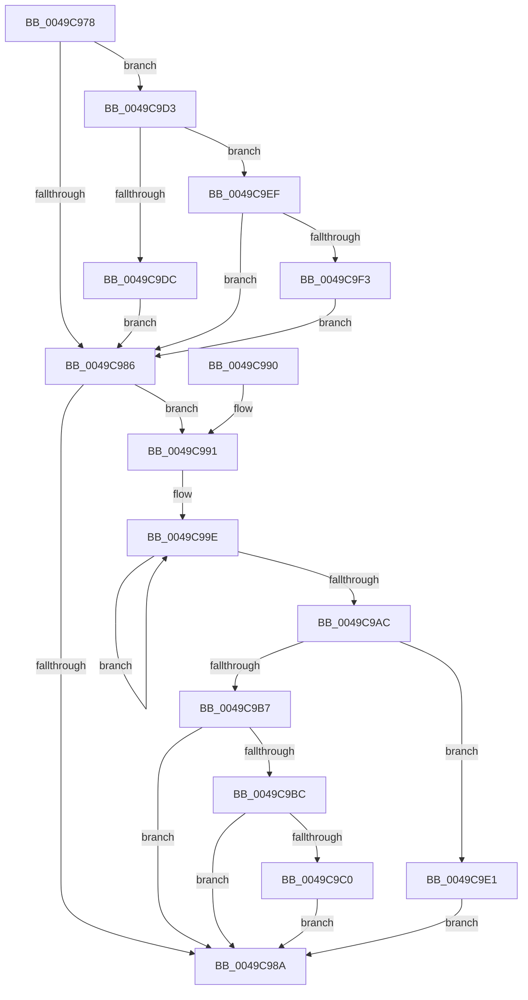

# CmFcpManagerArmFeatureUsageProviderFlushNotification

- RVA: `0x0049C978`–`0x0049C9F8` (길이 `128` bytes)
- VA: `0x000000014049C978`
- 실행 섹션: `.text`
- PDB 이름 있음: `예`; PDB Function 태그: `아니요`
- unwind 정보 RVA: `0x000B4CAC`
- 디코드: `43`개 명령, `128/128` bytes 표시
- 미해석 바이트: `0` (있으면 어셈블리에 `.byte`로 보존)

> 이 문서는 커널 이미지의 기계어와 PDB 기호를 분석해 생성했습니다. 4번과 5번은 함수 원형과 자료형을 바이너리 사용 방식에서 추정한 C 해석이며 원본 소스 복구 결과는 아닙니다.

## 1. Dependencies

- 직접 호출 지점: **3**; 고유 호출 대상: **3**
- 직접 호출자로 확인된 함수: **3**
- RIP 상대 이미지 참조: **3**

### Outgoing calls
- `0x0049C9CC` → [KeInsertQueueDpc](../20/KeInsertQueueDpc_function_00207C50.md) (function, `0x00207C50`)
- `0x0049C9D3` → [KeGetEffectiveIrql](../2F/KeGetEffectiveIrql_function_002F8030.md) (function, `0x002F8030`)
- `0x0049C9E8` → [CmFcpManagerArmFeatureUsageProviderFlushTimer](../4F/CmFcpManagerArmFeatureUsageProviderFlushTimer_function_004FC838.md) (function, `0x004FC838`)

### Direct callers
- [CmFcManagerRecordFeatureUsage](CmFcManagerRecordFeatureUsage_function_0049C7B4.md) at `0x0049C860`
- [RtlArmFeatureUsageProviderFlushNotification](../4F/RtlArmFeatureUsageProviderFlushNotification_function_004F5F30.md) at `0x004F5F52`
- [wil_details_RecordFeatureUsageReporting](../66/wil_details_RecordFeatureUsageReporting_function_0066AAB0.md) at `0x0066AB01`

### Static image references
- `0x0049C991` → RVA `0x00EF7A10` (`.data`; read)
- `0x0049C9C3` → RVA `0x00EF78C0` (`.data`; read)
- `0x0049C9E1` → RVA `0x00EF72E0` (`.data`; read)

## 2. Other-region calls and transfers

- 다른 실행 섹션으로 향하는 call: **0**
- 별도 외부 분기/꼬리 이동을 확인하지 못했습니다.

## 3. Assembly (complete function range)

```asm
0049C978  40 53                           push rbx
0049C97A  48 83 EC 20                     sub rsp, 0x20
0049C97E  41 8B D8                        mov ebx, r8d
0049C981  F6 C2 01                        test dl, 1
0049C984  75 4D                           jne 0x14049c9d3
0049C986  85 DB                           test ebx, ebx
0049C988  75 07                           jne 0x14049c991
0049C98A  48 83 C4 20                     add rsp, 0x20
0049C98E  5B                              pop rbx
0049C98F  C3                              ret
0049C990  CC                              int3
0049C991  0F 0D 0D 78 B0 A5 00            prefetchw byte ptr [rip + 0xa5b078]
0049C998  8B 05 72 B0 A5 00               mov eax, dword ptr [rip + 0xa5b072]
0049C99E  8B C8                           mov ecx, eax
0049C9A0  0B CB                           or ecx, ebx
0049C9A2  F0 0F B1 0D 66 B0 A5 00         lock cmpxchg dword ptr [rip + 0xa5b066], ecx
0049C9AA  75 F2                           jne 0x14049c99e
0049C9AC  8B C8                           mov ecx, eax
0049C9AE  F7 D1                           not ecx
0049C9B0  23 D9                           and ebx, ecx
0049C9B2  F6 C3 02                        test bl, 2
0049C9B5  75 2A                           jne 0x14049c9e1
0049C9B7  F6 C3 04                        test bl, 4
0049C9BA  74 CE                           je 0x14049c98a
0049C9BC  A8 02                           test al, 2
0049C9BE  75 CA                           jne 0x14049c98a
0049C9C0  45 33 C0                        xor r8d, r8d
0049C9C3  48 8D 0D F6 AE A5 00            lea rcx, [rip + 0xa5aef6]
0049C9CA  33 D2                           xor edx, edx
0049C9CC  E8 7F B2 D6 FF                  call 0x140207c50
0049C9D1  EB B7                           jmp 0x14049c98a
0049C9D3  E8 58 B6 E5 FF                  call 0x1402f8030
0049C9D8  3C 02                           cmp al, 2
0049C9DA  73 13                           jae 0x14049c9ef
0049C9DC  83 CB 02                        or ebx, 2
0049C9DF  EB A5                           jmp 0x14049c986
0049C9E1  48 8D 0D F8 A8 A5 00            lea rcx, [rip + 0xa5a8f8]
0049C9E8  E8 4B FE 05 00                  call 0x1404fc838
0049C9ED  EB 9B                           jmp 0x14049c98a
0049C9EF  3C 0F                           cmp al, 0xf
0049C9F1  73 93                           jae 0x14049c986
0049C9F3  83 CB 04                        or ebx, 4
0049C9F6  EB 8E                           jmp 0x14049c986
```

## 4. C-style interpretation (structured pseudocode)

```c
__int64 __fastcall CmFcpManagerArmFeatureUsageProviderFlushNotification(__int64 a1, int a2, int a3)
{
    __int64 result;
    __int64 v_rbx;
    __int64 v_rsp;

    v_rsp = (v_rsp) - (32);
    if ((((unsigned __int8)(a2)) & (1)) != 0) goto loc_0049C9D3;
loc_0049C986:
    if ((unsigned int)((unsigned int)(a3)) != 0) goto loc_0049C991;
loc_0049C98A:
    v_rsp = (v_rsp) + (32);
    return result;
loc_0049C991:
loc_0049C99E:
    a1 = (unsigned int)(((unsigned int)((unsigned int)((unsigned int)(*(unsigned int *)(v_rip + 10858610))))) | ((unsigned int)((unsigned int)(a3))));
    if (condition_is_not_equal) goto loc_0049C99E;
    a1 = (unsigned int)(~((unsigned int)((unsigned int)((unsigned int)(*(unsigned int *)(v_rip + 10858610))))));
    v_rbx = (unsigned int)(((unsigned int)(a3)) & ((unsigned int)(a1)));
    if ((((unsigned __int8)(v_rbx)) & (2)) != 0) goto loc_0049C9E1;
    if ((((unsigned __int8)(v_rbx)) & (4)) == 0) goto loc_0049C98A;
    if ((((unsigned __int8)((unsigned int)(*(unsigned int *)(v_rip + 10858610)))) & (2)) != 0) goto loc_0049C98A;
    a3 = 0;
    a2 = 0;
    result = KeInsertQueueDpc(v_rip + 10858230, a2, a3, a4);
    goto loc_0049C98A;
loc_0049C9D3:
    result = KeGetEffectiveIrql(v_rip + 10858230, a2, a3, a4);
    if (((unsigned __int8)(result)) >= 2) goto loc_0049C9EF;
    v_rbx = (unsigned int)((v_rbx) | (2));
    goto loc_0049C986;
loc_0049C9E1:
    result = CmFcpManagerArmFeatureUsageProviderFlushTimer(v_rip + 10856696, a2, a3, a4);
    goto loc_0049C98A;
loc_0049C9EF:
    if (((unsigned __int8)(result)) >= 15) goto loc_0049C986;
    v_rbx = (unsigned int)((v_rbx) | (4));
    goto loc_0049C986;
}
```

## 5. (Beta) C Style

```c
int64_t CmFcpManagerArmFeatureUsageProviderFlushNotification(int64_t Arg1, int32_t Arg2, int32_t Arg3)
{
    int64_t result;
    int64_t local_rbx;
    int64_t local_rsp;

    local_rsp = (local_rsp) - (32);
    if ((((uint8_t)(Arg2)) & (1)) != 0) goto loc_0049C9D3;
loc_0049C986:
    if ((uint32_t)((uint32_t)(Arg3)) != 0) goto loc_0049C991;
loc_0049C98A:
    local_rsp = (local_rsp) + (32);
    return result;
loc_0049C991:
loc_0049C99E:
    Arg1 = (uint32_t)(((uint32_t)((uint32_t)((uint32_t)(*(uint32_t *)(v_rip + 0xA5B072))))) | ((uint32_t)((uint32_t)(Arg3))));
    if (condition_is_not_equal) goto loc_0049C99E;
    Arg1 = (uint32_t)(~((uint32_t)((uint32_t)((uint32_t)(*(uint32_t *)(v_rip + 0xA5B072))))));
    local_rbx = (uint32_t)(((uint32_t)(Arg3)) & ((uint32_t)(Arg1)));
    if ((((uint8_t)(local_rbx)) & (2)) != 0) goto loc_0049C9E1;
    if ((((uint8_t)(local_rbx)) & (4)) == 0) goto loc_0049C98A;
    if ((((uint8_t)((uint32_t)(*(uint32_t *)(v_rip + 0xA5B072)))) & (2)) != 0) goto loc_0049C98A;
    Arg3 = 0;
    Arg2 = 0;
    result = KeInsertQueueDpc(v_rip + 10858230, Arg2, Arg3, a4);
    goto loc_0049C98A;
loc_0049C9D3:
    result = KeGetEffectiveIrql(v_rip + 10858230, Arg2, Arg3, a4);
    if (((uint8_t)(result)) >= 2) goto loc_0049C9EF;
    local_rbx = (uint32_t)((local_rbx) | (2));
    goto loc_0049C986;
loc_0049C9E1:
    result = CmFcpManagerArmFeatureUsageProviderFlushTimer(v_rip + 10856696, Arg2, Arg3, a4);
    goto loc_0049C98A;
loc_0049C9EF:
    if (((uint8_t)(result)) >= 15) goto loc_0049C986;
    local_rbx = (uint32_t)((local_rbx) | (4));
    goto loc_0049C986;
}
```

## 6. Execution-region graph

[열기: 2D/3D 그래프와 함수 탐색 컨트롤 패널](../../../control-panel.html?section=text&rva=0x0049C978&view=graph)

- 2D 그래프는 위에서 아래로 흐르고, 3D 그래프는 빈 공간을 드래그해 회전합니다. Shift+드래그는 이동, 휠은 확대·축소, 함수 노드 선택은 대상 보고서 이동입니다.

### Static fallback


