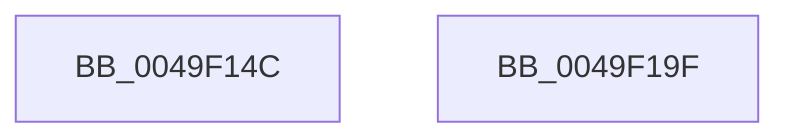

# CmSiCreateSectionForFile

- RVA: `0x0049F14C`–`0x0049F1A0` (길이 `84` bytes)
- VA: `0x000000014049F14C`
- 실행 섹션: `.text`
- PDB 이름 있음: `예`; PDB Function 태그: `아니요`
- unwind 정보 RVA: `0x0006C9B8`
- 디코드: `19`개 명령, `84/84` bytes 표시
- 미해석 바이트: `0` (있으면 어셈블리에 `.byte`로 보존)

> 이 문서는 커널 이미지의 기계어와 PDB 기호를 분석해 생성했습니다. 4번과 5번은 함수 원형과 자료형을 바이너리 사용 방식에서 추정한 C 해석이며 원본 소스 복구 결과는 아닙니다.

## 1. Dependencies

- 직접 호출 지점: **1**; 고유 호출 대상: **1**
- 직접 호출자로 확인된 함수: **1**
- RIP 상대 이미지 참조: **0**

### Outgoing calls
- `0x0049F195` → [ZwCreateSection](../6A/ZwCreateSection_function_006ADA10.md) (function, `0x006ADA10`)

### Direct callers
- [HvpViewMapStart](../../page/9B/HvpViewMapStart_function_009B98E0.md) at `0x009B992C`

### Static image references
- 디코드된 RIP-relative 메모리 참조가 없습니다.

## 2. Other-region calls and transfers

- 다른 실행 섹션으로 향하는 call: **0**
- 별도 외부 분기/꼬리 이동을 확인하지 못했습니다.

## 3. Assembly (complete function range)

```asm
0049F14C  4C 8B DC                        mov r11, rsp
0049F14F  48 83 EC 78                     sub rsp, 0x78
0049F153  33 C0                           xor eax, eax
0049F155  49 C7 43 C8 30 00 00 00         mov qword ptr [r11 - 0x38], 0x30
0049F15D  49 89 43 D0                     mov qword ptr [r11 - 0x30], rax
0049F161  0F 57 C0                        xorps xmm0, xmm0
0049F164  49 89 43 D8                     mov qword ptr [r11 - 0x28], rax
0049F168  45 33 C9                        xor r9d, r9d
0049F16B  48 8B 84 24 A0 00 00 00         mov rax, qword ptr [rsp + 0xa0]
0049F173  49 89 43 B8                     mov qword ptr [r11 - 0x48], rax
0049F177  49 C7 43 E0 00 02 00 00         mov qword ptr [r11 - 0x20], 0x200
0049F17F  C7 44 24 28 00 00 00 04         mov dword ptr [rsp + 0x28], 0x4000000
0049F187  45 89 43 A8                     mov dword ptr [r11 - 0x58], r8d
0049F18B  4D 8D 43 C8                     lea r8, [r11 - 0x38]
0049F18F  F3 0F 7F 44 24 60               movdqu xmmword ptr [rsp + 0x60], xmm0
0049F195  E8 76 E8 20 00                  call 0x1406ada10
0049F19A  48 83 C4 78                     add rsp, 0x78
0049F19E  C3                              ret
0049F19F  CC                              int3
```

## 4. C-style interpretation (structured pseudocode)

```c
__int64 __fastcall CmSiCreateSectionForFile(__int64 a1, __int64 a2, int a3, int a4, __int64 a5)
{
    __int64 result;
    __int64 v_rsp;
    unsigned __int64 v_stack_m18;
    unsigned int v_stack_m50;

    v_rsp = (v_rsp) - (120);
    result = 0;
    *(unsigned __int64 *)(v_rsp - 56) = 48;
    *(unsigned __int64 *)(v_rsp - 48) = 0;
    *(unsigned __int64 *)(v_rsp - 40) = 0;
    a4 = 0;
    *(unsigned __int64 *)(v_rsp - 72) = a5;
    *(unsigned __int64 *)(v_rsp - 32) = 512;
    v_stack_m50 = 0x4000000ULL;
    *(unsigned int *)(v_rsp - 88) = a3;
    v_stack_m18 = v_xmm0;
    result = ZwCreateSection(a1, a2, v_rsp - 56, a4);
    v_rsp = (v_rsp) + (120);
    return result;
}
```

## 5. (Beta) C Style

```c
int64_t CmSiCreateSectionForFile(int64_t Arg1, int64_t Arg2, int32_t Arg3, int32_t Arg4, int64_t Arg5)
{
    int64_t result;
    int64_t local_rsp;
    uint64_t v_stack_m18;
    uint32_t v_stack_m50;

    local_rsp = (local_rsp) - (120);
    result = 0;
    *(uint64_t *)(local_rsp - 0x38) = 48;
    *(uint64_t *)(local_rsp - 0x30) = 0;
    *(uint64_t *)(local_rsp - 0x28) = 0;
    Arg4 = 0;
    *(uint64_t *)(local_rsp - 0x48) = Arg5;
    *(uint64_t *)(local_rsp - 0x20) = 512;
    v_stack_m50 = 0x4000000ULL;
    *(uint32_t *)(local_rsp - 0x58) = Arg3;
    v_stack_m18 = v_xmm0;
    result = ZwCreateSection(Arg1, Arg2, local_rsp - 56, Arg4);
    local_rsp = (local_rsp) + (120);
    return result;
}
```

## 6. Execution-region graph

[열기: 2D/3D 그래프와 함수 탐색 컨트롤 패널](../../../control-panel.html?section=text&rva=0x0049F14C&view=graph)

- 2D 그래프는 위에서 아래로 흐르고, 3D 그래프는 빈 공간을 드래그해 회전합니다. Shift+드래그는 이동, 휠은 확대·축소, 함수 노드 선택은 대상 보고서 이동입니다.

### Static fallback


