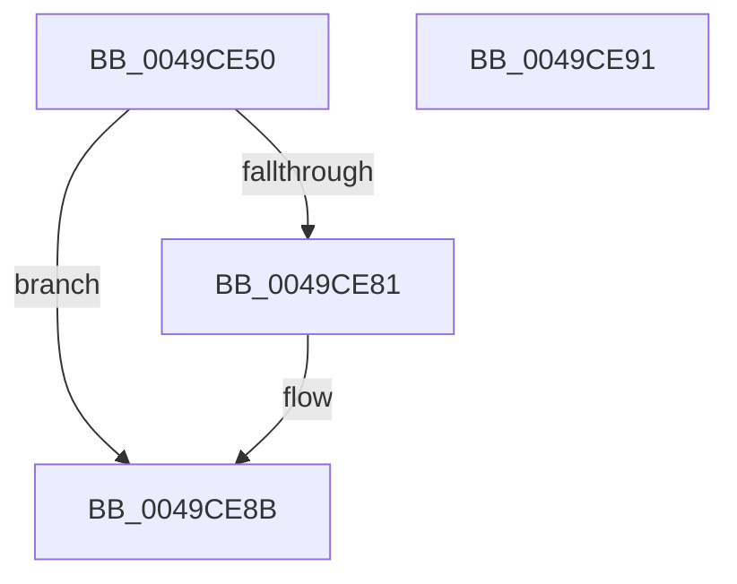

# CmSiGetSectionLength

- RVA: `0x0049CE50`–`0x0049CE92` (길이 `66` bytes)
- VA: `0x000000014049CE50`
- 실행 섹션: `.text`
- PDB 이름 있음: `예`; PDB Function 태그: `아니요`
- unwind 정보 RVA: `0x00071A74`
- 디코드: `21`개 명령, `66/66` bytes 표시
- 미해석 바이트: `0` (있으면 어셈블리에 `.byte`로 보존)

> 이 문서는 커널 이미지의 기계어와 PDB 기호를 분석해 생성했습니다. 4번과 5번은 함수 원형과 자료형을 바이너리 사용 방식에서 추정한 C 해석이며 원본 소스 복구 결과는 아닙니다.

## 1. Dependencies

- 직접 호출 지점: **1**; 고유 호출 대상: **1**
- 직접 호출자로 확인된 함수: **1**
- RIP 상대 이미지 참조: **0**

### Outgoing calls
- `0x0049CE78` → [ZwQuerySection](../6A/ZwQuerySection_function_006ADAF0.md) (function, `0x006ADAF0`)

### Direct callers
- [HvpViewMapStart](../../page/9B/HvpViewMapStart_function_009B98E0.md) at `0x009B993D`

### Static image references
- 디코드된 RIP-relative 메모리 참조가 없습니다.

## 2. Other-region calls and transfers

- 다른 실행 섹션으로 향하는 call: **0**
- 별도 외부 분기/꼬리 이동을 확인하지 못했습니다.

## 3. Assembly (complete function range)

```asm
0049CE50  40 53                           push rbx
0049CE52  48 83 EC 50                     sub rsp, 0x50
0049CE56  33 C0                           xor eax, eax
0049CE58  4C 8D 44 24 30                  lea r8, [rsp + 0x30]
0049CE5D  48 21 44 24 20                  and qword ptr [rsp + 0x20], rax
0049CE62  48 8B DA                        mov rbx, rdx
0049CE65  0F 57 C0                        xorps xmm0, xmm0
0049CE68  48 89 44 24 40                  mov qword ptr [rsp + 0x40], rax
0049CE6D  33 D2                           xor edx, edx
0049CE6F  44 8D 48 18                     lea r9d, [rax + 0x18]
0049CE73  0F 11 44 24 30                  movups xmmword ptr [rsp + 0x30], xmm0
0049CE78  E8 73 0C 21 00                  call 0x1406adaf0
0049CE7D  85 C0                           test eax, eax
0049CE7F  78 0A                           js 0x14049ce8b
0049CE81  48 8B 44 24 40                  mov rax, qword ptr [rsp + 0x40]
0049CE86  48 89 03                        mov qword ptr [rbx], rax
0049CE89  33 C0                           xor eax, eax
0049CE8B  48 83 C4 50                     add rsp, 0x50
0049CE8F  5B                              pop rbx
0049CE90  C3                              ret
0049CE91  CC                              int3
```

## 4. C-style interpretation (structured pseudocode)

```c
__int64 __fastcall CmSiGetSectionLength(__int64 a1, __int64 a2)
{
    __int64 result;
    __int64 v_rsp;
    unsigned __int64 v_stack_m18;
    unsigned __int64 v_stack_m28;
    unsigned __int64 v_stack_m38;

    v_rsp = (v_rsp) - (80);
    result = 0;
    v_stack_m18 = 0;
    a2 = 0;
    v_stack_m28 = v_xmm0;
    result = ZwQuerySection(a1, a2, v_stack_m28, result + 24);
    if (!(sign_flag)) {
        result = v_stack_m18;
        *(unsigned __int64 *)(a2) = result;
        result = 0;
    }
    v_rsp = (v_rsp) + (80);
    return result;
}
```

## 5. (Beta) C Style

```c
int64_t CmSiGetSectionLength(int64_t Arg1, void *Arg2)
{
    uint8_t *arg2 = (uint8_t *)Arg2;

    int64_t result;
    int64_t local_rsp;
    uint64_t v_stack_m18;
    uint64_t v_stack_m28;
    uint64_t v_stack_m38;

    local_rsp = (local_rsp) - (80);
    result = 0;
    v_stack_m18 = 0;
    Arg2 = 0;
    v_stack_m28 = v_xmm0;
    result = ZwQuerySection(Arg1, Arg2, v_stack_m28, result + 24);
    if (!(sign_flag)) {
        result = v_stack_m18;
        *(uint64_t *)(arg2) = result;
        result = 0;
    }
    local_rsp = (local_rsp) + (80);
    return result;
}
```

### 관측된 메모리 오프셋

구조체 형식이 확인되지 않은 접근은 인자 기준의 오프셋으로만 기록했습니다.

| 기준 인자 | 오프셋 표현 | 폭 (bit) | 접근 |
|---|---:|---:|---|
| `Arg2` | `+ 0x0` | `64` | `W` |

## 6. Execution-region graph

[열기: 2D/3D 그래프와 함수 탐색 컨트롤 패널](../../../control-panel.html?section=text&rva=0x0049CE50&view=graph)

- 2D 그래프는 위에서 아래로 흐르고, 3D 그래프는 빈 공간을 드래그해 회전합니다. Shift+드래그는 이동, 휠은 확대·축소, 함수 노드 선택은 대상 보고서 이동입니다.

### Static fallback


