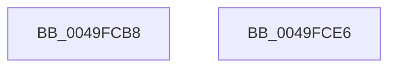

# CmSiLockViewOfSection

- RVA: `0x0049FCB8`–`0x0049FCE7` (길이 `47` bytes)
- VA: `0x000000014049FCB8`
- 실행 섹션: `.text`
- PDB 이름 있음: `예`; PDB Function 태그: `아니요`
- unwind 정보 RVA: `0x000B47B4`
- 디코드: `13`개 명령, `47/47` bytes 표시
- 미해석 바이트: `0` (있으면 어셈블리에 `.byte`로 보존)

> 이 문서는 커널 이미지의 기계어와 PDB 기호를 분석해 생성했습니다. 4번과 5번은 함수 원형과 자료형을 바이너리 사용 방식에서 추정한 C 해석이며 원본 소스 복구 결과는 아닙니다.

## 1. Dependencies

- 직접 호출 지점: **1**; 고유 호출 대상: **1**
- 직접 호출자로 확인된 함수: **1**
- RIP 상대 이미지 참조: **0**

### Outgoing calls
- `0x0049FCDC` → [ZwLockVirtualMemory](../6A/ZwLockVirtualMemory_function_006AF3B0.md) (function, `0x006AF3B0`)

### Direct callers
- [HvpViewMapAcquireChargesAndLockViewPages](../../page/9B/HvpViewMapAcquireChargesAndLockViewPages_function_009B6480.md) at `0x009B64B7`

### Static image references
- 디코드된 RIP-relative 메모리 참조가 없습니다.

## 2. Other-region calls and transfers

- 다른 실행 섹션으로 향하는 call: **0**
- 별도 외부 분기/꼬리 이동을 확인하지 못했습니다.

## 3. Assembly (complete function range)

```asm
0049FCB8  48 8B C4                        mov rax, rsp
0049FCBB  48 89 48 08                     mov qword ptr [rax + 8], rcx
0049FCBF  48 83 EC 28                     sub rsp, 0x28
0049FCC3  48 8B 0A                        mov rcx, qword ptr [rdx]
0049FCC6  48 8D 50 10                     lea rdx, [rax + 0x10]
0049FCCA  4C 89 40 10                     mov qword ptr [rax + 0x10], r8
0049FCCE  4C 8D 40 08                     lea r8, [rax + 8]
0049FCD2  4C 89 48 08                     mov qword ptr [rax + 8], r9
0049FCD6  41 B9 01 00 00 00               mov r9d, 1
0049FCDC  E8 CF F6 20 00                  call 0x1406af3b0
0049FCE1  48 83 C4 28                     add rsp, 0x28
0049FCE5  C3                              ret
0049FCE6  CC                              int3
```

## 4. C-style interpretation (structured pseudocode)

```c
__int64 __fastcall CmSiLockViewOfSection(__int64 a1, __int64 a2, __int64 a3, __int64 a4)
{
    __int64 result;
    __int64 v_rsp;

    *(unsigned __int64 *)(v_rsp + 8) = a1;
    v_rsp = (v_rsp) - (40);
    *(unsigned __int64 *)(v_rsp + 16) = a3;
    *(unsigned __int64 *)(v_rsp + 8) = a4;
    result = ZwLockVirtualMemory(*(unsigned __int64 *)(a2), v_rsp + 16, v_rsp + 8, 1);
    v_rsp = (v_rsp) + (40);
    return result;
}
```

## 5. (Beta) C Style

```c
int64_t CmSiLockViewOfSection(int64_t Arg1, void *Arg2, int64_t Arg3, int64_t Arg4)
{
    uint8_t *arg2 = (uint8_t *)Arg2;

    int64_t result;
    int64_t local_rsp;

    *(uint64_t *)(local_rsp + 0x8) = Arg1;
    local_rsp = (local_rsp) - (40);
    *(uint64_t *)(local_rsp + 0x10) = Arg3;
    *(uint64_t *)(local_rsp + 0x8) = Arg4;
    result = ZwLockVirtualMemory(*(uint64_t *)(arg2), local_rsp + 16, local_rsp + 8, 1);
    local_rsp = (local_rsp) + (40);
    return result;
}
```

### 관측된 메모리 오프셋

구조체 형식이 확인되지 않은 접근은 인자 기준의 오프셋으로만 기록했습니다.

| 기준 인자 | 오프셋 표현 | 폭 (bit) | 접근 |
|---|---:|---:|---|
| `Arg2` | `+ 0x0` | `64` | `R` |

## 6. Execution-region graph

[열기: 2D/3D 그래프와 함수 탐색 컨트롤 패널](../../../control-panel.html?section=text&rva=0x0049FCB8&view=graph)

- 2D 그래프는 위에서 아래로 흐르고, 3D 그래프는 빈 공간을 드래그해 회전합니다. Shift+드래그는 이동, 휠은 확대·축소, 함수 노드 선택은 대상 보고서 이동입니다.

### Static fallback


