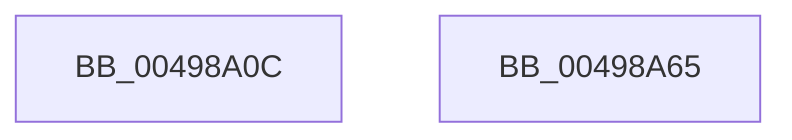

# CmSiMapViewOfSection

- RVA: `0x00498A0C`–`0x00498A66` (길이 `90` bytes)
- VA: `0x0000000140498A0C`
- 실행 섹션: `.text`
- PDB 이름 있음: `예`; PDB Function 태그: `아니요`
- unwind 정보 RVA: `0x000B42C0`
- 디코드: `22`개 명령, `90/90` bytes 표시
- 미해석 바이트: `0` (있으면 어셈블리에 `.byte`로 보존)

> 이 문서는 커널 이미지의 기계어와 PDB 기호를 분석해 생성했습니다. 4번과 5번은 함수 원형과 자료형을 바이너리 사용 방식에서 추정한 C 해석이며 원본 소스 복구 결과는 아닙니다.

## 1. Dependencies

- 직접 호출 지점: **1**; 고유 호출 대상: **1**
- 직접 호출자로 확인된 함수: **1**
- RIP 상대 이미지 참조: **0**

### Outgoing calls
- `0x00498A5B` → [ZwMapViewOfSection](../6A/ZwMapViewOfSection_function_006AD5D0.md) (function, `0x006AD5D0`)

### Direct callers
- [HvpViewMapCreateView](../../page/9B/HvpViewMapCreateView_function_009B6310.md) at `0x009B6398`

### Static image references
- 디코드된 RIP-relative 메모리 참조가 없습니다.

## 2. Other-region calls and transfers

- 다른 실행 섹션으로 향하는 call: **0**
- 별도 외부 분기/꼬리 이동을 확인하지 못했습니다.

## 3. Assembly (complete function range)

```asm
00498A0C  4C 8B DC                        mov r11, rsp
00498A0F  4D 89 4B 20                     mov qword ptr [r11 + 0x20], r9
00498A13  48 83 EC 58                     sub rsp, 0x58
00498A17  8B 84 24 80 00 00 00            mov eax, dword ptr [rsp + 0x80]
00498A1E  41 B9 02 00 00 00               mov r9d, 2
00498A24  45 89 4B F0                     mov dword ptr [r11 - 0x10], r9d
00498A28  89 44 24 40                     mov dword ptr [rsp + 0x40], eax
00498A2C  49 8D 43 20                     lea rax, [r11 + 0x20]
00498A30  45 89 4B E0                     mov dword ptr [r11 - 0x20], r9d
00498A34  45 33 C9                        xor r9d, r9d
00498A37  49 89 43 D8                     mov qword ptr [r11 - 0x28], rax
00498A3B  49 8D 43 10                     lea rax, [r11 + 0x10]
00498A3F  4D 89 43 10                     mov qword ptr [r11 + 0x10], r8
00498A43  4C 8B 84 24 90 00 00 00         mov r8, qword ptr [rsp + 0x90]
00498A4B  49 89 43 D0                     mov qword ptr [r11 - 0x30], rax
00498A4F  49 83 63 C8 00                  and qword ptr [r11 - 0x38], 0
00498A54  49 83 20 00                     and qword ptr [r8], 0
00498A58  48 8B 12                        mov rdx, qword ptr [rdx]
00498A5B  E8 70 4B 21 00                  call 0x1406ad5d0
00498A60  48 83 C4 58                     add rsp, 0x58
00498A64  C3                              ret
00498A65  CC                              int3
```

## 4. C-style interpretation (structured pseudocode)

```c
__int64 __fastcall CmSiMapViewOfSection(__int64 a1, __int64 a2, __int64 a3, __int64 a4, unsigned int a5, __int64 a6, __int64 a7)
{
    __int64 result;
    __int64 v_rsp;
    unsigned int v_stack_m18;

    *(unsigned __int64 *)(v_rsp + 32) = a4;
    v_rsp = (v_rsp) - (88);
    *(unsigned int *)(v_rsp - 16) = 2;
    v_stack_m18 = (unsigned int)((unsigned int)(a5));
    *(unsigned int *)(v_rsp - 32) = 2;
    a4 = 0;
    *(unsigned __int64 *)(v_rsp - 40) = v_rsp + 32;
    *(unsigned __int64 *)(v_rsp + 16) = a3;
    *(unsigned __int64 *)(v_rsp - 48) = v_rsp + 16;
    result = ZwMapViewOfSection(a1, *(unsigned __int64 *)(a2), a7, a4);
    v_rsp = (v_rsp) + (88);
    return result;
}
```

## 5. (Beta) C Style

```c
int64_t CmSiMapViewOfSection(int64_t Arg1, void *Arg2, int64_t Arg3, int64_t Arg4, uint32_t Arg5, uint64_t Arg6, void *Arg7)
{
    uint8_t *arg2 = (uint8_t *)Arg2;
    uint8_t *arg7 = (uint8_t *)Arg7;

    int64_t result;
    int64_t local_rsp;
    uint32_t v_stack_m18;

    *(uint64_t *)(local_rsp + 0x20) = Arg4;
    local_rsp = (local_rsp) - (88);
    *(uint32_t *)(local_rsp - 0x10) = 2;
    v_stack_m18 = (uint32_t)((uint32_t)(Arg5));
    *(uint32_t *)(local_rsp - 0x20) = 2;
    Arg4 = 0;
    *(uint64_t *)(local_rsp - 0x28) = local_rsp + 32;
    *(uint64_t *)(local_rsp + 0x10) = Arg3;
    *(uint64_t *)(local_rsp - 0x30) = local_rsp + 16;
    result = ZwMapViewOfSection(Arg1, *(uint64_t *)(arg2), Arg7, Arg4);
    local_rsp = (local_rsp) + (88);
    return result;
}
```

### 관측된 메모리 오프셋

구조체 형식이 확인되지 않은 접근은 인자 기준의 오프셋으로만 기록했습니다.

| 기준 인자 | 오프셋 표현 | 폭 (bit) | 접근 |
|---|---:|---:|---|
| `Arg2` | `+ 0x0` | `64` | `R` |
| `Arg7` | `+ 0x0` | `64` | `R/W` |

## 6. Execution-region graph

[열기: 2D/3D 그래프와 함수 탐색 컨트롤 패널](../../../control-panel.html?section=text&rva=0x00498A0C&view=graph)

- 2D 그래프는 위에서 아래로 흐르고, 3D 그래프는 빈 공간을 드래그해 회전합니다. Shift+드래그는 이동, 휠은 확대·축소, 함수 노드 선택은 대상 보고서 이동입니다.

### Static fallback


